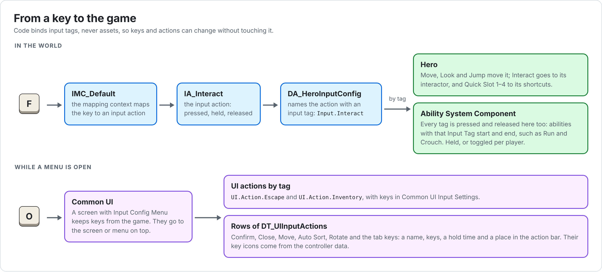

# Hades: Gameplay

The player controller, the hero, how the hero moves, runs and crouches, the camera, input, and the player's settings. For interacting with things, see [Interaction](Interaction.md); for items, see [Inventory](Inventory.md).

## Contents

1. [Game framework](#1-game-framework)
2. [Player controller](#2-player-controller)
3. [Characters](#3-characters)
4. [Movement](#4-movement)
5. [Abilities](#5-abilities)
6. [Camera](#6-camera)
7. [Input](#7-input)
8. [Player settings](#8-player-settings)
9. [How-to guides](#9-how-to-guides)
10. [Troubleshooting](#10-troubleshooting)

---

## 1. Game framework

| Class | Parent | In the editor | What it does |
| --- | --- | --- | --- |
| `UHadesGameInstance` | `UCommonGameInstance` | Project Settings › Maps & Modes › **Game Instance Class** | Nothing of its own. Common Game needs a game instance of its own type: it hands each local player to the UI manager, which gives them a root layout. |
| `AHadesGameMode` | `AGameModeBase` | `BP_HadesGameMode` | Nothing of its own. The Blueprint sets **Default Pawn Class** `BP_HadesHero` and **Player Controller Class** `BP_HadesPlayerController`, and is the project's Default GameMode. |
| `AHadesPlayerController` | `ACommonPlayerController` | `BP_HadesPlayerController` | [2](#2-player-controller) |
| `AHadesPlayerCameraManager` | `APlayerCameraManager` | used as it is | The player controller's camera manager. Nothing of its own yet; camera modifiers can be added to a Blueprint child ([9.2](#92-a-wider-view-while-running)). |
| `AHadesHeroCharacter` | `AHadesCharacterBase` | `BP_HadesHero` | [3.2](#32-hero) |

---

## 2. Player controller

`AHadesPlayerController` keeps what belongs to the player rather than to the body they control: the HUD, pausing, messages, the item box storage and the world markers.

**Components**

| Component | Class | What it does |
| --- | --- | --- |
| `WorldMarkerManager` | Hades World Marker Manager Component | Holds the world markers this player sees. The HUD's marker layer draws them ([Interaction 4](Interaction.md#4-world-markers)). |
| `ItemBoxInventory` | Inventory Component | The storage every item box opens, so all boxes share it. `BP_HadesPlayerController` gives it **Containers**: Tag `Container.ItemBox`, Layout `CL_ItemBox` ([Inventory 11](Inventory.md#11-the-item-box)). |
| `PausedPostProcess` | Post Process Component | Turns the world grey while it's stopped (see [How it works](#how-it-works), step 4). |

**Settings** (Class Defaults)

| Category | Field | Default | `BP_HadesPlayerController` | Description |
| --- | --- | --- | --- | --- |
| Input | Default Mapping Contexts | empty | `IMC_Default` | Added to the player's Enhanced Input subsystem, at priority 0, when input is set up. |
| UI | HUD Layout Class | none | `W_HUD` | Pushed onto the `UI.Layer.Game` layer when the player arrives. |

**Functions and events**

| Function | Description |
| --- | --- |
| Show Message (Message) | Shows a message such as "It's locked." in every Hades Message widget ([UI 6](UI.md#6-messages)). |
| `ShowMessageTo` (Player Pawn, Message) | C++ only. Show Message on the controller of a player's pawn; nothing for any other actor. Gameplay code that only knows an actor, such as a lock, uses it. |
| `AddPauseRequest` / `RemovePauseRequest` (Requester) | C++ only. Screens that stop the world call these ([UI 4](UI.md#4-pausing)). |
| `GetItemBoxInventory` | C++ only. The item box storage. |
| **On Message** (event) | Fires with each message. The message widget listens to it. |

### How it works

1. **The HUD.** When the player arrives (`ReceivedPlayer`), Common Game has just given the local player its root layout. The controller loads **HUD Layout Class** and pushes it onto `UI.Layer.Game`. If that fails, `LogHadesUI` says so: check the game instance, the local player class and the UI policy ([README 2.2](README.md#22-project-settings)).
2. **Input.** When input is set up, each **Default Mapping Context** is added.
3. **Pausing.** Screens that stop the world add a pause request while they're active. While there is at least one, the game is paused, the HUD collapses, and `PausedPostProcess` is on. Requests from widgets that no longer exist are dropped.
4. **The grey world.** `PausedPostProcess` is unbound, Priority `1000`, with **Color Grading › Global › Saturation** set to `0`, and off until the game pauses. The UI is drawn after post processing, so menus keep their colors. To change the look behind menus, select `PausedPostProcess` in `BP_HadesPlayerController`'s Components panel and change its settings, such as **Lens › Image Effects › Vignette Intensity**. A camera or volume that sets Saturation itself, with a higher priority, wins.
5. **The camera manager** is `AHadesPlayerCameraManager`. A Blueprint can change it under **Player Camera Manager Class**.

---

## 3. Characters

### 3.1 Character base

`AHadesCharacterBase` is the base of every character: the hero now, enemies later. It has an Ability System Component and the Hades movement component.

| Part | Description |
| --- | --- |
| `AbilitySystemComponent` | A Hades Ability System Component ([5.1](#51-hades-ability-system-component)). The character is its own owner and avatar, and exposes it through the Ability System Interface. |
| Movement Set | Made with the character, so the Ability System Component finds it by itself ([5.4](#54-movement-set)). |
| `CharacterMovement` | A Hades Character Movement Component ([4](#4-movement)) in place of the engine's. Crouching is allowed. |

| Category | Field | Description |
| --- | --- | --- |
| Character | Default Abilities | Given to the character on begin play. |
| Character | Default Effects | Applied to the character on begin play, before the abilities are given. |

| Function or event | Description |
| --- | --- |
| Run / Stop Run | Tells the movement component the character wants to run, or no longer does. It only runs while moving forward on the ground and not crouching ([4](#4-movement)). The Run ability calls these. |
| Is Running | Whether it is running now. |
| Get Hades Character Movement | The movement component. |
| **On Start Run / On End Run** (events) | Blueprint events when running starts and stops, such as for footstep sounds. |

**State tags.** While the character runs, its Ability System Component has `Character.State.Running`; while it crouches, `Character.State.Crouching`. They are loose tags, so abilities, effects and camera modifiers can react to them.

When the character's controller changes, the Ability System Component refreshes its actor info, so abilities find the new controller.

### 3.2 Hero

`AHadesHeroCharacter`, made in the editor as `BP_HadesHero`.

**Components**

| Component | Class | Set up in C++ |
| --- | --- | --- |
| `CapsuleComponent` | Capsule | Radius 40, half height 90. Ignores the Camera channel. |
| `Mesh` | Skeletal Mesh | The full body, for the world and shadows. No collision. First Person Primitive Type: **World Space Representation**. |
| `ViewRoot` | Scene | At eye height. It moves smoothly when the hero crouches or stands. |
| `FirstPersonCamera` | Camera | On `ViewRoot`, turned by the controller. **Enable First Person Field Of View** with **First Person Field Of View** `70`, and **Enable First Person Scale** with **First Person Scale** `0.6`. |
| `ArmsMesh` | Skeletal Mesh | On the camera. Only the player sees it. First Person Primitive Type: **First Person**. No collision, no shadow. It updates after the movement component. |
| `InteractorComponent` | Hades Interactor Component | [Interaction 3](Interaction.md#3-hades-interactor-component) |
| `InventoryComponent` | Hades Inventory Component | [Inventory 3](Inventory.md#3-hades-inventory-component) |
| `EquipmentComponent` | Inventory Equipment Component | Applies the item in hand: its grants, and its cosmetic pieces, which attach to `FirstPersonCamera` or `ArmsMesh`. See the plugin README, 6.2. |
| `QuickSlotComponent` | Hades Quick Slot Component | [Inventory 5](Inventory.md#5-shortcuts) |

**Settings**

| Category | Field | Default | `BP_HadesHero` | Description |
| --- | --- | --- | --- | --- |
| Character › Input | Input Config | none | `DA_HeroInputConfig` | The hero's input actions by tag ([7.2](#72-input-config)). Without it, no input is bound and `LogHadesInput` reports an error. |
| Character › Camera | Eye Height Smoothing Time | 0.1 s | 0.1 s | How long the camera takes to reach a new eye height after crouching or standing. 0 snaps. |
| Character | Default Abilities, Default Effects | empty | empty | See [3.1](#31-character-base) and [9.1](#91-run-and-crouch). |

The inventory components' settings are in [Inventory 3](Inventory.md#3-hades-inventory-component) and [5](Inventory.md#5-shortcuts).

**What the input does**

| Input tag | When | What it does |
| --- | --- | --- |
| `Input.Move` | Triggered | Moves along the hero's forward (Y) and right (X). |
| `Input.Look` | Triggered | Turns the view: X is yaw, Y is pitch. |
| `Input.Jump` | Started, Completed | Jump, Stop Jumping. |
| `Input.Interact` | Started, Completed | The interactor's Start Interaction and Stop Interaction ([Interaction 3](Interaction.md#3-hades-interactor-component)). |
| `Input.QuickSlot.1` to `.4` | Started | The quick slot component's Activate Slot, slots 0 to 3. |
| Every tag in the input config | pressed, released | Sent to the Ability System Component, which starts or ends abilities with that **Input Tag** ([5.1](#51-hades-ability-system-component)). |

**Get Input Value** (Input Tag) returns the live value of the action mapped to a tag, such as how far the stick is pushed. It is zero for tags not in the input config and on pawns that aren't locally controlled.

**How it works**

- **Begin play.** Once the components have begun play, the inventory holds its starting items. Every item that can be held is then put on the first free shortcut, so the pistol is on 1 and the flashlight on 2 ([Inventory 5](Inventory.md#5-shortcuts)).
- **Eye height.** `ViewRoot` follows the eye height with critically damped smoothing. When the hero crouches or stands, the capsule changes height at once, and the eye is moved by the same amount the other way first, so the camera glides instead of jumping.
- **Losing the player.** When the hero is unpossessed, its held inputs are released and its abilities' input is cleared, so a held or toggled run doesn't carry on.
- **The input component** is a Hades Input Component, whatever the project's Default Input Component Class ([7.3](#73-input-component)).

---

## 4. Movement

`UHadesCharacterMovementComponent` adds running, a curve for acceleration, and a speed multiplier to the engine's character movement.

| Category | Field | Default | Description |
| --- | --- | --- | --- |
| Character Movement: Run | Max Walk Speed Run | 1000 | Top speed while running on the ground. Walking uses the engine's **Max Walk Speed**, and crouching its **Max Walk Speed Crouched**. |
| Character Movement: Walking | Acceleration Curve | none | A Curve Vector sampled by mapped speed while on the ground: **X** is Max Acceleration, **Y** Braking Deceleration Walking, **Z** Ground Friction. Empty keeps the component's own values ([9.6](#96-an-acceleration-curve)). |

**Rules**

- **Running** needs all of: the character wants to run, it is on the ground, it isn't crouching, and it is accelerating forward. Strafing or backing up stops the run; the run starts again when moving forward, as long as the character still wants to.
- **Speed** is Max Walk Speed Run while running on the ground, otherwise the engine's speed for the movement mode, multiplied by the Movement Set's **Move Speed Multiplier**.
- **Crouching** only starts on the ground.
- **Mapped speed** turns the current speed into a number: 0 standing still, 1 at walking speed, 2 at running speed, scaled by the multiplier.

| Function | Description |
| --- | --- |
| Set Wants To Run | What Run and Stop Run on the character call. |
| Is Running | Running now. |
| Can Stand | Whether a crouched character has room to stand up. True when not crouched. |
| Is Moving Forward (Threshold) | On the ground and accelerating within the forward direction. Threshold 0.2 by default: the dot product of forward and acceleration must be above it. |
| Is Accelerating | Speeding up rather than slowing down. |
| Get Speed | The length of the velocity. |
| Get Mapped Speed | See above. |
| Get Acceleration | The measured acceleration, from the change in velocity. |
| Get Relative Acceleration | The measured acceleration in the character's own space, as a part of the maximum: -1 to 1 per axis. For animation. |

---

## 5. Abilities

### 5.1 Hades Ability System Component

`UHadesAbilitySystemComponent` lets input start and end abilities by input tag.

- **Pressed.** Every ability given to the character whose **Input Tag** matches either starts, or, if it is already active, hears the press. Its spec remembers the input as held.
- **Released.** Matching abilities hear the release. An ability that ends on release then ends ([5.2](#52-hades-ability)).
- **Held input restarts.** When an ability finishes (not cancelled), the abilities whose input is still held try to start again, oldest press first. Hold Run, then hold Crouch: crouching cancels the run. Let go of Crouch while still holding Run, and the run starts again.
- **Clear Ability Input** forgets every held input and cancels the abilities it keeps active, toggled ones included. The hero calls it when it loses its player.

### 5.2 Hades Ability

`UHadesAbility` is the base of the game's abilities. One instance is made per character.

| Category | Field | Default | Description |
| --- | --- | --- | --- |
| Input | Input Tag | none | The input that starts it, such as `Input.Run`. |
| Input | End On Input Release | off | Ends the ability when its input is released, and starts it again while the input is held once whatever cancelled or blocked it is finished. If the player set this input to toggle ([8](#8-player-settings)), the next press ends it instead. |

| Function | Description |
| --- | --- |
| Get Hades Character From Actor Info | The character the ability belongs to. |

### 5.3 Run and Crouch

| | Run (`UHadesAbility_Run`) | Crouch (`UHadesAbility_Crouch`) |
| --- | --- | --- |
| Asset tag | `Ability.Run` | `Ability.Crouch` |
| Cancels abilities with tag | `Ability.Crouch` | `Ability.Run` |
| Input Tag | `Input.Run` | `Input.Crouch` |
| End On Input Release | on | on |
| Activate | Commits, then **Run** on the character | Commits, then **Crouch** |
| End | **Stop Run** | **Un Crouch** |

Both work as they are, or as Blueprint children with changes. To give them keys, see [9.1](#91-run-and-crouch).

### 5.4 Movement Set

`UHadesMovementSet` holds one attribute:

| Attribute | Default | Description |
| --- | --- | --- |
| Move Speed Multiplier | 1 | Multiplies every speed of the movement component. Never below 0. Change it with a Gameplay Effect ([9.3](#93-slowing-the-hero)). |

### 5.5 Tags

| Tag | Where | Meaning |
| --- | --- | --- |
| `Ability.Run`, `Ability.Crouch` | Asset tags | Which ability it is. Use them to cancel or block it. |
| `Character.State.Running`, `Character.State.Crouching` | On the Ability System Component | What the character is doing ([3.1](#31-character-base)). |

---

## 6. Camera

### 6.1 First-person camera

The world is drawn with the camera's **Field Of View** (90 by default). The arms, and anything else with First Person Primitive Type **First Person**, are drawn with **First Person Field Of View** `70` and scaled by **First Person Scale** `0.6` toward the camera, so they don't stretch at the edges of the screen or poke through walls.

### 6.2 FOV camera modifier

`UHadesCameraModifier_FOV` widens or narrows the view while the character has a state tag, such as while running. It is abstract: make a Blueprint child per effect.

| Category | Field | Default | Description |
| --- | --- | --- | --- |
| FOV | Active Tag | none | Blends in while the view target's Ability System Component has this tag, such as `Character.State.Running`. |
| FOV | FOV Offset | 0° | Added to the field of view at full blend. |
| FOV | Easing | Ease In Out | The shape of the blend. |
| Camera Modifier | Alpha In Time, Alpha Out Time | (engine) | How long it takes to blend in and out. |

Add it to a camera manager's **Default Modifiers** ([9.2](#92-a-wider-view-while-running)).

### 6.3 Camera library

| Function | Description |
| --- | --- |
| Get Camera View Point (Pawn) | Where the pawn's player looks from, and which way: the controller's view point, or the pawn's eyes without a controller. |
| Camera Forward Trace (Pawn, Distance, Trace Channel, …) | A line trace from the view point along the view. **Spread Half Angle Degrees** above 0 picks a random direction in that cone. The interactor uses it to find what the player looks at. |

---

## 7. Input

### 7.1 Input actions and mapping context

In `Content/Input`:

| Asset | Value Type |
| --- | --- |
| `IA_Move` | Axis2D (Vector2D) |
| `IA_Look` | Axis2D (Vector2D) |
| `IA_Jump` | Digital (bool) |
| `IA_Interact` | Digital (bool) |
| `IA_QuickSlot1` to `IA_QuickSlot4` | Digital (bool) |

`IMC_Default`, added by the player controller:

| Action | Key | Modifiers |
| --- | --- | --- |
| `IA_Move` | `W` | Swizzle Input Axis Values (Order `YXZ`) |
| | `S` | Swizzle Input Axis Values (`YXZ`), then Negate |
| | `A` | Negate |
| | `D` | none |
| | `Gamepad Left Thumbstick 2D-Axis` | Dead Zone |
| `IA_Look` | `Mouse XY 2D-Axis` | Negate (Y only) |
| | `Gamepad Right Thumbstick 2D-Axis` | Dead Zone, then Negate (Y only) |
| `IA_Jump` | `Space Bar`, `Gamepad Face Button Bottom` | none |
| `IA_Interact` | `F`, `Gamepad Face Button Left` | none |
| `IA_QuickSlot1` | `One`, `Gamepad D-pad Up` | none |
| `IA_QuickSlot2` | `Two`, `Gamepad D-pad Right` | none |
| `IA_QuickSlot3` | `Three`, `Gamepad D-pad Down` | none |
| `IA_QuickSlot4` | `Four`, `Gamepad D-pad Left` | none |

The prompt and the shortcut badges show these keys from rows of `DT_UIInputActions` (`Interact`, `Shortcut1` to `4`), which only display them. If you rebind one of these actions, change its row to match ([UI 13.2](UI.md#132-action-rows)).

### 7.2 Input config

`UHadesInputConfig` is a data asset that names a character's input actions with input tags, so code binds tags and never asset paths.

| Field | Description |
| --- | --- |
| Input Actions | Rows of **Input Tag** + **Input Action**. |

`DA_HeroInputConfig`:

| Input Tag | Input Action |
| --- | --- |
| `Input.Move` | `IA_Move` |
| `Input.Look` | `IA_Look` |
| `Input.Jump` | `IA_Jump` |
| `Input.Interact` | `IA_Interact` |
| `Input.QuickSlot.1` | `IA_QuickSlot1` |
| `Input.QuickSlot.2` | `IA_QuickSlot2` |
| `Input.QuickSlot.3` | `IA_QuickSlot3` |
| `Input.QuickSlot.4` | `IA_QuickSlot4` |

Saving the asset checks it: every row needs a tag and an action, and a tag may only appear once, as a lookup finds the first row with it. A tag the hero binds but the config lacks logs a warning in `LogHadesInput`, except for the shortcut tags, which are optional.

### 7.3 Input component

`UHadesInputComponent` is the hero's input component.

| Function | Description |
| --- | --- |
| `BindActionByTag` (Config, Tag, Trigger Event, Object, Function) | C++. Binds the action the config names for a tag. |
| `BindPressedAndReleased` (Config, Object, Pressed, Released) | C++. Sends every tag in the config to two functions: pressed once when its action triggers, released when it completes, or drops back while a trigger such as Pulse waits between pulses. |
| `ReleaseHeldInputs` | Releases every input still held. |
| `BindInputValues` / `GetInputValue` (Tag) | Keeps the live value of every action in the config, for Get Input Value on the hero. |

### 7.4 Input in menus

While a screen with a **Menu** input config is open, such as the inventory, Common UI keeps input from the game. Menus use their own actions: `UI.Action.*` tags and rows of `DT_UIInputActions`. See [UI 13](UI.md#13-input-key-icons-and-the-action-bar).

---

## 8. Player settings

`UHadesPlayerSettings` holds one local player's preferences. `UHadesPlayerSettingsSubsystem` loads them, from the save slot `PlayerSettings`, when the local player is added, and keeps them across level loads.

| Function | Description |
| --- | --- |
| Get Settings (on the subsystem) | In Blueprint: **Get HadesPlayerSettingsSubsystem** (from a player controller) › **Get Settings**. |
| Is Input Toggle Enabled (Input Tag) | Whether the player set this input to toggle. |
| Set Input Toggle Enabled (Input Tag, Enabled) | For an ability with **End On Input Release** on this input: when enabled, a press starts it and the next press ends it, instead of holding. |

Settings last for the session. To keep them for the next one, call **Async Save Game To Slot For Local Player** on the settings object after changing them. There is no settings screen yet.

---

## 9. How-to guides

### 9.1 Run and crouch

1. In `Content/Input`, add two **Input Actions**, Value Type **Digital (bool)**: `IA_Run` and `IA_Crouch`.
2. In `IMC_Default`, map `IA_Run` to `Left Shift` and `Gamepad Left Thumbstick Button`, and `IA_Crouch` to `C` and `Gamepad Face Button Right`.
3. In `DA_HeroInputConfig`, add the rows `Input.Run` + `IA_Run` and `Input.Crouch` + `IA_Crouch`.
4. In `BP_HadesHero`'s Class Defaults, under **Character › Default Abilities**, add `HadesAbility_Run` and `HadesAbility_Crouch`.
5. Play. Hold Shift while moving forward to run, and C to crouch.

To make crouch a toggle, call **Set Input Toggle Enabled** (`Input.Crouch`, true) on the player's settings ([8](#8-player-settings)), such as from a settings screen.

### 9.2 A wider view while running

1. Add a **Blueprint Class** with parent `HadesCameraModifier_FOV`, named `CM_RunFOV`. In its Class Defaults:
   - FOV › **Active Tag**: `Character.State.Running`
   - FOV › **FOV Offset**: `8`
   - Camera Modifier › **Alpha In Time** `0.25`, **Alpha Out Time** `0.35`
2. Add a **Blueprint Class** with parent `HadesPlayerCameraManager`, named `BP_HadesCameraManager`. In its Class Defaults, add `CM_RunFOV` to **Default Modifiers**.
3. In `BP_HadesPlayerController`'s Class Defaults, set **Player Camera Manager Class** to `BP_HadesCameraManager`.

### 9.3 Slowing the hero

1. Add a **Gameplay Effect** Blueprint, `GE_Slow`, with **Duration Policy** **Infinite**.
2. Add a **Modifier**: Attribute `HadesMovementSet.MoveSpeedMultiplier`, Modifier Op **Multiply (Compound)**, Magnitude `0.5`.
3. Apply it to the hero with **Apply Gameplay Effect To Self** on its Ability System Component, and keep the handle it returns. Remove it with **Remove Active Gameplay Effect**.

Walking, running and crouching all slow down by half, and the acceleration curve follows, as it uses mapped speed.

### 9.4 A new input bound in C++

1. Declare the tag in `HadesGameplayTags.h` (`UE_DECLARE_GAMEPLAY_TAG_EXTERN`) and define it in `HadesGameplayTags.cpp` (`UE_DEFINE_GAMEPLAY_TAG`), such as `Input.Aim`.
2. Add the input action, map it in `IMC_Default`, and add its row to `DA_HeroInputConfig`.
3. In `AHadesHeroCharacter::SetupPlayerInputComponent`, bind it with `BindActionByTag`.

An input that only starts an ability needs no code: every tag in the config already reaches the Ability System Component. Skip step 3 and see 9.5.

### 9.5 A new ability on a key

1. Add a **Blueprint Class** with parent `HadesAbility`. Set **Input Tag**, and tick **End On Input Release** if it should last while the key is held.
2. Implement **Activate Ability** and **End Ability** in its graph.
3. Give it a key as in 9.1 steps 1 to 3, and add it to the hero's **Default Abilities**.

### 9.6 An acceleration curve

1. **Add › Miscellaneous › Curve**, choose **CurveVector**, named `CV_HeroAcceleration`.
2. Add keys at times 0, 1 and 2 (still, walking, running) on each of the three curves: X Max Acceleration, Y Braking Deceleration Walking, Z Ground Friction. For example, X `1200, 1600, 1000` for a quick start that settles at a run; Y `2000, 2048, 1200` for a longer slide after running; Z `8, 8, 6`.
3. In `BP_HadesHero`, select **CharacterMovement** and set **Acceleration Curve** to it.

---

## 10. Troubleshooting

| Symptom | Cause | Fix |
| --- | --- | --- |
| The hero doesn't move or look; the log says it has no InputConfig | **Input Config** isn't set | Set it on `BP_HadesHero` (3.2) |
| No input at all, with an Input Config | `IMC_Default` isn't in the controller's **Default Mapping Contexts**, or the game mode doesn't use `BP_HadesPlayerController` | 2; 1 |
| Up and down are inverted | The Negate on `IA_Look`'s Y | Tick or untick **Y** on that Negate modifier (7.1) |
| Run does nothing | No key or config row for `Input.Run`, the ability isn't in **Default Abilities**, or the hero isn't moving forward | 9.1; running needs forward movement |
| The run stops when strafing | Running needs forward movement | As designed (4) |
| Crouch does nothing in the air | Crouching only starts on the ground | As designed (4) |
| A toggle setting does nothing | The ability doesn't have **End On Input Release** ticked, or the setting is for another tag | 5.2; 8 |
| The camera jumps when crouching | **Eye Height Smoothing Time** is 0 | Set it to 0.1 (3.2) |
| The arms stretch at the edges or poke through walls | The camera's first-person settings were changed | 3.2: First Person Field Of View 70, First Person Scale 0.6 |
| The HUD never appears; `LogHadesUI` says the HUD layout couldn't be pushed | Game Instance Class, Local Player Class or the UI policy isn't set up | [README 2.2](README.md#22-project-settings) |
| The world stays in color behind menus | A camera or volume sets Saturation with a higher priority | Untick it there, or grade the world another way (2) |
| `DA_HeroInputConfig` fails validation | A row without a tag or action, or a tag used twice | 7.2 |
