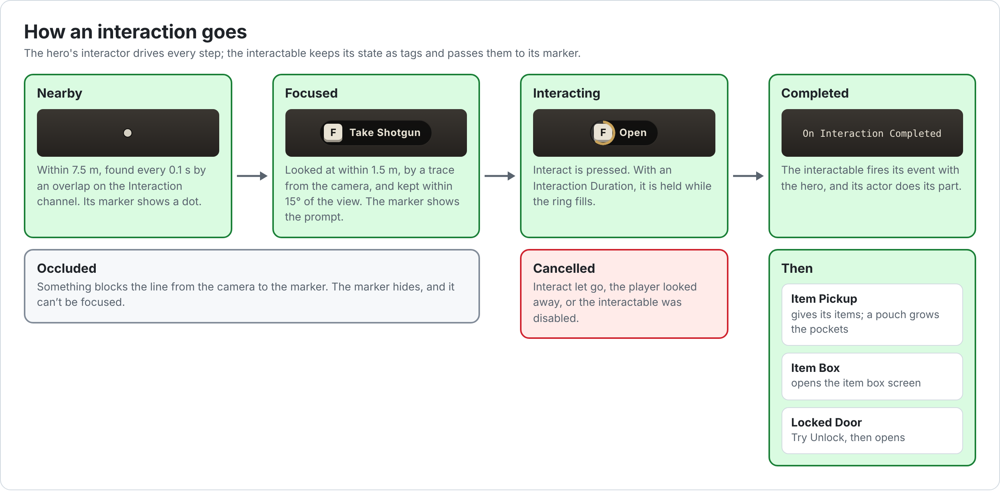

# Hades: Interaction

How the hero finds, looks at and uses things in the world: the interactable and interactor components, the world markers that show them on screen, and the actors built on them: pickups, item boxes and locked doors.

## Contents

1. [How interaction works](#1-how-interaction-works)
2. [Hades Interactable Component](#2-hades-interactable-component)
3. [Hades Interactor Component](#3-hades-interactor-component)
4. [World markers](#4-world-markers)
5. [Interactable marker widget](#5-interactable-marker-widget)
6. [Pickups](#6-pickups)
7. [Item boxes](#7-item-boxes)
8. [Locks and locked doors](#8-locks-and-locked-doors)
9. [How-to guides](#9-how-to-guides)
10. [Debugging](#10-debugging)
11. [Troubleshooting](#11-troubleshooting)

---

## 1. How interaction works

1. **Nearby.** Every 0.1 seconds, the hero's interactor looks for focus targets within 7.5 m of the hero: collision that blocks the `Interaction` trace channel. Their interactables are nearby. Each one's marker is added to the player's world markers, and the HUD draws it: a small dot.
2. **Hidden.** For each nearby interactable, a line from the camera to its marker is tested against the Visibility channel, and against the interactable's own **Occlusion Components**. If anything is in the way, it is occluded: its marker hides, and it can't be focused.
3. **Focused.** While anything is nearby, the interactor traces from the camera along the view every frame, up to 1.5 m, on the `Interaction` channel. The nearby, unoccluded interactable it hits is focused, and its marker becomes the prompt: the Interact key's icon and the interaction text, such as "Take Shotgun". When the trace slips off it, it stays focused while it is within 15° of the view and 1.5 m of the camera, so the prompt doesn't flicker at the edges.
4. **Interacting.** Pressing Interact starts an interaction with the focused interactable. With an **Interaction Duration** of 0, it completes at once. Otherwise the player holds Interact while the marker's ring fills. Letting go, looking away, or the interactable being disabled cancels it.
5. **Completed.** The interactable fires **On Interaction Completed** with the hero, and its actor does the rest: a pickup gives its items, an item box opens its screen, a door tries its lock.

The `Interaction` channel ignores everything by default, so the traces only find focus targets, which the interactable sets to block it. The channel must be the project's first custom trace channel ([README 2.2](README.md#22-project-settings)).

**State tags.** Each interactable keeps its state as tags, and passes them on to its marker:

| Tag | While |
| --- | --- |
| `Interactable.State.Nearby` | It's within the interactor's Nearby Radius. |
| `Interactable.State.Focused` | The player looks at it. |
| `Interactable.State.Occluded` | Something is between the camera and its marker. |
| `Interactable.State.Disabled` | **Set Interaction Enabled** turned it off. It keeps its marker, shows its Disabled Text, and refuses to start. |
| `Interactable.State.Interacting` | An interaction is in progress. |

Its marker shows while it is nearby and not occluded, and, unless **Show Marker When Nearby** is ticked, only while focused.

---

## 2. Hades Interactable Component

Makes its actor interactable and gives it a world marker. Add it to any actor: **Add › Hades Interactable Component**.

| Category | Field | Default | Description |
| --- | --- | --- | --- |
| Interaction | Interaction Duration | 0 s | How long Interact must be held. 0 completes as soon as it is pressed. Above 0, the marker shows a progress ring. |
| Interaction | Interaction Enabled | ticked | Unticked, the interactable keeps its marker, with the Disabled state, but interactions don't start. |
| Interaction | Focus Component | the actor's root | The collision the player looks at. On begin play it is set to block the `Interaction` channel, and given query collision if it had none. It needs collision geometry: basic shapes have it. |
| Interaction › Prompt | Interaction Text | empty | Shown beside the key's icon while focused, such as "Open". Empty shows only the icon. |
| Interaction › Prompt | Disabled Text | empty | Shown instead while disabled, such as "Not enough space". Empty keeps the interaction text. |
| Interaction › Marker | Marker Component | the actor's root | Where the marker sits. Keep it clear of other actors' collision, or the marker counts as hidden. |
| Interaction › Marker | Marker Widget Class | none | The marker's widget, such as `W_InteractableMarker`. Empty: no marker. |
| Interaction › Marker | Show Marker When Nearby | ticked | Unticked, the marker only shows while focused. |
| Interaction › Occlusion | Occlusion Components | empty | Parts of this actor that hide its marker when they are between the player and it, such as a cabinet's doors. Other actors always do. |

**Events**

| Event | When |
| --- | --- |
| On Interaction Started (Interactor) | An interaction starts. |
| On Interaction Progressed (Elapsed Time) | Every frame while it is held. |
| On Interaction Completed (Interactor) | It was held for the full duration, or started with none. |
| On Interaction Cancelled (Interactor) | It stopped early. |
| On Interaction Ended (Interactor) | After either of the two above. |
| On State Tag Changed (Tag, Added) | A state tag was added or removed. |

**Functions**

| Function | Description |
| --- | --- |
| Try Start Interaction (Interactor) | Starts an interaction, unless one is in progress or the interactable is disabled. Can be overridden in a Blueprint child. |
| Try Stop Interaction (Interactor) | Cancels the interaction that interactor started. |
| Set Interaction Enabled (Enabled), Is Interaction Enabled | Disabling it also cancels an interaction in progress. |
| Is Interacting, Get Elapsed Time, Requires Hold | |
| Set Interaction Text, Set Disabled Text, and their getters | The marker updates at once. |
| Has State Tag (Tag) | |
| Get World Marker, Get Marker Anchor, Get Focus Target | The marker is empty without a Marker Widget Class. |
| On Nearby Begin / End, On Focus Begin / End | Called by the interactor. They set the state tags; a Blueprint child that overrides them must call the parent. |

---

## 3. Hades Interactor Component

Lets a player's pawn notice nearby interactables and focus the one it looks at. The hero has one, `InteractorComponent`.

| Category | Field | Default | Description |
| --- | --- | --- | --- |
| Interaction | Nearby Radius | 750 cm | How far from the pawn interactables count as nearby. |
| Interaction | Focus Distance | 150 cm | How far from the camera the player can focus one. |
| Interaction | Focus Keep Angle | 15° | Once the trace leaves the focused interactable without finding another, it stays focused while it is within this angle of the view and Focus Distance of the camera. 0 drops it at once. |
| Interaction | Nearby Update Interval | 0.1 s | How often it looks for nearby interactables. |

| Function or event | Description |
| --- | --- |
| Start Interaction | Starts interacting with the focused interactable. The hero calls it when Interact is pressed. |
| Stop Interaction | Stops it. The hero calls it when Interact is released. |
| Set Interaction Enabled (Enabled), Is Interaction Enabled | Turns all interaction off, clearing every marker and the focus, or back on. |
| Get Focused Interactable | |
| **On Focused Interactable Changed** (event) | The focus moved. Also fires, with nothing, when the focused interactable is destroyed. |

**How it works**

- It only works for a pawn controlled by a player.
- The nearby check is a sphere overlap at the pawn's location on the `Interaction` channel, on a timer. Interactables that come near have their marker added to the player controller's World Marker Manager; those that leave have it removed.
- It only ticks while something is nearby. Each tick it traces for the focus.
- When focus moves away from an interactable, any interaction with it is cancelled. That's why looking away cancels a hold.

---

## 4. World markers

World markers draw a widget over a point in the world. Interactables use them for their dot and prompt; anything else can use them too, such as an objective marker ([9.4](#94-a-marker-on-anything)).

### 4.1 How they work

- An owner, such as an interactable, creates a **Hades World Marker**, sets its anchor and widget class, and adds it to the player's **World Marker Manager**, on the player controller.
- The HUD's **Hades World Marker Layer** watches the manager. For each marker it takes a widget of the marker's class from a pool, loading the class in the background the first time, places it over the anchor every frame, and fades it in.
- The owner drives the widget through the marker: state tags, a progress value and one-shot events. The widget reacts in C++ or in its Blueprint events.
- A removed marker fades out, then its widget goes back to the pool.
- Markers with a higher **Priority** draw on top. Within a priority, nearer markers draw on top.

### 4.2 Hades World Marker

| Function | Description |
| --- | --- |
| Set Anchor (Anchor, Socket Name) / Get Anchor | The component it sits on, and optionally a socket. |
| Set Widget Class (Widget Class) | A Hades World Marker Widget class. It loads in the background the first time a layer needs it. |
| Set Context Object / Get Context Object | What the marker stands for, such as an interactable component. |
| Set Priority / Get Priority | Higher draws on top. |
| Set Visible / Is Visible | A hidden marker stays registered and fades out. |
| Set State Tag (Tag, Enabled) / Has State Tag | Passed on to its widget. |
| Set Progress (0 to 1) / Get Progress | Passed on to its widget. |
| Notify Event (Event Tag) | A one-shot moment, such as an interaction completing. Dropped when no widget shows the marker. |
| Refresh Widget | Call when the context object's data changes, so the widget redraws. |
| Unregister | Removes it from its manager. |

### 4.3 World Marker Manager Component

On the player controller, as `WorldMarkerManager`.

| Function | Description |
| --- | --- |
| Get World Marker Manager (Controller) | Static. The manager on a controller. |
| Add Marker (Marker) / Remove Marker (Marker) | |

### 4.4 Hades World Marker Layer

A widget that draws the owning player's markers. It is in `W_HUD`'s Overlay, filling the screen ([UI Reference 8.2](UIReference.md#82-w_hud)). It never takes the mouse, has no settings, and shows nothing in the designer.

### 4.5 Hades World Marker Widget

The base of marker widgets. It is abstract: make a Blueprint child, or a child of the Interactable Marker Widget (5).

| Category | Field | Default | Description |
| --- | --- | --- | --- |
| World Marker › Screen | Marker Scale | 1 | Scales the whole marker while keeping text and images sharp. Edge Padding scales with it. |
| World Marker › Screen | Anchor Alignment | 0.5, 0.5 | The point of the widget placed on the anchor, from 0, 0 at the top left to 1, 1 at the bottom right. 0.5, 1 suits markers that point down at their anchor. |
| World Marker › Screen | Edge Mode | None | What happens near the screen's edge; see below. |
| World Marker › Screen | Edge Fade Start, Edge Fade End | 0.6, 0.95 | With Fade: the distance from the screen's center where fading starts and ends. 1 is the middle of each edge. |
| World Marker › Screen | Edge Padding | 48 | With Clamp: the room kept between the anchor point and each screen edge. |
| World Marker › Screen | Show Edge Arrow On Screen | unticked | Keeps Edge Arrow visible, pointing down, while the marker is on screen. |
| World Marker › Visibility | Fade In Time, Fade Out Time | 0.15 s, 0.2 s | How long it fades in and out, when it has no Show Animation. |

| Edge Mode | Behavior |
| --- | --- |
| None | Slides off the screen with its anchor. Hidden behind the camera. |
| Fade | Fades out as its anchor nears the screen's edge. |
| Clamp | Pins to the screen's edge while its anchor is off screen, even behind the camera. **Edge Arrow** turns to point at it. |

| Named part | Type | Description |
| --- | --- | --- |
| `ShowAnimation` | Animation, optional | Played forward when the marker appears and in reverse when it goes, in place of the fades. |
| `EdgeArrow` | Any widget, optional | Shown while clamped, turned around its center to point at the anchor. Draw it pointing down. |

| Event | Description |
| --- | --- |
| On Context Changed | The widget was given a marker. Widgets are reused, so read everything from the current marker. |
| On State Tag Changed (Tag, Added) | |
| On Progress Changed (Progress) | 0 to 1. |
| On Event Received (Event Tag) | A one-shot event. It arrives before the state changes it causes. |
| On Edge Clamp Changed (Clamped) | |

| Function | Description |
| --- | --- |
| Get Marker, Get Anchor, Get Context Object, Get Context Actor | The context actor is the anchor's owner. |
| Has State Tag (Tag), Get Progress | |

---

## 5. Interactable marker widget

`UHadesInteractableMarkerWidget` is the marker over an interactable: a small indicator while the player is near, and a prompt while they look at it. `W_InteractableMarker` is made from it ([UI Reference 8.1](UIReference.md#81-w_interactablemarker)).

| Named part | Type | Required | Description |
| --- | --- | --- | --- |
| `Indicator` | Any widget | yes | Shown while nearby and not focused. |
| `Prompt` | Any widget | yes | Shown while focused. |
| `ActionText` | Text Block | no | The interaction text, or the disabled text while disabled. Collapsed when empty. |
| `ProgressRing` | Image | no | Shown for interactions that need a hold, unless disabled. Its material needs a scalar parameter named `Progress`, which goes from 0 to 1. |
| `FocusAnimation` | Animation | no | Played forward on focus and in reverse when focus is lost, instead of swapping Indicator and Prompt at once. Both are visible while it plays. |
| `FocusLoopAnimation` | Animation | no | Loops while focused. |
| `CompleteAnimation` | Animation | no | Played when an interaction completes. The ring stays full while it plays, and whatever it changes is put back when it ends. |

| Category | Field | Default | Description |
| --- | --- | --- | --- |
| Interactable Marker | Clamp While Focused | unticked | While focused, the marker clamps to the screen's edge whatever its Edge Mode, so the prompt stays on screen while focus is kept. |

**Get Interactable** returns the interactable the marker belongs to.

`W_InteractableMarker` has `Indicator`, `Prompt` and `ActionText`, with the Interact key's icon in the prompt. It has no ring or animations yet.

---

## 6. Pickups

`AHadesItemPickup` is an item lying in the world, taken by interacting. `BP_ItemPickup` is made from it. Discarded items are dropped in one, and the same class is placed in levels.

| Component | Class | Description |
| --- | --- | --- |
| `Mesh` | Static Mesh | The root. It has no collision of its own: the interactable gives it query collision on the `Interaction` channel only, so it never blocks the player. Left empty, it shows the first item's **World Mesh**. |
| `Interactable` | Hades Interactable Component | **Disabled Text** is "Not enough space". |
| `Inventory` | Inventory Component | Holds the real items, so their state, such as a gun's rounds, survives being dropped and taken again. |

`BP_ItemPickup` sets:

| Component | Field | Value |
| --- | --- | --- |
| `Inventory` | Containers | Tag `Container.Pickup`, Layout `CL_Pickup` |
| `Interactable` | Marker Widget Class | `W_InteractableMarker` |

Each pickup placed in a level sets its items under **Inventory › Starting Items**.

**How it works**

- **In the editor**, a placed pickup shows its first starting item's World Mesh. The level saves the mesh, so it doesn't pop in.
- **In game**, it shows the first item's World Mesh, loaded in the background, and its prompt says "Take" and the item's name, such as "Take Shotgun".
- **Room.** While the player looks at it, it watches the player's inventory. If none of its items would fit, it is disabled: the prompt says "Not enough space" and it can't be taken.
- **Taking.** It moves as much of each item into the player's storage as fits, and puts each new thing to hold on a free shortcut. A pouch isn't taken: it grows the pockets ([Inventory 9](Inventory.md#9-pouches)). Once empty, the pickup is destroyed. Otherwise the player is told "Not enough space for the rest."

| Function | Description |
| --- | --- |
| Get Inventory | The pickup's Inventory Component. |

The mesh must have collision geometry to be looked at. Basic shapes have it.

---

## 7. Item boxes

`AHadesItemBox` opens the item box screen. `BP_ItemBox` is made from it. Every box shows the same storage, kept by the player controller, so what's stored in one is in all of them ([Inventory 11](Inventory.md#11-the-item-box)).

| Component | Class | Description |
| --- | --- | --- |
| `Mesh` | Static Mesh | The root. |
| `Interactable` | Hades Interactable Component | **Interaction Text** is "Open item box". |

| Category | Field | Description |
| --- | --- | --- |
| Item Box | Screen Class | An inventory screen with an Item Box List, pushed onto the `UI.Layer.GameMenu` layer of the player who opened the box. |

`BP_ItemBox` sets:

| Where | Field | Value |
| --- | --- | --- |
| `Mesh` | Static Mesh, Scale | `Cube`, X 1, Y 1.5, Z 0.8 |
| `Interactable` | Marker Widget Class | `W_InteractableMarker` |
| Class Defaults | Screen Class | `W_ItemBoxScreen` |

---

## 8. Locks and locked doors

`UHadesLockComponent` keeps something locked until the player brings its key. It doesn't open anything itself: its owner calls **Try Unlock** from its interaction and opens when it returns true.

| Category | Field | Default | Description |
| --- | --- | --- | --- |
| Lock | Key | none | The key's item definition. |
| Lock | Locked | ticked | Untick for a lock that starts open. |
| Lock | Locked Text | "It's locked." | Told to the player when they try it without the key. |

| Function or event | Description |
| --- | --- |
| Try Unlock (Unlocker) | True if it's unlocked, now or before. If the unlocker carries the key, anywhere in their inventory, it unlocks and uses the key. Otherwise it tells them Locked Text and returns false. |
| Is Locked | |
| **On Unlocked** (Unlocker) | It just unlocked. |

**Using up keys.** Each unlock takes one from the key's `Item.Stat.Uses`. When none are left, the key is removed, and the player is told "Used the Basement Key. It's no longer needed, so you discarded it." Otherwise they're told "Used the Basement Key." A key without `Item.Stat.Uses` is never used up.

**`BP_LockedDoor`** (an Actor Blueprint):

| Component | Settings |
| --- | --- |
| Static Mesh (the root) | Mesh `Cube`, Scale X 0.2, Y 1.5, Z 2.5. The interactable uses the root as what the player looks at. |
| Hades Interactable Component | Interaction Text "Open", Marker Widget Class `W_InteractableMarker` |
| Hades Lock Component | Key `DA_BasementKey` |

Graph: **On Interaction Completed** (Hades Interactable Component) → **Try Unlock** (Hades Lock Component; Unlocker: the event's **Interactor**) → **Branch** on the return value → True: **Destroy Actor**.

---

## 9. How-to guides

### 9.1 Making something interactable

1. Open the actor's Blueprint. Its root must be a component with collision, or set **Focus Component** to one that has it.
2. **Add › Hades Interactable Component**. Set **Interaction Text**, such as "Pull", and **Marker Widget Class** `W_InteractableMarker`.
3. In the graph, add its **On Interaction Completed** event and do what the interaction does.

### 9.2 An interaction you hold

1. Set **Interaction Duration**, such as `1.5`.
2. For a ring in the marker: make a Material with **Material Domain** **User Interface** that draws a ring filled up to a scalar parameter named `Progress`, from 0 to 1. In `W_InteractableMarker`, add an **Image** named exactly `ProgressRing` inside `Prompt`, with that material as its brush.

The ring shows only on interactions that need a hold.

### 9.3 Something that only works sometimes

Call **Set Interaction Enabled** (false) on its interactable and set **Disabled Text**, such as "It needs fuel." The prompt says so, and Interact does nothing. Enable it again when it can work.

### 9.4 A marker on anything

1. Make a Widget Blueprint with parent `HadesWorldMarkerWidget`, such as an objective icon. Set **Edge Mode** **Clamp** to keep it on screen, and add an `EdgeArrow`.
2. In the actor that should be marked: **Construct Object from Class** (`HadesWorldMarker`, Outer: self), then **Set Anchor** (its root), **Set Widget Class** (your widget).
3. **Get World Marker Manager** (Get Player Controller 0) › **Add Marker**. Keep the marker in a variable.
4. When it's done, call **Unregister** on the marker.

### 9.5 A door that swings open

In `BP_LockedDoor`'s graph, replace **Destroy Actor** with a Timeline that turns the door mesh, then **Set Interaction Enabled** (false) on the interactable so the prompt goes.

---

## 10. Debugging

| Console variable | Effect |
| --- | --- |
| `Hades.Interaction.ShowNearby 1` | Draws the nearby sphere. |
| `Hades.Interaction.ShowFocus 1` | Draws the focus trace. |
| `Hades.Interaction.ShowOcclusion 1` | Draws a line from the camera to each nearby marker: green when clear, red when occluded. |
| `Hades.Interaction.NearbyRadiusOverride 300` | Overrides Nearby Radius. -1 goes back to the component's value. |
| `Hades.Interaction.FocusDistanceOverride 300` | Overrides Focus Distance. -1 goes back. |

`Log LogHadesInteraction Verbose` logs each interaction starting, completing and cancelling.

---

## 11. Troubleshooting

| Symptom | Cause | Fix |
| --- | --- | --- |
| Nothing can be looked at or interacted with | `Interaction` isn't the first custom trace channel | [README 2.2](README.md#22-project-settings) |
| One thing can't be focused | Its focus component has no collision geometry, it's farther than Focus Distance, or it's occluded | 2; `Hades.Interaction.ShowFocus 1` and `ShowOcclusion 1` |
| No dot or prompt | **Marker Widget Class** isn't set, or `W_HUD` has no Hades World Marker Layer | 2; [UI Reference 8.2](UIReference.md#82-w_hud) |
| A marker hides although nothing seems in the way | Its anchor is inside another actor's collision, such as a table under a pickup | Move it with **Marker Component** |
| A marker shows through a wall | The wall doesn't block the Visibility channel | Give it collision that blocks Visibility |
| A hold cancels by itself | Interact was let go, the player looked away, or the interactable was disabled | As designed (1) |
| A hold completes at once | **Interaction Duration** is 0 | 9.2 |
| A pickup says "Not enough space" | Nothing it holds fits in the pockets | Make room |
| An item box opens nothing | **Screen Class** isn't set | 7 |
| A door says "It's locked." with the key in the inventory | **Key** is set to another definition | 8 |
| A door never opens | Its graph isn't wired to Try Unlock and Destroy Actor | 8 |
