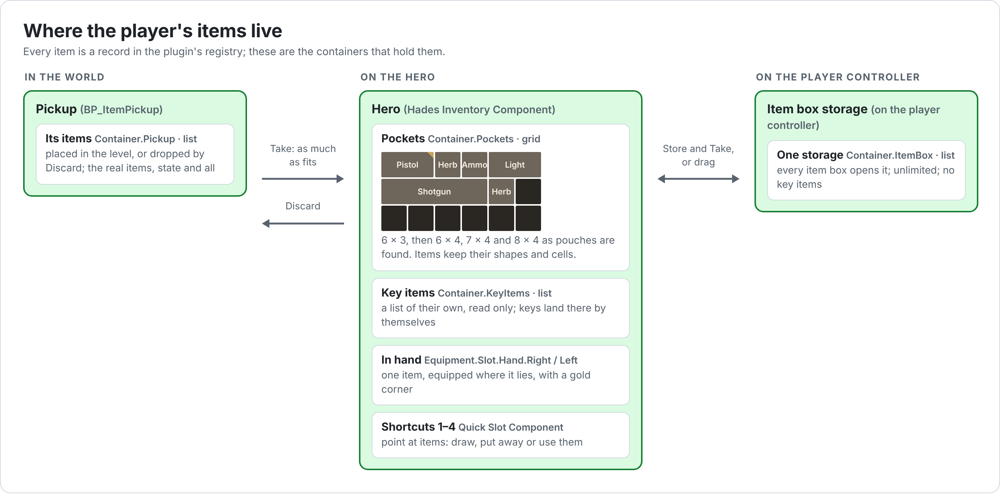

# Hades: Inventory

The game's inventory rules, built on the Modular Inventory plugin: the pockets and key items, the one item in hand, shortcuts, using, combining and discarding items, guns and their rounds, pouches, auto sort and the item box. For items, containers, equipment, crafting and the plugin's widgets themselves, read the plugin's [README](../Plugins/ModularInventory/README.md). For the screens, read [UI](UI.md).

## Contents

1. [Overview](#1-overview)
2. [Containers](#2-containers)
3. [Hades Inventory Component](#3-hades-inventory-component)
4. [The item in hand](#4-the-item-in-hand)
5. [Shortcuts](#5-shortcuts)
6. [Item actions](#6-item-actions)
7. [Guns and ammo](#7-guns-and-ammo)
8. [Key items](#8-key-items)
9. [Pouches](#9-pouches)
10. [Auto sort](#10-auto-sort)
11. [The item box](#11-the-item-box)
12. [Messages](#12-messages)
13. [Data assets](#13-data-assets)
14. [How-to guides](#14-how-to-guides)
15. [Troubleshooting](#15-troubleshooting)
16. [Design choices](#16-design-choices)

---

## 1. Overview

- **Pockets.** One grid, 6 × 3 at the start. Each hip pouch grows it: 6 × 4, 7 × 4, then 8 × 4. Items keep their shapes: a shotgun takes four cells in a row.
- **Key items** go in their own list. They take no pocket space, can't be moved, discarded or stored, and go away after their last use.
- **One item in hand.** Drawing an item equips it where it lies: it keeps its cell in the pockets, marked with a cream corner. Drawing another puts the first away.
- **Four shortcuts**, on 1 to 4 and the D-pad. A shortcut draws its item, puts it away if it's in hand, or uses it.
- **Item actions.** Items can be used (herbs heal), combined (herbs, gunpowder, a gun with its ammo), discarded onto the floor, and stored in or taken from the item box.
- **Guns** keep their own rounds and load from their ammo.
- **Item boxes** share one storage.
- **The inventory screen** plays like Requiem's. See [UI 8](UI.md#8-inventory-screen).

---

## 2. Containers

| Tag | Layout | Type | On | Filter | Notes |
| --- | --- | --- | --- | --- | --- |
| `Container.Pockets` | `CL_Pockets` (6 × 3), then `CL_Pockets_2` (6 × 4), `CL_Pockets_3` (7 × 4), `CL_Pockets_4` (8 × 4) | Grid | The hero's Inventory Component, first | No Tags Match `Item.Type.KeyItem` | New items fill it first. |
| `Container.KeyItems` | `CL_KeyItems` | List, Capacity 0 (unlimited), **Read Only In UI** | The hero's Inventory Component, second | Any Tags Match `Item.Type.KeyItem` | Key items land here by themselves, as the pockets refuse them. |
| `Container.ItemBox` | `CL_ItemBox` | List, Capacity 0 | The player controller's Item Box Inventory | No Tags Match `Item.Type.KeyItem` | One storage for every item box. |
| `Container.Pickup` | `CL_Pickup` | List, Capacity 0 | Each pickup's Inventory Component | none | |

There are no hand slots: the item in hand is equipped where it lies ([4](#4-the-item-in-hand)).

Each pocket layout holds the one before it (6 × 3 fits in 6 × 4, and so on), because items keep their cells when the pockets grow.

---

## 3. Hades Inventory Component

`UHadesInventoryComponent` is the player's Inventory Component with the game's rules on top. The hero has one, `InventoryComponent`. It expects a `Container.Pockets` grid and a `Container.KeyItems` list, and an Inventory Equipment Component on the same actor.

**Settings.** Besides the plugin's own (README 6.1):

| Category | Field | Description |
| --- | --- | --- |
| Inventory › Hades | Dropped Pickup Class | Spawned with a discarded item inside, so it can be taken again. Empty destroys discarded items. |
| Inventory › Hades | Combine Recipes | What Combine can make. Each recipe takes one or two ingredients. |
| Inventory › Hades | Pocket Upgrades | The layouts the pockets move through, one per pouch. Each must hold the one before it. |

`BP_HadesHero`'s Inventory Component:

| Category | Field | Value |
| --- | --- | --- |
| Inventory | Containers | 1. `Container.Pockets` + `CL_Pockets`; 2. `Container.KeyItems` + `CL_KeyItems` |
| Inventory | Preload Cosmetics | ticked |
| Inventory › Starting Items | Starting Items | `DA_Pistol` × 1, `DA_HandgunAmmo` × 12, `DA_GreenHerb` × 1, `DA_RedHerb` × 1, `DA_Flashlight` × 1 |
| Inventory › Starting Items | Starting Equipment | empty |
| Inventory › Hades | Dropped Pickup Class | `BP_ItemPickup` |
| Inventory › Hades | Combine Recipes | `RB_Combine` |
| Inventory › Hades | Pocket Upgrades | `CL_Pockets_2`, `CL_Pockets_3`, `CL_Pockets_4` |

**Functions**

| Group | Function | Description |
| --- | --- | --- |
| Hands | Draw Item (Item) | Takes the item in hand, putting away whatever was held ([4](#4-the-item-in-hand)). |
| Hands | Stow Item (Item) | Puts it away, if it's in hand. |
| Hands | Can Draw (Item) | The player carries it, and its Equip Rules allow a hand. |
| Hands | Is In Hand (Item), Get Item In Hand | |
| Actions | Can Use Item, Use Item (Item) | [6](#6-item-actions) |
| Actions | Can Discard Item, Discard Item (Item) | |
| Actions | Can Combine (Item), Combine Items (Item, Other) | |
| Actions | Is Key Item (Item) | Tagged `Item.Type.KeyItem`. |
| Guns | Get Loaded Rounds, Get Capacity, Get Spare Rounds, Reload Gun, Spend Rounds | [7](#7-guns-and-ammo) |
| Pockets | Upgrade Pockets | Moves the pockets on to the next of Pocket Upgrades. False once they are the biggest. |
| Pockets | Organize Pockets | Repacks the pockets, biggest items first ([10](#10-auto-sort)). |

---

## 4. The item in hand

As in the RE games, the item in hand stays where it is in the pockets, marked with a cream corner. One item is in hand at a time.

- **Draw Item** equips the item in place to the first hand its **Equip Rules** allow: `Equipment.Slot.Hand.Right`, then `Equipment.Slot.Hand.Left`. Whatever was in hand is put away first.
- The Inventory Equipment Component then applies the item: its grants, and its cosmetic pieces, such as the flashlight's light ([13](#13-data-assets)).
- **Stow Item** puts it away. An item also leaves the hand when it leaves the inventory, such as when it's discarded.
- **Get Item In Hand** looks in the right hand, then the left.

| Equip Rules | Slots | Blocked Slots | Used by |
| --- | --- | --- | --- |
| `ER_OneHanded` | `Equipment.Slot.Hand.Right` | | `DA_Pistol` |
| `ER_TwoHanded` | `Equipment.Slot.Hand.Right` | `Equipment.Slot.Hand.Left` | `DA_Shotgun` |
| `ER_Light` | `Equipment.Slot.Hand.Left` | | `DA_Flashlight` |

With one item in hand, Blocked Slots make no difference yet. A tool for either hand would use Slots `Equipment.Slot.Hand`.

The UI shows the item in hand three ways: a cream triangle in the top-right corner of its tile, the **IN HAND** panel of the inventory, and a gold frame on its shortcut in the HUD.

---

## 5. Shortcuts

`UHadesQuickSlotComponent` gives the player number-key shortcuts to items they carry. The hero has one, `QuickSlotComponent`. A shortcut only points at its item: the item stays where it is.

| Category | Field | Default | `BP_HadesHero` | Description |
| --- | --- | --- | --- | --- |
| Quick Slots | Num Slots | 4 | 4 | The hero binds `Input.QuickSlot.1` to `.4`, so more than four need more input in C++. |
| Quick Slots | Slot Keys | empty | `DT_UIInputActions` rows `Shortcut1`, `Shortcut2`, `Shortcut3`, `Shortcut4` | The action rows whose key icons stand for each slot in the UI, slot 1 first. Only for show: the hero binds the keys. |

**Rules**

- **Activating a slot** (its key) puts its item away if it's in hand, draws it if it can be held, or else uses it. Every press also fires **On Slot Activated**, even on an empty slot, so the HUD shows the shortcuts for a moment.
- **What can go on a slot:** anything that can be held or used.
- **New finds.** Something that can be held goes on the first free slot when it's picked up, unless it has a slot already. At the start, every item the hero carries that can be held is put on a free slot: with the starting items above, the pistol on 1 and the flashlight on 2.
- **A slot follows its item** wherever it moves in the inventory, and empties when the item leaves it.
- An item is on one slot at most: assigning it moves it from any other.

| Function or event | Description |
| --- | --- |
| Assign Item (Slot Index, Item) | Puts the item on a slot, moving it from any other. Does nothing for items that can't be held or used. |
| Assign To Free Slot (Item) | For new finds: the first free slot, if the item can be held and has no slot yet. |
| Clear Slot (Slot Index) | |
| Activate Slot (Slot Index) | What the shortcut keys call. |
| Get Slot Item (Slot Index), Find Slot (Item) | Find Slot is -1 when the item has no slot. |
| Get Slot Key (Slot Index), Get Num Slots | |
| Can Assign (Item) | Something to hold or to use. |
| **On Changed** (event) | The slots changed, or what's in hand did. |
| **On Slot Activated** (Slot Index) | A shortcut key was pressed. |

Shortcuts are set in the inventory with **Register Shortcut** ([UI 10](UI.md#10-shortcut-menu)). Picking the shortcut an item is already on takes it off.

---

## 6. Item actions

The item menu shows only the actions an item can do now. The inventory screen decides which ([UI 8](UI.md#8-inventory-screen)):

| Action | Menu text | Shown when | What it does |
| --- | --- | --- | --- |
| Shortcut | Register Shortcut | It can be held or used, and the screen has a Shortcut Menu Class | Opens the shortcut menu beside the item ([5](#5-shortcuts)). |
| Use | Use | It has a **Hades Item Use** fragment with an Effect | Applies the effect to the hero and uses up one of the stack. |
| Equip | Equip | It can be held, and isn't in hand | Draw Item. |
| Unequip | Unequip | It's in hand | Stow Item. |
| Combine | Combine | Can Combine | The player picks a second item; the two are combined. |
| Discard | Discard | The player carries it, and it isn't a key item | Drops it in front of the hero as a pickup. |
| Store | Store | At an item box: the player carries it, and it isn't a key item | Moves it into the item box. |
| Take | Take | At an item box: it's in the box | Moves it into the pockets, as much as fits. |

**Use.** Add a **Hades Item Use** fragment to an item definition's **Fragments** to make it usable:

| Fragment | Field | Description |
| --- | --- | --- |
| Hades Item Use | Effect | A Gameplay Effect applied to the hero. Using the item uses up one of the stack. |

**Discard.** The item goes into a new **Dropped Pickup Class** pickup, about 60 cm in front of the hero, on the floor below. The pickup holds the real item, so it keeps its state. With no Dropped Pickup Class, the item is destroyed.

**Combine.** After choosing Combine, the player picks the second item; Back cancels. Then:

1. If one of the two is a gun and the other its ammo, the gun loads ([7](#7-guns-and-ammo)). If it's already full, the player is told "It's already fully loaded."
2. Otherwise the first recipe in **Combine Recipes** made from the two is crafted. A recipe is made from them when every ingredient matches one of the two, and both are used: green + green for one ingredient of two, or green + red for two ingredients. The ingredients are used up and the result goes into the pockets.
3. With no such recipe, the player is told "Those can't be combined."; with no room for the result, "Not enough space."

**Can Combine** is true when any of Combine Recipes uses the item, or when it's a gun or ammo whose partner the player carries. "Green + Red + Yellow" takes two steps, as in the RE games: G+R, then the result + Y.

---

## 7. Guns and ammo

Add a **Hades Gun** fragment to a gun's item definition. Each gun keeps its own rounds.

| Fragment | Field | Default | Description |
| --- | --- | --- | --- |
| Hades Gun | Capacity | 10 | Rounds it holds when full. |
| Hades Gun | Starting Rounds | 10 | Rounds in it when found, up to Capacity. |
| Hades Gun | Ammo | none | The item it loads, such as `DA_HandgunAmmo`. |

| Gun | Capacity | Starting Rounds | Ammo |
| --- | --- | --- | --- |
| `DA_Pistol` | 10 | 10 | `DA_HandgunAmmo` |
| `DA_Shotgun` | 5 | 5 | `DA_ShotgunShells` |

**How it works**

- A gun has its Starting Rounds until it's loaded or fired. From then on its rounds are kept on the item as the tag value `Item.Stat.Rounds`, so they stay with it when it's dropped, stored or moved.
- **Loading.** Combining a gun with its ammo, in either order, takes as many rounds as it's missing from the ammo the player carries, from any number of stacks.
- **Firing.** Nothing fires yet. Firing code calls **Spend Rounds**.

| Function | Description |
| --- | --- |
| Get Loaded Rounds (Gun) | Rounds in it. 0 for anything without a Hades Gun. |
| Get Capacity (Gun) | Rounds it holds when full, or 0 for anything that isn't a gun. |
| Get Spare Rounds (Gun) | Rounds for it in the inventory, not counting those in it. |
| Reload Gun (Gun) | Fills it from its ammo in the inventory. False if it's full or there's none. |
| Spend Rounds (Gun, Count) | Takes rounds out. False, taking none, if it hasn't that many. |

**In the UI.** A gun's tile shows its rounds where a stack's count goes: green when full, white when partly loaded, red when empty. A gun on a HUD shortcut shows its rounds, colored the same way, then the spare rounds, such as `10/12` ([UI 11](UI.md#11-item-and-slot-widgets)).

---

## 8. Key items

Items tagged `Item.Type.KeyItem` are key items.

- The pockets refuse them and the key item list only takes them, so they land in the list by themselves.
- The list is **Read Only In UI**: they show their details, but can't be picked up or moved.
- They can't be discarded or stored.
- A lock uses one of a key's `Item.Stat.Uses` each time it opens, and the key is removed after the last ([Interaction 8](Interaction.md#8-locks-and-locked-doors)). `DA_BasementKey` has `Item.Stat.Uses` = 2: it opens two doors. A key without Uses is kept.

---

## 9. Pouches

Items tagged `Item.Type.Pouch` grow the pockets.

- Taking a pouch from a pickup doesn't put it in the inventory. The pockets move on to the next layout in **Pocket Upgrades**, the pouch is removed, and the player is told "Hip Pouch: you can carry more."
- A pickup with a pouch can always be taken, even with full pockets.
- With no bigger pockets left, the pouch is still used up, and `LogHadesInventory` warns.
- Items keep their cells, which is why each layout must hold the one before it.

The inventory screen keeps the pockets' panel at the size of the biggest grid, 8 × 4, so nothing moves when they grow.

---

## 10. Auto sort

**Organize Pockets** repacks the pockets with the plugin's Sort Container: biggest items first. On the inventory screens it's the **Auto Sort** action, held for 0.6 seconds (O, or the left stick's button). If the items can't all be placed again, nothing changes and the player is told "Couldn't organize your pockets."

---

## 11. The item box

- The storage is on the player controller, `ItemBoxInventory`, with one container: `Container.ItemBox` + `CL_ItemBox`, an unlimited list. Every item box opens it, so what's stored in one is in all of them.
- An item box pushes `W_ItemBoxScreen`: the inventory screen with an **Item Box List** on the left ([UI 8.6](UI.md#86-item-box-mode)).
- Items move between the box and the pockets by dragging, or with **Store** and **Take** in the item menu. Dropping an item anywhere on the box's list puts it at the end.
- The box refuses key items.

---

## 12. Messages

What the inventory tells the player. Messages show near the bottom of the screen, over everything ([UI 6](UI.md#6-messages)).

| Message | When | From |
| --- | --- | --- |
| It's locked. | A lock is tried without its key. The text is the lock's **Locked Text**. | Hades Lock Component |
| Used the Basement Key. | A key opens a lock and has uses left, or has no Uses. | Hades Lock Component |
| Used the Basement Key. It's no longer needed, so you discarded it. | A key's last use. | Hades Lock Component |
| Hip Pouch: you can carry more. | A pouch grows the pockets. | Item pickup |
| Not enough space for the rest. | A pickup is taken, but not all of it fits. | Item pickup |
| It's already fully loaded. | A full gun is combined with its ammo. | Hades Inventory Component |
| Those can't be combined. | No recipe uses both items. | Hades Inventory Component |
| Not enough space. | A combined result doesn't fit, or Take finds no room. | Hades Inventory Component, inventory screen |
| You can't combine those right now. | The recipe can't be crafted for another reason. | Hades Inventory Component |
| That can't go in the item box. | Store fails. | Inventory screen |
| Couldn't organize your pockets. | Auto Sort fails. | Inventory screen |
| Only things to hold or use go in quick slots. | An item that can't be held or used is put on a HUD shortcut. | Quick slot widget |

The prompts: "Take" and the item's name, and "Not enough space" on a pickup; "Open item box"; "Open" on `BP_LockedDoor`.

---

## 13. Data assets

**Layouts** (`Content/Inventory/Layouts`, **Add › Inventory › Container Layout**):

| Asset | Type | Settings | Filter › Tag Query |
| --- | --- | --- | --- |
| `CL_Pockets` | Grid | Grid Size 6 × 3 | No Tags Match: `Item.Type.KeyItem` |
| `CL_Pockets_2` | Grid | Grid Size 6 × 4 | No Tags Match: `Item.Type.KeyItem` |
| `CL_Pockets_3` | Grid | Grid Size 7 × 4 | No Tags Match: `Item.Type.KeyItem` |
| `CL_Pockets_4` | Grid | Grid Size 8 × 4 | No Tags Match: `Item.Type.KeyItem` |
| `CL_KeyItems` | List | Capacity 0; Rules › **Read Only In UI** ticked | Any Tags Match: `Item.Type.KeyItem` |
| `CL_ItemBox` | List | Capacity 0 | No Tags Match: `Item.Type.KeyItem` |
| `CL_Pickup` | List | Capacity 0 | empty |

**Rules** (`Content/Inventory/Rules`):

| Asset | Type | Settings |
| --- | --- | --- |
| `SR_HandgunAmmo` | Stack Rules | Max Stack Size 30, Can Split ticked |
| `ER_OneHanded`, `ER_TwoHanded`, `ER_Light` | Equip Rules | See [4](#4-the-item-in-hand) |

**Effects** (`Content/Inventory/Effects`): `GE_Heal_Small`, `GE_Heal_Medium` and `GE_Heal_Full`, Gameplay Effects with **Duration Policy** **Instant**. They change nothing until the hero has a Health attribute.

**Items** (`Content/Inventory/Items`). Each was made with **Create Inventory Item** from a mesh, which also made its `_Cosmetics` asset and its icon. Fields not listed are left at their defaults.

| Asset | Display Name | Size | Stack Rules | Equip Rules | Tags | Tag Values | Fragments |
| --- | --- | --- | --- | --- | --- | --- | --- |
| `DA_Pistol` | Pistol | 2 × 1 | | `ER_OneHanded` | | | Hades Gun: 10, 10, `DA_HandgunAmmo` |
| `DA_Shotgun` | Shotgun | 4 × 1 | | `ER_TwoHanded` | | | Hades Gun: 5, 5, `DA_ShotgunShells` |
| `DA_Flashlight` | Flashlight | 2 × 1 | | `ER_Light` | | | |
| `DA_HandgunAmmo` | Handgun Ammo | 1 × 1 | `SR_HandgunAmmo` | | | | |
| `DA_ShotgunShells` | Shotgun Shells | 1 × 1 | `SR_HandgunAmmo` | | | | |
| `DA_GreenHerb` | Green Herb | 1 × 1 | | | | | Hades Item Use: `GE_Heal_Small` |
| `DA_RedHerb` | Red Herb | 1 × 1 | | | | | |
| `DA_MixedHerbGG` | Mixed Herb (G+G) | 1 × 1 | | | | | Hades Item Use: `GE_Heal_Medium` |
| `DA_MixedHerbGR` | Mixed Herb (G+R) | 1 × 1 | | | | | Hades Item Use: `GE_Heal_Full` |
| `DA_Gunpowder` | Gunpowder | 1 × 1 | | | | | |
| `DA_BasementKey` | Basement Key | 1 × 1 | | | `Item.Type.KeyItem` | `Item.Stat.Uses` = 2 | |
| `DA_HipPouch` | Hip Pouch | 1 × 1 | | | `Item.Type.Pouch` | | |

Every item has a **Description**, shown in the details panel. Herbs and gunpowder don't stack, as in the RE games: Combine needs two separate items to pick from.

**Cosmetics** (`Content/Inventory/Actors` and the items' `_Cosmetics`):

| Asset | Piece | Settings |
| --- | --- | --- |
| `BP_FlashlightLight` | (an Actor Blueprint) | A **Spot Light**: Intensity 50 cd, Attenuation Radius 2500, Outer Cone Angle 25, Inner Cone Angle 12. |
| `DA_Flashlight_Cosmetics` | Actor | Actor Class `BP_FlashlightLight`, Attach Component `FirstPersonCamera`, Location X 10, Y -15, Z -10 |
| `DA_Pistol_Cosmetics`, `DA_Shotgun_Cosmetics` (optional) | Static Mesh | The item's mesh, Attach Component `FirstPersonCamera`, Location X 40, Y 15, Z -15, First Person Primitive Type **First Person** |

**Recipes** (`Content/Inventory/Recipes`):

| Asset | Ingredients | Output |
| --- | --- | --- |
| `RCP_MixedHerbGG` | `DA_GreenHerb` × 2, Consume ticked | `DA_MixedHerbGG` × 1 |
| `RCP_MixedHerbGR` | `DA_GreenHerb` × 1; `DA_RedHerb` × 1 | `DA_MixedHerbGR` × 1 |
| `RCP_HandgunAmmo` | `DA_Gunpowder` × 2 | `DA_HandgunAmmo` × 15 |

`RB_Combine` is a Recipe Book with all three, set as the hero's **Combine Recipes**.

---

## 14. How-to guides

### 14.1 A new item

1. Right-click its mesh and choose **Create Inventory Item**. Rename the new `DA_` and `DA_..._Cosmetics` assets.
2. Open the definition: **Display Name**, **Description**, **Size**, and Stack Rules if it stacks.
3. If you changed Size, right-click it and choose **Generate Item Icons**.
4. Place a `BP_ItemPickup` with it under **Inventory › Starting Items**, or give it with `Inventory.Give DA_YourItem 1`.

### 14.2 A usable item

Make a Gameplay Effect for what it does, then add a **Hades Item Use** fragment to the item with that **Effect**. **Use** appears in its menu, and it can go on a shortcut.

### 14.3 A gun

1. Its ammo: a 1 × 1 item with Stack Rules.
2. The gun: Equip Rules that allow a hand, such as `ER_OneHanded`, and a **Hades Gun** fragment with Capacity, Starting Rounds and Ammo.
3. Optional: a Static Mesh piece in its cosmetics, so it shows in hand.

It goes on a shortcut when found, shows its rounds, and loads by combining it with its ammo.

### 14.4 A key and its door

1. A key item: Tags `Item.Type.KeyItem`, and Tag Values `Item.Stat.Uses` = the number of locks it opens. Leave Uses out for a key that's never used up.
2. A door: copy `BP_LockedDoor` and set its Hades Lock Component's **Key**.

### 14.5 A combine recipe

**Add › Inventory › Recipe** with one or two ingredients and an output, then add it to `RB_Combine`. Both items must be used: one ingredient with Count 2, or two ingredients with Count 1.

### 14.6 Bigger or more pocket upgrades

Make more Grid layouts, each holding the last, and add them to the hero's **Pocket Upgrades** in order. The inventory screen's pocket panel is sized for 8 × 4: raise its minimum size for a bigger grid ([UI Reference 7.1](UIReference.md#71-w_inventoryscreen)).

### 14.7 Firing a gun

From your fire ability or input: **Get Item In Hand**; if **Get Capacity** is above 0, call **Spend Rounds** (1). If it returns false, the gun is empty. The tiles and shortcuts update by themselves.

---

## 15. Troubleshooting

| Symptom | Cause | Fix |
| --- | --- | --- |
| The pistol isn't on shortcut 1 at the start | The hero's **Starting Items** order, or the item has no Equip Rules for a hand | 3; 4 |
| Equip is missing from a weapon's menu | Its Equip Rules don't allow `Equipment.Slot.Hand.Right` or `.Left` | 4 |
| Use is missing | No **Hades Item Use** fragment, or it has no Effect | 6 |
| Combine is missing | No recipe in **Combine Recipes** uses the item, and it's no gun or ammo with its partner carried | 6; 13 |
| Combine says "Those can't be combined." | The recipe needs both items, or more of one | 6 |
| A gun shows no rounds | Its definition has no **Hades Gun** fragment | 7 |
| A gun won't load: "It's already fully loaded." | It is full | |
| Key items take pocket space | The pockets' filter is missing | 13: `CL_Pockets` filters |
| Key items can be moved | `CL_KeyItems` isn't Read Only In UI | 13 |
| Discard destroys the item | **Dropped Pickup Class** is empty | 3 |
| A pouch does nothing; the log warns | No bigger layouts left in **Pocket Upgrades** | 9 |
| Items jump to other cells when the pockets grow | A layout doesn't hold the one before it | 2 |
| Each item box has its own items | The storage isn't on the controller's `ItemBoxInventory`, or its container isn't tagged `Container.ItemBox` | 11 |

---

## 16. Design choices

| Choice | Why | To change it |
| --- | --- | --- |
| One item in hand, which stays in the pockets | The RE games, Requiem included, work this way: the item in hand keeps its cell and is marked there. | `UHadesInventoryComponent::DrawItem` equips in place. The plugin can also equip by moving items into equipment slots. |
| Key items in an unlimited list, removed after their last use | Key items taking slots is the genre's top complaint. Village and the RE4 remake keep them off the grid. | Give `CL_KeyItems` a Capacity, or remove the pockets' filter. |
| An unlimited, linked item box | RE7, the RE2 remake and Requiem do this. It keeps backtracking reasonable. | Give `CL_ItemBox` a Capacity. |
| Pouches grow one grid | Like the RE2 remake's hip pouches. One grid is less fiddly than several. | **Pocket Upgrades**. |
| Discard drops the item | It can be undone, and players like dropping items anywhere. | Clear **Dropped Pickup Class** to destroy discarded items, as the RE games do. |
| Four shortcuts | Matches the D-pad, as in RE7 and the RE2 remake. | **Num Slots** and **Slot Keys**, plus more `Input.QuickSlot` tags and bindings in C++. |
| Items keep their shapes | A shotgun takes more room than a herb, which makes packing a choice. | Set every item's Size to 1 × 1, and clear **Rotate Action** on the screens. |
| Only items of the same size and shape swap | A swap then never depends on what space is free. | The plugin's Inventory UI Subsystem; see its README, 11.4. |

With one item in hand, the flashlight and a gun can't be held together yet. Requiem keeps a light on the player all the time; a head lamp, or a light on the gun through the plugin's attachment slots, would do the same.
