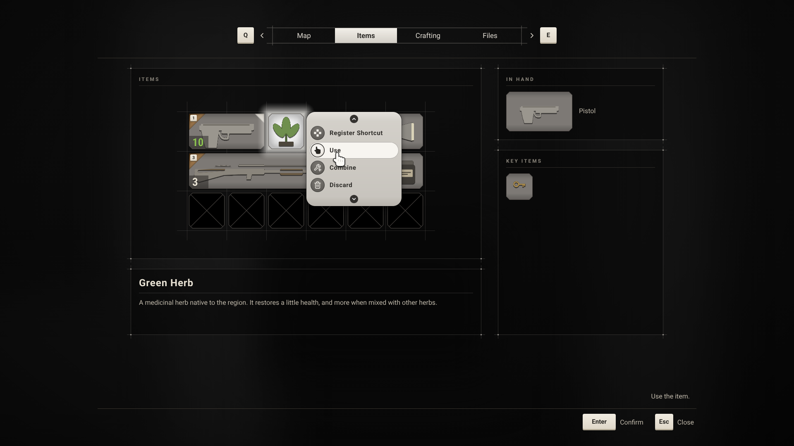

# Hades: Inventory UI Setup

The editor steps for bringing the inventory UI up to date after a patch. Every widget as it ends up, with every property, is in the [UI Reference](UIReference.md); how the UI works is in [UI](UI.md).

## Contents

1. [Updating from an earlier patch](#updating-from-an-earlier-patch)
   - [From patch 0012 to 0013: the plugin's item menu](#from-patch-0012-to-0013-the-plugins-item-menu)
   - [From patch 0011 to 0012: the plugin's inventory screen](#from-patch-0011-to-0012-the-plugins-inventory-screen)
   - [From patch 0010 to 0011: the restyle](#from-patch-0010-to-0011-the-restyle)
2. [Troubleshooting](#troubleshooting)

---

## Updating from an earlier patch

### From patch 0012 to 0013: the plugin's item menu

Patch 0013 changes no looks and no widget layouts. The popup behaviour the item and shortcut menus shared moved from Hades's `UHadesPopupMenu` into the Modular Inventory plugin's new **Inventory Item Menu Widget**, and the plugin gained features Hades doesn't use yet: transfer and Take All for chests, item meters, tag colors, stat rows and dropping items outside the inventory (plugin README, 11).

**What changes**

- `UHadesItemMenu` and `UHadesShortcutMenu` are built on the plugin's **Inventory Item Menu Widget**. `UHadesPopupMenu` is gone. Placing, closing on Back or a click outside, the drag from the item, and the selection while a menu is open now come from the plugin.
- The menus no longer have **Input Config**, **Game Mouse Capture Mode** or **Pause Game**: they always take menu input and never stop the world, as they were set before.
- Menus for items in the item box or the key item list now open beside the item, instead of beside the gamepad's focus or at the cursor.
- Combine uses exactly the two items picked. Before, a recipe could use up another herb of the same kind from elsewhere in the pockets.

**Steps**

1. Close the editor, pull the branch, and build **Development Editor** for **Win64**.
2. Open `W_ItemMenu` (`Content/UI/Inventory`). Check that it compiles, and that **Class Defaults** › Input › **Confirm Action** is still `Confirm`. It moved into the plugin's class under the same name, so it should have kept its row; set it again if it's empty (Data Table `DT_UIInputActions`). Compile and save.
3. Do the same for `W_ShortcutMenu`.

**Check it**

1. Click an item: its menu opens beside it, the item lights up, and the first row takes the gamepad's focus. Click outside the menu: it closes and the item goes dark.
2. With a menu open, drag the item: the menu closes and the item moves.
3. At an item box, open the menu of an item in the box: it opens beside that row.
4. Register Shortcut opens the shortcut menu beside the item, on the shortcut the item is on.
5. Combine a green herb with another green herb: those two are used, and any third herb stays.

| Symptom | Cause | Fix |
| --- | --- | --- |
| `W_ItemMenu` or `W_ShortcutMenu` fails to compile, saying its parent class is missing | The C++ wasn't built | Build Development Editor (step 1) |
| The action bar has no Confirm while a menu is open | The row was cleared when it moved to the plugin's class | Set it again (step 2) |

### From patch 0011 to 0012: the plugin's inventory screen

Patch 0012 changes no looks and no widgets. It moves code: what any inventory screen needs now lives in the Modular Inventory plugin, and Hades's inventory screen is built on it.

**What changes**

- `UHadesInventoryScreen` is built on the plugin's new **Inventory Screen Widget** instead of `UHadesActivatableWidget`. Move, Rotate, Split, Back, the focus on the first pocket cell and the cleanup on closing come from the plugin; the tabs, menus, item actions, hints, Auto Sort, the item box and stopping the world stay in Hades.
- The RE-style switches are now the screen's **Interaction Style** in Class Defaults, set by the C++, instead of being set on the subsystem when the screen opens.
- A click on an item must start and end on it, unless the style's **Click On Any Release** is on. Hades turns it on, so one click still goes from one item's menu to another's.
- The inventory screens no longer show **Input Config** or **Pause Game**: they always take menu input and always stop the world.
- Equipping in place now checks the equip rules' Owner Requirements and Blocked Slots. Hades's equip rules have neither set, so nothing changes in play.

**Steps**

1. Close the editor, pull the branch, and build **Development Editor** for **Win64**.
2. Open the project and open `W_InventoryScreen` (`Content/UI/Inventory`). In **Class Defaults**, check:
   - Input: **Confirm Action** `Confirm`, **Move Action** `Move`, **Rotate Action** `Rotate`, **Split Action** empty, **Organize Action** `Organize`, **Previous Tab Action** `PreviousTab`, **Next Tab Action** `NextTab`. The first four moved into the plugin's class under the same names, so they should have kept their rows; set any that are empty again (Data Table `DT_UIInputActions`).
   - Inventory › Screen › **Interaction Style**: Click Opens Item Menu, Snap Held Item, Swap Items, Swap Picks Up Other and Click On Any Release ticked.
3. Compile and save.
4. Do the same for `W_ItemBoxScreen`.

**Check it**

1. Tab opens the inventory, the world stops and turns grey, and the action bar shows Auto Sort, Confirm and Close, with Move while the cursor or focus is on an item.
2. Click an item: its menu opens. With the menu open, click another item: that item's menu opens straight away.
3. Move picks up the item under the cursor; Q, E or Rotate turn it; Back puts it back; a second Back closes the inventory and the world runs again.
4. Combine a green herb, then click the same herb: nothing happens. Click a red herb: they combine.
5. At an item box, Store and Take still work, and a drag between the box and the pockets still works.

| Symptom | Cause | Fix |
| --- | --- | --- |
| The action bar has no Move, Rotate or Confirm | The rows were cleared when they moved to the plugin's class | Set them again (step 2) |
| Clicking another item while a menu is open only closes the menu | Click On Any Release is off | Tick it in Interaction Style (step 2) |
| Clicking an item picks it up instead of opening its menu | Click Opens Item Menu is off | Tick it in Interaction Style (step 2) |
| The world keeps running behind the inventory | The C++ wasn't built | Build Development Editor (step 1) |

### From patch 0010 to 0011: the restyle



Patch 0011 changes how the inventory looks, not how it works or where anything is. Every panel keeps its place and size.

**What changes**

- Panels and the pocket grid get thin lines that run a little past their corners, with a dot where panel lines cross.
- Items sit on a grey tile that is darker at the top and bottom. Empty cells are black with an X.
- The hovered or focused item, and the item whose menu is open, turns bright and glows over its neighbours.
- A full orange triangle in the top-left corner marks an item that's on a shortcut, with the shortcut's key on it. A cream triangle in the top-right corner marks the item in hand.
- Counts and rounds move to the bottom left, on a darker patch, in Roboto Condensed.
- The four tabs become one bar of text tabs; the open one is filled light. The tab keys sit beside the bar.
- The item menu becomes a light capsule of rows, each a round icon and a label. The shortcut menu matches it.
- The hint above the action bar loses its box.
- A soft shadow under every item icon keeps light icons readable on the grey tiles.
- Optional: a hand cursor in place of the arrow.

**What stays as it is**: the escape menu, the HUD (its shortcuts keep their gold in-hand frame), the item box's list of rows, and every behaviour.

**New in the code**, which these steps rely on:

- Hades: the **Hades Menu Button** class, for the menu rows; **Active Label Style** and **Inactive Label Style** on tab buttons; the item widget's `ShortcutMarker`, `CountPatch`, `LitBackground` and `Glow` parts.
- Modular Inventory: `IconShadow` on item widgets; **Draw Grid Lines** on grids; the hovered or selected item drawn above the others.

#### Before you start

1. Close the editor.
2. Get the patch: pull the branch.
3. In Visual Studio, build **Development Editor** for **Win64**. The new class and properties have to exist before a Blueprint can use them.
4. Open the project.
5. Keep a copy of `Content/UI`, such as by committing it first, so you can go back.

Work through the parts in order: each one uses assets made in the ones before it. When a part is done, press **Compile** on each Widget Blueprint it changed, and **Save** (Ctrl+S).

How to read the steps:

| Written | Meaning |
| --- | --- |
| Slot: Fill/Fill | In the widget's **Slot** section of Details: Horizontal Alignment Fill, Vertical Alignment Fill. |
| Slot: H Left, V Top | Horizontal Alignment Left, Vertical Alignment Top. |
| Padding 5 | All four sides 5. Padding Left 6, Bottom 6 means those two; the other two are 0. |
| `D6D0C626` | A color as hex sRGB: red, green, blue, alpha. Click the color, and type it into the picker's **Hex sRGB** box. |
| Width 46 | Size Box › Child Layout: **Width Override** ticked and set to 46; Height likewise. |
| Brush: Box, `T_UI_X`, 64 × 64, Margin 0.25 | In the brush: **Draw As** Box, **Image** `T_UI_X`, **Image Size** X 64 and Y 64, **Margin** 0.25 in all four boxes, **Tint** `FFFFFFFF`. |
| Brush: Image, `T_UI_X`, 40 × 40 | **Draw As** Image, **Image** `T_UI_X`, **Image Size** 40 × 40, **Tint** `FFFFFFFF`. |
| Is Variable | The checkbox beside the widget's name at the top of Details. |
| Not Hit-Testable | Behavior › Visibility: **Not Hit-Testable (Self & All Children)**. |

A Widget Blueprint's own settings are in **Graph › Class Defaults**. Text styles and button styles show their settings as soon as they open.

#### Part 1. Import the textures

The textures are in `SourceArt/UI` in the repository. They all go in `Content/UI/Style`.

1. In the Content Browser, open `Content/UI/Style`.
2. Right-click `T_UI_Panel` and choose **Reimport**. Its source, `SourceArt/UI/T_UI_Panel.png`, has the new frame. If the editor asks for a file, pick that one.
3. Click **Import** (or **+ Add › Import to /Game/UI/Style**), go to `SourceArt/UI`, and select these 28 files. Leave `T_UI_Cell.png`, `T_UI_ItemTile.png` and `T_UI_Panel.png` out.

   | File | Size | What it is |
   | --- | --- | --- |
   | `T_UI_GridCell_HasItem` | 128 × 128 | The grey tile under an item, darker at the top and bottom |
   | `T_UI_GridCell_Hover` | 128 × 128 | The bright tile under a lit item |
   | `T_UI_GridCell_Empty` | 256 × 256 | A whole empty cell: the black tile with an X, inset 5 px |
   | `T_UI_GridCell_EmptyHover` | 256 × 256 | The same, brighter, for a hovered empty cell |
   | `T_UI_ItemGlow` | 128 × 128 | The glow around a lit item |
   | `T_UI_CountPatch` | 64 × 64 | The darker patch behind a count |
   | `T_UI_ShortcutMarker` | 128 × 128 | The orange triangle, with its inner shadow |
   | `T_UI_InHandMarker` | 128 × 128 | The cream triangle for the item in hand |
   | `T_UI_TabBarFrame` | 64 × 64 | The lines above and below the tabs |
   | `T_UI_TabActive` | 64 × 64 | The open tab's light fill |
   | `T_UI_ChevronLeft`, `T_UI_ChevronRight` | 64 × 64 | The arrows beside the tab bar, white |
   | `T_UI_MenuPanel` | 128 × 128 | The item menu's light capsule |
   | `T_UI_MenuShadow` | 128 × 128 | The soft shadow under a menu |
   | `T_UI_MenuChevronUp`, `T_UI_MenuChevronDown` | 64 × 64 | The arrows at the top and bottom of the item menu |
   | `T_UI_MenuBadge`, `T_UI_MenuBadgeLit` | 128 × 128 | The round badge behind a menu icon, normal and highlighted |
   | `T_UI_Icon_Shortcut`, `T_UI_Icon_Use`, `T_UI_Icon_Equip`, `T_UI_Icon_Unequip`, `T_UI_Icon_Combine`, `T_UI_Icon_Discard`, `T_UI_Icon_Store`, `T_UI_Icon_Take` | 128 × 128 | The menu icons, white so they can be tinted. Shortcut is four squares. |
   | `T_UI_Cursor_Hand` | 128 × 128 | The hand cursor (only for Part 12) |

4. Select the 28 new textures and `T_UI_Panel` together (Ctrl+click), right-click, and choose **Asset Actions › Edit Selection in Property Matrix** (some engine versions call it **Bulk Edit via Property Matrix**). In the panel on the right, set:
   - Compression › **Compression Settings**: UserInterface2D (RGBA)
   - Level Of Detail › **Mip Gen Settings**: SimpleAverage
   - Level Of Detail › **Texture Group**: UI

   Close the matrix and **Save All**. To do it one at a time instead, open each texture and set the same three settings.

Every texture is twice the size it's drawn at, or more, so it stays sharp; the mipmaps keep it smooth when it's drawn smaller.

#### Part 2. Import the count font

Counts and rounds use Roboto Condensed Bold. The font file and its license are in `SourceArt/Fonts`.

1. In `Content/UI/Style`, click **Import** and pick `SourceArt/Fonts/RobotoCondensed-Bold.ttf`. The editor makes a **Font Face** asset. If it asks whether to make a Font asset too, choose No: you make it in step 3, with the right name.
2. Rename the Font Face `FF_RobotoCondensed_Bold`.
3. **+ Add › User Interface › Font**. Name it `F_RobotoCondensed` and open it.
4. Under **Default Font Family**, click **Add Font**. In the new entry, set **Font** to `FF_RobotoCondensed_Bold` and the entry's name to `Bold`.
5. Save it.

#### Part 3. Text styles

Five new styles, all in `Content/UI/Style`. Make each one by right-clicking an existing style and choosing **Duplicate**, then changing what the table says. Duplicate `TS_Body` for the first four and `TS_Label` for the last.

| Asset | Font Family | Typeface | Size | Letter Spacing | Color | Uses Drop Shadow | Shadow Offset | Shadow Color | Line Height Percentage |
| --- | --- | --- | --- | --- | --- | --- | --- | --- | --- |
| `TS_Tab` | Roboto | Regular | 17 | 0 | `DDD8CFFF` | off | | | 1 |
| `TS_TabActive` | Roboto | Bold | 17 | 0 | `2A2825FF` | off | | | 1 |
| `TS_TileCount` | `F_RobotoCondensed` | Bold | 27 | 0 | `F4F1EBFF` | on | X 0, Y 1 | `0000008C` | 1 |
| `TS_MenuItem` | Roboto | Bold | 15 | 40 | `2E2C29FF` | off | | | 1 |
| `TS_MenuLabel` | Roboto | Bold | 12 | 250 | `6B6760FF` | off | | | 1 |

Font Family, Typeface, Size and Letter Spacing are inside **Font**. **Margin** stays 0 on all of them. Save each.

#### Part 4. Button styles

Four new styles and one change, in `Content/UI/Style`. Make the new ones by duplicating `BS_Slot`. In each brush, set only what's listed; **Selected** brushes and text styles stay as they are.

**`BS_GridCell`**, for the pocket cells:

- **Normal Base**: Brush: Image, `T_UI_GridCell_Empty`, 96 × 96
- **Normal Hovered**: Brush: Image, `T_UI_GridCell_EmptyHover`, 96 × 96
- **Normal Pressed**: Brush: Image, `T_UI_GridCell_EmptyHover`, 96 × 96
- **Disabled**: Brush: Image, `T_UI_GridCell_Empty`, 96 × 96, but **Tint** `FFFFFF80`
- **Button Padding**: 0. **Min Width** 0, **Min Height** 0.

Draw As Image stretches the texture over the whole cell, which is what's wanted here: the texture is a whole 96-pixel cell with the tile inset.

**`BS_GridCellHolding`**, for the cells while an item is moved: duplicate `BS_GridCell`, then set **Normal Hovered** and **Normal Pressed** to `T_UI_GridCell_Empty` too, so cells don't light up under a moved item.

**`BS_ItemSlot`**, for the key items:

- **Normal Base**: Brush: Box, `T_UI_GridCell_HasItem`, 64 × 64, Margin 0.25
- **Normal Hovered**: Brush: Box, `T_UI_GridCell_Hover`, 64 × 64, Margin 0.25
- **Normal Pressed**: Brush: Box, `T_UI_GridCell_Hover`, 64 × 64, Margin 0.25
- **Disabled**: Brush: Box, `T_UI_GridCell_HasItem`, 64 × 64, Margin 0.25, but **Tint** `FFFFFF80`
- **Button Padding**: 0. **Min Width** 0, **Min Height** 0.

**`BS_ItemMenuRow`**, for the rows of the item and shortcut menus:

- **Normal Base**: **Draw As** None
- **Normal Hovered**: **Draw As** Rounded Box; **Tint** `F7F5F0FF`; Outline Settings › **Corner Radii** 20, 20, 20, 20; **Color** `2A282659`; **Width** 1; **Rounding Type** Fixed Radius
- **Normal Pressed**: as Normal Hovered, but **Tint** `FFFFFFFF`
- **Disabled**: **Draw As** None
- **Button Padding**: Left 3, Top 3, Right 16, Bottom 3
- **Min Width** 0, **Min Height** 0

**`BS_ActionButton`** (change): the tabs and the action bar use it, and its gold goes:

- **Normal Hovered** › **Tint**: `FFFFFF14` (was `C8A25A1F`)
- **Normal Pressed** › **Tint**: `FFFFFF29` (was `C8A25A40`)

Save each.

#### Part 5. W_Panel

The frame grows 9 pixels past the panel on every side, so its lines run past the corners without moving anything.

1. Open `W_Panel` (`Content/UI/Foundation`).
2. In the Hierarchy, right-click `Frame` and choose **Wrap With › Overlay**. The Overlay is now the root.
3. Select `Frame`:
   - Slot: Fill/Fill; **Padding** Left -9, Top -9, Right -9, Bottom -9
   - **Padding** (the Border's own): 29. That is the old 20 plus the 9 the frame grew, so the title and content stay where they were.
   - Its brush stays as it is: Box, `T_UI_Panel`, 64 × 64, Margin 0.375. Reimporting `T_UI_Panel` in Part 1 changed the look.
4. Compile and save.

Every panel in both inventory screens now has the new frame.

#### Part 6. The tabs

**6.1 W_TabButton**

1. Open `W_TabButton` (`Content/UI/Foundation`).
2. Select the outer **Size Box**: **Width** 150, **Height** 36.
3. Select the **Size Box** inside `ActiveFrame` and delete it.
4. Select `ActiveFrame`:
   - Slot: Fill/Fill; **Padding** 0
   - Brush: Image, `T_UI_TabActive`, 64 × 64. Draw As Image stretches it over the whole tab; the old outline settings stop mattering.
   - **Padding** (the Border's own): 0
5. Select the **Vertical Box**: Slot: H Center, V Center.
6. Select `Icon`: Slot **Padding** 0. It stays collapsed, as the tabs have no icon now.
7. Select `Label`: Slot **Padding** 0; **Style** `TS_Tab`.
8. **Class Defaults**:
   - Tab › **Active Label Style**: `TS_TabActive`
   - Tab › **Inactive Label Style**: `TS_Tab`
   - **Style** stays `BS_ActionButton`.
9. Compile and save.

**6.2 The tab row**

1. Open `W_InventoryScreen` (`Content/UI/Inventory`).
2. In the Hierarchy, right-click `TabRow` and choose **Wrap With › Size Box**. Select the new Size Box:
   - **Height** 92 (Width Override stays unticked), so everything below stays where it is
   - Slot: Horizontal Alignment Fill
3. Right-click `TabBar` and choose **Wrap With › Border**. Name the Border `TabFrame` and select it:
   - Brush: Box, `T_UI_TabBarFrame`, 32 × 32, Margin 0.5
   - **Brush Color**: `FFFFFFFF`
   - **Padding**: Left 15, Top 6, Right 15, Bottom 6
4. From the Palette, drag a **Horizontal Box** into `TabRow`. Name it `TabGroup`. Slot: H Center, V Center.
5. Drag these into `TabGroup`, in this order, and set each one's slot (Size **Auto**, Vertical Alignment **Center**):
   1. `PreviousTabKey`. Slot Padding 0.
   2. A new **Image** from the Palette, named `PreviousTabArrow`. Slot Padding Left 12, Right 3. Brush: Image, `T_UI_ChevronLeft`, 16 × 16. **Color and Opacity** `D6D0C6FF`. Not Hit-Testable.
   3. `TabFrame`. Slot Padding 0.
   4. A new **Image**, named `NextTabArrow`. Slot Padding Left 3, Right 12. Brush: Image, `T_UI_ChevronRight`, 16 × 16. **Color and Opacity** `D6D0C6FF`. Not Hit-Testable.
   5. `NextTabKey`. Slot Padding 0.
6. `TabRow` now holds only `TabGroup`. Check the order: `PreviousTabKey`, `PreviousTabArrow`, `TabFrame` (holding `TabBar` and its four tabs), `NextTabArrow`, `NextTabKey`.
7. Select each tab in `TabBar` and set, under Tab:

   | Tab | Icon Texture | Label Text |
   | --- | --- | --- |
   | `MapTab` | None (click the reset arrow, or pick Clear) | `Map` |
   | `ItemsTab` | None | `Items` |
   | `CraftingTab` | None | `Crafting` |
   | `FilesTab` | None | `Files` |

8. Compile and save.

The bar is 630 × 48 with its lines: four tabs of 150 × 36, the lines 1 pixel above and below them running 14 pixels past each end, and a tick at each end. The keys sit 12 pixels beyond the arrows.

#### Part 7. W_InventoryItem

The item gets its tiles, glow, count patch and corner marks. Do the graph first, as two of its events use widgets that go away.

**The graph**

1. Open `W_InventoryItem` (`Content/UI/Inventory`) and switch to **Graph**.
2. Delete **Event On Hovered Changed** and every node after it (the **Select** and `Highlight`'s **Set Visibility**).
3. Delete **Event On Selected Changed** and every node after it (the **Select** and `SelectedFill`'s **Set Visibility**).
4. Keep **Event On Held Changed** and its **Set Render Opacity**. The C++ now lights the item.
5. Compile.

**The designer**

6. Switch to **Designer**. Delete `Highlight` and `SelectedFill`.
7. Select the root **Overlay**: Clipping › **Clipping**: Inherit (was Clip to Bounds), so the glow can reach past the item.
8. Select `Background`:
   - Slot: Fill/Fill; **Padding** 5, which leaves the gap the grid lines run through
   - Brush: Box, `T_UI_GridCell_HasItem`, 64 × 64, Margin 0.25
   - **Padding** (the Border's own): 0
9. From the Palette, drag an **Image** into the root Overlay, then drag it in the Hierarchy to be the **first** child, above `Background`. Name it `Glow`, tick Is Variable, and set:
   - Slot: Fill/Fill; **Padding** -23, which reaches 28 pixels past the tile
   - Brush: Box, `T_UI_ItemGlow`, 64 × 64, Margin 0.4375
   - **Color and Opacity**: `FFFFFFFF`
   - Behavior › **Visibility**: Hidden
10. Drag an **Image** in right after `Background`. Name it `LitBackground`, tick Is Variable, and set:
    - Slot: Fill/Fill; **Padding** 5
    - Brush: Box, `T_UI_GridCell_Hover`, 64 × 64, Margin 0.25
    - Behavior › **Visibility**: Hidden
11. Drag an **Image** in right after `LitBackground`, just before `Icon`. Name it `IconShadow`, tick Is Variable, and set:
    - Slot: H Center, V Center. Not Fill: the grid sizes and turns it with the icon.
    - Brush: leave **Image** empty
    - **Color and Opacity**: `0000008C`
    - Render Transform › Transform › **Translation**: X 0, Y 2
    - Not Hit-Testable
12. Leave `Icon` as it is: Slot H Center, V Center.
13. Drag a **Size Box** in right after `Icon`. Name it `CountPatch`, tick Is Variable, and set:
    - Slot: H Left, V Bottom; **Padding** Left 6, Bottom 6. That is 5 for the tile's inset and 1 for its outline.
    - **Width** 46, **Height** 31
    - Not Hit-Testable
14. Drag an **Overlay** into `CountPatch`.
15. Drag an **Image** into that Overlay. Slot: Fill/Fill. Brush: Box, `T_UI_CountPatch`, 32 × 32, Margin 0.25.
16. Drag `CountText` into that Overlay, after the Image. Slot: H Left, V Center; **Padding** Left 7. **Style** `TS_TileCount`. Text stays `99`.
17. Drag `AmmoText` into that Overlay, after `CountText`. Slot: H Left, V Center; **Padding** Left 7. **Style** `TS_TileCount`. Text stays `10`. The C++ colors it by how full the gun is, as before.
18. Drag an **Overlay** into the root Overlay, after `CountPatch`. Name it `ShortcutMarker`, tick Is Variable, and set:
    - Slot: H Left, V Top; **Padding** Left 5, Top 5, so the triangle's tip sits on the tile's corner
    - Not Hit-Testable
19. Drag an **Image** into `ShortcutMarker`. Slot: H Left, V Top. Brush: Image, `T_UI_ShortcutMarker`, 40 × 40.
20. Drag the existing **Scale Box**, the one holding `ShortcutKey`, into `ShortcutMarker` after the Image. Set:
    - Slot: H Left, V Top; **Padding** Left 3, Top 3
    - Stretching › **User Specified Scale**: 0.4 (Stretch stays User Specified), which draws the 40-pixel key icon at 16 pixels
21. Drag `EquippedMarker` to be the **last** child of the root Overlay, and set:
    - Slot: H Right, V Top; **Padding** Right 5, Top 5
    - Brush: Image, `T_UI_InHandMarker`, 24 × 24
    - **Color and Opacity**: `FFFFFFFF` (was `C8A25AFF`)
    - Render Transform › Transform › **Translation**: X 0, Y 0; **Angle**: 0
    - Behavior › **Visibility** stays Collapsed; the C++ shows it while the item is in hand.
22. Check the order of the root Overlay's children:

    ```
    Overlay
    ├─ Glow
    ├─ Background
    ├─ LitBackground
    ├─ IconShadow
    ├─ Icon
    ├─ CountPatch
    │  └─ Overlay
    │     ├─ Image
    │     ├─ CountText
    │     └─ AmmoText
    ├─ ShortcutMarker
    │  ├─ Image
    │  └─ Scale Box
    │     └─ ShortcutKey
    └─ EquippedMarker
    ```

23. Compile and save.

What the C++ does with it: shows `LitBackground` and `Glow` while the item is hovered, focused or selected; `ShortcutMarker` only while it's on a shortcut; `CountPatch` only while there's a count or rounds; `EquippedMarker` while it's in hand; and gives `IconShadow` the icon's texture, size and turn.

#### Part 8. The other inventory pieces

**8.1 W_SlotItem**, the item inside slots, the in-hand box, the shortcut menu and the HUD:

1. Open `W_SlotItem`. Right-click `Icon` and choose **Wrap With › Overlay**.
2. Select `Icon`: Slot: H Center, V Center.
3. Drag an **Image** into the new Overlay, **before** `Icon`. Name it `IconShadow`, tick Is Variable, and set: Slot: H Center, V Center; **Color and Opacity** `0000008C`; Render Transform › **Translation** X 0, Y 2; Not Hit-Testable.
4. Compile and save.

**8.2 W_InventoryCell**

1. Open `W_InventoryCell`. **Class Defaults**: **Style** `BS_GridCell`; Cell › **Holding Style** `BS_GridCellHolding`.
2. Compile and save.

**8.3 W_InventoryGrid**

1. Open `W_InventoryGrid`. **Class Defaults**, under Inventory › Grid › Lines:
   - **Draw Grid Lines**: ticked
   - **Grid Line Color**: `D6D0C626`
   - **Grid Line Thickness**: 1
   - **Grid Line Overhang**: 24
2. In the **Graph**, on **Event On Placement Preview Changed**'s **Select**, change the colors:

   | Action | Was | Now |
   | --- | --- | --- |
   | None | `FFFFFF00` | `FFFFFF00` |
   | Place | `C8A25A6B` | `FFFFFF42` |
   | Merge | `C8A25A6B` | `FFFFFF42` |
   | Swap | `C8A25A6B` | `FFFFFF42` |
   | Invalid | `B02A2273` | `B02A2280` |

3. Compile and save.

The lines are drawn under the cells, along every cell edge, and run 24 pixels past the grid. They follow the grid when a pouch grows it.

**8.4 W_InventorySlot**, the key items:

1. Open `W_InventorySlot`. **Class Defaults**: **Style** `BS_ItemSlot`.
2. Compile and save.

**8.5 W_EquippedItem**, the IN HAND box:

1. Open `W_EquippedItem`. Select the **Border** around the Size Box. Brush: Box, `T_UI_GridCell_HasItem`, 64 × 64, Margin 0.25 (only the Image changes).
2. Select `EmptyMarker`: **Color and Opacity** `524D49FF`.
3. Compile and save.

**8.6 W_ItemDetails**

1. Open `W_ItemDetails`. Select `Underline`:
   - Slot: Horizontal Alignment Fill (was Left); Padding Top 10 stays
   - Brush › **Image Size**: 32 × 1 (was 48 × 2)
   - **Color and Opacity**: `D6D0C633` (was `C8A25AFF`)
2. Compile and save.

The details panel's top line and this rule now frame the name.

#### Part 9. The item menu

**9.1 W_ItemMenuButton**, one row of the menu:

1. In `Content/UI/Inventory`, **+ Add › User Interface › Widget Blueprint**. In **Pick Parent Class**, open **All Classes**, search `HadesMenuButton`, select it, and click **Select**. Name it `W_ItemMenuButton` and open it.
2. From the Palette, drag a **Horizontal Box** onto the canvas as the root.
3. Drag a **Size Box** into it. Name it `BadgeBox`. Slot: Size Auto, Vertical Alignment Center. **Width** 34, **Height** 34.
4. Drag an **Overlay** into `BadgeBox`.
5. Drag an **Image** into that Overlay. Name it `Badge`, tick Is Variable. Slot: Fill/Fill. Brush: Image, `T_UI_MenuBadge`, 34 × 34.
6. Drag an **Image** into that Overlay, after `Badge`. Name it `Icon`, tick Is Variable. Slot: H Center, V Center. Brush: leave **Image** empty, **Image Size** 20 × 20. **Color and Opacity** `F3F0EAFF`.
7. Drag a **Common Text** into the Horizontal Box, after `BadgeBox`. Name it `Label`, tick Is Variable. Slot: Size **Fill**, Vertical Alignment Center, **Padding** Left 12. **Style** `TS_MenuItem`. Text `Item Menu`.
8. **Class Defaults**:
   - **Style**: `BS_ItemMenuRow`
   - Menu Button › **Badge Brush**: Image, `T_UI_MenuBadge`, 34 × 34
   - Menu Button › **Lit Badge Brush**: Image, `T_UI_MenuBadgeLit`, 34 × 34
   - Menu Button › **Icon Color**: `F3F0EAFF`
   - Menu Button › **Lit Icon Color**: `262420FF`
   - Leave Icon Texture and Label Text empty; each placed row sets its own.
9. Compile and save. After compiling, `Badge` and `Icon` disappear from this Blueprint's own preview: a row without an icon hides them. They show in `W_ItemMenu`, where each row has one.

A row is 40 pixels tall: the 34-pixel badge and 3 pixels above and below it. While it's hovered, or focused on a gamepad, the style draws the cream highlight and the C++ swaps in the lit badge and the dark icon.

**9.2 W_ItemMenu**

1. Open `W_ItemMenu` (`Content/UI/Inventory`).
2. Select `MenuPanel`, the Border, and rename it `MenuBody`.
3. Right-click `MenuBody` and choose **Wrap With › Overlay**. Name the new Overlay `MenuPanel` and tick Is Variable. It must sit straight in the **Canvas Panel**.
4. Select `MenuPanel`: Slot (Canvas Panel Slot) › **Size To Content**: ticked. Leave Anchors, Position and Alignment; the C++ places the menu.
5. Select `MenuBody`:
   - Slot: Fill/Fill; **Padding** 0
   - Brush: Box, `T_UI_MenuPanel`, 64 × 64, Margin 0.375. The old Rounded Box settings stop mattering.
   - **Padding** (the Border's own): 8
6. Drag an **Image** into `MenuPanel`, then drag it to be the **first** child, above `MenuBody`. Name it `MenuShadow` and set:
   - Slot: Fill/Fill; **Padding** Left -14, Top -8, Right -14, Bottom -22, so the shadow falls mostly below the menu
   - Brush: Box, `T_UI_MenuShadow`, 64 × 64, Margin 0.5
   - Not Hit-Testable
7. Inside `MenuBody`'s **Vertical Box**, select the eight `W_MenuButton` rows and delete them.
8. Drag an **Image** into the Vertical Box. Name it `ChevronUp`. Slot: Horizontal Alignment Center; **Padding** Bottom 4. Brush: Image, `T_UI_MenuChevronUp`, 20 × 20. Not Hit-Testable.
9. Drag eight `W_ItemMenuButton` into the Vertical Box after `ChevronUp` (Palette › User Created, or type its name in the Palette search). For each: the name below, tick Is Variable, Slot: Horizontal Alignment Fill, **Padding** Bottom 2, and under Menu Button:

   | Name | Icon Texture | Label Text |
   | --- | --- | --- |
   | `ShortcutButton` | `T_UI_Icon_Shortcut` | `Register Shortcut` |
   | `UseButton` | `T_UI_Icon_Use` | `Use` |
   | `EquipButton` | `T_UI_Icon_Equip` | `Equip` |
   | `UnequipButton` | `T_UI_Icon_Unequip` | `Unequip` |
   | `CombineButton` | `T_UI_Icon_Combine` | `Combine` |
   | `DiscardButton` | `T_UI_Icon_Discard` | `Discard` |
   | `StoreButton` | `T_UI_Icon_Store` | `Store` |
   | `TakeButton` | `T_UI_Icon_Take` | `Take` |

   The names must match exactly: the C++ finds the buttons by them, and shows only those whose action can run.
10. Drag an **Image** into the Vertical Box after `TakeButton`. Name it `ChevronDown`. Slot: Horizontal Alignment Center; **Padding** Top 2. Brush: Image, `T_UI_MenuChevronDown`, 20 × 20. Not Hit-Testable.
11. Check the hierarchy:

    ```
    Overlay
    ├─ ClickCatcher
    └─ Canvas Panel
       └─ MenuPanel (Overlay)
          ├─ MenuShadow
          └─ MenuBody (Border)
             └─ Vertical Box
                ├─ ChevronUp
                ├─ ShortcutButton … TakeButton (W_ItemMenuButton × 8)
                └─ ChevronDown
    ```

12. **Class Defaults** stay as they are. Compile and save.

The menu is as wide as its longest row: about 232 pixels with Register Shortcut, narrower without it.

#### Part 10. The shortcut menu

It opens where the item menu was, so it gets the same capsule and rows.

**10.1 W_ShortcutEntry**

1. Open `W_ShortcutEntry`. **Class Defaults**: **Style** `BS_ItemMenuRow`.
2. Select `NameText`: **Style** `TS_MenuItem`.
3. Select `KeyIcon`: Slot **Padding** Left 8, so the key isn't against the highlight's edge.
4. Compile and save.

**10.2 W_ShortcutMenu**

1. Open `W_ShortcutMenu`. Do steps 2 to 6 of 9.2 here: rename the Border to `MenuBody`, wrap it in an Overlay named `MenuPanel` (Is Variable, straight in the Canvas Panel, Size To Content), set `MenuBody`'s slot, brush and padding, and add `MenuShadow`.
2. Select the **Common Text** `SHORTCUT`: **Style** `TS_MenuLabel`.
3. Select the **Image** under it: **Color and Opacity** `2A282640`.
4. Compile and save.

#### Part 11. The hint

In both `W_InventoryScreen` and `W_ItemBoxScreen`:

1. Select `ActionHint`. Brush › **Draw As**: None. Leave its Padding (Left 16, Top 10, Right 16, Bottom 10) and its slot, so the text stays where it was.
2. Compile and save.

#### Part 12. The hand cursor (optional)

A hand like the Example's, in place of the arrow. It is used everywhere the mouse shows, the escape menu included; on a gamepad, Common UI hides it as before.

1. In `Content/UI/Foundation`, **+ Add › User Interface › Widget Blueprint**, parent **User Widget**. Name it `W_HandCursor` and open it.
2. Drag a **Size Box** onto the canvas as the root. **Width** 80, **Height** 80. Not Hit-Testable.
3. Drag a **Canvas Panel** into the Size Box.
4. Drag an **Image** into the Canvas Panel and set its slot (Canvas Panel Slot):
   - **Anchors**: top left (Minimum 0, 0; Maximum 0, 0)
   - **Position X** 26.5, **Position Y** 37
   - **Size X** 40, **Size Y** 40
   - **Alignment** 0, 0; **Size To Content** unticked
   - Brush: Image, `T_UI_Cursor_Hand`, 40 × 40
5. Compile and save.
6. **Edit › Project Settings › Engine › User Interface › Software Cursors**: click **+**, set the new entry's key to **Default** and its value to `W_HandCursor`.
7. Stop and start Play again.

Slate draws a software cursor centered on the mouse. The fingertip is 13.5 pixels from the image's left and 3 from its top, so this position puts it at the middle of the 80 × 80 widget, where the click lands.

#### Part 13. Check it

Play, press Tab, and compare with the picture at the top of this section:

1. The tabs are one bar with Items filled light and dark text; Q and E sit beside it, each past an arrow. Q and E, or LB and RB, still change tabs.
2. Every panel has thin lines running past its corners, with a dot at each corner.
3. Grid lines run between the cells and 24 pixels past the grid.
4. Empty cells are black with an X; hovering one brightens its X.
5. Items sit on grey tiles, darker at the top and bottom; a gun two cells wide is one tile with sharp corners.
6. Hovering an item turns its tile bright and puts a glow around it that spills over its neighbours.
7. An item on a shortcut has the full orange triangle, its tip in the tile's corner, with the key on it. Switch to a gamepad: the key icon changes.
8. The item in hand has the cream triangle at the top right.
9. Stacks and guns show their number at the bottom left, on a darker patch; a gun's rounds are green when full.
10. Clicking an item opens the light capsule beside it, its rows a round icon and a label; the hovered row turns cream with a dark icon, and the hint reads its description with no box behind it. The item stays lit while its menu is open.
11. Register Shortcut opens the shortcut menu in the same capsule.
12. Moving an item shows soft white under it where it can go and red where it can't.
13. The key items and the IN HAND box use the grey tile.
14. The item box screen (open an item box) has the same frames, grid, tiles and hint.

---

## Troubleshooting

| Symptom | Cause | Fix |
| --- | --- | --- |
| `W_InventoryItem` won't compile: a variable or widget can't be found | The graph still uses `Highlight` or `SelectedFill` | Delete Event On Hovered Changed and Event On Selected Changed and their nodes (Part 7, steps 2 to 4) |
| A class or property in these steps isn't there | The C++ wasn't built | Close the editor, build Development Editor, open it again (Before you start) |
| The glow is cut off at the item's edges | The item's root Overlay still clips | Its Clipping: Inherit (Part 7, step 7) |
| The glow is under the items next to it | The plugin wasn't built, or the grid isn't `InventoryGridWidget` | Build; the grid draws the lit item above the others |
| No grid lines | Draw Grid Lines is off, or the color's alpha is 0 | Part 8.3 |
| Tiles have blurry, stretched or rounded corners | The brush isn't drawn as a Box, or its Image Size or Margin is wrong | Box, 64 × 64, Margin 0.25 for the tiles; check each brush against the steps |
| Textures look jagged or fuzzy | Their settings weren't changed | UserInterface2D, SimpleAverage, UI (Part 1, step 4) |
| Every item has the orange triangle, or none has | The Overlay isn't named `ShortcutMarker` | Rename it exactly; names are case-sensitive |
| The darker patch shows with no number, or never | The Size Box isn't named `CountPatch`, or the texts aren't inside it | Part 7, steps 13 to 17 |
| The in-hand triangle is tilted or off the corner | `EquippedMarker` kept the old Render Transform | Translation 0, 0; Angle 0 (Part 7, step 21) |
| Icons have no shadow, or a black copy sits beside them | `IconShadow` isn't straight in the same Overlay as `Icon`, isn't centred, or comes after it | Part 7, step 11, and Part 8.1 |
| The menu opens at the top left of the screen | `MenuPanel` isn't straight in the Canvas Panel, or Size To Content is off | Part 9.2, steps 3 and 4 |
| Two widgets are named `MenuPanel` | The Border wasn't renamed before wrapping | Rename the Border `MenuBody` (Part 9.2, step 2) |
| Menu rows don't light up | Badge Brush and Lit Badge Brush aren't set, or `Badge` and `Icon` are misnamed | Part 9.1, steps 5, 6 and 8 |
| Menu icons are black, or white on the cream highlight | Icon Color and Lit Icon Color are swapped or unset | `F3F0EAFF` and `262420FF` (Part 9.1, step 8) |
| A tab's label disappears, or is dark on dark | The label styles are missing or swapped | Active Label Style `TS_TabActive`, Inactive Label Style `TS_Tab` (Part 6.1, step 8) |
| The tab bar is at the top of the screen and the panels moved up | The new Size Box around `TabRow` has no height | Height 92 (Part 6.2, step 2) |
| Counts show in Roboto, not Roboto Condensed | `TS_TileCount`'s Font Family or Typeface is wrong | `F_RobotoCondensed`, typeface `Bold` (Part 2 and Part 3) |
| The hand cursor clicks beside its fingertip | The image isn't at 26.5, 37 in an 80 × 80 Size Box | Part 12, steps 2 to 4 |
| The arrow cursor still shows | Software Cursors has no Default entry | Part 12, step 6, then start Play again |
