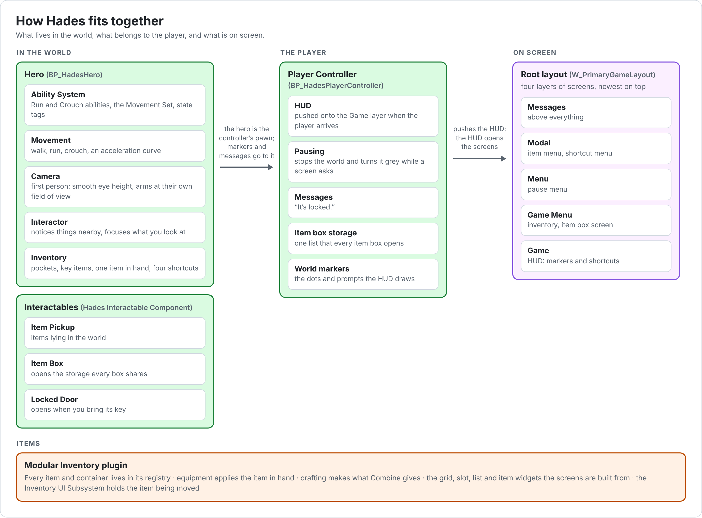

# Hades

A first-person survival horror game for Unreal Engine 5.7. It plays like the Resident Evil games, and most of all like Resident Evil Requiem: one item in hand, shortcuts on the number keys and the D-pad, pockets that grow when you find hip pouches, key items that take no space, item boxes that share one storage, and menus that stop the world and turn it grey.

These pages describe how the game works and how it is set up, in code and in the editor. Items and containers come from the **Modular Inventory** plugin in `Plugins/ModularInventory`, which has its own [README](../Plugins/ModularInventory/README.md). These pages cover what Hades builds on top of it.



## Documents

| Document | What it covers |
| --- | --- |
| **README** (this page) | Overview, project settings, folders and names, gameplay tags, debugging, what isn't built yet, and the rules the code follows. |
| [Gameplay](Gameplay.md) | The player controller, the hero, moving, running and crouching, abilities, the camera, input, and the player's settings. |
| [Interaction](Interaction.md) | Interactables and the interactor, world markers, pickups, item boxes and locked doors. |
| [Inventory](Inventory.md) | The game's inventory rules: pockets, key items, the item in hand, shortcuts, using, combining and discarding items, guns and ammo, pouches, auto sort and the item box. |
| [UI](UI.md) | How the UI works: layers, screens, pausing, the HUD, messages, the inventory screen and its menus, input, key icons and the action bar. |
| [UI Reference](UIReference.md) | Every UI asset as it is built in the editor: its widget hierarchy, every property changed from its default, its graph, its Class Defaults, and what its C++ class does. |
| [Inventory Setup](InventorySetup.md) | Step by step: the gameplay side in the editor, from an empty `Content` folder to a test level. |
| [Inventory UI Setup](InventoryUISetup.md) | Step by step: the whole UI, with the steps for updating from each patch. |
| [Modular Inventory](../Plugins/ModularInventory/README.md) | The inventory plugin: items, containers, equipment, crafting, loot, its widgets and editor tools. |

The setup guides say how to build things; the other pages say how they work and what they are once built. When they disagree, the code is right, and the page should be fixed.

## Contents

1. [Overview](#1-overview)
2. [Project setup](#2-project-setup)
3. [Source code](#3-source-code)
4. [Content](#4-content)
5. [Gameplay tags](#5-gameplay-tags)
6. [Debugging](#6-debugging)
7. [Not built yet](#7-not-built-yet)
8. [Rules for the code](#8-rules-for-the-code)

---

## 1. Overview

### 1.1 Features

| Area | What you get |
| --- | --- |
| Hero | A first-person character whose camera follows crouching smoothly, with arms drawn at their own field of view so they don't stretch at the edges of the screen. |
| Movement | Walking, running and crouching. Acceleration, braking and friction change with speed through one curve. |
| Abilities | Running and crouching are Gameplay Abilities bound to input by tag. Each input can be held, or set to toggle per player. A Move Speed Multiplier attribute scales every speed. |
| Camera | Field of view changes, such as while running, from camera modifiers that blend in while the hero has a state tag. |
| Input | Enhanced Input actions found by gameplay tag, from one data asset per character. |
| Interaction | A dot over things nearby, a prompt with the key's icon over the thing you look at, interactions you hold with a progress ring, and markers hidden behind walls. |
| Inventory | One item in hand that stays in its place in the pockets, four shortcuts, key items in their own list, combining herbs and gunpowder, loading guns from their ammo, dropping items on the floor, auto sort, and pouches that grow the pockets. |
| World | Pickups that tell you when there's no room, item boxes that share one storage, and doors that stay locked until you bring the key. |
| UI | Common UI screens on four layers, a HUD whose shortcuts appear when you use one, an inventory with tabs that plays like Requiem's, item menus that open beside the item, an action bar with key icons for keyboard and gamepad, and messages over everything. |
| Pausing | Menus that stop the world turn it grey behind them and hide the HUD. |
| Debugging | A log category per area, and console variables that draw the interaction checks. |

### 1.2 How it fits together

- The **player controller** keeps what belongs to the player rather than to the body: the HUD, pausing, messages, the item box storage and the world markers. See [Gameplay 2](Gameplay.md#2-player-controller).
- The **hero** is what the player does: moving, abilities, the camera, interacting and carrying items. See [Gameplay 3](Gameplay.md#3-characters).
- **Interactables** are actors with a Hades Interactable Component: pickups, item boxes and locked doors. The hero's interactor finds them, and the HUD draws their markers. See [Interaction](Interaction.md).
- The **inventory** is the Modular Inventory plugin's registry of items and containers. The Hades Inventory Component adds the game's rules on top of it. See [Inventory](Inventory.md).
- The **UI** is a stack of Common UI layers. The controller pushes the HUD; the HUD opens the inventory and the pause menu; an item box opens the item box screen; the inventory screen opens its menus. See [UI](UI.md).

### 1.3 Modules and plugins

| Module or plugin | Where | What Hades uses it for |
| --- | --- | --- |
| `Hades` | `Source/Hades` | The game. Everything in these pages. |
| Modular Inventory | `Plugins/ModularInventory` | Items, containers, equipment, crafting, and the inventory widgets the Hades widgets build on. |
| Common Game | `Plugins/CommonGame` | The UI manager, the UI policy and the root layout with its layers, and the base classes of the game instance, local player and player controller. |
| Common User, UI Extension | `Plugins/CommonUser`, `Plugins/UIExtension` | Needed by Common Game. |
| Modular Gameplay Actors | `Plugins/ModularGameplayActors` | The base class of Common Game's player controller. |
| Async Mixin | `Plugins/AsyncMixin` | Loading world marker widgets in the background. |
| Easy Multi Save | `Plugins/EasyMult…` | Nothing yet. It is meant for saving ([7](#7-not-built-yet)). |
| Common UI, Common Input | Engine | Screens, buttons, focus, input routing, the action bar and key icons. |
| Gameplay Abilities | Engine | Abilities, attributes and effects. |
| Enhanced Input | Engine | Input actions and mapping contexts. |
| Component Picker | Engine | The component pickers on the Hades Interactable Component. |

### 1.4 Requirements

- Unreal Engine 5.7, and Visual Studio with the **Development Editor** configuration on **Win64**.
- The plugins **Modular Inventory**, **Common UI**, **Gameplay Abilities**, **Enhanced Input**, **Common Game**, **Common User**, **Async Mixin**, **Modular Gameplay Actors** and **UI Extension** enabled under **Edit › Plugins**.
- Singleplayer. Nothing replicates.

### 1.5 Glossary

| Term | Meaning |
| --- | --- |
| Hero | The player's character: `AHadesHeroCharacter`, made in the editor as `BP_HadesHero`. |
| Interactable | An actor with a Hades Interactable Component. |
| Interactor | The hero's component that finds interactables and interacts with them. |
| Nearby | An interactable within 7.5 m of the hero. It shows its marker. |
| Focused | The nearby interactable the hero looks at, within 1.5 m. It shows its prompt, and Interact uses it. |
| World marker | A widget drawn over a point in the world, such as an interactable's dot or prompt. |
| Layer | One of the four stacks of screens in the root layout: Game, Game Menu, Menu and Modal. |
| Screen | A Common UI activatable widget pushed onto a layer, such as the inventory. While active it sets the input mode, and it can stop the world. |
| Pause request | A screen asking the player controller to stop the world. The world runs again once no screen asks. |
| Pockets | The hero's grid of items, `Container.Pockets`. |
| Key items | Items tagged `Item.Type.KeyItem`. They go in their own list and take no pocket space. |
| In hand | The one item the hero holds. It stays in its cell in the pockets. |
| Shortcut, quick slot | One of four slots on 1–4 and the D-pad that draws, puts away or uses its item. The code says quick slot; the screens say shortcut, as Requiem does. |
| Item box | A box that opens one storage, shared by every box in the game. |
| Input tag | A gameplay tag under `Input.` that names an input action, such as `Input.Interact`. |
| Action row | A row of `DT_UIInputActions`: a UI action's name, its keys and its place in the action bar. |

---

## 2. Project setup

The repository holds `Source`, `Plugins`, `Docs` and `SourceArt`. The project file, `Config` and `Content` live in your local project; these pages describe them as the setup guides build them.

### 2.1 Build and open

1. Close the editor.
2. Right-click `Hades.uproject` and choose **Generate Visual Studio project files**. Do this again whenever source files are added or removed.
3. Open the solution, select **Development Editor** and **Win64**, and build the **Hades** project.
4. Start the editor. If it asks about an Asset Manager entry for **GameFeatureData**, click **Yes**.

### 2.2 Project settings

| Where | Setting | Value | Why |
| --- | --- | --- | --- |
| Project › Maps & Modes | Game Instance Class | `HadesGameInstance` | Common Game gives each local player its root layout through the game instance. |
| Project › Maps & Modes | Default GameMode | `BP_HadesGameMode` | Spawns `BP_HadesHero` with `BP_HadesPlayerController`. |
| Engine › General Settings › Default Classes | Game Viewport Client Class | `CommonGameViewportClient` | Lets Common UI route input. |
| Engine › General Settings › Default Classes | Local Player Class | `CommonLocalPlayer` | The local player Common Game gives a root layout. |
| Engine › Input › Default Classes | Default Player Input Class, Default Input Component Class | `EnhancedPlayerInput`, `EnhancedInputComponent` | Enhanced Input. The hero makes its own Hades Input Component either way. |
| Engine › Collision › Trace Channels | `Interaction` | Default Response **Ignore**; the first custom trace channel | The C++ uses it as `ECC_GameTraceChannel1` to find interactables ([Interaction 1](Interaction.md#1-how-interaction-works)). |
| Game › Common Input Settings | Input Data | `B_CommonInputData` | Confirm and Back for every menu ([UI Reference 2.3](UIReference.md#23-b_commoninputdata)). |
| Game › Common Input Settings › Platform Input › Windows | Default Input Type, Supports Mouse and Keyboard, Supports Gamepad, Default Gamepad Name, Controller Data | Mouse and Keyboard; ticked; ticked; Generic; `CID_KeyboardMouse`, `CID_Gamepad` | Key icons for the keyboard and gamepads ([UI Reference 2.4](UIReference.md#24-cid_keyboardmouse-and-cid_gamepad)). |
| Game › Common UI Input Settings | Input Actions | `UI.Action.Escape`: Escape, Gamepad Special Right. `UI.Action.Inventory`: Tab, Gamepad Special Left. | The keys of the two actions the HUD and the inventory bind by tag ([UI 13.1](UI.md#131-ui-actions)). |
| Game › Asset Manager | Primary Asset Types to Scan | `GameFeatureData` and `InventoryItem` entries | Needed by the Modular Inventory plugin. See its README, 2.2. |

And in `Config/DefaultGame.ini`, the UI policy Common Game loads ([UI 2](UI.md#2-layers-and-the-root-layout)):

```ini
[/Script/Hades.HadesUIManagerSubsystem]
DefaultUIPolicyClass=/Game/UI/Foundation/B_HadesUIPolicy.B_HadesUIPolicy_C
```

### 2.3 Editor preferences

| Where | Setting | Value | Why |
| --- | --- | --- | --- |
| General › Keyboard Shortcuts › Play World (PIE/SIE) | Stop | **Shift + Escape** | Escape then reaches the game, for the pause menu and backing out of menus. |
| Level Editor › Play › Play in Editor | Game Gets Mouse Control | ticked | The mouse turns the camera as soon as Play starts. |

---

## 3. Source code

### 3.1 Folders

Everything is in `Source/Hades`:

| Folder | Contents |
| --- | --- |
| (root) | The module, its log categories (`Hades.h`), gameplay tags (`HadesGameplayTags`) and collision channels (`HadesCollisionChannels.h`). |
| `AbilitySystem` | The Ability System Component, the base ability, and the Movement Set. |
| `Camera` | The player camera manager, the FOV camera modifier and the camera function library. |
| `Character` | The character base class, the movement component, the Run and Crouch abilities, and the hero in `Character/Hero`. |
| `Game` | The game instance and the game mode. |
| `Input` | The input config data asset and the input component. |
| `Interaction` | The interactable and interactor components. |
| `Inventory` | The Hades Inventory Component, quick slots, pickups, item boxes and locks. |
| `Player` | The player controller, and the player's settings with the subsystem that loads them. |
| `UI/Foundation` | Base classes for screens, popup menus and tab buttons. |
| `UI/HUD` | The HUD layout and the message widget. |
| `UI/Inventory` | The inventory screen, the item and shortcut menus, and the item, shortcut and in-hand widgets. |
| `UI/Subsystem` | The UI manager subsystem. |
| `UI/WorldMarker` | World markers, their manager, the layer that draws them and their widgets. |
| `UI` | `HadesUIUtility`, a few Blueprint helpers for widgets. |

### 3.2 Classes

| Class | Parent | Made in the editor as | Described in |
| --- | --- | --- | --- |
| `UHadesGameInstance` | `UCommonGameInstance` | (set in Project Settings) | [Gameplay 1](Gameplay.md#1-game-framework) |
| `AHadesGameMode` | `AGameModeBase` | `BP_HadesGameMode` | [Gameplay 1](Gameplay.md#1-game-framework) |
| `AHadesPlayerController` | `ACommonPlayerController` | `BP_HadesPlayerController` | [Gameplay 2](Gameplay.md#2-player-controller) |
| `AHadesPlayerCameraManager` | `APlayerCameraManager` | (used directly) | [Gameplay 6](Gameplay.md#6-camera) |
| `AHadesCharacterBase` | `ACharacter` | | [Gameplay 3.1](Gameplay.md#31-character-base) |
| `AHadesHeroCharacter` | `AHadesCharacterBase` | `BP_HadesHero` | [Gameplay 3.2](Gameplay.md#32-hero) |
| `UHadesCharacterMovementComponent` | `UCharacterMovementComponent` | | [Gameplay 4](Gameplay.md#4-movement) |
| `UHadesAbilitySystemComponent` | `UAbilitySystemComponent` | | [Gameplay 5.1](Gameplay.md#51-hades-ability-system-component) |
| `UHadesAbility`, `UHadesAbility_Run`, `UHadesAbility_Crouch` | `UGameplayAbility` | | [Gameplay 5](Gameplay.md#5-abilities) |
| `UHadesMovementSet` | `UAttributeSet` | | [Gameplay 5.4](Gameplay.md#54-movement-set) |
| `UHadesCameraModifier_FOV` | `UCameraModifier` | | [Gameplay 6.2](Gameplay.md#62-fov-camera-modifier) |
| `UHadesCameraLibrary` | `UBlueprintFunctionLibrary` | | [Gameplay 6.3](Gameplay.md#63-camera-library) |
| `UHadesInputConfig` | `UDataAsset` | `DA_HeroInputConfig` | [Gameplay 7.2](Gameplay.md#72-input-config) |
| `UHadesInputComponent` | `UEnhancedInputComponent` | | [Gameplay 7.3](Gameplay.md#73-input-component) |
| `UHadesPlayerSettings`, `UHadesPlayerSettingsSubsystem` | `ULocalPlayerSaveGame`, `ULocalPlayerSubsystem` | | [Gameplay 8](Gameplay.md#8-player-settings) |
| `UHadesInteractableComponent` | `UActorComponent` | | [Interaction 2](Interaction.md#2-hades-interactable-component) |
| `UHadesInteractorComponent` | `UActorComponent` | | [Interaction 3](Interaction.md#3-hades-interactor-component) |
| `UHadesWorldMarker`, `UHadesWorldMarkerManagerComponent`, `UHadesWorldMarkerLayer`, `UHadesWorldMarkerWidget` | | | [Interaction 4](Interaction.md#4-world-markers) |
| `UHadesInteractableMarkerWidget` | `UHadesWorldMarkerWidget` | `W_InteractableMarker` | [Interaction 5](Interaction.md#5-interactable-marker-widget) |
| `AHadesItemPickup` | `AActor` | `BP_ItemPickup` | [Interaction 6](Interaction.md#6-pickups) |
| `AHadesItemBox` | `AActor` | `BP_ItemBox` | [Interaction 7](Interaction.md#7-item-boxes) |
| `UHadesLockComponent` | `UActorComponent` | on `BP_LockedDoor` | [Interaction 8](Interaction.md#8-locks-and-locked-doors) |
| `UHadesInventoryComponent` | `UInventoryComponent` | on `BP_HadesHero` | [Inventory 3](Inventory.md#3-hades-inventory-component) |
| `UHadesQuickSlotComponent` | `UActorComponent` | on `BP_HadesHero` | [Inventory 5](Inventory.md#5-shortcuts) |
| `FHadesItemUse`, `FHadesGun` | (fragments) | on item definitions | [Inventory 6](Inventory.md#6-item-actions), [7](Inventory.md#7-guns-and-ammo) |
| `UHadesUIManagerSubsystem` | `UGameUIManagerSubsystem` | | [UI 2](UI.md#2-layers-and-the-root-layout) |
| `UHadesActivatableWidget` | `UCommonActivatableWidget` | `W_EscapeMenu` | [UI 3](UI.md#3-screens) |
| `UHadesHUDLayout` | `UHadesActivatableWidget` | `W_HUD` | [UI 5](UI.md#5-hud) |
| `UHadesMessageWidget` | `UUserWidget` | `W_Message` | [UI 6](UI.md#6-messages) |
| `UHadesPopupMenu` | `UHadesActivatableWidget` | | [UI 7](UI.md#7-popup-menus) |
| `UHadesInventoryScreen` | `UHadesActivatableWidget` | `W_InventoryScreen`, `W_ItemBoxScreen` | [UI 8](UI.md#8-inventory-screen) |
| `UHadesItemMenu` | `UHadesPopupMenu` | `W_ItemMenu` | [UI 9](UI.md#9-item-menu) |
| `UHadesShortcutMenu`, `UHadesShortcutEntry` | `UHadesPopupMenu`, `UCommonButtonBase` | `W_ShortcutMenu`, `W_ShortcutEntry` | [UI 10](UI.md#10-shortcut-menu) |
| `UHadesInventoryItemWidget` | `UInventoryItemWidget` | `W_InventoryItem` | [UI 11.1](UI.md#111-hades-inventory-item-widget) |
| `UHadesQuickSlotWidget` | `UCommonButtonBase` | `W_QuickSlot` | [UI 11.2](UI.md#112-hades-quick-slot-widget) |
| `UHadesEquippedItemWidget` | `UUserWidget` | `W_EquippedItem` | [UI 11.3](UI.md#113-hades-equipped-item-widget) |
| `UHadesTabButton` | `UCommonButtonBase` | `W_TabButton` | [UI 12](UI.md#12-tab-buttons) |
| `UHadesUIUtility` | `UBlueprintFunctionLibrary` | | [UI 15](UI.md#15-ui-utility-library) |

---

## 4. Content

### 4.1 Folders

| Folder | Assets |
| --- | --- |
| `Content/Core` | `BP_HadesPlayerController`, `BP_HadesHero`, `BP_HadesGameMode` |
| `Content/Input` | `IA_Move`, `IA_Look`, `IA_Jump`, `IA_Interact`, `IA_QuickSlot1` to `4`, `IMC_Default`, `DA_HeroInputConfig`, `DT_UIInputActions`, `B_CommonInputData`, `CID_KeyboardMouse`, `CID_Gamepad`, and your key icon textures |
| `Content/Inventory/Layouts` | `CL_Pockets`, `CL_Pockets_2`, `CL_Pockets_3`, `CL_Pockets_4`, `CL_KeyItems`, `CL_ItemBox`, `CL_Pickup` |
| `Content/Inventory/Rules` | `SR_HandgunAmmo`, `ER_OneHanded`, `ER_TwoHanded`, `ER_Light` |
| `Content/Inventory/Effects` | `GE_Heal_Small`, `GE_Heal_Medium`, `GE_Heal_Full` |
| `Content/Inventory/Items` | Every item definition (`DA_Pistol`, `DA_Shotgun`, …), its `_Cosmetics`, its generated icon, and its mesh |
| `Content/Inventory/Recipes` | `RCP_MixedHerbGG`, `RCP_MixedHerbGR`, `RCP_HandgunAmmo`, `RB_Combine` |
| `Content/Inventory/Actors` | `BP_FlashlightLight`, `BP_ItemPickup`, `BP_ItemBox`, `BP_LockedDoor` |
| `Content/UI/Foundation` | `W_PrimaryGameLayout`, `B_HadesUIPolicy`, `W_Panel`, `W_BoundActionButton`, `W_TabButton`, `W_MenuButton`, `W_Message`, `W_EscapeMenu` |
| `Content/UI/Style` | `T_UI_Panel`, `T_UI_Cell`, `T_UI_ItemTile`, the text styles `TS_*` and the button styles `BS_*` |
| `Content/UI/Inventory` | `W_InventoryItem`, `W_SlotItem`, `W_InventoryCell`, `W_InventoryGrid`, `W_InventorySlot`, `W_ItemBoxEntry`, `W_InventoryList`, `W_QuickSlot`, `W_ItemDetails`, `W_EquippedItem`, `W_ItemMenu`, `W_ShortcutEntry`, `W_ShortcutMenu`, `W_InventoryScreen`, `W_ItemBoxScreen` |
| `Content/UI/HUD` | `W_InteractableMarker`, `W_HUD` |

The source art for the three UI textures is in the repository, in `SourceArt/UI`.

### 4.2 Names

| Prefix | Asset |
| --- | --- |
| `BP_` | Blueprint of an actor |
| `W_` | Widget Blueprint |
| `DA_` | Data asset: item definitions and the input config |
| `CL_` | Container Layout |
| `SR_`, `ER_` | Stack Rules, Equip Rules |
| `GE_` | Gameplay Effect |
| `RCP_`, `RB_` | Recipe, Recipe Book |
| `IA_`, `IMC_` | Input Action, Input Mapping Context |
| `DT_` | Data Table |
| `CID_` | Common Input controller data |
| `B_` | Other Blueprint classes, such as the UI policy |
| `TS_`, `BS_` | Common text style, Common button style |
| `T_` | Texture |

Names in `code font` in these pages are exact. The C++ finds widgets and animations by name, so a widget named differently isn't found.

---

## 5. Gameplay tags

Every tag the game uses is declared in C++, in `HadesGameplayTags.h` and `.cpp`, so none need adding in the editor. The Modular Inventory plugin declares `Inventory.Item.Level` itself.

| Tag | Meaning | Used by |
| --- | --- | --- |
| `Ability.Run`, `Ability.Crouch` | The Run and Crouch abilities. Each cancels the other. | [Gameplay 5.3](Gameplay.md#53-run-and-crouch) |
| `Character.State.Running`, `Character.State.Crouching` | On the character's Ability System Component while it runs or crouches. | Camera modifiers, abilities |
| `Interactable.State.Nearby`, `.Focused`, `.Occluded`, `.Disabled`, `.Interacting` | An interactable's state, passed on to its marker. | [Interaction 1](Interaction.md#1-how-interaction-works) |
| `Interactable.Event.Completed`, `.Cancelled` | One-shot events sent to an interactable's marker. | [Interaction 5](Interaction.md#5-interactable-marker-widget) |
| `UI.Layer.Game`, `.GameMenu`, `.Menu`, `.Modal` | The root layout's layers. | [UI 2](UI.md#2-layers-and-the-root-layout) |
| `UI.Action.Escape`, `UI.Action.Inventory` | UI actions bound by tag. Their keys are in Common UI Input Settings. | [UI 13.1](UI.md#131-ui-actions) |
| `Input.Move`, `.Look`, `.Jump`, `.Run`, `.Crouch`, `.Interact` | Input tags of the hero's actions. | [Gameplay 7](Gameplay.md#7-input) |
| `Input.QuickSlot.1` to `.4` | The four shortcut keys. | [Inventory 5](Inventory.md#5-shortcuts) |
| `Container.Pockets`, `.KeyItems`, `.ItemBox`, `.Pickup` | Container names. | [Inventory 2](Inventory.md#2-containers) |
| `Equipment.Slot.Hand.Right`, `.Left` | The hands the item in hand is equipped to. | [Inventory 4](Inventory.md#4-the-item-in-hand) |
| `Item.Type.KeyItem` | A key item: its own list, can't be discarded or stored. | [Inventory 8](Inventory.md#8-key-items) |
| `Item.Type.Pouch` | Taking it grows the pockets. | [Inventory 9](Inventory.md#9-pouches) |
| `Item.Stat.Uses` | Tag value: how many locks a key still opens. | [Inventory 8](Inventory.md#8-key-items) |
| `Item.Stat.Rounds` | Tag value: rounds in a gun, once it has been loaded or fired. | [Inventory 7](Inventory.md#7-guns-and-ammo) |

---

## 6. Debugging

| Tool | How |
| --- | --- |
| Logs | Categories `LogHadesInput`, `LogHadesInteraction`, `LogHadesUI` and `LogHadesInventory`. The plugin logs to `LogInventory`. For more detail, type `Log LogHadesInteraction Verbose` in the console: interactions then log when they start, complete and cancel. |
| Interaction | Console variables `Hades.Interaction.ShowNearby`, `ShowFocus`, `ShowOcclusion`, `NearbyRadiusOverride` and `FocusDistanceOverride` ([Interaction 10](Interaction.md#10-debugging)). |
| Inventory | `Inventory.Give DA_HandgunAmmo 30` gives items. The Gameplay Debugger's **Inventory** category (the apostrophe key, `'`) shows every container and item. See the plugin README, 17. |
| Abilities | `showdebug abilitysystem` shows the hero's tags, abilities and attributes. |
| Data | Right-click a folder › **Validate Assets**. `DA_HeroInputConfig` reports rows without a tag or action, and tags used twice. |

---

## 7. Not built yet

- **Saving.** Items, shortcuts, lock states, the item box and the player's settings are lost when Play stops. The Easy Multi Save plugin is in `Plugins` for this; the Modular Inventory README, 19, has the plan.
- **Health and damage.** The healing effects change nothing until the hero has a Health attribute.
- **Firing.** Guns keep their rounds, and `SpendRounds` takes them out, but nothing fires yet.
- **Run and crouch keys.** The abilities exist, but the setup guides don't give them keys or grant them. [Gameplay 9.1](Gameplay.md#91-run-and-crouch) does.
- **A settings menu.** The player's toggle settings exist, with no screen to change them.
- **Map, Crafting and Files.** Their tabs are empty pages.
- **A flashlight battery.** See the Modular Inventory README, 16.1.

---

## 8. Rules for the code

- **The plugin stays a plugin.** Modular Inventory knows nothing about Hades, survival horror, guns or key items, so another game could use it. The game's rules go in `Source/Hades`. The plugin changes only for something any game could use, and its README says so.
- **Simple and readable first.** No more machinery than the feature needs.
- **Comments only where the code isn't clear on its own**, such as why something is done a certain way.
- **The C++ does the work; Widget Blueprints hold the look.** Widgets are Blueprint children of C++ classes, which find their parts by name and drive them. The graphs only do small visual things, such as showing a highlight.
- **Tags are declared in C++**, so they can't be lost from an ini file.
- **Docs follow the code.** A change that alters how something works or how it's set up updates these pages, and a UI change also gets update steps in [Inventory UI Setup](InventoryUISetup.md#updating-from-an-earlier-patch).
