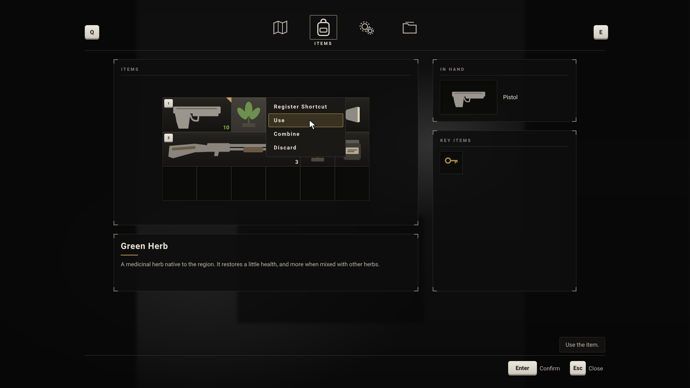
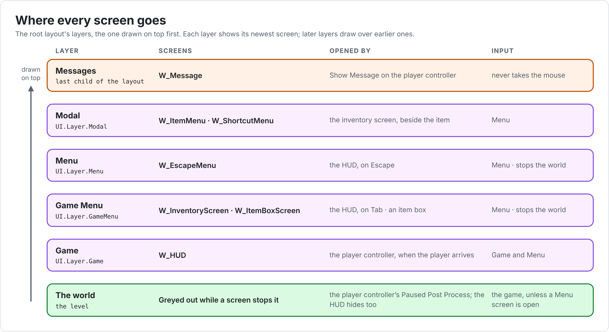
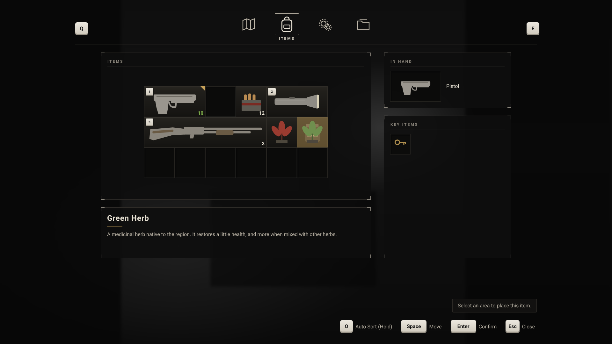
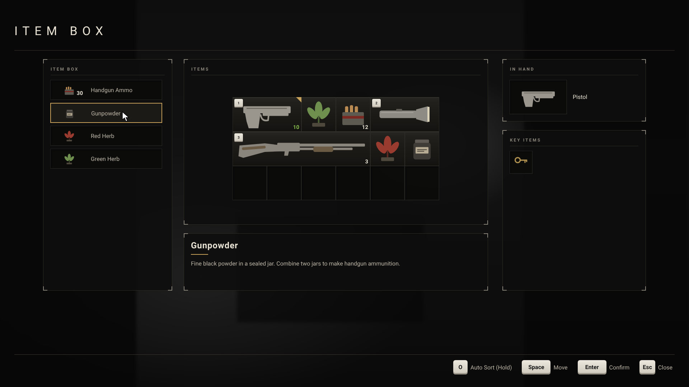
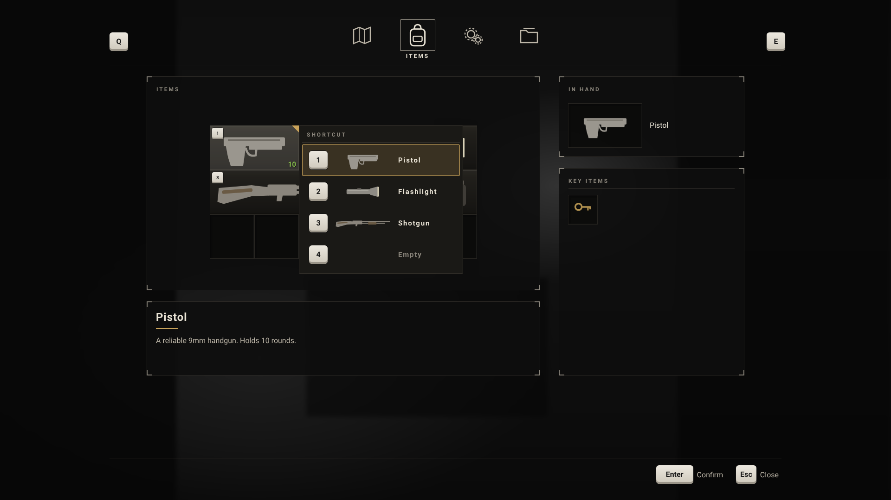

# Hades: UI

How the UI works: the layers screens go on, how screens set input and stop the world, the HUD, messages, the inventory screen and its menus, the widgets inside it, and how keys and their icons reach the screen. How each widget is built in the editor is in the [UI Reference](UIReference.md); how to build them step by step is in [Inventory UI Setup](InventoryUISetup.md).

## Contents

1. [How the UI works](#1-how-the-ui-works)
2. [Layers and the root layout](#2-layers-and-the-root-layout)
3. [Screens](#3-screens)
4. [Pausing](#4-pausing)
5. [HUD](#5-hud)
6. [Messages](#6-messages)
7. [Popup menus](#7-popup-menus)
8. [Inventory screen](#8-inventory-screen)
9. [Item menu](#9-item-menu)
10. [Shortcut menu](#10-shortcut-menu)
11. [Item and slot widgets](#11-item-and-slot-widgets)
12. [Tab buttons](#12-tab-buttons)
13. [Input, key icons and the action bar](#13-input-key-icons-and-the-action-bar)
14. [Style](#14-style)
15. [UI Utility library](#15-ui-utility-library)
16. [How-to guides](#16-how-to-guides)
17. [Troubleshooting](#17-troubleshooting)

---

## 1. How the UI works

- **Common Game** gives each local player a **root layout**, `W_PrimaryGameLayout`, with four layers. Screens are pushed onto a layer by its tag, and the top screen of each layer is the active one.
- **Every screen is an activatable widget.** While active, it decides whether input goes to the game, the UI or both, and it can stop the world.
- **The C++ does the work; Widget Blueprints hold the look.** Each widget is a Blueprint child of a C++ class. The class finds the parts it needs by name, such as `MainGrid` or `MenuPanel`, and drives them. Graphs only do small visual things, such as showing a highlight.
- **The inventory widgets come from the Modular Inventory plugin**: the grid, cells, slots, lists, item details and the Inventory UI Subsystem, which holds the item being moved. Hades adds the screens, the menus and the marks on items. See the plugin's README, 11.
- **Keys reach screens as UI actions**: two by gameplay tag, the rest as rows of `DT_UIInputActions`, which also give the action bar its names and key icons ([13](#13-input-key-icons-and-the-action-bar)).

---

## 2. Layers and the root layout

| Layer tag | Stack in `W_PrimaryGameLayout` | What goes there | Pushed by |
| --- | --- | --- | --- |
| `UI.Layer.Game` | `GameLayer_Stack` | `W_HUD` | The player controller, when the player arrives |
| `UI.Layer.GameMenu` | `GameMenuLayer_Stack` | `W_InventoryScreen`, `W_ItemBoxScreen` | The HUD (Inventory action); an item box |
| `UI.Layer.Menu` | `MenuLayer_Stack` | `W_EscapeMenu` | The HUD (Escape action) |
| `UI.Layer.Modal` | `ModalLayer_Stack` | `W_ItemMenu`, `W_ShortcutMenu` | The inventory screen |

Later stacks draw on top. `W_Message` is the root layout's last child, so messages draw above every layer ([6](#6-messages)).

**How the root layout is made.** `UHadesUIManagerSubsystem` is the game's UI manager. Common Game needs one of its own type, and reads its **Default UI Policy Class** from `Config/DefaultGame.ini` ([README 2.2](README.md#22-project-settings)): `B_HadesUIPolicy`, a Game UI Policy Blueprint whose **Layout Class** is `W_PrimaryGameLayout`. When a local player is added, the policy creates the layout for them. The layout registers its four stacks with their tags in its graph.

**The UI manager also:**

- **Hides all UI while the HUD is hidden.** Every frame, the root layout is collapsed while the player's HUD has **Show HUD** off, such as after the `ShowHUD` console command, and shown again after.
- **Stops Space from pressing buttons.** By default, Slate presses the focused button on Space as on Enter. That would beat any UI action bound to Space, such as the inventory's Move, so the UI manager removes Space from navigation while the game runs, and puts the old navigation back when it ends, as the editor shares it.

---

## 3. Screens

`UHadesActivatableWidget` is the base of every Hades screen. It is a Common UI activatable widget that sets the player's input mode while it is active, and can stop the world.

| Category | Field | Default | Description |
| --- | --- | --- | --- |
| Input | Input Config | Default | Where input goes while this is active. See below. |
| Input | Game Mouse Capture Mode | Capture Permanently | How the mouse is captured while the game gets input. |
| Pause | Pause Game | unticked | Stops the world while this is active ([4](#4-pausing)). |
| Input | Confirm Action | none | An action row shown in the action bar for what Accept does here, such as `Confirm`. It's only shown: Accept still goes to the focused button. |

| Input Config | Input goes to | Mouse |
| --- | --- | --- |
| Default | Unchanged | Unchanged |
| Game and Menu | The game and the UI | Game Mouse Capture Mode |
| Game | The game only. Common UI then ignores UI actions such as Tab and Escape. | Game Mouse Capture Mode |
| Menu | The UI only | Free, with a cursor |

| Screen | Class | Input Config | Pause Game | Is Back Handler |
| --- | --- | --- | --- | --- |
| `W_HUD` | `HadesHUDLayout` | Game and Menu | | |
| `W_InventoryScreen`, `W_ItemBoxScreen` | `HadesInventoryScreen` | Menu | ticked | ticked |
| `W_EscapeMenu` | `HadesActivatableWidget` | Menu | ticked | ticked |
| `W_ItemMenu`, `W_ShortcutMenu` | `HadesItemMenu`, `HadesShortcutMenu` | Menu | | ticked |

The defaults in the C++ classes already match the table, except for `W_EscapeMenu`, which sets its own.

Compiling a screen whose Blueprint doesn't implement **Get Desired Focus Target** gives a note: gamepads then have nothing to start on. The inventory screens and menus focus something in C++, so the note can be ignored for them.

Close a screen with Back or **Deactivate Widget**, never **Remove From Parent**: a screen that stops the world releases its pause request when it is deactivated.

---

## 4. Pausing

- A screen with **Pause Game** adds a pause request to the player controller when it is activated, and removes it when it is deactivated.
- While any request is open, the controller pauses the game, collapses the HUD, and turns on its `PausedPostProcess`, which takes all color out of the world ([Gameplay 2](Gameplay.md#2-player-controller)).
- The UI is drawn after post processing, so menus keep their colors. Behind the inventory, a light blur and dim let the grey room show through, as in Requiem.
- Widget animations play while the game is paused, so messages fade in menus too.

---

## 5. HUD

`UHadesHUDLayout` is the player's HUD, pushed onto `UI.Layer.Game` by the player controller. `W_HUD` is made from it ([UI Reference 8.2](UIReference.md#82-w_hud)).

| Category | Field | Description |
| --- | --- | --- |
| HUD | Escape Menu Class | Pushed onto `UI.Layer.Menu` on `UI.Action.Escape`. `W_EscapeMenu`. |
| HUD | Inventory Screen Class | Pushed onto `UI.Layer.GameMenu` on `UI.Action.Inventory`. `W_InventoryScreen`. |
| Input | Input Config | **Game and Menu** by default. With Game alone, Common UI ignores the two actions above. |

| Named part | Type | Description |
| --- | --- | --- |
| `ShowQuickSlotsAnimation` | Animation, optional | Played from the start whenever a shortcut key is pressed, even one with nothing on it. `W_HUD` uses it to show its shortcuts for a couple of seconds, as the RE games do. |

The HUD is made before the hero exists, so it finds the quick slot component again whenever the player's pawn changes.

`W_HUD` holds the world marker layer, which draws the dots and prompts over interactables ([Interaction 4](Interaction.md#4-world-markers)), and the four shortcuts in a cross laid out like the D-pad.

---

## 6. Messages

The player controller's **Show Message** tells the player something, such as "It's locked." ([Inventory 12](Inventory.md#12-messages) lists them all).

`UHadesMessageWidget` shows them. `W_Message` is made from it and sits in the root layout, after the layers, so a message shows the same way in the world, in the inventory and over a menu.

| Named part | Type | Required | Description |
| --- | --- | --- | --- |
| `MessageText` | Text Block | yes | Set to each message. Empty at the start. |
| `ShowAnimation` | Animation | no | Played from the start for every message: `W_Message` fades in, holds and fades out over three seconds. |

---

## 7. Popup menus

`UHadesPopupMenu` is a small menu pushed onto `UI.Layer.Modal` beside something on screen, such as an item. The item menu and the shortcut menu are popup menus.

| Named part | Type | Required | Description |
| --- | --- | --- | --- |
| `MenuPanel` | Any widget | yes | The menu itself. It must be inside a Canvas Panel that fills the screen, with **Size To Content** ticked, so it can be moved. |

**How it works**

- **Placing.** It opens beside its anchor, a box on screen such as the item's, toward the middle of the screen, so it never runs off an edge: to the right of an anchor on the left half of the screen and to the left of one on the right half; level with the anchor's top and running down in the upper half, level with its bottom and running up in the lower half. `PlaceBeside` is C++ only.
- **Clicks.** The menu's root is a full-screen, hit-testable border, so every click reaches the menu and nothing behind it can be hovered while it's open. A click inside `MenuPanel` works as normal. A click anywhere else closes the menu, except on the anchor, as in Requiem: there, a click does nothing, and dragging closes the menu and starts dragging the item.
- **Back** closes it. Its input config is **Menu**.
- Since a click elsewhere closes the menu on the press, letting go over another item opens that item's menu: one click switches menus.

---

## 8. Inventory screen

`UHadesInventoryScreen` is the player's inventory. `W_InventoryScreen` and `W_ItemBoxScreen` are made from it ([UI Reference 7](UIReference.md#7-screens)). The HUD pushes the inventory on Tab; an item box pushes the item box screen.

### 8.1 How it plays

| You do | It does |
| --- | --- |
| Tab | Opens the inventory on the Items tab. The world behind it stops and turns grey; the inventory keeps its colors. Tab, or Close (Escape), closes it. |
| Q or E | Switches tabs: Map, Items, Crafting, Files. Only Items works for now; the others are empty pages. |
| Click an item, or press Confirm on it | Its item menu opens beside it, with only what that item can do now. The item lights up and nothing else can be hovered. A hint above the action bar says what the highlighted option does. Close shuts the menu. |
| Drag an item, or press Move over it | It sits on the cells under the cursor or the gamepad focus, on a gold background, or a red one where it can't go. Its old spot looks empty, and the details show it. Let go, or press Confirm, to put it down. The hint says "Select an area to place this item." |
| Put it down on an item of the same size and shape | It snaps onto that item and they trade places: that item is picked up in turn. Put it down the same way, or press Close to leave it where the first item was. Items of different sizes don't swap: the spot shows red. |
| Rotate, or Q or E, while moving | Turns the item, if it turns and still fits the pockets. Rotate only shows in the action bar while you move something that can turn. |
| Register Shortcut | The shortcut menu opens beside the item. Pick a shortcut, and its key icon appears in the item's top-left corner. Pick the one it's already on to take it off. |
| Equip | The item stays where it is, with a gold corner, and shows under IN HAND. |
| Combine | The hint says "Select an item to combine with."; click the second item. Close cancels. |
| Hold Auto Sort | Repacks the pockets. |
| Click another item while a menu is open | The menu closes and that item's menu opens. |

### 8.2 Named parts

All are optional. A screen without `Pages` has no tabs; a screen with `ItemBoxList` is an item box screen.

| Named part | Type | Description |
| --- | --- | --- |
| `MainGrid` | Inventory Grid Widget | The pockets. Its first cell takes gamepad focus when the screen opens, and menus open beside its items. |
| `ItemBoxList` | Inventory List Widget | Shows the item box and turns on Store and Take ([8.6](#86-item-box-mode)). |
| `ActionHint` | Any widget | Holds `ActionHintText`. Hidden, not collapsed, while there's nothing to say, so the page above doesn't move. |
| `ActionHintText` | Text Block | What to do now, or what the highlighted menu option does. |
| `TabBar` | Any panel | A button per page, in the same order as `Pages`. Hades Tab Buttons show which one is open. |
| `Pages` | Widget Switcher | The pages. |

### 8.3 Settings

| Category | Field | Default | `W_InventoryScreen` | Description |
| --- | --- | --- | --- | --- |
| Inventory | Item Menu Class | none | `W_ItemMenu` | Pushed onto `UI.Layer.Modal` beside the item clicked. |
| Inventory | Shortcut Menu Class | none | `W_ShortcutMenu` | Pushed by Register Shortcut. Empty hides Register Shortcut. |
| Tabs | Items Page | 1 | 1 | The page with the items, counting from 0. The screen opens on it. |
| Input | Move Action | none | `Move` | Picks up the item under the cursor or focus, and puts the held item down. |
| Input | Organize Action | none | `Organize` | Auto Sort. |
| Input | Rotate Action | none | `Rotate` | Turns the held item. |
| Input | Split Action | none | empty | Halves the held stack. Requiem has none. |
| Input | Previous Tab Action, Next Tab Action | none | `PreviousTab`, `NextTab` | Change the page, or turn the held item. |
| Input | Confirm Action | none | `Confirm` | Shown in the action bar ([3](#3-screens)). |
| Hints | Move Hint | "Select an area to place this item." | | The hint while an item is moved. |
| Hints | Combine Hint | "Select an item to combine with." | | The hint while choosing the second item to combine. |
| Hints | Idle Hint | empty | empty | The hint the rest of the time. Empty hides it. |

The actions are rows of `DT_UIInputActions`; an action left empty does nothing and isn't shown. The C++ sets **Input Config** Menu, **Pause Game** and **Is Back Handler**. `W_InventoryScreen` also ticks **Is Back Action Displayed in Action Bar** and **Auto Restore Focus**.

### 8.4 Actions

Each action is only bound while it can work, so the action bar always shows what works now:

| Action | Bound while | Does |
| --- | --- | --- |
| Move | On the Items page, and something is held, or the item under the cursor or focus can be moved | Puts the held item down where it's drawn, or picks up the item under the cursor or focus. Not while choosing an item to combine. |
| Organize | On the Items page | Puts back anything held, then Organize Pockets. "Couldn't organize your pockets." if it fails. Not while choosing an item to combine. |
| Rotate | On the Items page, while the held item can turn and still fit | Rotate Held. |
| Split | On the Items page, while holding a stack of more than one that can split | Split Held. |
| Previous Tab, Next Tab | The screen has `Pages` | Turn the held item while moving one, as in Requiem; otherwise go to the previous or next page, wrapping round. |
| `UI.Action.Inventory` | Always | Closes the screen, so Tab toggles it. |
| Back | Always | Stops choosing an item to combine; or else puts back the held item; or else closes the screen. |

Items in the key item list can't be moved: Move isn't bound over them.

### 8.5 Item menus and actions

- **On opening**, the screen sets the plugin's Inventory UI Subsystem to play like Requiem: **Click Opens Item Menu**, **Swap Picks Up Other** and **Snap Held Item** on. It listens to the subsystem for item menus, held items, hovering and combining, and opens on the Items page.
- **A click or Accept on an item** asks for its item menu. The screen opens `W_ItemMenu` beside it if the item can do anything, it isn't choosing an item to combine, and it's on the Items page. It puts back anything held and marks the item as selected, which lights it up.
- **When a menu closes**, the hint goes back to the screen's own, and the item is unselected, unless the player is now choosing an item to combine with.
- **Dragging the item a menu is open on** closes the menu and starts dragging the item.
- **Running an action** ([Inventory 6](Inventory.md#6-item-actions)): the menu closes first, so the screen has focus again for whatever the action starts. Combine marks the first item, and the next item picked completes it. Store and Take tell the player when they fail.
- **Can Run Item Action** and **Run Item Action** (Action, Item) are Blueprint-callable, for screens of your own.
- **On closing**, the screen drops whatever is held, chosen, hovered or selected. Nothing moves until an item is put down, so closing is always safe.

### 8.6 Item box mode

A screen with `ItemBoxList` is an item box screen:

- On opening, the list is pointed at the player controller's item box storage ([Inventory 11](Inventory.md#11-the-item-box)).
- **Store** and **Take** appear in the item menu.
- Menus for items outside the pockets' grid, such as in the box or the key item list, open beside the gamepad's focus, or at the cursor.
- `W_ItemBoxScreen` has no `Pages`, so no tabs.

### 8.7 Tabs and pages

- Each button in `TabBar` opens the page with the same index when clicked.
- Changing the page sets the open tab with **Set Active** on Hades Tab Buttons.
- Off the Items page, the screen drops whatever is held and unbinds the item actions. Back on it, a gamepad's focus returns to the items.

---

## 9. Item menu

`UHadesItemMenu` lists what can be done with one item. `W_ItemMenu` is made from it ([UI Reference 6.11](UIReference.md#611-w_itemmenu)).

| Named part | Type | Description |
| --- | --- | --- |
| `MenuPanel` | Any widget, required | See [7](#7-popup-menus). |
| `ShortcutButton`, `UseButton`, `EquipButton`, `UnequipButton`, `CombineButton`, `DiscardButton`, `StoreButton`, `TakeButton` | Common Button, optional | One per action. Each only shows while its action can run. |
| `ItemNameText` | Text Block, optional | The item's name. `W_ItemMenu` doesn't have one. |

| Category | Field | Description |
| --- | --- | --- |
| Item Menu | Descriptions | The hint for each action, shown above the action bar while its button is hovered or focused. |

| Action | Description (default) |
| --- | --- |
| Shortcut | Put the item on a shortcut key. |
| Use | Use the item. |
| Equip | Hold the item in your hands. |
| Unequip | Put the item away. |
| Combine | Combine the item with another one. |
| Discard | Drop the item here. |
| Store | Put the item in the item box. |
| Take | Take the item from the item box. |

The first button that shows takes focus, and its description shows. Gamepad focus moves Common UI's hidden cursor onto a button, so hovering covers both.

---

## 10. Shortcut menu

`UHadesShortcutMenu` is the list **Register Shortcut** opens: one entry per quick slot, with its key's icon and what's on it now. `W_ShortcutMenu` and `W_ShortcutEntry` are made from it and from `UHadesShortcutEntry` ([UI Reference 6.13](UIReference.md#613-w_shortcutmenu)).

| Category | Field | Description |
| --- | --- | --- |
| Shortcut Menu | Entry Class | A Hades Shortcut Entry. `W_ShortcutEntry`. |

| Named part | Type | Description |
| --- | --- | --- |
| `MenuPanel` | Any widget, required | See [7](#7-popup-menus). |
| `EntryPanel` | Any panel, required | Gets one entry per quick slot, in order. |

- The entries are made again each time it opens, as the stack reuses menus.
- The entry of the shortcut the item is on takes focus; otherwise the first.
- Picking an entry puts the item on that shortcut, taking it off any other. Picking the one it's already on takes it off. The menu then closes.

**Shortcut entry** (`UHadesShortcutEntry`, a Common button):

| Named part or field | Type | Description |
| --- | --- | --- |
| `KeyIcon` | Common Action Widget, optional | The shortcut's key, from the quick slot component's Slot Keys. |
| `ItemWidget` | Inventory Item Widget, optional | What's on the shortcut. Hidden while it's empty. |
| `NameText` | Text Block, optional | The item's name, or Empty Text. |
| Shortcut › Empty Text | Text | `W_ShortcutEntry`: "Empty". |

---

## 11. Item and slot widgets

The grid, cells, slots, lists and item details are the plugin's widgets ([UI Reference 6](UIReference.md#6-inventory-pieces), and the plugin README, 11.2). Hades adds these:

### 11.1 Hades Inventory Item Widget

`UHadesInventoryItemWidget` is the plugin's item widget with the game's marks on it. `W_InventoryItem`, the item in the grid, is made from it.

| Named part or field | Type | Description |
| --- | --- | --- |
| `ShortcutKey` | Common Action Widget, optional | The key of the shortcut the item is on. It hides itself while the item has none. |
| `EquippedMarker` | Any widget, optional | Shown while the item is in hand. |
| `Background` | Any widget, optional | Covers the item's cells, so a big item reads as one. Hidden on the stand-in drawn for an item being moved, so what's under it shows through. |
| `AmmoText` | Text Block, optional | A gun's rounds, colored by how full it is. Collapsed for anything else. |
| Inventory › Item › Ammo Colors | Full, Partly, Empty | `8CC152` green when full, `E8E2D4` white when partly loaded, `D9534F` red when empty. |

The plugin's parts are there too: `Icon`, `CountText`, and the events On Held Changed, On Hovered Changed and On Selected Changed. The marks refresh when the shortcuts or the item in hand change, and when the item changes.

### 11.2 Hades Quick Slot Widget

`UHadesQuickSlotWidget` is one shortcut, such as in the HUD: its key, its item, and whether that item is in hand. It is a Common button. `W_QuickSlot` is made from it.

| Named part or field | Type | Description |
| --- | --- | --- |
| Quick Slot › Slot Index | Number | 0 is the first shortcut, on `Input.QuickSlot.1`. Set on each placed shortcut. |
| `ItemWidget` | Inventory Item Widget, optional | What's on it. Hidden, not collapsed, while it's empty, so a Size Box around it keeps its size. |
| `KeyIcon` | Common Action Widget, optional | The shortcut's key, from the quick slot component's Slot Keys. |
| `NumberText` | Text Block, optional | Slot Index + 1. `W_QuickSlot` uses the key icon instead. |
| `AmmoText` | Text Block, optional | The rounds in a gun on it, colored as on the item. |
| `SpareAmmoText` | Text Block, optional | The rounds for that gun in the inventory, such as "/12". |
| Quick Slot › Ammo Colors | | As on the item widget. |
| **On In Hand Changed** (Is In Hand) | Event | For a highlight while its item is in hand. |

- Dropping a held item on it, or pressing Accept on it while holding one, puts that item on the shortcut. The item stays where it is. Items that can't be held or used are refused with a message.
- Right-click empties it.
- The HUD's shortcuts don't take the mouse, and the HUD is hidden while the inventory is open, so the two points above only matter for a quick slot widget placed on a screen.
- It refreshes when the shortcuts change, and on every inventory change, so the rounds stay right.

### 11.3 Hades Equipped Item Widget

`UHadesEquippedItemWidget` shows the item in hand, such as in the inventory's IN HAND panel. `W_EquippedItem` is made from it.

| Named part or field | Type | Description |
| --- | --- | --- |
| `ItemWidget` | Inventory Item Widget, optional | The item in hand. Hidden while nothing is. |
| `NameText` | Text Block, optional | Its name, or Empty Text. |
| `EmptyMarker` | Any widget, optional | Shown while nothing is in hand, such as a slash across the empty box. |
| Equipped Item › Empty Text | Text | `W_EquippedItem`: empty, as the slash says it. |

---

## 12. Tab buttons

`UHadesTabButton` is one tab of a screen's tab bar. The open tab's icon grows, its label shows, and its frame appears. A tab without an icon always shows its label, so it reads before it has its art. `W_TabButton` is made from it.

| Named part or field | Type | Description |
| --- | --- | --- |
| `Icon` | Image, optional | Shows Icon Texture at the designer's size. Collapsed without one. |
| `Label` | Text Block, optional | Shows Label Text. Hidden, not collapsed, on tabs that aren't open, so the bar doesn't shift. |
| `ActiveFrame` | Any widget, optional | Shown only on the open tab. |
| Tab › Icon Texture, Label Text | | Set on each placed tab. |
| Tab › Active Icon Scale | Number | How much the open tab's icon grows. 1.2. |

Tabs never take gamepad focus: the tab keys change them, so focus stays on the page.

---

## 13. Input, key icons and the action bar

### 13.1 UI actions

Two actions are bound by gameplay tag. Their keys are in **Project Settings › Game › Common UI Input Settings › Input Actions**:

| Action Tag | Display Name | Keys | Bound by |
| --- | --- | --- | --- |
| `UI.Action.Escape` | Pause | Escape, Gamepad Special Right | The HUD: opens the pause menu |
| `UI.Action.Inventory` | Inventory | Tab, Gamepad Special Left | The HUD: opens the inventory. The inventory screen: closes it |

Accept and Back come from `B_CommonInputData`, which **Common Input Settings › Input Data** names: its Default Click Action is the `Confirm` row, its Default Back Action the `Back` row.

### 13.2 Action rows

Every other UI action is a row of `DT_UIInputActions` (row type `CommonInputActionDataBase`). A row gives the action its name, its keys, and its place in the action bar:

| Row | Display Name | Keyboard | Gamepad | Nav Bar Priority | Used by |
| --- | --- | --- | --- | --- | --- |
| `Confirm` | Confirm | Enter | Face Button Bottom | 5 | Accept; the screens' and menus' Confirm Action |
| `Back` | Close | Escape | Face Button Right | 6 | Back |
| `Organize` | Auto Sort (Hold) | O | Left Thumbstick Button | 1 | Organize Action. **Action Requires Hold**, Hold Time 0.6, on both. |
| `Move` | Move | Space Bar | Face Button Left | 2 | Move Action |
| `Rotate` | Rotate | R | Face Button Top | 3 | Rotate Action |
| `Split` | Split | Left Shift | Left Trigger | 4 | Split Action (not set on the screens) |
| `PreviousTab` | Previous Tab | Q | Left Shoulder | 0 | Previous Tab Action, the key beside the tabs |
| `NextTab` | Next Tab | E | Right Shoulder | 0 | Next Tab Action, the key beside the tabs |
| `Shortcut1` to `Shortcut4` | Shortcut 1 to 4 | One to Four | D-pad Up, Right, Down, Left | 0 | Slot Keys: icons only |
| `Interact` | Interact | F | Face Button Left | 0 | The prompt's key icon only |

The `Shortcut` and `Interact` rows only show keys. The shortcuts and interacting come from the hero's input actions; if those are rebound, these rows must be changed to match ([Gameplay 7.1](Gameplay.md#71-input-actions-and-mapping-context)).

### 13.3 Key icons

Common UI draws each key with an icon from a *controller data* asset: `CID_KeyboardMouse` for the keyboard and mouse, `CID_Gamepad` for gamepads. **Common Input Settings › Platform Input › Windows › Controller Data** lists both. A key with no icon there shows none. Icons are drawn 40 pixels tall, from 128-pixel textures with mipmaps, and at 60% in the badges on items and shortcuts. When the player switches between mouse and gamepad, every icon switches with them.

### 13.4 The action bar

A **Common Bound Action Bar** at the bottom of each inventory screen lists what the keys do right now, in the order of the rows' Nav Bar Priority: Auto Sort, Move, Rotate, Confirm, Close. It shows the actions of whatever has input: the screen, or, while a menu is open, the menu's Confirm and Close. Each entry, a `W_BoundActionButton`, is also a button: clicking it does the action. Entries can't take focus, so a gamepad's focus stays on the items.

### 13.5 Other input details

- **Space** is the inventory's Move key, not Accept ([2](#2-layers-and-the-root-layout)).
- **Holds.** An action row with **Action Requires Hold** only fires after its Hold Time. Auto Sort uses it, so it never happens by accident.
- **The HUD's input config is Game and Menu**, so the game keeps its input while Tab and Escape still reach the HUD.

---

## 14. Style

Every look is defined once and used everywhere:

| Kind | Assets | Used for |
| --- | --- | --- |
| Textures | `T_UI_Panel`, `T_UI_Cell`, `T_UI_ItemTile` | Panels, cells and slots, the box under each item. Drawn as 9-slice boxes, so one texture fits every size. Source art in `SourceArt/UI`. |
| Text styles | `TS_Title`, `TS_Label`, `TS_ItemName`, `TS_Body`, `TS_Count`, `TS_Button`, `TS_Message` | Every Common Text |
| Button styles | `BS_Slot`, `BS_SlotHolding`, `BS_MenuButton`, `BS_ActionButton`, `BS_QuickSlot` | Cells and slots; cells while an item is moved; menu buttons; the action bar and tabs; the HUD's shortcuts |
| Panel | `W_Panel` | Every framed section, with a small title and a line under it |

Gold, `C8A25A`, marks what is hovered, focused, in hand or being moved. The full palette and sizes are in the [UI Reference](UIReference.md#appendix-colors-and-sizes).

---

## 15. UI Utility library

`UHadesUIUtility`, under **UI** in the graph's menus:

| Function | Description |
| --- | --- |
| Set Size Box Size (Target, New Size) | Sets a Size Box's Width and Height Overrides. `W_InventorySlot` uses it for its Slot Size. |
| Set Image Brush Size (Target, New Size) | Sets an Image's brush Image Size. |
| Interpolate Widget Render Opacity (Target, Target Opacity, Interp Speed) | Moves a widget's opacity toward a value by one frame's step. Call it every frame. |

---

## 16. How-to guides

### 16.1 A new screen

1. Make a Widget Blueprint with parent `HadesActivatableWidget`.
2. In Class Defaults: **Input Config** Menu, **Pause Game** if the world should stop, **Is Back Handler** so Back closes it.
3. Override **Get Desired Focus Target** to return the widget a gamepad should start on.
4. Open it with **Push Content To Layer For Player** (layer tag `UI.Layer.Menu` or `UI.Layer.GameMenu`). Close it with **Deactivate Widget**.

### 16.2 A new popup menu

1. In C++, make a child of `UHadesPopupMenu`. Push it with `UPrimaryGameLayout::PushWidgetToLayerStack` onto `UI.Layer.Modal`, and call `PlaceBeside` with the box it belongs beside from the push's init function, as `UHadesInventoryScreen::OpenItemMenu` does.
2. Its Widget Blueprint: a root Overlay with a `ClickCatcher` Border (Fill/Fill, Brush Color `00000000`, **Visible**), then a Canvas Panel (Fill/Fill) holding `MenuPanel` with **Size To Content** ticked. See `W_ItemMenu` in the [UI Reference](UIReference.md#611-w_itemmenu).

### 16.3 A new item action

1. In `HadesInventoryScreen.h`, add it to `EHadesItemAction`, before `Take`, or update `ENUM_RANGE_BY_FIRST_AND_LAST` if it goes last.
2. In `UHadesInventoryScreen`, add its case to `CanRunItemAction` and `RunItemAction`.
3. In `UHadesItemMenu`, add a `BindWidgetOptional` button for it, return it from `GetButton`, and give it a description.
4. In `W_ItemMenu`, add a `W_MenuButton` with the button's exact name.

### 16.4 Something new in the HUD

Add it to `W_HUD`'s Overlay. If it reads from the hero, find the hero's components again when the pawn changes, as `UHadesQuickSlotWidget` does with the player controller's **On Possessed Pawn Changed**: the HUD is made before the hero exists.

### 16.5 Filling a tab

In `W_InventoryScreen`, replace the placeholder Common Text in `Pages` with your page widget. Keep the pages in the same order as the buttons in `TabBar`.

---

## 17. Troubleshooting

The most common problems. [Inventory UI Setup, Part 11](InventoryUISetup.md#part-11-troubleshooting) has the full list.

| Symptom | Cause | Fix |
| --- | --- | --- |
| Nothing shows at all | **HUD Layout Class** isn't set, or the UI policy isn't found | [Gameplay 2](Gameplay.md#2-player-controller); `Config/DefaultGame.ini` ([README 2.2](README.md#22-project-settings)) |
| Tab or Escape does nothing in game | `W_HUD`'s **Input Config** is Game | Set it to Game and Menu (5) |
| Escape stops Play | The editor's Stop shortcut | [README 2.3](README.md#23-editor-preferences) |
| The HUD stays hidden after a menu | A screen that stops the world was removed without being deactivated | Close screens with Back or Deactivate Widget (3) |
| The action bar is empty | `ActionBar` has no **Action Button Class**, or the screen's Input actions aren't set | [UI Reference 7.1](UIReference.md#71-w_inventoryscreen) |
| The action bar shows names but no icons | The key has no icon in the controller data for the device in use, or Common Input Settings doesn't list the controller data | 13.3 |
| Space presses the cell last clicked | The C++ is from before patch 0008 | Update the code |
| A menu opens at the top left corner | `MenuPanel` isn't directly in the Canvas Panel | 7 |
| Clicking outside a menu doesn't close it | `ClickCatcher` isn't **Visible**, or isn't Fill/Fill | 7 |
| A compile error: a required widget binding was not found | A named part's name doesn't match | Rename it exactly; names are case-sensitive |
| The world isn't grey behind menus | A camera or volume sets Saturation with a higher priority | [Gameplay 10](Gameplay.md#10-troubleshooting) |
