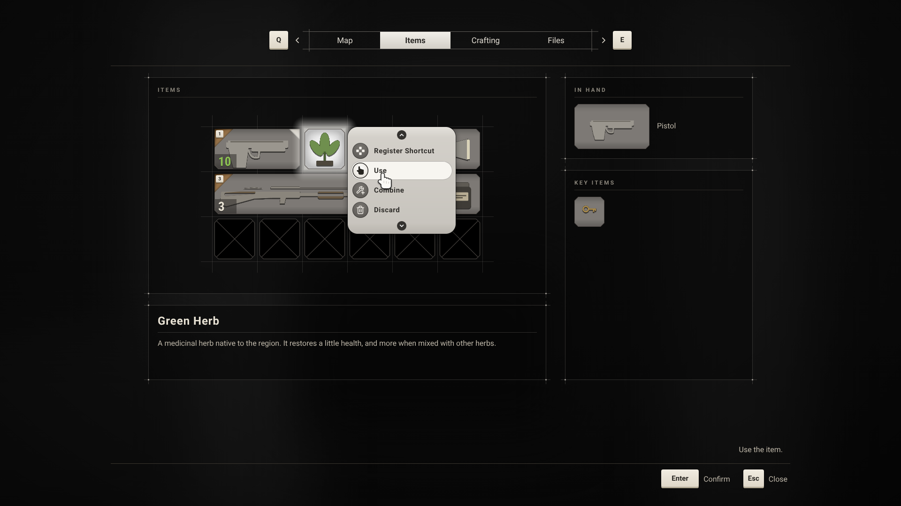

# Hades: UI Reference

Every UI asset in the project, as it is built in the editor: its parent class, its widget hierarchy, every property changed from its default, its graph, its Class Defaults, and what its C++ class does with it. Anything not listed is left at its default.

This is the state of the UI after patch 0011, the restyle. How the UI works is in [UI](UI.md); how to update from an earlier patch, step by step, is in [Inventory UI Setup](InventoryUISetup.md).




## Contents

1. [Reading this reference](#1-reading-this-reference)
2. [Input and project settings](#2-input-and-project-settings)
3. [Root layout](#3-root-layout)
4. [Style kit](#4-style-kit)
5. [Shared widgets](#5-shared-widgets)
6. [Inventory pieces](#6-inventory-pieces)
7. [Screens](#7-screens)
8. [HUD](#8-hud)
9. [Where the widgets are used](#9-where-the-widgets-are-used)
10. [Appendix. Colors and sizes](#appendix-colors-and-sizes)

---

## 1. Reading this reference

Each widget is described in the same order:

- **A table** with its parent class, its folder, and what uses it.
- **Hierarchy**: every widget in it, in order. A name in the tree, such as `Background`, is the widget's exact name; a type alone, such as `Overlay`, keeps its default name. The widget's type is in brackets.
- **Properties**: every widget in the hierarchy, in the same order, with each property that differs from its default. Paths follow the Details panel, such as **Brush › Draw As**. A widget listed with *no changes* keeps all its defaults.
- **Graph**: every node, when it has one.
- **Class Defaults**: the widget's own settings, in **Graph › Class Defaults**.
- **C++**: what the parent class needs and does. Named parts marked *required* must exist with that exact name, or the Blueprint doesn't compile.

Notation:

| Written | Meaning |
| --- | --- |
| **Is Variable** | The checkbox beside the name, ticked. |
| Slot: Fill/Fill | The widget's slot in its parent: Horizontal Alignment Fill, Vertical Alignment Fill. |
| Slot: H Center, V Top | Horizontal Alignment Center, Vertical Alignment Top. |
| Slot: Size Auto / Fill | In a Horizontal or Vertical Box. |
| Padding 6 | All four sides 6. Padding Left 12, Top 4 means those two; the others are 0. |
| `C8A25AFF` | A color as hex sRGB: red, green, blue, alpha. |
| Width 64 | **Width Override** ticked and set to 64; Height likewise. |

Brushes drawn with a texture are written **Box** or **Image**, then the texture, the **Image Size** and, for a Box, the **Margin** on all four sides, such as "Box, `T_UI_GridCell_HasItem`, 64 × 64, Margin 0.25". **Tint** is `FFFFFFFF` unless listed. A Box keeps the texture's outer margin at Margin × Image Size pixels and stretches the middle; an Image stretches the whole texture. Rounded Box brushes always have **Rounding Type** Fixed Radius unless written otherwise. A Border's **Brush Color**, outside its brush, stays `FFFFFFFF` unless listed. **Not Hit-Testable** is Behavior › Visibility: Not Hit-Testable (Self & All Children).

---

## 2. Input and project settings

### 2.1 UI actions

**Project Settings › Game › Common UI Input Settings › Input Actions**:

| Action Tag | Default Display Name | Key Mappings |
| --- | --- | --- |
| `UI.Action.Escape` | Pause | `Escape`, `Gamepad Special Right` |
| `UI.Action.Inventory` | Inventory | `Tab`, `Gamepad Special Left` |

Nothing else is in the list.

### 2.2 `DT_UIInputActions`

| | |
| --- | --- |
| Type | Data Table, Row Structure `CommonInputActionDataBase` |
| Folder | `Content/Input` |
| Used by | `B_CommonInputData`, the screens' and menus' Input actions, the Quick Slot Component's Slot Keys, `W_InteractableMarker`, `W_InventoryScreen`'s tab keys |

| Row | Display Name | Keyboard Input Type Info › Key | Default Gamepad Input Type Info › Key | Nav Bar Priority |
| --- | --- | --- | --- | --- |
| `Confirm` | Confirm | `Enter` | `Gamepad Face Button Bottom` | 5 |
| `Back` | Close | `Escape` | `Gamepad Face Button Right` | 6 |
| `Organize` | Auto Sort (Hold) | `O` | `Gamepad Left Thumbstick Button` | 1 |
| `Move` | Move | `Space Bar` | `Gamepad Face Button Left` | 2 |
| `Rotate` | Rotate | `R` | `Gamepad Face Button Top` | 3 |
| `Split` | Split | `Left Shift` | `Gamepad Left Trigger` | 4 |
| `PreviousTab` | Previous Tab | `Q` | `Gamepad Left Shoulder` | 0 |
| `NextTab` | Next Tab | `E` | `Gamepad Right Shoulder` | 0 |
| `Shortcut1` | Shortcut 1 | `One` | `Gamepad D-pad Up` | 0 |
| `Shortcut2` | Shortcut 2 | `Two` | `Gamepad D-pad Right` | 0 |
| `Shortcut3` | Shortcut 3 | `Three` | `Gamepad D-pad Down` | 0 |
| `Shortcut4` | Shortcut 4 | `Four` | `Gamepad D-pad Left` | 0 |
| `Interact` | Interact | `F` | `Gamepad Face Button Left` | 0 |

`Organize` also has **Action Requires Hold** ticked and **Hold Time** `0.6`, under both **Keyboard Input Type Info** and **Default Gamepad Input Type Info**.

### 2.3 `B_CommonInputData`

| | |
| --- | --- |
| Parent class | `CommonUIInputData` |
| Folder | `Content/Input` |
| Used by | **Project Settings › Game › Common Input Settings › Input Data** |

**Class Defaults**

- **Default Click Action**: Data Table `DT_UIInputActions`, Row Name `Confirm`
- **Default Back Action**: Data Table `DT_UIInputActions`, Row Name `Back`

### 2.4 `CID_KeyboardMouse` and `CID_Gamepad`

| | |
| --- | --- |
| Parent class | `CommonInputBaseControllerData` |
| Folder | `Content/Input` |
| Used by | **Project Settings › Game › Common Input Settings › Platform Input › Windows › Controller Data**: element 0 `CID_KeyboardMouse`, element 1 `CID_Gamepad` |

**Class Defaults of `CID_KeyboardMouse`**

- Default › **Input Type**: Mouse and Keyboard
- Display › **Input Brush Data Map**: one element per key below. Each sets **Key**, **Key Brush › Image** (your icon) and **Key Brush › Image Size**: Y `40`, X so the icon keeps its shape (`40` for a square icon, `80` for one twice as wide).

| Key | Shown for |
| --- | --- |
| `Enter` | Confirm |
| `Escape` | Close |
| `Space Bar` | Move |
| `O` | Auto Sort |
| `R` | Rotate |
| `Q` | Previous tab |
| `E` | Next tab |
| `One` to `Four` | Shortcuts 1 to 4 |
| `F` | Interact, in the prompt |

**Class Defaults of `CID_Gamepad`**

- Default › **Input Type**: Gamepad
- Gamepad › **Gamepad Name**: Generic; **Gamepad Display Name**: `Gamepad`
- Display › **Input Brush Data Map**, set the same way:

| Key | Shown for |
| --- | --- |
| `Gamepad Face Button Bottom` | Confirm |
| `Gamepad Face Button Right` | Close |
| `Gamepad Face Button Left` | Move, and Interact in the prompt |
| `Gamepad Left Thumbstick Button` | Auto Sort |
| `Gamepad Face Button Top` | Rotate |
| `Gamepad Left Shoulder` | Previous tab |
| `Gamepad Right Shoulder` | Next tab |
| `Gamepad D-pad Up`, `Right`, `Down`, `Left` | Shortcuts 1 to 4 |

**Platform Input › Windows** also sets: **Default Input Type** Mouse and Keyboard; **Supports Mouse and Keyboard** ticked; **Supports Gamepad** ticked; **Default Gamepad Name** Generic.

### 2.5 Key and tab icon textures

Every key icon and tab icon texture, 128 × 128:

- Compression › **Compression Settings**: UserInterface2D (RGBA)
- Level Of Detail › **Mip Gen Settings**: SimpleAverage
- Level Of Detail › **Texture Group**: UI

---

## 3. Root layout

### 3.1 `W_PrimaryGameLayout`

The root layout Common Game gives each local player: four layer stacks, with the messages above them.

| | |
| --- | --- |
| Parent class | `PrimaryGameLayout` |
| Folder | `Content/UI/Foundation` |
| Used by | `B_HadesUIPolicy` (**Layout Class**) |

**Hierarchy**

```
[W_PrimaryGameLayout]
└─ Overlay
   ├─ GameLayer_Stack (Common Activatable Widget Stack)
   ├─ GameMenuLayer_Stack (Common Activatable Widget Stack)
   ├─ MenuLayer_Stack (Common Activatable Widget Stack)
   ├─ ModalLayer_Stack (Common Activatable Widget Stack)
   └─ W_Message (W_Message)
```

**Properties**

- **Overlay**: no changes.
- **`GameLayer_Stack`**, **`GameMenuLayer_Stack`**, **`MenuLayer_Stack`**, **`ModalLayer_Stack`**: **Is Variable**; Slot: Fill/Fill.
- **W_Message**: Slot: H Center, V Bottom; Padding Bottom 112.

**Graph**

1. **Event On Initialized** → **Register Layer** (Layer Tag `UI.Layer.Game`, Layer Widget `GameLayer_Stack`) → **Register Layer** (`UI.Layer.GameMenu`, `GameMenuLayer_Stack`) → **Register Layer** (`UI.Layer.Menu`, `MenuLayer_Stack`) → **Register Layer** (`UI.Layer.Modal`, `ModalLayer_Stack`).

**C++.** Common Game's `UPrimaryGameLayout` pushes screens onto the registered stacks by tag. Later children of the Overlay draw on top, so `W_Message` is above every layer.

### 3.2 `B_HadesUIPolicy`

| | |
| --- | --- |
| Parent class | `GameUIPolicy` |
| Folder | `Content/UI/Foundation` |
| Used by | `Config/DefaultGame.ini`: `[/Script/Hades.HadesUIManagerSubsystem]` `DefaultUIPolicyClass=/Game/UI/Foundation/B_HadesUIPolicy.B_HadesUIPolicy_C` |

**Class Defaults**

- **Layout Class**: `W_PrimaryGameLayout`

---

## 4. Style kit

All in `Content/UI/Style`.

### 4.1 Textures

Imported from `SourceArt/UI`. Each texture is at least twice the size it's drawn at.

| Texture | Size | Looks like | Drawn as | Used by |
| --- | --- | --- | --- | --- |
| `T_UI_Panel` | 128 | A see-through dark panel inside 1 px lines that run 9 px past its corners, a 3 px dot where they cross | Box, 64 × 64, Margin 0.375 | `W_Panel` |
| `T_UI_GridCell_HasItem` | 128 | A grey tile with cut corners and a dark outline, darker at the top and bottom | Box, 64 × 64, Margin 0.25 | `W_InventoryItem`, `BS_ItemSlot`, `W_EquippedItem` |
| `T_UI_GridCell_Hover` | 128 | The same tile, white in the middle to light grey at the edges | Box, 64 × 64, Margin 0.25 | `W_InventoryItem`, `BS_ItemSlot` |
| `T_UI_GridCell_Empty` | 256 | A whole 96 px cell: a black tile with an X, inset 5 px | Image, 96 × 96 | `BS_GridCell`, `BS_GridCellHolding` |
| `T_UI_GridCell_EmptyHover` | 256 | The same with a brighter outline and X, and a faint glow | Image, 96 × 96 | `BS_GridCell` |
| `T_UI_ItemGlow` | 128 | A soft white glow, solid in the middle, fading over its outer 28 px | Box, 64 × 64, Margin 0.4375 | `W_InventoryItem` |
| `T_UI_CountPatch` | 64 | A see-through dark patch, its bottom-left corner cut | Box, 32 × 32, Margin 0.25 | `W_InventoryItem` |
| `T_UI_ShortcutMarker` | 128 | A full orange right triangle, its right angle top left, lighter toward the long edge, with an inner shadow along every edge | Image, 40 × 40 | `W_InventoryItem` |
| `T_UI_InHandMarker` | 128 | The same triangle in cream, its right angle top right | Image, 24 × 24 | `W_InventoryItem` |
| `T_UI_TabBarFrame` | 64 | Lines above and below the tabs running past them, a tick at each end | Box, 32 × 32, Margin 0.5 | `W_InventoryScreen` |
| `T_UI_TabActive` | 64 | A light fill, `F2EFE9` at the top to `D3CFC7` at the bottom | Image, 64 × 64 | `W_TabButton` |
| `T_UI_ChevronLeft`, `T_UI_ChevronRight` | 64 | White arrows | Image, 16 × 16 | `W_InventoryScreen` |
| `T_UI_MenuPanel` | 128 | A light grey capsule, `E4E1DB` to `B7B3AC`, 22 px corners, a thin dark edge | Box, 64 × 64, Margin 0.375 | `W_ItemMenu`, `W_ShortcutMenu` |
| `T_UI_MenuShadow` | 128 | A soft black shadow | Box, 64 × 64, Margin 0.5 | `W_ItemMenu`, `W_ShortcutMenu` |
| `T_UI_MenuChevronUp`, `T_UI_MenuChevronDown` | 64 | A dark circle with a white arrow | Image, 20 × 20 | `W_ItemMenu` |
| `T_UI_MenuBadge` | 128 | A dark grey round badge | Image, 34 × 34 | `W_ItemMenuButton` |
| `T_UI_MenuBadgeLit` | 128 | A cream round badge with a dark ring | Image, 34 × 34 | `W_ItemMenuButton` |
| `T_UI_Icon_Shortcut`, `_Use`, `_Equip`, `_Unequip`, `_Combine`, `_Discard`, `_Store`, `_Take` | 128 | White menu icons: four squares, a hand, a crosshair, a crossed-out crosshair, a wrench with a plus, a bin, arrows into and out of a tray | Image, 20 × 20, tinted | `W_ItemMenu` |
| `T_UI_Cursor_Hand` | 128 | A white pointing hand with a dark outline | Image, 40 × 40 | `W_HandCursor` |
| `T_UI_Cell` | 64 | A dark cell that looks sunk in | Box, 64 × 64, Margin 0.25 | `BS_Slot`, `BS_SlotHolding` |
| `T_UI_ItemTile` | 64 | A box lit softly from above | Box, 64 × 64, Margin 0.25 | Nothing since patch 0011 |

Each:

- Compression › **Compression Settings**: UserInterface2D (RGBA)
- Level Of Detail › **Mip Gen Settings**: SimpleAverage (`T_UI_Cell` and `T_UI_ItemTile`: FromTextureGroup)
- Level Of Detail › **Texture Group**: UI

### 4.1.1 Fonts

| Asset | Type | Description |
| --- | --- | --- |
| `FF_RobotoCondensed_Bold` | Font Face | Imported from `SourceArt/Fonts/RobotoCondensed-Bold.ttf`. Open Font License, in `SourceArt/Fonts/OFL.txt`. |
| `F_RobotoCondensed` | Font | **Default Font Family**: one entry, named `Bold`, Font `FF_RobotoCondensed_Bold`. Used by `TS_TileCount`. |

Both in `Content/UI/Style`.

### 4.2 Text styles

Parent class `CommonTextStyle`. Every one uses **Font Family** Roboto (engine content) and **Margin** 0, except `TS_TileCount` (below). When **Uses Drop Shadow** is ticked: **Shadow Offset** X `1`, Y `1`, **Shadow Color** `000000E6`.

| Asset | Typeface | Size | Letter Spacing | Color | Uses Drop Shadow | Line Height Percentage | Used for |
| --- | --- | --- | --- | --- | --- | --- | --- |
| `TS_Title` | Regular | 34 | 400 | `E8E2D4FF` | off | 1 | Screen titles: ITEM BOX, PAUSED |
| `TS_Label` | Bold | 12 | 250 | `8A857BFF` | off | 1 | Panel titles, small labels, tab labels, the placeholder pages, the shortcut menu's title |
| `TS_ItemName` | Bold | 24 | 40 | `E8E2D4FF` | off | 1 | The item name in the details panel |
| `TS_Body` | Regular | 16 | 0 | `BDB6A8FF` | off | 1.15 | Descriptions, the action bar and its hint, names in the item box and the in-hand panel |
| `TS_Count` | Bold | 15 | 0 | `E8E2D4FF` | on | 1 | Stack counts and rounds in slots, the shortcut menu and the HUD |
| `TS_Button` | Bold | 15 | 120 | `E8E2D4FF` | off | 1 | The pause menu's button and the interaction prompt |
| `TS_Message` | Regular | 19 | 20 | `E8E2D4FF` | on | 1 | Messages such as "It's locked." |
| `TS_Tab` | Regular | 17 | 0 | `DDD8CFFF` | off | 1 | Tab labels |
| `TS_TabActive` | Bold | 17 | 0 | `2A2825FF` | off | 1 | The open tab's label |
| `TS_TileCount` | Bold, of `F_RobotoCondensed` | 27 | 0 | `F4F1EBFF` | on | 1 | Stack counts and rounds on items in the grid |
| `TS_MenuItem` | Bold | 15 | 40 | `2E2C29FF` | off | 1 | Item menu rows and shortcut entries |
| `TS_MenuLabel` | Bold | 12 | 250 | `6B6760FF` | off | 1 | The shortcut menu's title |

`TS_TileCount` uses **Font Family** `F_RobotoCondensed`, not Roboto, and its shadow is **Shadow Offset** X `0`, Y `1`, **Shadow Color** `0000008C`.

### 4.3 `BS_Slot`

The item box's rows.

| | |
| --- | --- |
| Parent class | `CommonButtonStyle` |
| Used by | `W_ItemBoxEntry` (**Style**). Since patch 0011 the cells use `BS_GridCell` and the key items `BS_ItemSlot`. |

**Class Defaults**

- **Normal Base**: Draw As Box; Image `T_UI_Cell`; Image Size 64 × 64; Margin `0.25`; Tint `FFFFFFFF`
- **Normal Hovered**: Draw As Rounded Box; Tint `1C1A16FF`; Outline Settings › Corner Radii `0, 0, 0, 0`, Color `C8A25AFF`, Width `2`, Rounding Type Fixed Radius
- **Normal Pressed**: Draw As Rounded Box; Tint `2A251DFF`; Outline Settings › Corner Radii `0, 0, 0, 0`, Color `E2C27EFF`, Width `2`, Rounding Type Fixed Radius
- **Disabled**: Draw As Rounded Box; Tint `0A0A0A80`; Outline Settings › Corner Radii `0, 0, 0, 0`, Color `1A1916FF`, Width `1`, Rounding Type Fixed Radius
- **Button Padding**: `0`
- **Min Width** `0`, **Min Height** `0`
- Selected brushes and text styles: no changes.

Common UI shows the Hovered look under the mouse and under gamepad focus, so the gold outline is also the gamepad cursor.

### 4.4 `BS_SlotHolding`

Cells while an item is moved: no hover outline, as the moved item shows where it goes.

| | |
| --- | --- |
| Parent class | `CommonButtonStyle` (a duplicate of `BS_Slot`) |
| Used by | Nothing since patch 0011: `W_InventoryCell` uses `BS_GridCellHolding` |

**Class Defaults**: as `BS_Slot`, except:

- **Normal Hovered**: Draw As Box; Image `T_UI_Cell`; Image Size 64 × 64; Margin `0.25`; Tint `FFFFFFFF`
- **Normal Pressed**: the same

### 4.5 `BS_MenuButton`

The item menu, shortcut menu and pause menu buttons.

| | |
| --- | --- |
| Parent class | `CommonButtonStyle` |
| Used by | `W_MenuButton` (**Style**) |

**Class Defaults**

- **Normal Base**: Draw As Rounded Box; Tint `00000000`; Outline Settings › Corner Radii `2, 2, 2, 2`, Color `00000000`, Width `0`, Rounding Type Fixed Radius
- **Normal Hovered**: Draw As Rounded Box; Tint `C8A25A2E`; Outline Settings › Corner Radii `2, 2, 2, 2`, Color `C8A25AFF`, Width `1`, Rounding Type Fixed Radius
- **Normal Pressed**: Draw As Rounded Box; Tint `C8A25A59`; Outline Settings › Corner Radii `2, 2, 2, 2`, Color `E2C27EFF`, Width `1`, Rounding Type Fixed Radius
- **Disabled**: Draw As Rounded Box; Tint `00000000`; Outline Settings › Width `0`, Rounding Type Fixed Radius
- **Button Padding**: Left `14`, Top `9`, Right `14`, Bottom `9`
- **Min Width** `208`, **Min Height** `0`

### 4.6 `BS_ActionButton`

The action bar's entries and the tabs: flat, with a faint highlight under the mouse.

| | |
| --- | --- |
| Parent class | `CommonButtonStyle` |
| Used by | `W_BoundActionButton`, `W_TabButton` (**Style**) |

**Class Defaults**

- **Normal Base**: Draw As Rounded Box; Tint `00000000`; Outline Settings › Corner Radii `2, 2, 2, 2`, Color `00000000`, Width `0`, Rounding Type Fixed Radius
- **Normal Hovered**: Draw As Rounded Box; Tint `FFFFFF14`; Outline Settings › Corner Radii `2, 2, 2, 2`, Color `00000000`, Width `0`, Rounding Type Fixed Radius
- **Normal Pressed**: Draw As Rounded Box; Tint `FFFFFF29`; Outline Settings › Corner Radii `2, 2, 2, 2`, Color `00000000`, Width `0`, Rounding Type Fixed Radius
- **Disabled**: Draw As Rounded Box; Tint `00000000`; Outline Settings › Width `0`, Rounding Type Fixed Radius
- **Button Padding**: Left `6`, Top `3`, Right `6`, Bottom `3`
- **Min Width** `0`, **Min Height** `0`
- **Normal Text Style**, **Normal Hovered Text Style**, **Selected Text Style**, **Selected Hovered Text Style**, **Disabled Text Style**: `TS_Body`. The action bar's buttons apply it to their action name.

### 4.7 `BS_QuickSlot`

The HUD's shortcuts: see-through boxes without an outline.

| | |
| --- | --- |
| Parent class | `CommonButtonStyle` |
| Used by | `W_QuickSlot` (**Style**) |

**Class Defaults**

- **Normal Base**: Draw As Rounded Box; Tint `0A0A0AB3`; Outline Settings › Corner Radii `0, 0, 0, 0`, Width `0`, Rounding Type Fixed Radius
- **Button Padding**: `0`
- **Min Width** `0`, **Min Height** `0`

The HUD's shortcuts never take the mouse or focus, so the other brushes are never seen.

### 4.8 `BS_GridCell`

The pocket cells: the empty tile with an X, brighter under the mouse or gamepad focus.

| | |
| --- | --- |
| Parent class | `CommonButtonStyle` (a duplicate of `BS_Slot`) |
| Used by | `W_InventoryCell` (**Style**) |

**Class Defaults**

- **Normal Base**: Image, `T_UI_GridCell_Empty`, 96 × 96
- **Normal Hovered**: Image, `T_UI_GridCell_EmptyHover`, 96 × 96
- **Normal Pressed**: Image, `T_UI_GridCell_EmptyHover`, 96 × 96
- **Disabled**: Image, `T_UI_GridCell_Empty`, 96 × 96; Tint `FFFFFF80`
- **Button Padding**: `0`
- **Min Width** `0`, **Min Height** `0`
- Selected brushes and text styles: as `BS_Slot`.

The texture is a whole cell with the tile inset 5 px, so the grid lines run in the gaps between tiles.

### 4.9 `BS_GridCellHolding`

The pocket cells while an item is moved: no hover look, as the moved item shows where it goes.

| | |
| --- | --- |
| Parent class | `CommonButtonStyle` (a duplicate of `BS_GridCell`) |
| Used by | `W_InventoryCell` (**Holding Style**) |

**Class Defaults**: as `BS_GridCell`, except **Normal Hovered** and **Normal Pressed**: Image, `T_UI_GridCell_Empty`, 96 × 96.

### 4.10 `BS_ItemSlot`

The key items: the item tile, bright under the mouse.

| | |
| --- | --- |
| Parent class | `CommonButtonStyle` (a duplicate of `BS_Slot`) |
| Used by | `W_InventorySlot` (**Style**) |

**Class Defaults**

- **Normal Base**: Box, `T_UI_GridCell_HasItem`, 64 × 64, Margin 0.25
- **Normal Hovered**: Box, `T_UI_GridCell_Hover`, 64 × 64, Margin 0.25
- **Normal Pressed**: Box, `T_UI_GridCell_Hover`, 64 × 64, Margin 0.25
- **Disabled**: Box, `T_UI_GridCell_HasItem`, 64 × 64, Margin 0.25; Tint `FFFFFF80`
- **Button Padding**: `0`
- **Min Width** `0`, **Min Height** `0`

### 4.11 `BS_ItemMenuRow`

The rows of the item and shortcut menus: nothing behind them, a cream pill under the mouse or gamepad focus.

| | |
| --- | --- |
| Parent class | `CommonButtonStyle` |
| Used by | `W_ItemMenuButton`, `W_ShortcutEntry` (**Style**) |

**Class Defaults**

- **Normal Base**: Draw As None
- **Normal Hovered**: Draw As Rounded Box; Tint `F7F5F0FF`; Outline Settings › Corner Radii `20, 20, 20, 20`, Color `2A282659`, Width `1`, Rounding Type Fixed Radius
- **Normal Pressed**: Draw As Rounded Box; Tint `FFFFFFFF`; Outline Settings as Normal Hovered
- **Disabled**: Draw As None
- **Button Padding**: Left `3`, Top `3`, Right `16`, Bottom `3`
- **Min Width** `0`, **Min Height** `0`
- Selected brushes and text styles: no changes.

---

## 5. Shared widgets

All in `Content/UI/Foundation`.

### 5.1 `W_Panel`

The framed panel every section sits in: a see-through dark panel inside thin lines that run past its corners, a small title, a thin line under it, and a slot for content.

| | |
| --- | --- |
| Parent class | User Widget |
| Used by | `W_InventoryScreen`, `W_ItemBoxScreen` |

**Hierarchy**

```
[W_Panel]
└─ Overlay
   └─ Frame (Border)
      └─ Vertical Box
         ├─ Header (Vertical Box)
         │  ├─ TitleText (Common Text)
         │  └─ HeaderRule (Image)
         └─ Content (Named Slot)
```

**Properties**

- **Overlay**: no changes.
- **`Frame`** (Border):
  - Slot: Fill/Fill; Padding `-9` on all four sides. The frame reaches 9 px past the panel, so its lines run past the corners without changing the panel's size.
  - Brush › Draw As: Box
  - Brush › Image: `T_UI_Panel`
  - Brush › Image Size: 64 × 64
  - Brush › Margin: `0.375`
  - Brush › Tint: `FFFFFFFF`
  - Padding: `29`: the content stays 20 px inside the lines.
- **Vertical Box**: no changes.
- **`Header`** (Vertical Box):
  - **Is Variable**
  - Slot: Size Auto; Horizontal Alignment Fill
- **`TitleText`** (Common Text):
  - **Is Variable**
  - Style: `TS_Label`
  - Text: `TITLE`
- **`HeaderRule`** (Image):
  - Slot: Horizontal Alignment Fill; Padding Top 8, Bottom 14
  - Brush › Image Size: 32 × 1
  - Color and Opacity: `2F2C28FF`
- **`Content`** (Named Slot):
  - Slot: Size Fill; Horizontal Alignment Fill; Vertical Alignment Fill

**Graph**

- Variable **`Title`**: Text, **Instance Editable**, Default Value empty.
- **Event Pre Construct** → `TitleText` › **Set Text** (In Text: `Title`) → `Header` › **Set Visibility** (In Visibility: **Select** with Index `Title` › **Is Empty**: False → Not Hit-Testable (Self & All Children), True → Collapsed).

A panel without a title shows no title row.

**Using it.** On each placed `W_Panel`, **Title** is under **Default** in its Details, and its contents go on its **Content** entry in the Hierarchy.

### 5.2 `W_BoundActionButton`

One entry of the action bar: a key's icon and the action's name.

| | |
| --- | --- |
| Parent class | `CommonBoundActionButton` |
| Used by | The **Action Bar** of `W_InventoryScreen` and `W_ItemBoxScreen` (**Action Button Class**) |

**Hierarchy**

```
[W_BoundActionButton]
└─ Horizontal Box
   ├─ InputActionWidget (Common Action Widget)
   └─ Text_ActionName (Common Text)
```

**Properties**

- **Horizontal Box**: no changes.
- **`InputActionWidget`** (Common Action Widget):
  - **Is Variable**
  - Slot: Size Auto; Vertical Alignment Center
- **`Text_ActionName`** (Common Text):
  - **Is Variable**
  - Slot: Size Auto; Vertical Alignment Center; Padding Left 8
  - Style: `TS_Body`
  - Text: `Action`

**Class Defaults**

- **Style**: `BS_ActionButton`
- Interaction › **Is Focusable**: unticked

No graph.

**C++.** Common UI's `UCommonBoundActionButton` finds `InputActionWidget` and `Text_ActionName` by name. The action bar makes one per action, sets the key's icon and the action's name, and clicking it does the action.

### 5.3 `W_TabButton`

One tab of the tab bar: a text tab, filled light while it's open.

| | |
| --- | --- |
| Parent class | `HadesTabButton` |
| Used by | `W_InventoryScreen` (`TabBar`) |

**Hierarchy**

```
[W_TabButton]
└─ Size Box
   └─ Overlay
      ├─ ActiveFrame (Border)
      └─ Vertical Box
         ├─ Icon (Image)
         └─ Label (Common Text)
```

**Properties**

- **Size Box**: Width 150; Height 36
- **Overlay**: no changes.
- **`ActiveFrame`** (Border):
  - **Is Variable**
  - Slot: Fill/Fill; Padding 0
  - Brush: Image, `T_UI_TabActive`, 64 × 64
  - Padding: `0`
- **Vertical Box**: Slot: H Center, V Center
- **`Icon`** (Image):
  - **Is Variable**
  - Slot: Horizontal Alignment Center; Padding 0
  - Brush › Image Size: 48 × 48
  - Color and Opacity: `E8E2D4FF`
- **`Label`** (Common Text):
  - **Is Variable**
  - Slot: Horizontal Alignment Center; Padding 0
  - Style: `TS_Tab`
  - Text: `TAB`

**Class Defaults**

- **Style**: `BS_ActionButton`
- Tab › **Active Label Style**: `TS_TabActive`
- Tab › **Inactive Label Style**: `TS_Tab`

No graph.

**On each placed tab**: Tab › **Icon Texture** None, and **Label Text** (`W_InventoryScreen`'s are `Map`, `Items`, `Crafting`, `Files`). Active Icon Scale doesn't matter without an icon.

**C++** (`UHadesTabButton`). Finds `Icon`, `Label` and `ActiveFrame` (all optional). Sets the icon from Icon Texture without changing its size, and the label from Label Text. The open tab's icon is scaled by Active Icon Scale, its label and frame show; on other tabs the label and frame are hidden, not collapsed. Without an icon, the label always shows. A Common Text label takes Active Label Style on the open tab and Inactive Label Style on the others. Tabs can't take focus.

### 5.4 `W_MenuButton`

A text button.

| | |
| --- | --- |
| Parent class | `CommonButtonBase` |
| Used by | `W_ItemMenu`, `W_EscapeMenu` |

**Hierarchy**

```
[W_MenuButton]
└─ Label (Common Text)
```

**Properties**

- **`Label`** (Common Text):
  - **Is Variable**
  - Style: `TS_Button`
  - Text: `Button`

**Graph**

- Variable **`LabelText`**: Text, **Instance Editable**, Default Value `Button`.
- **Event Pre Construct** → `Label` › **Set Text** (In Text: `LabelText`).

**Class Defaults**

- **Style**: `BS_MenuButton`

**On each placed button**: **Label Text**, under **Default**.

### 5.5 `W_Message`

Messages such as "It's locked."

| | |
| --- | --- |
| Parent class | `HadesMessageWidget` |
| Used by | `W_PrimaryGameLayout` |

**Hierarchy**

```
[W_Message]
└─ Band (Border)
   └─ MessageText (Common Text)
```

**Properties**

- **`Band`** (Border):
  - **Is Variable**
  - Behavior › Visibility: Not Hit-Testable (Self & All Children)
  - Behavior › Render Opacity: `0`
  - Brush › Draw As: Rounded Box
  - Brush › Tint: `000000A6`
  - Brush › Outline Settings › Corner Radii `3, 3, 3, 3`, Color `00000000`, Width `0`, Rounding Type Fixed Radius
  - Padding: Left 28, Top 10, Right 28, Bottom 10
  - Horizontal Alignment Center, Vertical Alignment Center
- **`MessageText`** (Common Text):
  - **Is Variable**
  - Style: `TS_Message`
  - Text: `Message`
  - Justification: Center

**Animation `ShowAnimation`**: one track, `Band` › **Render Opacity**, with keys 0.00 → `0`, 0.15 → `1`, 2.60 → `1`, 3.00 → `0`. The timeline ends at 3.00.

No graph.

**C++** (`UHadesMessageWidget`). Finds `MessageText` (*required*) and the animation `ShowAnimation` (optional). Empties the text on construct, then, for each message the player controller sends, sets the text and plays the animation from the start.

### 5.6 `W_HandCursor`

The mouse cursor: a pointing hand. Optional; without it the cursor is the system arrow.

| | |
| --- | --- |
| Parent class | User Widget |
| Used by | **Project Settings › Engine › User Interface › Software Cursors**: Default |

**Hierarchy**

```
[W_HandCursor]
└─ Size Box
   └─ Canvas Panel
      └─ Image
```

**Properties**

- **Size Box**: Width 80; Height 80; Behavior › Visibility: Not Hit-Testable
- **Canvas Panel**: no changes.
- **Image**:
  - Slot (Canvas Panel Slot): Anchors top left (Minimum 0, 0, Maximum 0, 0); Position X `26.5`, Y `37`; Size X `40`, Y `40`; Alignment 0, 0; Size To Content unticked
  - Brush: Image, `T_UI_Cursor_Hand`, 40 × 40

No graph.

Slate draws a software cursor centered on the mouse. The fingertip is 13.5 px from the image's left and 3 px from its top, so this puts it at the middle of the widget, where the click lands.

---

## 6. Inventory pieces

All in `Content/UI/Inventory`.

### 6.1 `W_InventoryItem`

An item in the grid. The grid places it over the item's cells, sizes the icon to them, and turns it with the item. It also stands in for the item being moved, on the cells it would land on.

| | |
| --- | --- |
| Parent class | `HadesInventoryItemWidget` |
| Used by | `W_InventoryGrid` (**Item Class**) |

**Hierarchy**

```
[W_InventoryItem]
└─ Overlay
   ├─ Glow (Image)
   ├─ Background (Border)
   ├─ LitBackground (Image)
   ├─ IconShadow (Image)
   ├─ Icon (Image)
   ├─ CountPatch (Size Box)
   │  └─ Overlay
   │     ├─ Image
   │     ├─ CountText (Common Text)
   │     └─ AmmoText (Common Text)
   ├─ ShortcutMarker (Overlay)
   │  ├─ Image
   │  └─ Scale Box
   │     └─ ShortcutKey (Common Action Widget)
   └─ EquippedMarker (Image)
```

**Properties**

- **Overlay**:
  - Clipping › Clipping: Inherit, so `Glow` can reach past the item.
- **`Glow`** (Image):
  - **Is Variable**
  - Slot: Fill/Fill; Padding `-23`: it reaches 28 px past the tile
  - Behavior › Visibility: Hidden
  - Brush: Box, `T_UI_ItemGlow`, 64 × 64, Margin 0.4375
  - Color and Opacity: `FFFFFFFF`
- **`Background`** (Border):
  - **Is Variable**
  - Slot: Fill/Fill; Padding `5`: the gap the grid lines run through
  - Brush: Box, `T_UI_GridCell_HasItem`, 64 × 64, Margin 0.25
  - Padding: `0`
- **`LitBackground`** (Image):
  - **Is Variable**
  - Slot: Fill/Fill; Padding `5`
  - Behavior › Visibility: Hidden
  - Brush: Box, `T_UI_GridCell_Hover`, 64 × 64, Margin 0.25
- **`IconShadow`** (Image):
  - **Is Variable**
  - Slot: H Center, V Center, as `Icon`
  - Brush › Image: none
  - Color and Opacity: `0000008C`
  - Render Transform › Translation: X 0, Y 2
  - Behavior › Visibility: Not Hit-Testable
- **`Icon`** (Image):
  - **Is Variable**
  - Slot: H Center, V Center. Not Fill: the grid sizes the icon and turns it.
- **`CountPatch`** (Size Box):
  - **Is Variable**
  - Slot: H Left, V Bottom; Padding Left 6, Bottom 6: inside the tile's 5 px inset and 1 px outline
  - Width 46; Height 31
  - Behavior › Visibility: Not Hit-Testable
- **Overlay** (in `CountPatch`): no changes.
- **Image** (in `CountPatch`):
  - Slot: Fill/Fill
  - Brush: Box, `T_UI_CountPatch`, 32 × 32, Margin 0.25
- **`CountText`** (Common Text):
  - **Is Variable**
  - Slot: H Left, V Center; Padding Left 7
  - Style: `TS_TileCount`
  - Text: `99`
- **`AmmoText`** (Common Text):
  - **Is Variable**
  - Slot: H Left, V Center; Padding Left 7
  - Style: `TS_TileCount`
  - Text: `10`
- **`ShortcutMarker`** (Overlay):
  - **Is Variable**
  - Slot: H Left, V Top; Padding Left 5, Top 5: the triangle's tip sits on the tile's corner
  - Behavior › Visibility: Not Hit-Testable
- **Image** (in `ShortcutMarker`):
  - Slot: H Left, V Top
  - Brush: Image, `T_UI_ShortcutMarker`, 40 × 40
- **Scale Box**:
  - Slot: H Left, V Top; Padding Left 3, Top 3
  - Stretching › Stretch: User Specified
  - Stretching › User Specified Scale: `0.4`: the 40 px key icon at 16 px
  - Behavior › Visibility: Not Hit-Testable
- **`ShortcutKey`** (Common Action Widget):
  - **Is Variable**
  - Input Actions: empty
- **`EquippedMarker`** (Image):
  - **Is Variable**
  - Slot: H Right, V Top; Padding Right 5, Top 5
  - Behavior › Visibility: Collapsed
  - Brush: Image, `T_UI_InHandMarker`, 24 × 24
  - Color and Opacity: `FFFFFFFF`
  - Render Transform: Translation 0, 0; Angle `0`

**Graph**

1. **Event On Held Changed** → **Set Render Opacity** (Target: self; In Opacity: **Select** on **Is Held**: False `1.0`, True `0`). The spot an item leaves looks empty while it's moved.

The C++ lights the item, so there are no hover or selection events in the graph.

**Class Defaults**

- Drag Visual Class, Tooltip Class: None (the defaults).
- Inventory › Item › **Ammo Colors**: Full `8CC152`, Partly `E8E2D4`, Empty `D9534F` (the defaults).

**C++** (`UHadesInventoryItemWidget`, on the plugin's `UInventoryItemWidget`).

- The plugin finds `Icon`, `IconShadow` and `CountText` (optional). It sets the icon, gives `IconShadow` the same texture, size and turn, hides the count for items that don't stack, and sends the Held, Hovered and Selected events. Items aren't hovered while something is held.
- Hades finds `ShortcutKey`, `ShortcutMarker`, `EquippedMarker`, `Background`, `LitBackground`, `Glow`, `CountPatch` and `AmmoText` (optional). It sets the shortcut's key icon, or clears it, and shows `ShortcutMarker` only while there is one; shows `EquippedMarker` while the item is in hand; shows `LitBackground` and `Glow` while the item is hovered, focused or selected, such as while its menu is open; hides `Background` on the stand-in for a moved item, so the item under it shows through, and never lights the stand-in; shows a gun's rounds in `AmmoText`, colored by Ammo Colors, collapsing it for anything else; and shows `CountPatch` only while `CountText` or `AmmoText` shows.
- The grid draws the lit item above the other items, so its glow spills over them.

### 6.2 `W_SlotItem`

An item inside a slot: the key items, the item box rows, the HUD's shortcuts, the in-hand box and the shortcut menu. Its icon shrinks to fit while the count keeps its size.

| | |
| --- | --- |
| Parent class | `InventoryItemWidget` |
| Used by | `W_InventorySlot`, `W_ItemBoxEntry`, `W_QuickSlot`, `W_EquippedItem`, `W_ShortcutEntry` (as `ItemWidget`) |

**Hierarchy**

```
[W_SlotItem]
└─ Overlay
   ├─ Scale Box
   │  └─ Overlay
   │     ├─ IconShadow (Image)
   │     └─ Icon (Image)
   └─ CountText (Common Text)
```

**Properties**

- **Overlay**: no changes.
- **Scale Box**:
  - Slot: Fill/Fill
  - Stretching › Stretch: Scale To Fit
  - Stretching › Stretch Direction: Down Only
- **Overlay** (in the Scale Box): no changes.
- **`IconShadow`** (Image):
  - **Is Variable**
  - Slot: H Center, V Center
  - Color and Opacity: `0000008C`
  - Render Transform › Translation: X 0, Y 2
  - Behavior › Visibility: Not Hit-Testable
- **`Icon`** (Image):
  - **Is Variable**
  - Slot: H Center, V Center
- **`CountText`** (Common Text):
  - **Is Variable**
  - Slot: H Right, V Bottom; Padding Right 2
  - Style: `TS_Count`
  - Text: `99`

**Graph**

1. **Event On Held Changed** → **Set Render Opacity** (Target: self; **Select** on **Is Held**: False `1.0`, True `0.35`).

**Class Defaults**: no changes.

**C++.** The plugin's item widget, as in 6.1. Outside a grid the icon takes its texture's size, 128 pixels per cell, and the Scale Box shrinks it to fit, never larger. `IconShadow` gets the same texture, so it shrinks with it.

### 6.3 `W_InventoryCell`

One cell of the grid.

| | |
| --- | --- |
| Parent class | `InventoryCellWidget` |
| Used by | `W_InventoryGrid` (**Cell Class**) |

**Hierarchy**

```
[W_InventoryCell]
└─ Overlay
```

**Properties**

- **Overlay**: no changes, and no children. The grid sizes each cell.

**Class Defaults**

- **Style**: `BS_GridCell`
- Cell › **Holding Style**: `BS_GridCellHolding`

No graph.

**C++** (plugin). A Common button: Common UI only builds the button around designer content, so the empty Overlay is what makes the cell draw and take clicks. While an item is held, the cell uses Holding Style.

### 6.4 `W_InventoryGrid`

The pockets.

| | |
| --- | --- |
| Parent class | `InventoryGridWidget` |
| Used by | `W_InventoryScreen`, `W_ItemBoxScreen` (`MainGrid`) |

**Hierarchy**

```
[W_InventoryGrid]
└─ GridCanvas (Canvas Panel)
   └─ PlacementPreview (Border)
```

**Properties**

- **`GridCanvas`** (Canvas Panel):
  - **Is Variable**
- **`PlacementPreview`** (Border):
  - **Is Variable**
  - Slot: position and size left as they are; the grid moves it.
  - Brush › Draw As: Rounded Box
  - Brush › Tint: `FFFFFFFF`
  - Brush › Outline Settings › Corner Radii `0, 0, 0, 0`, Width `0`, Rounding Type Fixed Radius
  - Brush Color: `FFFFFF59`
  - Padding: `0`

**Graph**

1. **Event On Placement Preview Changed** → `PlacementPreview` › **Set Brush Color** (In Brush Color: **Select** on **Action**):

   | Action | Color |
   | --- | --- |
   | None | `FFFFFF00` |
   | Place | `FFFFFF42` |
   | Merge | `FFFFFF42` |
   | Swap | `FFFFFF42` |
   | Invalid | `B02A2280` |

**Class Defaults**

- **Container Tag**: `Container.Pockets`
- **Cell Size**: `96`
- **Cell Class**: `W_InventoryCell`
- **Item Class**: `W_InventoryItem`
- Inventory › Grid › Lines: **Draw Grid Lines** ticked; **Grid Line Color** `D6D0C626`; **Grid Line Thickness** `1`; **Grid Line Overhang** `24`

**C++** (plugin). Finds `GridCanvas` (*required*) and `PlacementPreview` (optional). Shows the pockets of the owning player, a cell per grid cell and an item widget per item. With Draw Grid Lines, it draws lines along every cell edge under the cells, running Grid Line Overhang pixels past the grid, and keeps them the grid's size as pouches grow it. The hovered or selected item is drawn above the other items. While an item is moved, it draws the item on the cells it would land on, over the preview: soft white where it can go, red where it can't. Items glide to new cells at **Preview Glide Speed** (left at its default).

### 6.5 `W_InventorySlot`

One slot of a container. The key item list is made of them.

| | |
| --- | --- |
| Parent class | `InventorySlotWidget` |
| Used by | `W_InventoryList` (**Entry Class**), for the key items |

**Hierarchy**

```
[W_InventorySlot]
└─ Overlay
   ├─ SlotBox (Size Box)
   │  └─ ItemWidget (W_SlotItem)
   └─ PlacementPreview (Border)
```

**Properties**

- **Overlay**: no changes.
- **`SlotBox`** (Size Box):
  - **Is Variable**
  - Slot: H Center, V Center
  - Child Layout: Width 64; Height 64
- **`ItemWidget`** (W_SlotItem):
  - **Is Variable**
  - Slot: Fill/Fill; Padding 6
- **`PlacementPreview`** (Border):
  - **Is Variable**
  - Slot: Fill/Fill
  - Behavior › Visibility: Hidden
  - Brush › Draw As: Rounded Box
  - Brush › Tint: `FFFFFFFF`
  - Brush › Outline Settings › Corner Radii `0, 0, 0, 0`, Width `0`, Rounding Type Fixed Radius
  - Brush Color: `FFFFFF59`
  - Padding: `0`

**Graph**

- Variable **`SlotSize`**: Vector 2D, **Instance Editable**, Default Value X `64`, Y `64`.
1. **Event Pre Construct** → **Set Size Box Size** (Target `SlotBox`, New Size `SlotSize`).
2. **Event On Placement Preview Changed** → `PlacementPreview` › **Set Brush Color** (**Select** on **Action**, the five colors of 6.4) → `PlacementPreview` › **Set Visibility** (**Select** on **Action**: None → Hidden; Place, Merge, Swap, Invalid → Not Hit-Testable (Self & All Children)).

**Class Defaults**

- **Style**: `BS_ItemSlot`: the item tile, bright under the mouse
- Container Tag, Slot Tag: empty.

**C++** (plugin). Finds `ItemWidget` and `NameText` (optional). Shows the item in one slot of a container, hiding the item widget, not collapsing it, while the slot is empty.

### 6.6 `W_ItemBoxEntry`

A row in the item box: the item and its name.

| | |
| --- | --- |
| Parent class | `InventorySlotWidget` |
| Used by | `W_ItemBoxScreen`'s `ItemBoxList` (**Entry Class**) |

**Hierarchy**

```
[W_ItemBoxEntry]
└─ Size Box
   └─ Horizontal Box
      ├─ Size Box
      │  └─ ItemWidget (W_SlotItem)
      └─ NameText (Common Text)
```

**Properties**

- **Size Box**: Child Layout: Width 312; Height 56
- **Horizontal Box**: no changes.
- **Size Box** (inner):
  - Slot: Vertical Alignment Center; Padding Left 4
  - Width 96; Height 48
- **`ItemWidget`** (W_SlotItem):
  - **Is Variable**
  - Slot: Fill/Fill; Padding 4
- **`NameText`** (Common Text):
  - **Is Variable**
  - Slot: Size Fill; Vertical Alignment Center; Padding Left 12, Right 8
  - Style: `TS_Body`
  - Text: `Item name`

**Class Defaults**

- **Style**: `BS_Slot`

No graph.

**C++** (plugin). As 6.5. `NameText` shows the item's name, or nothing for an empty row.

### 6.7 `W_InventoryList`

The key items and the item box.

| | |
| --- | --- |
| Parent class | `InventoryListWidget` |
| Used by | `W_InventoryScreen` (`KeyItemList`), `W_ItemBoxScreen` (`KeyItemList`, `ItemBoxList`) |

**Hierarchy**

```
[W_InventoryList]
└─ Scroll Box
   └─ EntryPanel (Wrap Box)
```

**Properties**

- **Scroll Box**: no changes.
- **`EntryPanel`** (Wrap Box):
  - **Is Variable**
  - Content › Inner Slot Padding: X 8, Y 8
  - Explicit Wrap Size: unticked (the default), so it wraps at the width it's given

**Class Defaults**

- **Entry Class**: `W_InventorySlot`
- **Container Tag**: empty; set where the list is placed
- **Show Empty Entry**: unticked

No graph.

**C++** (plugin). Finds `EntryPanel` (*required*) and fills it with an entry per item. An item dropped anywhere else on the list goes to the end. Read-only lists, such as the key items, can't take items.

### 6.8 `W_QuickSlot`

One of the four shortcuts in the HUD: a wide box, so a long gun gets the room it needs.

| | |
| --- | --- |
| Parent class | `HadesQuickSlotWidget` |
| Used by | `W_HUD` (`HudQuickSlot1` to `4`) |

**Hierarchy**

```
[W_QuickSlot]
└─ Overlay
   ├─ InHandFrame (Image)
   ├─ Size Box
   │  └─ ItemWidget (W_SlotItem)
   ├─ Scale Box
   │  └─ KeyIcon (Common Action Widget)
   └─ Horizontal Box
      ├─ AmmoText (Common Text)
      └─ SpareAmmoText (Common Text)
```

**Properties**

- **Overlay**: no changes.
- **`InHandFrame`** (Image):
  - **Is Variable**
  - Slot: Fill/Fill; Padding 0
  - Behavior › Visibility: Hidden
  - Brush › Draw As: Border
  - Brush › Tint: `C8A25AFF`
  - Brush › Image Size: 16 × 16
  - Brush › Margin: `0.125`, two pixels of the 16
  - Color and Opacity: `FFFFFFFF`

  A Border brush fades with its parent; a Rounded Box outline wouldn't.
- **Size Box**:
  - Slot: H Center, V Center
  - Width 144; Height 72
- **`ItemWidget`** (W_SlotItem):
  - **Is Variable**
  - Slot: Fill/Fill; Padding 8
- **Scale Box**:
  - Slot: H Left, V Top; Padding Left 4, Top 4
  - Stretching › Stretch: User Specified
  - Stretching › User Specified Scale: `0.6`
- **`KeyIcon`** (Common Action Widget):
  - **Is Variable**
  - Input Actions: empty
- **Horizontal Box**:
  - Slot: H Right, V Bottom; Padding Right 6, Bottom 3
  - Behavior › Visibility: Not Hit-Testable (Self & All Children)
- **`AmmoText`** (Common Text):
  - **Is Variable**
  - Style: `TS_Count`
  - Text: `10`
- **`SpareAmmoText`** (Common Text):
  - **Is Variable**
  - Style: `TS_Count`
  - Text: `/12`

**Graph**

1. **Event On In Hand Changed** → `InHandFrame` › **Set Visibility** (**Select** on **Is In Hand**: False → Hidden, True → Not Hit-Testable (Self & All Children)).

**Class Defaults**

- **Style**: `BS_QuickSlot`
- Quick Slot › **Ammo Colors**: the defaults (6.1)

**On each placed shortcut**: Quick Slot › **Slot Index**, and Interaction › **Is Focusable** unticked ([8.2](#82-w_hud)).

**C++** (`UHadesQuickSlotWidget`). Finds `ItemWidget`, `KeyIcon`, `NumberText`, `AmmoText` and `SpareAmmoText` (all optional). Shows the slot's item (hidden while empty), its key's icon from the hero's **Slot Keys**, and, for a gun, its rounds in Ammo Colors and the spare rounds as "/12". Sends **On In Hand Changed** when the slot's item goes in or out of hand. Refreshes when the shortcuts change and on every inventory change.

### 6.9 `W_ItemDetails`

The name and description of the item moved, hovered or focused.

| | |
| --- | --- |
| Parent class | `InventoryItemDetailsWidget` |
| Used by | `W_InventoryScreen`, `W_ItemBoxScreen` (`ItemDetails`) |

**Hierarchy**

```
[W_ItemDetails]
└─ Vertical Box
   ├─ NameText (Common Text)
   ├─ Underline (Image)
   └─ DescriptionText (Common Text)
```

**Properties**

- **Vertical Box**: no changes.
- **`NameText`** (Common Text):
  - **Is Variable**
  - Slot: Horizontal Alignment Fill
  - Style: `TS_ItemName`
  - Text: `Item Name`
- **`Underline`** (Image):
  - Slot: Horizontal Alignment Fill; Padding Top 10
  - Brush › Image Size: 32 × 1
  - Color and Opacity: `D6D0C633`

  With the panel's top line, it frames the name, as in the Example.
- **`DescriptionText`** (Common Text):
  - **Is Variable**
  - Slot: Horizontal Alignment Fill; Padding Top 14
  - Style: `TS_Body`
  - Text: `Description`
  - Auto Wrap Text: ticked

**Class Defaults**

- **Follow Hovered Item**: ticked
- **Keep Last Item**: unticked
- **Hide Without Item**: ticked

No graph.

**C++** (plugin). Finds `Icon`, `NameText`, `DescriptionText` and `CountText` (optional; this one has no icon, as the grid shows it). Shows the item being moved, or else the one hovered or focused, and hides its contents without one, keeping its size.

### 6.10 `W_EquippedItem`

What's in hand, in the IN HAND panel.

| | |
| --- | --- |
| Parent class | `HadesEquippedItemWidget` |
| Used by | `W_InventoryScreen`, `W_ItemBoxScreen` (`EquippedItem`) |

**Hierarchy**

```
[W_EquippedItem]
└─ Horizontal Box
   ├─ Border
   │  └─ Size Box
   │     └─ Overlay
   │        ├─ ItemWidget (W_SlotItem)
   │        └─ EmptyMarker (Image)
   └─ NameText (Common Text)
```

**Properties**

- **Horizontal Box**: no changes.
- **Border**:
  - Slot: Size Auto; Vertical Alignment Center
  - Brush › Draw As: Box
  - Brush › Image: `T_UI_GridCell_HasItem`
  - Brush › Image Size: 64 × 64
  - Brush › Margin: `0.25`
  - Brush › Tint: `FFFFFFFF`
  - Padding: `0`
- **Size Box**: Width 160; Height 96
- **Overlay**:
  - Clipping › Clipping: Clip to Bounds
- **`ItemWidget`** (W_SlotItem):
  - **Is Variable**
  - Slot: Fill/Fill; Padding 12
- **`EmptyMarker`** (Image):
  - **Is Variable**
  - Slot: H Fill, V Center; Padding Left -14, Right -14
  - Brush › Image Size: 32 × 2
  - Color and Opacity: `524D49FF`
  - Render Transform › Angle: `-31`, corner to corner of a 160 × 96 box
- **`NameText`** (Common Text):
  - **Is Variable**
  - Slot: Size Fill; Vertical Alignment Center; Padding Left 16
  - Style: `TS_Body`
  - Text: `Item Name`

**Class Defaults**

- Equipped Item › **Empty Text**: empty

No graph.

**C++** (`UHadesEquippedItemWidget`). Finds `ItemWidget`, `NameText` and `EmptyMarker` (optional). Shows the item in hand and its name; with nothing in hand, hides the item, shows `EmptyMarker` and Empty Text. Refreshes when the shortcuts or what's in hand change.

### 6.11 `W_ItemMenu`

Register Shortcut, Use, Equip and the rest, beside the item: a light capsule of rows, each a round icon and a label, as in the Example.

| | |
| --- | --- |
| Parent class | `HadesItemMenu` |
| Used by | `W_InventoryScreen`, `W_ItemBoxScreen` (**Item Menu Class**) |

**Hierarchy**

```
[W_ItemMenu]
└─ Overlay
   ├─ ClickCatcher (Border)
   └─ Canvas Panel
      └─ MenuPanel (Overlay)
         ├─ MenuShadow (Image)
         └─ MenuBody (Border)
            └─ Vertical Box
               ├─ ChevronUp (Image)
               ├─ ShortcutButton (W_ItemMenuButton)
               ├─ UseButton (W_ItemMenuButton)
               ├─ EquipButton (W_ItemMenuButton)
               ├─ UnequipButton (W_ItemMenuButton)
               ├─ CombineButton (W_ItemMenuButton)
               ├─ DiscardButton (W_ItemMenuButton)
               ├─ StoreButton (W_ItemMenuButton)
               ├─ TakeButton (W_ItemMenuButton)
               └─ ChevronDown (Image)
```

**Properties**

- **Overlay**: no changes.
- **`ClickCatcher`** (Border):
  - Slot: Fill/Fill
  - Brush Color: `00000000`
  - Behavior › Visibility: Visible
- **Canvas Panel**: Slot: Fill/Fill
- **`MenuPanel`** (Overlay):
  - **Is Variable**
  - Slot (Canvas Panel Slot): Size To Content ticked; Anchors, Position and Alignment left as they are
- **`MenuShadow`** (Image):
  - Slot: Fill/Fill; Padding Left -14, Top -8, Right -14, Bottom -22: the shadow falls mostly below the menu
  - Brush: Box, `T_UI_MenuShadow`, 64 × 64, Margin 0.5
  - Behavior › Visibility: Not Hit-Testable
- **`MenuBody`** (Border):
  - Slot: Fill/Fill; Padding 0
  - Brush: Box, `T_UI_MenuPanel`, 64 × 64, Margin 0.375
  - Padding: `8`
- **Vertical Box**: no changes.
- **`ChevronUp`** (Image):
  - Slot: Horizontal Alignment Center; Padding Bottom 4
  - Brush: Image, `T_UI_MenuChevronUp`, 20 × 20
  - Behavior › Visibility: Not Hit-Testable
- **The eight buttons** (W_ItemMenuButton): each **Is Variable**; Slot: Horizontal Alignment Fill; Padding Bottom 2; under Menu Button:

  | Name | Icon Texture | Label Text |
  | --- | --- | --- |
  | `ShortcutButton` | `T_UI_Icon_Shortcut` | Register Shortcut |
  | `UseButton` | `T_UI_Icon_Use` | Use |
  | `EquipButton` | `T_UI_Icon_Equip` | Equip |
  | `UnequipButton` | `T_UI_Icon_Unequip` | Unequip |
  | `CombineButton` | `T_UI_Icon_Combine` | Combine |
  | `DiscardButton` | `T_UI_Icon_Discard` | Discard |
  | `StoreButton` | `T_UI_Icon_Store` | Store |
  | `TakeButton` | `T_UI_Icon_Take` | Take |

- **`ChevronDown`** (Image):
  - Slot: Horizontal Alignment Center; Padding Top 2
  - Brush: Image, `T_UI_MenuChevronDown`, 20 × 20
  - Behavior › Visibility: Not Hit-Testable

**Class Defaults**

- Input › **Confirm Action**: `DT_UIInputActions`, Row Name `Confirm`
- Back › **Is Back Action Displayed in Action Bar**: ticked
- Item Menu › **Descriptions**: the defaults ([UI 9](UI.md#9-item-menu))
- Set by the C++: Input › **Input Config** Menu; Back › **Is Back Handler** ticked

No graph.

The menu is as wide as its longest visible row: about 232 px with Register Shortcut.

**C++** (`UHadesItemMenu`, on `UHadesPopupMenu`). Finds `MenuPanel` (*required*), the eight buttons and `ItemNameText` (optional). Places the menu beside the item, shows only the buttons whose action can run, focuses the first, shows each button's description in the screen's hint while it's hovered, and on a click closes, then runs the action on the screen. A click outside `MenuPanel` closes it, except on the item. The buttons light themselves ([6.14](#614-w_itemmenubutton)).

### 6.12 `W_ShortcutEntry`

One shortcut in the shortcut menu.

| | |
| --- | --- |
| Parent class | `HadesShortcutEntry` |
| Used by | `W_ShortcutMenu` (**Entry Class**) |

**Hierarchy**

```
[W_ShortcutEntry]
└─ Horizontal Box
   ├─ KeyIcon (Common Action Widget)
   ├─ Size Box
   │  └─ ItemWidget (W_SlotItem)
   └─ NameText (Common Text)
```

**Properties**

- **Horizontal Box**: no changes.
- **`KeyIcon`** (Common Action Widget):
  - **Is Variable**
  - Slot: Size Auto; Vertical Alignment Center; Padding Left 8
- **Size Box**:
  - Slot: Size Auto; Vertical Alignment Center; Padding Left 12, Right 12
  - Width 128; Height 48
- **`ItemWidget`** (W_SlotItem):
  - **Is Variable**
  - Slot: Fill/Fill
- **`NameText`** (Common Text):
  - **Is Variable**
  - Slot: Size Fill; Vertical Alignment Center
  - Style: `TS_MenuItem`
  - Text: `Item Name`

**Class Defaults**

- **Style**: `BS_ItemMenuRow`
- Shortcut › **Empty Text**: `Empty`

No graph.

**C++** (`UHadesShortcutEntry`). Finds `KeyIcon`, `ItemWidget` and `NameText` (optional). Shows the shortcut's key, its item (hidden while empty), and the item's name or Empty Text.

### 6.13 `W_ShortcutMenu`

The list Register Shortcut opens, in the same capsule as the item menu.

| | |
| --- | --- |
| Parent class | `HadesShortcutMenu` |
| Used by | `W_InventoryScreen`, `W_ItemBoxScreen` (**Shortcut Menu Class**) |

**Hierarchy**

```
[W_ShortcutMenu]
└─ Overlay
   ├─ ClickCatcher (Border)
   └─ Canvas Panel
      └─ MenuPanel (Overlay)
         ├─ MenuShadow (Image)
         └─ MenuBody (Border)
            └─ Vertical Box
               ├─ Common Text "SHORTCUT"
               ├─ Image
               └─ EntryPanel (Vertical Box)
```

**Properties**

- **Overlay**: no changes.
- **`ClickCatcher`** (Border): as in 6.11.
- **Canvas Panel**: Slot: Fill/Fill
- **`MenuPanel`** (Overlay), **`MenuShadow`** (Image), **`MenuBody`** (Border): as in 6.11.
- **Vertical Box**: no changes.
- **Common Text**:
  - Slot: Padding Left 10, Top 6, Right 10, Bottom 8
  - Style: `TS_MenuLabel`
  - Text: `SHORTCUT`
- **Image**:
  - Slot: Horizontal Alignment Fill; Padding Bottom 4
  - Brush › Image Size: 32 × 1
  - Color and Opacity: `2A282640`
- **`EntryPanel`** (Vertical Box):
  - **Is Variable**
  - No children; the C++ fills it.

**Class Defaults**

- Shortcut Menu › **Entry Class**: `W_ShortcutEntry`
- Input › **Confirm Action**: `DT_UIInputActions`, Row Name `Confirm`
- Back › **Is Back Action Displayed in Action Bar**: ticked

No graph.

**C++** (`UHadesShortcutMenu`, on `UHadesPopupMenu`). Finds `MenuPanel` and `EntryPanel` (*required*). Each time it opens, it fills `EntryPanel` with one entry per quick slot, focuses the one the item is on, and puts the item on the picked shortcut, or takes it off if it was already there.

### 6.14 `W_ItemMenuButton`

One row of the item menu: an icon on a round badge, and a label.

| | |
| --- | --- |
| Parent class | `HadesMenuButton` |
| Folder | `Content/UI/Inventory` |
| Used by | `W_ItemMenu` (the eight buttons) |

**Hierarchy**

```
[W_ItemMenuButton]
└─ Horizontal Box
   ├─ BadgeBox (Size Box)
   │  └─ Overlay
   │     ├─ Badge (Image)
   │     └─ Icon (Image)
   └─ Label (Common Text)
```

**Properties**

- **Horizontal Box**: no changes.
- **`BadgeBox`** (Size Box):
  - Slot: Size Auto; Vertical Alignment Center
  - Width 34; Height 34
- **Overlay**: no changes.
- **`Badge`** (Image):
  - **Is Variable**
  - Slot: Fill/Fill
  - Brush: Image, `T_UI_MenuBadge`, 34 × 34
- **`Icon`** (Image):
  - **Is Variable**
  - Slot: H Center, V Center
  - Brush › Image: none; Image Size 20 × 20
  - Color and Opacity: `F3F0EAFF`
- **`Label`** (Common Text):
  - **Is Variable**
  - Slot: Size Fill; Vertical Alignment Center; Padding Left 12
  - Style: `TS_MenuItem`
  - Text: `Item Menu`

**Class Defaults**

- **Style**: `BS_ItemMenuRow`
- Menu Button › **Badge Brush**: Image, `T_UI_MenuBadge`, 34 × 34
- Menu Button › **Lit Badge Brush**: Image, `T_UI_MenuBadgeLit`, 34 × 34
- Menu Button › **Icon Color**: `F3F0EAFF`
- Menu Button › **Lit Icon Color**: `262420FF`
- Menu Button › **Icon Texture** and **Label Text**: empty; set on each placed row.

No graph.

A row is 40 px tall: the badge and 3 px above and below it.

**C++** (`UHadesMenuButton`, a Common button). Finds `Badge`, `Icon` and `Label` (optional). Sets the label from Label Text and the icon from Icon Texture, keeping the designer's Image Size; without an icon, hides the icon and its badge. While hovered, or focused on a gamepad, gives `Badge` the Lit Badge Brush and tints `Icon` Lit Icon Color; otherwise Badge Brush and Icon Color. The cream highlight behind the row comes from the Style.

---

## 7. Screens

### 7.1 `W_InventoryScreen`

The inventory, with tabs.

| | |
| --- | --- |
| Parent class | `HadesInventoryScreen` |
| Folder | `Content/UI/Inventory` |
| Used by | `W_HUD` (**Inventory Screen Class**) |

**Hierarchy**

```
[W_InventoryScreen]
└─ Overlay
   ├─ Background Blur
   ├─ Dim (Border)
   └─ Safe Zone
      └─ Scale Box
         └─ Frame (Size Box)
            └─ Vertical Box
               ├─ Size Box
               │  └─ TabRow (Overlay)
               │     └─ TabGroup (Horizontal Box)
               │        ├─ PreviousTabKey (Common Action Widget)
               │        ├─ PreviousTabArrow (Image)
               │        ├─ TabFrame (Border)
               │        │  └─ TabBar (Horizontal Box)
               │        │     ├─ MapTab (W_TabButton)
               │        │     ├─ ItemsTab (W_TabButton)
               │        │     ├─ CraftingTab (W_TabButton)
               │        │     └─ FilesTab (W_TabButton)
               │        ├─ NextTabArrow (Image)
               │        └─ NextTabKey (Common Action Widget)
               ├─ HeaderRule (Image)
               ├─ Pages (Widget Switcher)
               │  ├─ MapPage (Common Text)
               │  ├─ ItemsPage (Horizontal Box)
               │  │  ├─ LeftColumn (Size Box)
               │  │  │  └─ Vertical Box
               │  │  │     ├─ ItemsPanel (W_Panel)
               │  │  │     │  └─ Content
               │  │  │     │     └─ Size Box
               │  │  │     │        └─ MainGrid (W_InventoryGrid)
               │  │  │     └─ DetailsPanel (W_Panel)
               │  │  │        └─ Content
               │  │  │           └─ Size Box
               │  │  │              └─ ItemDetails (W_ItemDetails)
               │  │  └─ RightColumn (Size Box)
               │  │     └─ Vertical Box
               │  │        ├─ InHandPanel (W_Panel)
               │  │        │  └─ Content
               │  │        │     └─ EquippedItem (W_EquippedItem)
               │  │        └─ KeyItemsPanel (W_Panel)
               │  │           └─ Content
               │  │              └─ KeyItemList (W_InventoryList)
               │  ├─ CraftingPage (Common Text)
               │  └─ FilesPage (Common Text)
               ├─ ActionHint (Border)
               │  └─ ActionHintText (Common Text)
               ├─ FooterRule (Image)
               └─ ActionBar (Common Bound Action Bar)
```

**Properties: the background and the frame**

- **Overlay**: no changes.
- **Background Blur**:
  - Slot: Fill/Fill
  - Blur Strength: `2`
- **`Dim`** (Border):
  - Slot: Fill/Fill
  - Brush Color: `00000080`
  - Padding: `0`
- **Safe Zone**: Slot: Fill/Fill
- **Scale Box**:
  - Slot: Fill/Fill
  - Stretch: Scale To Fit
  - Stretch Direction: Down Only

  The screen is laid out for 1920 × 1080; on a narrower screen this shrinks it to fit.
- **`Frame`** (Size Box): Width 1448; Height 1000
- **Vertical Box**: no changes.

**Properties: the tab row**

One bar of text tabs, centered, with the tab keys beside it, as in the Example.

- **Size Box**: Slot: Horizontal Alignment Fill; Height 92 (Width Override unticked). It keeps the row as tall as before, so nothing below moves.
- **`TabRow`** (Overlay): no changes.
- **`TabGroup`** (Horizontal Box): Slot: H Center, V Center
- **`PreviousTabKey`** (Common Action Widget):
  - Slot: Size Auto; Vertical Alignment Center
  - Input Actions: one element, Data Table `DT_UIInputActions`, Row Name `PreviousTab`
- **`PreviousTabArrow`** (Image):
  - Slot: Size Auto; Vertical Alignment Center; Padding Left 12, Right 3
  - Brush: Image, `T_UI_ChevronLeft`, 16 × 16
  - Color and Opacity: `D6D0C6FF`
  - Behavior › Visibility: Not Hit-Testable
- **`TabFrame`** (Border):
  - Slot: Size Auto; Vertical Alignment Center
  - Brush: Box, `T_UI_TabBarFrame`, 32 × 32, Margin 0.5
  - Padding: Left 15, Top 6, Right 15, Bottom 6. The lines sit 1 px above and below the tabs and run 14 px past them, with a tick at each end.
- **`TabBar`** (Horizontal Box):
  - **Is Variable**
- **`MapTab`**, **`ItemsTab`**, **`CraftingTab`**, **`FilesTab`** (W_TabButton): Tab › **Label Text** `Map`, `Items`, `Crafting`, `Files`; Tab › **Icon Texture** None. Their order matches `Pages`.
- **`NextTabArrow`** (Image):
  - Slot: Size Auto; Vertical Alignment Center; Padding Left 3, Right 12
  - Brush: Image, `T_UI_ChevronRight`, 16 × 16
  - Color and Opacity: `D6D0C6FF`
  - Behavior › Visibility: Not Hit-Testable
- **`NextTabKey`** (Common Action Widget):
  - Slot: Size Auto; Vertical Alignment Center
  - Input Actions: one element, Data Table `DT_UIInputActions`, Row Name `NextTab`
- **`HeaderRule`** (Image):
  - Slot: Horizontal Alignment Fill; Padding Top 8
  - Brush › Image Size: 32 × 1
  - Color and Opacity: `3A362FFF`

**Properties: the pages**

- **`Pages`** (Widget Switcher):
  - **Is Variable**
  - Slot: Size Fill; Horizontal Alignment Fill, Vertical Alignment Fill; Padding Top 24
  - Active Widget Index: `1`, so the designer shows the Items page
- **`MapPage`** (Common Text):
  - Slot: H Center, V Center
  - Style: `TS_Label`
  - Text: `THE MAP ISN'T BUILT YET`
- **`ItemsPage`** (Horizontal Box): Slot: H Fill, V Fill. The second page, matching **Items Page** `1`.
- **`LeftColumn`** (Size Box):
  - Slot: Size Auto; Vertical Alignment Top; Padding Left 80
  - Width 848
- **Vertical Box** (in `LeftColumn`): no changes.
- **`ItemsPanel`** (W_Panel):
  - Slot: Size Auto
  - Title: `ITEMS`
- **Size Box** (in `ItemsPanel`):
  - Min Desired Width: ticked, `768`
  - Min Desired Height: ticked, `384`

  The biggest pocket grid, 8 × 4 cells of 96, so the panel doesn't change size when a pouch grows the pockets.
- **`MainGrid`** (W_InventoryGrid):
  - **Is Variable**
  - Slot: H Center, V Center
- **`DetailsPanel`** (W_Panel):
  - Slot: Size Auto; Padding Top 24
  - Title: empty
- **Size Box** (in `DetailsPanel`): Height 120, so the panel keeps its height whatever the description
- **`ItemDetails`** (W_ItemDetails): no changes.
- **`RightColumn`** (Size Box):
  - Slot: Size Auto; Vertical Alignment Top; Padding Left 40
  - Width 400; Height 646, the height of the left column
- **Vertical Box** (in `RightColumn`): no changes.
- **`InHandPanel`** (W_Panel):
  - Slot: Size Auto
  - Title: `IN HAND`
- **`EquippedItem`** (W_EquippedItem): no changes.
- **`KeyItemsPanel`** (W_Panel):
  - Slot: Size Fill; Padding Top 24
  - Title: `KEY ITEMS`
- **`KeyItemList`** (W_InventoryList):
  - Container Tag: `Container.KeyItems`
  - Entry Class: `W_InventorySlot`
- **`CraftingPage`** (Common Text): as `MapPage`, with Text `CRAFTING ISN'T BUILT YET`
- **`FilesPage`** (Common Text): as `MapPage`, with Text `FILES AREN'T BUILT YET`

**Properties: the footer**

- **`ActionHint`** (Border):
  - **Is Variable**
  - Slot: Horizontal Alignment Right; Padding Bottom 8
  - Behavior › Visibility: Hidden
  - Brush › Draw As: None: the hint is text only
  - Padding: Left 16, Top 10, Right 16, Bottom 10, so the text sits where it did inside the old box
- **`ActionHintText`** (Common Text):
  - **Is Variable**
  - Style: `TS_Body`
  - Text: `What the option does.`
- **`FooterRule`** (Image):
  - Slot: Horizontal Alignment Fill
  - Brush › Image Size: 32 × 1
  - Color and Opacity: `3A362FFF`
- **`ActionBar`** (Common Bound Action Bar):
  - Slot: Horizontal Alignment Right; Padding Top 12
  - Action Button Class: `W_BoundActionButton`
  - Entry Spacing: X 16, Y 0
  - Entry Size Rule: Auto
  - Entry Vertical Alignment: Center

**Class Defaults**

- Inventory › **Item Menu Class**: `W_ItemMenu`
- Inventory › **Shortcut Menu Class**: `W_ShortcutMenu`
- Tabs › **Items Page**: `1`
- Hints: **Move Hint** and **Combine Hint** left as they are; **Idle Hint** empty
- Input, each a Data Table `DT_UIInputActions` and a Row Name:

  | Property | Row Name |
  | --- | --- |
  | Confirm Action | `Confirm` |
  | Move Action | `Move` |
  | Organize Action | `Organize` |
  | Rotate Action | `Rotate` |
  | Previous Tab Action | `PreviousTab` |
  | Next Tab Action | `NextTab` |
  | Split Action | empty |

- Back › **Is Back Action Displayed in Action Bar**: ticked
- Activation › **Auto Restore Focus**: ticked
- Set by the C++: Input › **Input Config** Menu; Pause › **Pause Game** ticked; Back › **Is Back Handler** ticked

No graph. Compiling notes that **Get Desired Focus Target** isn't implemented; the C++ focuses the first pocket cell.

**C++** (`UHadesInventoryScreen`). Finds `MainGrid`, `ItemBoxList`, `ActionHint`, `ActionHintText`, `TabBar` and `Pages` (all optional). See [UI 8](UI.md#8-inventory-screen).

### 7.2 `W_ItemBoxScreen`

The same screen with the item box on the left, and no tabs. It was made by duplicating `W_InventoryScreen`.

| | |
| --- | --- |
| Parent class | `HadesInventoryScreen` |
| Folder | `Content/UI/Inventory` |
| Used by | `BP_ItemBox` (**Screen Class**) |

**Hierarchy**

```
[W_ItemBoxScreen]
└─ Overlay
   ├─ Background Blur
   ├─ Dim (Border)
   └─ Safe Zone
      └─ Scale Box
         └─ Frame (Size Box)
            └─ Vertical Box
               ├─ TabRow (Overlay)
               │  └─ Common Text "ITEM BOX"
               ├─ HeaderRule (Image)
               ├─ ItemsPage (Horizontal Box)
               │  ├─ BoxColumn (Size Box)
               │  │  └─ ItemBoxPanel (W_Panel)
               │  │     └─ Content
               │  │        └─ ItemBoxList (W_InventoryList)
               │  ├─ LeftColumn (Size Box)
               │  │  └─ Vertical Box
               │  │     ├─ ItemsPanel (W_Panel)
               │  │     │  └─ Content
               │  │     │     └─ Size Box
               │  │     │        └─ MainGrid (W_InventoryGrid)
               │  │     └─ DetailsPanel (W_Panel)
               │  │        └─ Content
               │  │           └─ Size Box
               │  │              └─ ItemDetails (W_ItemDetails)
               │  └─ RightColumn (Size Box)
               │     └─ Vertical Box
               │        ├─ InHandPanel (W_Panel)
               │        │  └─ Content
               │        │     └─ EquippedItem (W_EquippedItem)
               │        └─ KeyItemsPanel (W_Panel)
               │           └─ Content
               │              └─ KeyItemList (W_InventoryList)
               ├─ ActionHint (Border)
               │  └─ ActionHintText (Common Text)
               ├─ FooterRule (Image)
               └─ ActionBar (Common Bound Action Bar)
```

**Properties.** As `W_InventoryScreen`, `ActionHint` included, except:

- `TabRow` is as it was before patch 0011: an Overlay straight in the Vertical Box, with no Size Box around it, holding only the title.

- There is no `PreviousTabKey`, `TabBar`, `NextTabKey` or `Pages`, and no Map, Crafting or Files page.
- **`Frame`** (Size Box): Width 1840
- **Common Text** (in `TabRow`):
  - Slot: H Left, V Center
  - Style: `TS_Title`
  - Text: `ITEM BOX`
- **`ItemsPage`** (Horizontal Box): now in the Frame's Vertical Box, just below `HeaderRule`. Slot: Size Fill; Padding Top 24
- **`BoxColumn`** (Size Box), the first child of `ItemsPage`:
  - Slot: Size Auto; Vertical Alignment Top; Padding Left 80
  - Width 360; Height 646
- **`ItemBoxPanel`** (W_Panel): Title `ITEM BOX`
- **`ItemBoxList`** (W_InventoryList):
  - **Is Variable**
  - Container Tag: empty
  - Entry Class: `W_ItemBoxEntry`
- **`LeftColumn`** (Size Box): Slot Padding Left 32

**Class Defaults.** As `W_InventoryScreen`. The tab settings do nothing here, as there's no `Pages`.

No graph.

**C++.** Having `ItemBoxList` makes it the item box screen: the list shows the player controller's item box storage, and the item menu offers Store and Take ([UI 8.6](UI.md#86-item-box-mode)).

### 7.3 `W_EscapeMenu`

The pause menu.

| | |
| --- | --- |
| Parent class | `HadesActivatableWidget` |
| Folder | `Content/UI/Foundation` |
| Used by | `W_HUD` (**Escape Menu Class**) |

**Hierarchy**

```
[W_EscapeMenu]
└─ Overlay
   ├─ Background Blur
   ├─ Dim (Border)
   └─ Vertical Box
      ├─ Common Text "PAUSED"
      ├─ Image
      └─ ResumeButton (W_MenuButton)
```

**Properties**

- **Overlay**: no changes.
- **Background Blur**:
  - Slot: Fill/Fill
  - Blur Strength: `6`
- **`Dim`** (Border):
  - Slot: Fill/Fill
  - Brush Color: `000000C7`
- **Vertical Box**: Slot: H Center, V Center
- **Common Text**:
  - Slot: Horizontal Alignment Center
  - Style: `TS_Title`
  - Text: `PAUSED`
- **Image**:
  - Slot: Horizontal Alignment Fill; Padding Top 16, Bottom 24
  - Brush › Image Size: 32 × 1
  - Color and Opacity: `3A362FFF`
- **`ResumeButton`** (W_MenuButton):
  - **Is Variable**
  - Slot: Horizontal Alignment Center
  - Label Text: `Resume`

**Graph**

1. `ResumeButton`'s **On Button Base Clicked** (listed as On Clicked in some engine versions) → **Deactivate Widget**.
2. Function override **Get Desired Focus Target** → Return Value: `ResumeButton`.

**Class Defaults**

- Input › **Input Config**: Menu
- Pause › **Pause Game**: ticked
- Back › **Is Back Handler**: ticked

**C++** (`UHadesActivatableWidget`). Sets the input mode while active and adds a pause request ([UI 3](UI.md#3-screens)).

---

## 8. HUD

In `Content/UI/HUD`.

### 8.1 `W_InteractableMarker`

The dot over things nearby, and the prompt with the key over the one looked at.

| | |
| --- | --- |
| Parent class | `HadesInteractableMarkerWidget` |
| Used by | **Marker Widget Class** on the interactables of `BP_ItemPickup`, `BP_ItemBox` and `BP_LockedDoor` |

**Hierarchy**

```
[W_InteractableMarker]
└─ Overlay
   ├─ Indicator (Image)
   └─ Prompt (Border)
      └─ Horizontal Box
         ├─ InteractKey (Common Action Widget)
         └─ ActionText (Common Text)
```

**Properties**

- **Overlay**: no changes.
- **`Indicator`** (Image):
  - **Is Variable**
  - Slot: H Center, V Center
  - Brush › Image Size: 10 × 10
  - Brush › Draw As: Rounded Box
  - Brush › Outline Settings › Color `000000B3`, Width `1`, Rounding Type **Half Height Radius** (a circle), **Use Brush Transparency** ticked
  - Color and Opacity: `E8E2D4E6`
- **`Prompt`** (Border):
  - **Is Variable**
  - Slot: H Center, V Center
  - Brush › Draw As: Rounded Box
  - Brush › Tint: `0A0A0AC7`
  - Brush › Outline Settings › Color `2F2C28FF`, Width `1`, Rounding Type **Half Height Radius** (a pill), **Use Brush Transparency** ticked
  - Padding: Left 10, Top 5, Right 16, Bottom 5
- **Horizontal Box**: no changes.
- **`InteractKey`** (Common Action Widget):
  - Slot: Vertical Alignment Center
  - Input Actions: one element, Data Table `DT_UIInputActions`, Row Name `Interact`
- **`ActionText`** (Common Text):
  - **Is Variable**
  - Slot: Vertical Alignment Center; Padding Left 10
  - Style: `TS_Button`
  - Text: `Take Shotgun`

**Class Defaults**

- World Marker › Screen › **Anchor Alignment**: X 0.5, Y 0.5 (the default)

No graph.

**C++** (`UHadesInteractableMarkerWidget`). Finds `Indicator` and `Prompt` (*required*), and `ActionText` and `ProgressRing` (optional) and its three animations (optional; this one has none). Shows `Indicator` while nearby and `Prompt` while focused, and fills `ActionText` with the interaction text, such as "Take Shotgun", or the disabled text, such as "Not enough space" ([Interaction 5](Interaction.md#5-interactable-marker-widget)).

### 8.2 `W_HUD`

The HUD: the world markers and the four shortcuts.

| | |
| --- | --- |
| Parent class | `HadesHUDLayout` |
| Used by | `BP_HadesPlayerController` (**HUD Layout Class**) |

**Hierarchy**

```
[W_HUD]
└─ Overlay
   ├─ Hades World Marker Layer
   └─ QuickSlotGroup (Scale Box)
      └─ Grid Panel
         ├─ HudQuickSlot1 (W_QuickSlot)
         ├─ HudQuickSlot2 (W_QuickSlot)
         ├─ HudQuickSlot3 (W_QuickSlot)
         └─ HudQuickSlot4 (W_QuickSlot)
```

**Properties**

- **Overlay**: no changes.
- **Hades World Marker Layer**: Slot: Fill/Fill
- **`QuickSlotGroup`** (Scale Box):
  - **Is Variable**
  - Slot: H Left, V Bottom; Padding Left 56, Bottom 56
  - Stretch: User Specified
  - User Specified Scale: `1`. Change it to make every shortcut bigger or smaller.
  - Behavior › Visibility: Not Hit-Testable (Self & All Children)
  - Behavior › Render Opacity: `0`. The animation shows it.
- **Grid Panel**: no changes.
- **The four shortcuts** (W_QuickSlot): each Slot (Grid Slot) **Padding** 4, Interaction › **Is Focusable** unticked, and:

  | Name | Slot Index | Row | Column | D-pad |
  | --- | --- | --- | --- | --- |
  | `HudQuickSlot1` | 0 | 0 | 1 | Up |
  | `HudQuickSlot2` | 1 | 1 | 2 | Right |
  | `HudQuickSlot3` | 2 | 2 | 1 | Down |
  | `HudQuickSlot4` | 3 | 1 | 0 | Left |

  A cross with the center empty, laid out like the D-pad.

**Animation `ShowQuickSlotsAnimation`**: one track, `QuickSlotGroup` › **Render Opacity**, with keys 0.00 → `1`, 2.20 → `1`, 2.60 → `0`. The timeline ends at 2.60.

**Class Defaults**

- HUD › **Escape Menu Class**: `W_EscapeMenu`
- HUD › **Inventory Screen Class**: `W_InventoryScreen`
- Input › **Input Config**: Game and Menu (the default)

No graph. There's no message widget here: messages come from the root layout.

**C++** (`UHadesHUDLayout`). Finds the animation `ShowQuickSlotsAnimation` (optional) and plays it from the start whenever a shortcut key is pressed. Opens Escape Menu Class on `UI.Action.Escape` and Inventory Screen Class on `UI.Action.Inventory` ([UI 5](UI.md#5-hud)).

---

## 9. Where the widgets are used

The settings outside the UI that point at UI assets:

| Asset | Where | Field | Value |
| --- | --- | --- | --- |
| `BP_HadesPlayerController` | Class Defaults | UI › HUD Layout Class | `W_HUD` |
| `BP_HadesHero` | Quick Slot Component | Quick Slots › Slot Keys | `DT_UIInputActions`: `Shortcut1`, `Shortcut2`, `Shortcut3`, `Shortcut4` |
| `BP_ItemPickup` | Interactable | Interaction › Marker › Marker Widget Class | `W_InteractableMarker` |
| `BP_ItemBox` | Interactable | Interaction › Marker › Marker Widget Class | `W_InteractableMarker` |
| `BP_ItemBox` | Class Defaults | Item Box › Screen Class | `W_ItemBoxScreen` |
| `BP_LockedDoor` | Hades Interactable Component | Interaction › Marker › Marker Widget Class | `W_InteractableMarker` |
| `CL_KeyItems` | | Rules › Read Only In UI | ticked |
| `B_HadesUIPolicy` | Class Defaults | Layout Class | `W_PrimaryGameLayout` |
| Project Settings | Game › Common Input Settings | Input Data | `B_CommonInputData` |
| Project Settings | Game › Common Input Settings › Platform Input › Windows | Controller Data | `CID_KeyboardMouse`, `CID_Gamepad` |
| `Config/DefaultGame.ini` | `[/Script/Hades.HadesUIManagerSubsystem]` | DefaultUIPolicyClass | `/Game/UI/Foundation/B_HadesUIPolicy.B_HadesUIPolicy_C` |
| Project Settings | Engine › User Interface › Software Cursors | Default | `W_HandCursor` (optional) |

And which widget holds which:

| Widget | Holds |
| --- | --- |
| `W_PrimaryGameLayout` | `W_Message` |
| `W_HUD` | `W_QuickSlot` × 4 |
| `W_InventoryScreen` | `W_TabButton` × 4, `W_Panel` × 4, `W_InventoryGrid`, `W_ItemDetails`, `W_EquippedItem`, `W_InventoryList`; `W_BoundActionButton` through the action bar; `W_ItemMenu` and `W_ShortcutMenu` through its Class Defaults |
| `W_ItemBoxScreen` | As `W_InventoryScreen` without the tabs, plus a fifth `W_Panel` and a second `W_InventoryList` |
| `W_InventoryGrid` | `W_InventoryCell` and `W_InventoryItem` through its Class Defaults |
| `W_InventoryList` | `W_InventorySlot`, or `W_ItemBoxEntry` in the item box, through Entry Class |
| `W_InventorySlot`, `W_ItemBoxEntry`, `W_QuickSlot`, `W_EquippedItem`, `W_ShortcutEntry` | `W_SlotItem` |
| `W_ItemMenu` | `W_ItemMenuButton` × 8 |
| `W_EscapeMenu` | `W_MenuButton` |
| `W_ShortcutMenu` | `W_ShortcutEntry` through Entry Class |

---

## Appendix. Colors and sizes

**Palette.** Every color in the UI comes from this list. The inventory has no gold since patch 0011; the HUD's in-hand frame and the pause menu keep it.

| Name | Hex sRGB, or texture | Where |
| --- | --- | --- |
| Backdrop | `00000080` | The dim over the grey world behind the inventory |
| Pause backdrop | `000000C7` | The dim behind the pause menu |
| Panel | `T_UI_Panel` | Panel fill, lines and corner dots: lines `D6D0C6` at 20%, dots `E6E0D6` at 55%, fill `060606` at 50% |
| Panel line | `2F2C28FF` | The line under panel titles, the prompt's outline |
| Rule | `3A362FFF` | The lines under the tabs and above the action bar; the pause menu's line |
| Grid line | `D6D0C626` | The lines between the cells |
| Tab bar line | `T_UI_TabBarFrame` | `D6D0C6` at 42% |
| Tab arrow | `D6D0C6FF` | The arrows beside the tab bar |
| Open tab | `T_UI_TabActive` | `F2EFE9` to `D3CFC7` |
| Item tile | `T_UI_GridCell_HasItem` | `64615E` at the top and bottom, `7D7975` in the middle, outline `524D49` |
| Lit tile | `T_UI_GridCell_Hover` | `FFFFFF` in the middle to `C2C2C2` at the edges, outline `524D49` |
| Empty cell | `T_UI_GridCell_Empty` | Black, outline and X `524D49`; hovered `A29C92` and `8E887E` |
| Glow | `T_UI_ItemGlow` | `FFFDF8` at 74% to 0 |
| Count patch | `T_UI_CountPatch` | `22201E` at 50% |
| Shortcut | `T_UI_ShortcutMarker` | Orange, `5F401C` in the corner to `AF804B` at the long edge |
| In hand | `T_UI_InHandMarker` | Cream, `B2ACA2` to `F0ECE4` |
| Icon shadow | `0000008C` | Under every item icon |
| Menu | `T_UI_MenuPanel` | `E4E1DB` to `B7B3AC`, edge black at 60% |
| Menu row, lit | `F7F5F0FF`, outline `2A282659` | The highlighted row |
| Menu badge | `T_UI_MenuBadge`, `T_UI_MenuBadgeLit` | `7C7974` to `575450`; lit `FFFFFF` to `D4D0C8`, ring `2A2826` |
| Menu icon | `F3F0EAFF`; lit `262420FF` | The icons on the badges |
| Menu text | `2E2C29FF` | Menu rows; the shortcut menu's title `6B6760FF` |
| Moving | `FFFFFF42` | Under an item being moved, where it can go |
| Invalid | `B02A2280` | Under an item being moved, where it can't go |
| Ammo full | `8CC152FF` | A full gun's rounds |
| Ammo empty | `D9534FFF` | An empty gun's rounds |
| Text bright | `E8E2D4FF` | Titles, names, buttons, messages; a partly loaded gun's rounds |
| Count | `F4F1EBFF` | Counts on items in the grid |
| Tab text | `DDD8CFFF`; open tab `2A2825FF` | Tab labels |
| Text | `BDB6A8FF` | Descriptions, the hint, action names |
| Text muted | `8A857BFF` | Small labels |
| Item box rows | `T_UI_Cell`; hovered `1C1A16FF` with a `C8A25AFF` outline, pressed `E2C27EFF` | `BS_Slot`, the item box's rows |
| Pause and HUD accent | `C8A25AFF`, pressed `E2C27EFF` | The HUD's in-hand frame, the pause menu's hovered button |

**Sizes**, at 1920 × 1080:

| What | Size |
| --- | --- |
| Inventory frame | 1448 × 1000 (item box screen: 1840 × 1000) |
| Tab row | 92 tall; the bar 630 × 48 with its lines, tabs 150 × 36; keys 12 past the arrows |
| Columns | Left 848, right 400, item box 360; 40 between left and right, 32 before left on the item box screen; 80 from the frame's edge |
| Panel lines | 9 past each corner; content 20 inside them |
| Grid cells | 96; tiles inset 5, so 86 for one cell; corners cut 8; grid lines 24 past the grid |
| Item panel | Holds up to 8 × 4 cells: 768 × 384 |
| Lit item glow | 28 past the tile |
| Count patch | 46 × 31, 6 in from the item's bottom-left corner |
| Shortcut corner | 40, its tip on the tile's corner; key icon 16 |
| In-hand corner | 24, its tip on the tile's top-right corner |
| Details panel | 120 tall |
| In-hand box | 160 × 96 |
| Key item slots | 64, with 8 between |
| Item box rows | 312 × 56, with 8 between |
| Item menu | Rows 40 tall, badge 34, icon 20, label 12 past the badge; 8 inside the capsule; chevrons 20 |
| Shortcut menu items | 128 × 48 |
| Pause menu buttons | At least 208 wide |
| Key icons | 40 tall; 60% in the HUD's badges, 40% on the shortcut corner |
| Panel padding | 20 inside the lines |
| Message | 112 above the bottom of the screen |
| HUD shortcuts | 144 × 72, 4 around each, 56 from the bottom left corner; shown for 2.6 seconds after a shortcut key |
| Hand cursor | 40, in an 80 × 80 widget with the fingertip at its center |
