# Modular Inventory

A data-driven inventory system for Unreal Engine 5.7. Items live in grid, slot or list containers, can carry containers of their own, can be equipped with Gameplay Ability System grants and visible meshes, and can be crafted or rolled from loot tables. Everything is set up with data assets in the editor and can be used from Blueprint or C++. The plugin is for singleplayer games and has no replication.

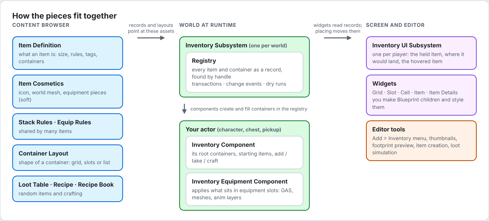

## Contents

1. [Overview](#1-overview)
2. [Installation and project setup](#2-installation-and-project-setup)
3. [Quick start](#3-quick-start)
4. [Core concepts](#4-core-concepts)
5. [Data assets](#5-data-assets)
6. [Components](#6-components)
7. [Grids: placement, rotation and sockets](#7-grids-placement-rotation-and-sockets)
8. [Equipment](#8-equipment)
9. [Loot tables](#9-loot-tables)
10. [Crafting](#10-crafting)
11. [User interface](#11-user-interface)
12. [Editor tools](#12-editor-tools)
13. [Loading and the Asset Manager](#13-loading-and-the-asset-manager)
14. [Game Features](#14-game-features)
15. [Scripting reference](#15-scripting-reference)
16. [How-to guides](#16-how-to-guides)
17. [Debugging and testing](#17-debugging-and-testing)
18. [Troubleshooting](#18-troubleshooting)
19. [Saving (not implemented yet)](#19-saving-not-implemented-yet)
20. [Design notes](#20-design-notes)

---

## 1. Overview

### 1.1 Features

| Area | What you get |
| --- | --- |
| Containers | Grids with items of any size that can turn 90 degrees, tagged slots, and ordered lists. Each container can have filters, and limit what the player can do to it. |
| Capacity | Storage that fits the game: fixed grids, grids that grow as upgrades add cells (up to a limit or without one), grids that grow to fit whatever is put in them, slots and lists that unlock, capacity upgrade items such as pouches, upgrades that let items stack higher, and an optional carry limit such as weight. |
| Nesting | Items can carry containers, such as a backpack's storage or a rifle's attachment slots, to any depth. |
| Stacks | Stacking, splitting, merging and swapping, with per-kind stack rules, and per-container stack bonuses from upgrades. |
| Item state | Tags and numeric tag values per item (durability, charge, ammo), plus fragments for structured data. |
| Equipment | Equipment slots that grant abilities, effects, attribute sets and tags, spawn meshes or actors on the character, and link anim layers. Grants scale with item level. |
| Sockets | Items in a grid can boost the items next to them. |
| Loot | Weighted pools, nested tables, tag conditions and random tag values. |
| Crafting | Recipes with consumed ingredients and tools, tag requirements, fixed and random outputs. |
| Safety | Every change is a transaction: it fully succeeds or is fully undone. |
| UI | Common UI screens and widgets for mouse, keyboard, gamepad and touch: drag and drop, placement previews, item menus and actions, recipe menus listing what an item makes, a description line, tabbed pages, numbers on items, details with stat comparisons, and shortcut bars. |
| Shortcuts | Quick slots that point at items the owner carries, follow them as they move, and move on to the next of the same kind. |
| Editor | A Modular Inventory menu on the Level Editor toolbar with this guide and the tools, an Inventory section in the Add menu, one-click item creation, an icon generator with a live studio, icon thumbnails, a socket preview, live loot drop rates, extra validation and automatic Asset Manager setup. |
| Debugging | A Gameplay Debugger category, Unreal Insights scopes, automation tests, and a console command to give items. |

### 1.2 Modules

| Module | Type | Contents |
| --- | --- | --- |
| `ModularInventory` | Runtime | Data assets, the registry and subsystem, Inventory and Equipment components, loot, crafting, the Game Feature action. |
| `ModularInventoryUI` | Runtime | The Inventory UI Subsystem, the screen, menu and widget base classes, and item actions. Needs Common UI and Modular UI. |
| `ModularInventoryEditor` | Editor | Editor tools and the documentation window. It is never part of a packaged game. |

### 1.3 Requirements

- Unreal Engine 5.7.
- The plugins **Gameplay Abilities**, **Game Features**, **Common UI** and **Modular UI**, and **Data Validation** for the editor. Modular Inventory turns them on for you. Modular UI is a separate plugin, so copy it into your project's `Plugins` folder too.
- An Ability System Component on actors that equip items, for the GAS grants only. Meshes, actors and anim layers work without one.

### 1.4 Glossary

| Term | Meaning |
| --- | --- |
| Item | One stack of something in a container: a record in the registry, not a UObject. |
| Item Definition | The data asset describing a kind of item: its size, rules, tags and visuals. |
| Handle | How you refer to an item or container: `FInventoryItemHandle`, `FInventoryContainerHandle`. |
| Container | A grid, slot set or list holding items. Built at runtime from a Container Layout. |
| Placement | Where an item sits in its container: a cell and rotation for grids, an index for slots and lists. |
| Storage | The containers new items go into: everything an Inventory Component holds except equipment slots. |
| Equipment container | A slot container whose layout has **Equipment** ticked. |
| Tag value | A number on an item, keyed by a gameplay tag. |
| Fragment | Any struct stored on a definition, item or container. |
| Context tags | Tags passed in when rolling loot or crafting, tested by conditions and requirements. |
| Capacity | How much a container can hold now: usable cells, unlocked slots, or the most items in a list. The rest is locked. See [4.7](#47-capacity-storage-that-grows). |
| Grid Growth | Whether a grid grows past its Grid Size: not at all, as upgrades add cells, or to fit its items. See [4.7](#47-capacity-storage-that-grows). |
| Capacity upgrade | An item with an Inventory Capacity Upgrade, such as a pouch: it adds room to one of its user's containers, or lets items stack higher there. |
| Stack bonus | How much higher matching items stack in one container than their definition says, from stack size upgrades. |
| Carry limit | An optional limit on the total of a tag value, such as weight, across everything an Inventory Component holds. See [4.9](#49-carry-limit). |
| Player Access | What a container lets the player do to its items through the UI. See [4.8](#48-player-access). |

---

## 2. Installation and project setup

### 2.1 Install the plugin

1. Copy the `ModularInventory` folder into your project's `Plugins` folder, so you have `YourProject/Plugins/ModularInventory/ModularInventory.uplugin`.
2. If your C++ code uses the plugin, add the modules to your module's `.Build.cs`:
   ```csharp
   PublicDependencyModuleNames.AddRange(new string[] { "ModularInventory", "ModularInventoryUI" });
   ```
   `ModularInventoryUI` is only needed if your C++ touches the widgets or the UI subsystem.
3. Close the editor. Right-click your `.uproject` and choose **Generate Visual Studio project files**.
4. Build the **Development Editor** configuration in your IDE.
5. Start the editor. Under **Edit > Plugins**, check that **Modular Inventory** is enabled.

> If the editor says *"The following modules are missing or built with a different engine version: ModularInventoryEditor"*, the plugin's modules weren't compiled. Close the editor, regenerate project files and build again from your IDE.

### 2.2 Asset Manager

The plugin needs two entries in **Project Settings > Game > Asset Manager > Primary Asset Types to Scan**. Both are saved in `Config/DefaultGame.ini`; commit that file afterwards.

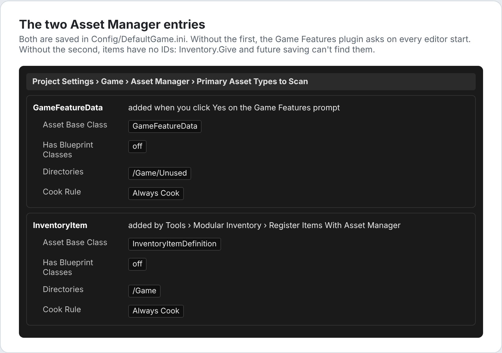

**GameFeatureData**, required by the Game Features plugin that Modular Inventory turns on. On the first start the editor asks:

> *Asset Manager settings do not include an entry for assets of type GameFeatureData, which is required for game feature plugins to function. Add entry to PrimaryAssetTypesToScan?*

Click **Yes**. The question then never comes back. If it keeps coming back, the entry wasn't saved: you clicked No, or `Config/DefaultGame.ini` is read-only. Add the entry by hand:

1. Open **Project Settings > Game > Asset Manager**.
2. Next to **Primary Asset Types to Scan**, click **+**.
3. Expand the new element and set:
   | Field | Value |
   | --- | --- |
   | Primary Asset Type | `GameFeatureData` |
   | Asset Base Class | `GameFeatureData` |
   | Has Blueprint Classes | off |
   | Is Editor Only | off |
   | Directories | `/Game/Unused` (any folder works; Game Feature data is found per plugin) |
   | Rules > Cook Rule | Always Cook |
4. Restart the editor.

**InventoryItem**, which gives every item definition an ID. There's nothing to do: as soon as the project has an item definition, the editor adds this entry by itself and says so in a notification. Commit `Config/DefaultGame.ini` afterwards.

| Field | Value |
| --- | --- |
| Primary Asset Type | `InventoryItem` |
| Asset Base Class | `InventoryItemDefinition` |
| Directories | `/Game` |
| Rules > Cook Rule | Always Cook |

- An `InventoryItem` entry the project already has is left as it is, so you can change its folders or rules.
- Item definitions saved by a version of the plugin from before items had this type are resaved once, so their IDs update.
- Nothing is changed while cooking or running unattended, such as on a build machine. If `Config/DefaultGame.ini` can't be written, the notification says so, and every item definition shows a validation warning when saved until the entry is there; make the file writable and open the editor again, or add the entry by hand as above.

See [13. Loading and the Asset Manager](#13-loading-and-the-asset-manager) for what the IDs are used for.

### 2.3 Gameplay tags

Containers, slots, item kinds and item numbers are all identified by gameplay tags. The plugin only defines `Inventory.Item.Level`; you create the rest.

To add tags, open **Project Settings > Project > GameplayTags**, click **Manage Gameplay Tags**, then click **+**, type the tag name, and save it to `DefaultGameplayTags.ini`.

A good starting set:

| Purpose | Example tags | Used in |
| --- | --- | --- |
| Container names | `Container.Inventory`, `Container.Equipment`, `Container.Backpack`, `Container.Pickup`, `Container.Chest` | Inventory Component containers, item containers, the UI's Container Tag |
| Equipment slots | `Equipment.Slot.Hand.Main`, `Equipment.Slot.Hand.Off`, `Equipment.Slot.Head`, `Equipment.Slot.Back` | Slot layouts, Equip Rules, Starting Equipment, slot widgets |
| Item kinds | `Item.Type.Weapon`, `Item.Type.Light`, `Item.Type.Ammo`, `Item.Type.Key`, `Item.Type.Consumable` | Item Definition tags, filters, recipes |
| Item numbers | `Item.Stat.Durability`, `Item.Stat.Charge`, `Item.Stat.Damage` | Tag values, loot ranges, sockets |
| Context | `Station.Workbench`, `Difficulty.Hard`, `Location.Basement` | Loot conditions, recipe requirements |
| Built in | `Inventory.Item.Level` | Item level; equipment grants scale with it |

Slot tags are matched hierarchically: equip rules that allow `Equipment.Slot.Hand` fit both `Equipment.Slot.Hand.Main` and `Equipment.Slot.Hand.Off`.

### 2.4 Common UI input

Only needed for the widgets.

- **Accept and Back** use your project's Common UI defaults (**Project Settings > Game > Common Input Settings > Input Data**). If menus already work with a gamepad, nothing changes here.
- **Move, Item Menu, Rotate, Split, Transfer, Take All and Confirm** are rows of a Common UI input action data table: **Add › Miscellaneous › Data Table**, row structure **CommonInputActionDataBase**. Give each row a display name and its keyboard and gamepad keys, such as:
  | Row | Example keys |
  | --- | --- |
  | Rotate | R; Gamepad Face Button Top |
  | Split | Left Shift; Gamepad Left Shoulder |
  | Item Menu | Tab; Gamepad Face Button Left |
  | Transfer | T; Gamepad Right Shoulder |

Pick the rows you want on your inventory screen ([11.3](#113-building-an-inventory-screen)). Each is bound while the player is doing something it's for, such as Rotate while an item is held, as the screen's **Action Availability** says. See [11.4](#114-input-and-interaction-style) for what they do.

---

## 3. Quick start

This builds a working inventory: a character that starts with a flashlight in hand and batteries in its inventory. Each step only uses what earlier steps created.

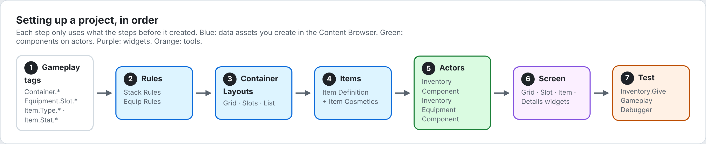

**Step 1. Create the tags.** Add `Container.Inventory`, `Container.Equipment`, `Equipment.Slot.Hand.Main`, `Item.Type.Light` and `Item.Stat.Charge` (see [2.3](#23-gameplay-tags)).

**Step 2. Create folders.** For example `Content/Inventory/Rules`, `Content/Inventory/Layouts`, `Content/Inventory/Items` and `Content/UI/Inventory`.

**Step 3. Create the rules.** In the Content Browser, click **Add > Inventory**:

| Asset | Type | Settings |
| --- | --- | --- |
| `SR_Battery` | Stack Rules | Max Stack Size `10`, Can Split on |
| `ER_HandItem` | Equip Rules | Slots: `Equipment.Slot.Hand` |

**Step 4. Create the container layouts.**

| Asset | Settings |
| --- | --- |
| `CL_Inventory` | Type **Grid**, Grid Size `6 × 4` |
| `CL_Equipment` | Type **Slots**, **Equipment** ticked, Slots: one element with Tag `Equipment.Slot.Hand.Main` and Display Name `Main Hand` |

**Step 5. Create the items.** Right-click your battery mesh (or its icon texture) and choose **Create Inventory Item**. Do the same for the flashlight. Then open each definition:

| Asset | Settings |
| --- | --- |
| `DA_Battery` | Size `1 × 1`, Stack Rules `SR_Battery`, Tags `Item.Type.Consumable` |
| `DA_Flashlight` | Size `1 × 2`, Equip Rules `ER_HandItem`, Tags `Item.Type.Light`, Tag Values `Item.Stat.Charge = 100` |

Items made from a mesh get an icon rendered from it. After changing an item's Size, right-click it and choose **Generate Item Icons** so the icon takes the new shape ([12.3](#123-item-icons)).

Open `DA_Flashlight_Cosmetics`. Under **Pieces**, add a **Static Mesh** piece and set:
- Mesh: the flashlight mesh;
- Attach Component: the name of your first-person mesh component;
- Attach Socket: the hand socket;
- First Person Primitive Type: First Person.

**Step 6. Commit the Asset Manager entry.** Creating the first item added the `InventoryItem` entry to `Config/DefaultGame.ini`, as a notification said ([2.2](#22-asset-manager)). Commit that file with your items.

**Step 7. Set up the character.** Open your character Blueprint and add an **Inventory Component** and an **Inventory Equipment Component** (**Add > Inventory**). Select the Inventory Component and set:

| Field | Value |
| --- | --- |
| Containers | `Container.Inventory` + `CL_Inventory`, and `Container.Equipment` + `CL_Equipment` |
| Preload Cosmetics | on |
| Starting Equipment | Slot `Equipment.Slot.Hand.Main`, Item Definition `DA_Flashlight` |
| Starting Items | Definition `DA_Battery`, Count `3` |

**Step 8. Test.** Press Play. The flashlight appears in your hand. Open the console with the backquote key (`` ` ``) and type `Inventory.Give DA_Battery 5`. Press the apostrophe key (`'`) and turn on the **Inventory** category: the inventory grid now holds one stack of 8 batteries.

**Step 9. Add a screen.** Follow [11.3 Building an inventory screen](#113-building-an-inventory-screen).

---

## 4. Core concepts

### 4.1 Items are records

Items are rows in one registry per world, owned by the **Inventory Subsystem**. You refer to them with handles. A handle remembers the slot and the slot's generation, so it can never reach an item that later reused the slot.

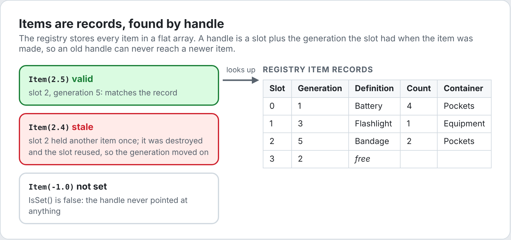

- A handle stays valid while its item exists, wherever the item moves: other containers, other actors, inside other items.
- `IsSet()` only says the handle was ever set. To know whether the item still exists, ask **Is Valid Item** on the subsystem.
- Containers work the same way with `FInventoryContainerHandle`.

### 4.2 Containers

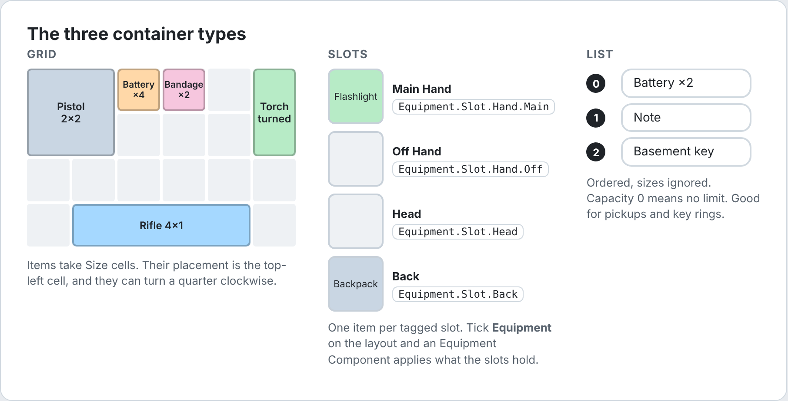

| Type | Placement | Behaviour |
| --- | --- | --- |
| Grid | `Cell` (top-left) and `Rotated` | Items take `Size` cells and may turn. See [7](#7-grids-placement-rotation-and-sockets). |
| Slots | `Index` | One item per slot. Each slot has a tag, a display name and its own filter. |
| List | `Index` (insert position) | Ordered. Item size is ignored. `Capacity` limits the count; 0 means unlimited. |

Containers are created at runtime from a **Container Layout**: by an Inventory Component on begin play, or with every item that carries containers.

### 4.3 Containers inside items

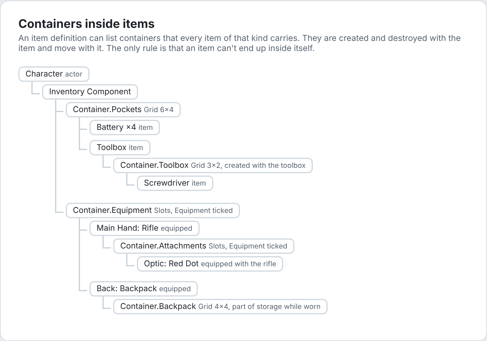

- Containers listed under an item definition's **Containers** are created with each item and destroyed with it. They move with the item, contents included.
- An item can't be put inside itself, directly or through other items (error `Would Contain Itself`).
- Items that carry containers never stack.
- Containers inside **equipped** items count as storage. A worn backpack holds new items; a backpack in the inventory grid also does, but after the grid.

### 4.4 Tags, tag values and item level

| | Definition | Item |
| --- | --- | --- |
| Tags | **Tags** on the definition | The definition's tags plus tags added to the item at runtime |
| Tag values | **Tag Values** on the definition: the defaults | Values set on the item. An item only stores a value once it differs from the default |

- **Defaults stay live.** Changing a definition's default changes every existing item that hasn't set its own value.
- **Stacking.** Two stacks merge only if they have the same definition and identical item state: tags, tag values and instance fragments. A battery at 50% charge doesn't merge with a full one.
- **Item level** is the tag value `Inventory.Item.Level`. Items without it are level 1. Equipment grants scale with it ([8.2](#82-what-equipping-does)).
- **Effective values** add socket bonuses ([7.2](#72-sockets)). Plain values and tags ignore sockets.

### 4.5 Item queries

`FInventoryItemQuery` describes which items match. It is used by container and slot filters, recipe ingredients, socket targets, and searches such as Find, Count and Remove Items.

| Field | Meaning | Empty means |
| --- | --- | --- |
| Definitions | The item must be one of these definitions. | any definition |
| Tag Query | Tested against the item's tags, its definition's included. | any tags |
| Value Conditions | Each condition compares a tag value: Equal, Not Equal, Less, Less Or Equal, Greater, Greater Or Equal. All must pass. | no conditions |

An empty query matches every item. Examples:

| Want | Query |
| --- | --- |
| Only ammo in a pouch | Tag Query: Any Tags Match `Item.Type.Ammo` |
| Weapons with durability left | Tag Query `Item.Type.Weapon`; Value Condition `Item.Stat.Durability` Greater `0` |
| A specific key | Definitions: `DA_Key_Basement` |

### 4.6 Transactions and errors

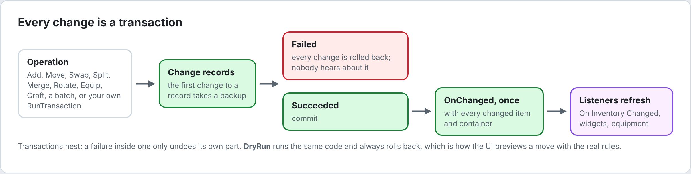

Every operation is all or nothing. Listeners hear about committed changes once, with the full set of changed items and containers.

| Operation | What it does |
| --- | --- |
| Add | Creates items from an item spec. Tops up matching stacks first unless a placement is given. |
| Remove | Removes a count from a stack, or the whole stack. |
| Move | Moves a stack, or part of one, to a container. Joins a stack if dropped on one. |
| Swap | Trades two items' places. Whole stacks only. |
| Split | Splits part of a stack into a new stack. |
| Merge | Moves count from one stack into another of the same kind. |
| Rotate | Turns a grid item a quarter, in place. |
| Equip / Unequip | Moves an item into or out of an equipment slot. |
| Batch | Runs several operations; if one fails, all are undone. |

Calls that can fail return or output an `EInventoryError`:

| Error | Meaning |
| --- | --- |
| None | Success. |
| Invalid Item / Invalid Container | The handle is stale or was never set. |
| Invalid Definition | No definition, or no recipe. |
| Invalid Count | The count is negative or more than the stack holds. |
| Invalid Tag / Invalid Fragment | Missing tag or fragment type. |
| Out Of Bounds | Outside the grid, or no such slot. |
| Occupied | The spot is taken. |
| Rejected | A container or slot filter refused the item. |
| Not Equippable | The equip rules don't allow the slot, another item blocks it, or the owner fails the requirements. |
| Cannot Rotate | The item can't turn, or turning doesn't fit. |
| Cannot Stack | Different kind or state, not stackable, or the stack is full. |
| Would Contain Itself | The target container is inside the item being moved. |
| No Space | Nothing fits anywhere. |
| Missing Ingredients | Not enough ingredients for the recipe. |
| Requirements Not Met | The recipe's requirements or Is Available refused. |
| At Max Capacity | The container can't grow any more: every cell or slot it can have is unlocked, or it has no limit to raise. |
| Over Carry Limit | Taking it would carry more than the Inventory Component's carry limit allows ([4.9](#49-carry-limit)). |

### 4.7 Capacity: storage that grows

A container's **capacity** is how much it can hold now. Whatever is past it is locked: nothing can go there, and inventory widgets draw it disabled.

| Type | Capacity is | It grows |
| --- | --- | --- |
| Grid | How many cells are usable, counted row by row from the top left | As its layout's **Grid Growth** says, below |
| Slots | How many slots are unlocked, from the first | Up to every slot the layout has |
| List | The most items it holds | Without end. A list without a limit has nothing to unlock |

**Grids.** A grid layout's **Grid Size** is the grid the player starts with. **Grid Growth** decides what happens next, and **Max Rows** is how far it can grow, 0 for no limit:

| Grid Growth | When the grid is full | How it grows | Such as |
| --- | --- | --- | --- |
| None | New items are turned away | It doesn't | Minecraft, Diablo II, a backpack of fixed size |
| With Upgrades | New items are turned away | Capacity upgrades, or Add Container Capacity, add cells after the last one. When added cells start a new row, the whole row is shown, with the cells not added yet disabled | Requiem and the Resident Evil games, Stardew Valley, a stash bought bigger |
| To Fit Items | New items are always taken | It adds rows as items need them, and loses empty rows at the bottom again, down to Grid Size | Baldur's Gate 3, Divinity: Original Sin 2 |

A 4 × 2 grid growing **With Upgrades** up to Max Rows 5, given pouches that add two cells each:

| Pouches | Capacity | The grid shows |
| --- | --- | --- |
| 0 | 8 | 4 × 2, every cell usable |
| 1 | 10 | 4 × 3: the third row's first two cells usable, its last two disabled |
| 2 | 12 | 4 × 3, every cell usable |
| 6 | 20 | 4 × 5, every cell usable. It can't grow any more: another pouch is turned away with **At Max Capacity** |

A grid growing **To Fit Items** shows the rows its items reach, never fewer than Grid Size, and a free row below them for the player to put items in. Move the last item up to the top, and the grid shrinks back. It never runs out of room before Max Rows, so capacity upgrades find nothing to add; to cap it by cells instead, and let upgrades raise the cap, give it a Starting Capacity where it's used.

Where a container's capacity comes from, the first that applies:

1. **At runtime**: capacity upgrade items ([5.11](#511-inventory-capacity-upgrade)), **Add Container Capacity** and **Set Container Capacity** on the Inventory Component, by container tag, and **Add Capacity** and **Set Capacity** on the Inventory Subsystem, by container handle. This is stored on the container, and saved with it.
2. **Where the layout is used**: the optional **Starting Capacity** of an Inventory Component's container ([6.1](#61-inventory-component)), or of an item definition's container ([5.1](#51-item-definition)), such as a harder difficulty starting the same 4 × 2 inventory with 6 usable cells.
3. **On the layout** ([5.5](#55-container-layout)): every cell of Grid Size, or for a grid growing To Fit Items as much as Max Rows allows; **Usable Slots**, or else every slot; **Capacity** for a list.

One layout serves every stage of an upgrade path, every difficulty and every character. Make another layout only for another shape. **Set Container Layout** swaps the shape itself, such as the Resident Evil 4 attaché case bought bigger; the container then follows the new layout's capacity.

Capacity never takes items away: locking a cell or slot an item sits on, or shrinking a list below what it holds, fails and changes nothing. Growing stops at the most the layout allows, and adding capacity fails with **At Max Capacity** once there's nothing left to unlock, so an upgrade can tell it isn't needed.

**Bigger stacks.** A container can also let items stack higher than their definitions say, such as ammo that stacks to 40 instead of 30 once the player finds an ammo case. That's a **stack bonus**: a capacity upgrade of the kind Stack Size adds one ([5.11](#511-inventory-capacity-upgrade)), and so do **Add Container Stack Bonus** on the Inventory Component and **Add Stack Bonus** on the Inventory Subsystem. Bonuses stay with the container and add up. A stack bigger than a container allows, such as one moved from the inventory into a chest, stays whole there but takes no more.

### 4.8 Player access

A layout's **Player Access** says what the player may do to its containers' items through the inventory UI. Code is never limited by it: pickups, crafting and quest scripts still add, move and remove items freely.

| Player Access | The player can | Such as |
| --- | --- | --- |
| Full | Take items out, put items in and move them around | A player's inventory, backpacks, chests |
| Take Only | Take items out and move them around inside, but not put anything in | A corpse's loot, a shop's stock |
| Put Only | Put items in, but not take them back out or move them | A donation box, a quest turn-in, an offering |
| Read Only | Look at the items and open their item menus, and nothing else | Key items that come and go by themselves |

Item menus work on items the player can't move, so a key item can still be examined, used or combined. For rules about single items rather than whole containers, such as an item that can't be discarded, use the item actions' **Item Filter** ([11.8](#118-item-menus-and-item-actions)).

### 4.9 Carry limit

An Inventory Component can limit the total of a tag value across everything it holds, such as weight. It's off unless you turn it on, in the component's **Carry Limit** settings ([6.1](#61-inventory-component)):

| Carry Limit | What happens past Max Carried | Such as |
| --- | --- | --- |
| None | Nothing: only the room in its containers limits it | Most games with grids |
| Refuse | Items that would take the total past **Max Carried** are turned away, with **Over Carry Limit** | Survival games with a hard limit |
| Allow Over | Items are always taken; the component is over its limit, and fires **On Over Carry Limit Changed**, for the game to slow the owner down | Skyrim, Fallout, Baldur's Gate 3 |

- **Carried Value Tag** is the tag value that adds up, such as `Item.Stat.Weight`. Each item counts its value times its count, and an item counts everything inside it, so a full backpack weighs what's in it. Equipped items count too.
- With **Refuse**, every way in keeps to it: pickups, chests, dragging in the inventory UI, and code using the Inventory Subsystem. A partial pickup, such as Take Item with Allow Partial, takes as much of a stack as can be carried and leaves the rest.
- **Get Carried**, **Get Max Carried**, **Get Carry Room** and **Is Over Carry Limit** tell the game where it stands, such as for a weight bar. **Set Max Carried** changes the limit at runtime, such as for a strength bonus. Lowering it never drops anything.

### 4.10 Inventory Component or Inventory Subsystem?

Both change the same inventory. They're meant for different jobs:

| Use | For | Works by | Such as |
| --- | --- | --- | --- |
| **Inventory Component** | Gameplay: an actor's inventory | Container tags, and items it should take | Give an item, take a pickup's item, take everything from a chest, use an upgrade, add capacity, craft, read the carry limit |
| **Inventory Subsystem** | Anything else, on any container or item | Handles | Put an item on an exact cell, look into a chest's container, read or change an item's tag values, sort, equip into a given slot, run a batch |

Start with the Inventory Component. It applies the actor's rules: capacity upgrades are used as they're taken instead of being stored, new items go to its storage containers in order, and its events fire. The Inventory Subsystem does exactly what it's asked to the container it's given: its Add Item on the inventory's container stores a pouch rather than using it.

Handles are for items and containers that already exist. You get them from the Inventory Component's Get Container, Find Items or Add Item, from widgets and item menus, and from events. To create an item you don't need one: **Add Item** takes an item spec, a definition and a count, and **Add Item By Definition** takes just those two.

### 4.11 The inventory process, end to end

What happens to an item from the moment it exists until it's gone, and which part of the plugin handles each step.

**1. Setting up (data, before play)**

- An **Item Definition** describes a kind of item: size, stack rules, tags and tag values, equip rules, fragments such as a capacity upgrade, and cosmetics ([5.1](#51-item-definition)).
- A **Container Layout** describes a container: grid, slots or list, how it grows, its filter and its Player Access ([5.5](#55-container-layout)).
- An **Inventory Component** on an actor lists its containers, each a tag and a layout, plus starting items, equipment and loot, and an optional carry limit ([6.1](#61-inventory-component)).

**2. Begin play**

The Inventory Component creates its containers in the world's registry, places its starting equipment, adds its starting items (capacity upgrades among them are applied, not stored), and rolls its starting loot.

**3. Coming in**

An item enters an inventory in one of these ways, each ending in the same registry checks:

| Way in | Call | Notes |
| --- | --- | --- |
| A new item | Inventory Component › Add Item, Add Item By Definition, Add Loot | Creates the item in storage, topping up stacks first |
| From somewhere else | Inventory Component › Take Item, Take All, Transfer Item | Moves an existing item, such as a pickup's or a chest's |
| By the player | The inventory UI: dragging, Shift Click Transfers, Take All | Goes through the Inventory UI Subsystem ([11.7](#117-inventory-ui-subsystem)) |
| Crafting | Inventory Component › Craft, Craft From Items | Uses up ingredients, then adds the results, all or nothing |
| Exactly placed | Inventory Subsystem › Add Item At, Move Item To | For code that chooses the cell or slot |

Every way in passes the same checks, in this order: the container's **Filter**; the **entry check**, which applies equip requirements and the owner's **carry limit**; then room: free cells or a free slot within the container's **capacity**, or a stack with space below its **stack limit**. The inventory UI also follows **Player Access**. A capacity upgrade taken by an Inventory Component with its container is applied instead of stored.

**4. While it's held**

- Its state lives on its record: count, tags, tag values such as durability, and fragments ([4.4](#44-tags-tag-values-and-item-level)). Change it with the Inventory Subsystem's Set Tag Value, Add Item Tag and the fragment functions.
- Equipping is a move into an equipment slot; the Equipment Component then grants abilities, effects and visuals ([8](#8-equipment)).
- Neighbouring items' sockets and attached items change its effective values ([7.2](#72-sockets)).
- Every change runs in a transaction and is reported once committed ([4.6](#46-transactions-and-errors), [15.6](#156-events-what-fires-when)).

**5. Going out**

| Way out | Call |
| --- | --- |
| Used up | Inventory Component › Remove Items (by query); Inventory Subsystem › Remove Item (one stack) |
| Handed over | Inventory Component › Transfer Item; the other component's Take Item |
| Dropped by the player | The inventory UI's On Dropped Outside, or an item action that spawns a pickup holding it |
| Consumed by crafting | Craft, Craft From Items |
| With its owner | End play destroys a component's containers and everything in them; move items first if they should stay |

---

## 5. Data assets

Create every asset type with **Add > Inventory** in the Content Browser, or right-click an empty area of a folder.

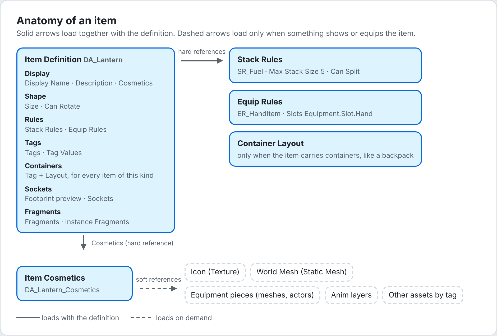

### 5.1 Item Definition

What a kind of item is. Every item record points at one.

| Category | Field | Default | Description |
| --- | --- | --- | --- |
| Display | Display Name | empty | Shown by widgets and pickups. |
| Display | Description | empty | Multi-line text for details panels. |
| Display | Cosmetics | None | The Item Cosmetics asset holding the visuals. |
| Shape | Size | 1 × 1 | Cells taken in grids: X wide, Y tall. Ignored by slots and lists. |
| Shape | Can Rotate | on | Whether the item may turn a quarter in grids. |
| Rules | Stack Rules | None | None: the item never stacks. |
| Rules | Equip Rules | None | None: the item can't be equipped. |
| Tags | Tags | empty | What kind of item this is. Matched by queries and filters. |
| Tags | Tag Values | empty | Starting numbers, such as `Item.Stat.Charge = 100`. |
| Containers | Containers | empty | Tag + Layout pairs, each with an optional **Starting Capacity** ([4.7](#47-capacity-storage-that-grows)). Every item of this kind carries these containers. |
| Sockets | Footprint | | Editor preview of cells and sockets ([12.4](#124-item-definition-details)). |
| Sockets | Sockets | empty | Boosts for neighbouring items ([7.2](#72-sockets)). |
| Fragments | Fragments | empty | Structs shared by all items of this kind, such as a use sound, or the plugin's **Inventory Capacity Upgrade** ([5.11](#511-inventory-capacity-upgrade)). |
| Fragments | Instance Fragments | empty | Structs copied onto each new item as its own state, such as a magazine. |

- **Asset Manager ID:** `InventoryItem:<asset name>`, so item definition names must be unique across the project.
- **Stack size:** taken from the Stack Rules. It is always 1 without Stack Rules, or when the item carries containers.
- **Validation** checks the size, container layouts, duplicate container tags, empty sockets, fragments, capacity upgrades without a container, and Asset Manager registration. The editor also checks for items sharing a name, and for missing or wrongly shaped icons ([12.9](#129-data-validation)).

### 5.2 Item Cosmetics

Everything visual about an item, all soft references. It is separate from the definition so that loading definitions never loads meshes or textures, and so artists and designers can edit different assets. Several definitions can share one.

| Category | Field | Description |
| --- | --- | --- |
| Display | Icon | Texture for widgets and Content Browser thumbnails. |
| Display | World Mesh | Static mesh for the item lying in the world. |
| Equipment | Pieces | What appears on the owner while the item is equipped. See below. |
| Equipment | Anim Layers | Anim layer classes linked while equipped. |
| Assets | Assets | Any other assets keyed by tag: sounds, effects, materials. Your code loads them. |

**Pieces.** Add one or more. Choose the type from the dropdown.

| Piece | Own fields | Spawns |
| --- | --- | --- |
| Actor | Actor Class | An actor attached to the owner. If it implements **Inventory Equipment Actor Interface**, it gets **On Equipped** (Equipment, Item, Slot) right after spawning. |
| Static Mesh | Mesh | A static mesh component. |
| Skeletal Mesh | Mesh, Follow Parent Pose, Anim Class | A skeletal mesh component. **Follow Parent Pose** copies the pose of the mesh it attaches to, for clothing and armour. Otherwise **Anim Class** animates it. |

Fields on every piece:

| Field | Description |
| --- | --- |
| Attach Component | A component tag or name on the owner. None attaches to the character mesh, or the root. Pieces of attachments attach to their parent item's first piece instead. |
| Attach Socket | Socket or bone name on that component. |
| Relative Transform | Offset from the socket. |
| First Person Primitive Type | For first-person rendering: **First Person** for the first-person view, **World Space Representation** for the world body. |

**Anim Layers.** Each element has a **Target Mesh** (component tag or name; None uses the character mesh) and a **Layer Class**. When several equipped items link the same layer interface, the last one equipped wins. When an item is unequipped, the remaining items' layers are linked again.

### 5.3 Stack Rules

How items of a kind stack. Share one asset between items, such as one for all ammo.

| Field | Default | Description |
| --- | --- | --- |
| Max Stack Size | 10 | Most items in one stack. |
| Can Split | on | Whether a stack may be divided. Off: stacks always move whole. |

### 5.4 Equip Rules

Where an item can be equipped and what it grants. Share one asset between items, such as one for all pistols.

| Category | Field | Description |
| --- | --- | --- |
| Slots | Slots | Slot tags the item fits. A slot matches if its tag is one of these or a child of one. |
| Slots | Blocked Slots | Slots in the same container that must stay empty while equipped, such as the off hand for a two-handed weapon. |
| Requirements | Owner Requirements | Tags the owner's Ability System Component must have (Require Tags) or must not have (Ignore Tags), or a tag query. |
| Granted | Abilities | Ability class, **Level** (default 1) and **Scale With Item Level** (default on). |
| Granted | Effects | Effect class, **Level** and **Scale With Item Level**. |
| Granted | Attribute Sets | Attribute set classes added while equipped. |
| Granted | Owner Tags | Loose tags added to the owner while equipped. |

**Level scaling.** With Scale With Item Level on, the granted level is `Level + ItemLevel - 1`:

| Level | Item level | Granted level |
| --- | --- | --- |
| 1 | 1 | 1 |
| 1 | 3 | 3 |
| 2 | 3 | 4 |
| 2 | 3, scaling off | 2 |

If the item's level changes while it's equipped, the grants are updated in place.

### 5.5 Container Layout

The shape and rules of a container. It is shared by every container built from it, on actors or inside items.

| Category | Field | Shown for | Description |
| --- | --- | --- | --- |
| Layout | Type | all | Grid, Slots or List. |
| Layout | Grid Size | Grid | Columns × rows: the grid each container starts with. Every cell of it is usable. Default 4 × 4. |
| Layout | Grid Growth | Grid | Whether the grid grows past Grid Size: **None**; **With Upgrades**, as capacity upgrades add cells, turning away what doesn't fit; or **To Fit Items**, adding rows whenever an item doesn't fit ([4.7](#47-capacity-storage-that-grows)). Default None. |
| Layout | Max Rows | Grid, with Grid Growth | The most rows the grid can grow to. 0 for no limit. |
| Layout | Slots | Slots | Each slot has a **Tag**, a **Display Name** and a **Filter**, which applies on top of the layout's. |
| Layout | Usable Slots | Slots | How many slots each container starts with unlocked, from the first. 0 unlocks them all. |
| Layout | Capacity | List | The most items each container starts able to hold; 0 means unlimited. |
| Layout | Equipment | Slots | The slots are equipment: only items whose equip rules allow the slot fit, and an Equipment Component applies them. |
| Rules | Filter | all | Query every item must match. Empty accepts anything. |
| Rules | Player Access | all | What the player may do to the items through the inventory UI: Full, Take Only, Put Only or Read Only ([4.8](#48-player-access)). Code is never limited by it. |
| Tags | Tags | all | Tags for your own logic. |
| Fragments | Fragments / Instance Fragments | all | Static data, and per-container state. |

Grid Size, Usable Slots and Capacity are where containers start. Grid Growth and Max Rows say how a grid grows, slots unlock up to the last one, and lists grow without end. Where a layout is used, a Starting Capacity can start a container elsewhere, and capacity can grow at runtime ([4.7](#47-capacity-storage-that-grows)). Layouts saved with the earlier **Read Only In UI** setting load as Read Only.

### 5.6 Loot Table

Random item generation. See [9. Loot tables](#9-loot-tables) for how a roll works.

| Level | Field | Default | Description |
| --- | --- | --- | --- |
| Pool | Min Rolls / Max Rolls | 1 / 1 | How many times the pool rolls. |
| Pool | Condition | empty | Tag query against the context tags. Empty always passes. |
| Pool | Entries | | What a roll can pick. |
| Entry | Type | Item | **Item**, **Table** (roll another table) or **Nothing**. |
| Entry | Item / Table | | What to give or roll. |
| Entry | Min Count / Max Count | 1 / 1 | Item: how many. Table: how many times to roll it. |
| Entry | Weight | 1 | Chance relative to the pool's other entries. |
| Entry | Condition | empty | Tag query; entries that fail are skipped. |
| Entry | Tag Values | | Item only: Tag, Min, Max, Whole Number. Random starting values. |
| Drop Rates | Simulation Rolls / Simulation Context | 1000 | Editor-only live odds ([12.6](#126-loot-table-drop-rates)). |

### 5.7 Recipe

Turns ingredients into items. See [10. Crafting](#10-crafting).

| Field | Description |
| --- | --- |
| Display Name | Name for crafting menus. |
| Tags | Tags for your own logic, such as a category. |
| Requirements | Tag query against the context tags: the station's tags you pass, plus the crafter's. Empty always passes. |
| Ingredients | Each has a **Query**, a **Count** and **Consume**. Consume off makes it a tool that is required but kept. **Display Item** is what recipe menus show for it, such as one item standing for a tag query; without one they show the query's first definition, or the first held item that matches. |
| Outputs | Item specs added on every craft. |
| Random Outputs | A loot table rolled on every craft and added to the outputs. |
| Fragments | Anything else your game needs, such as craft time. |

To add custom rules, make a Blueprint child of the recipe class and override **Is Available**.

### 5.8 Recipe Book

A list of recipes, such as everything a workbench can make. **Get Recipes** returns its own recipes followed by any added by Game Features.

### 5.9 Item specs

An item spec says what to create. It is used by Starting Items, Starting Equipment, recipe outputs, Add Item and loot results.

| Field | Default | Description |
| --- | --- | --- |
| Definition | | The item definition. |
| Count | 1 | How many. |
| Tag Values | empty | Set on the new item, replacing the definition's defaults. |
| Tags | empty | Added to the item's tags. |
| Fragments | empty | Replace the definition's instance fragment of the same type, or add a new one. |

### 5.10 Suggested names

| Asset | Prefix | Example |
| --- | --- | --- |
| Item Definition | `DA_` | `DA_Flashlight` |
| Item Cosmetics | `DA_` + `_Cosmetics` | `DA_Flashlight_Cosmetics` |
| Stack Rules | `SR_` | `SR_Ammo` |
| Equip Rules | `ER_` | `ER_HandItem` |
| Container Layout | `CL_` | `CL_Inventory` |
| Loot Table | `LT_` | `LT_Drawer` |
| Recipe | `RCP_` | `RCP_Torch` |
| Recipe Book | `RB_` | `RB_Workbench` |
| Item icon | `T_` + `_Icon` | `T_Flashlight_Icon` |

The editor tools name the item definitions, cosmetics and icons they create this way. Change the prefixes in the settings ([12.8](#128-settings)).

### 5.11 Inventory Capacity Upgrade

A fragment the plugin provides. Add it to an item definition's **Fragments** to make the item let one of its user's containers hold more: a pouch that adds two cells, a ring slot earned during play, a satchel that holds five more items, or an ammo case that lets ammo stack higher. No code is needed.

| Field | Default | Description |
| --- | --- | --- |
| Container Tag | | The Inventory Component's container it upgrades, such as `Container.Inventory`. That's how it knows which container: the component that uses it upgrades its own container with this tag. |
| Kind | Room | **Room** adds cells to a grid, slots to slots, or items to a list. **Stack Size** lets matching items stack higher in the container. |
| Amount | 1 | How much one of the item adds. Room: cells for a grid, added after the last one; slots; items for a list. Stack Size: how many more of each matching item one stack holds. |
| Stack Items | empty | Stack Size only: which items stack higher, such as a Tag Query of `Item.Type.Ammo`. Empty means every item that stacks. |
| Apply When Taken | on | An Inventory Component with that container uses the item up as it takes it, with Add Item, Take Item, Take All or Add Loot, so it never needs room. Off, the item is kept like any other until **Apply Capacity Upgrade** uses it, such as from an item menu. |

- Only Inventory Components with the container apply it. A chest or a pickup holding the item keeps it like any other.
- Room needs room to add: a grid that grows **With Upgrades**, a grid started smaller than its Grid Size with a Starting Capacity, locked slots, or a list with a Capacity. Growing stops at the most the layout allows, such as a grid's **Max Rows**: +2 with one cell left adds that one. Once the container can't grow any more, taking an upgrade that's applied when taken fails with **At Max Capacity** and leaves it where it was. **Can Take Item** says so beforehand, so a pickup can show it can't be taken.
- Each upgrade used up fires the component's **On Capacity Upgraded**, such as to tell the player.
- Moving the item into the inventory by hand in the UI stores it, as dragging only moves items. The **Apply Capacity Upgrade** item action ([11.8](#118-item-menus-and-item-actions)) uses an upgrade the player carries.

---

## 6. Components

### 6.1 Inventory Component

Gives an actor its own containers. Use it on characters, chests, drawers and pickups. It's the gameplay way in to an actor's inventory, by container tag; the Inventory Subsystem works on any container by handle ([4.10](#410-inventory-component-or-inventory-subsystem)).

| Field | Description |
| --- | --- |
| Containers | Tag + Layout pairs, each with an optional **Starting Capacity**: how much the container holds when play begins, instead of its layout's ([4.7](#47-capacity-storage-that-grows)). Each becomes a root container on begin play. The order matters for where new items go. |
| Preload Cosmetics | Keeps the cosmetics of everything held here loaded ([13.2](#132-when-soft-assets-load)). Turn it on for the player only. |
| Starting Items | Item specs added on begin play. |
| Starting Equipment | Slot + item spec. Each is placed straight into the first equipment container that has that slot. |
| Starting Loot | A loot table rolled on begin play, such as a drawer's contents. |
| Starting Loot Context | Context tags for that roll. |
| Carry Limit | **None** (default), **Refuse** or **Allow Over**: whether a total of Carried Value Tag across everything it holds, such as weight, limits what it takes ([4.9](#49-carry-limit)). |
| Carried Value Tag | The tag value that adds up, such as `Item.Stat.Weight`. |
| Max Carried | The most it can carry before it's over its limit. Default 100. |

**Lifecycle**

1. **Begin play** creates the containers with their Starting Capacity, places the Starting Equipment, adds the Starting Items, rolls the Starting Loot, then starts preloading if it's on. Items that don't fit are logged as warnings.
2. **End play** destroys the containers and everything in them. Move items elsewhere first if they should survive, such as with Transfer Item.

**Where new items go**

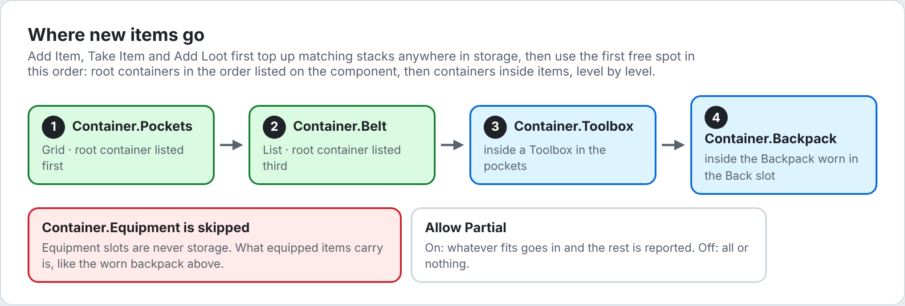

**Functions**

| Function | Description |
| --- | --- |
| Find Inventory Component (Actor) | Static. The first Inventory Component on an actor. |
| Get Containers / Get Container (Tag) | Root containers, or the one with a tag. |
| Get Storage Containers / Get Equipment Containers | The containers new items go into, and the equipment slot containers. |
| Owns Container / Owns Item | Whether something is inside this component, at any depth. |
| Add Item (Spec, Allow Partial) | Creates items in storage and returns how many were added. Out Items lists the stacks touched. A capacity upgrade applied when taken is applied instead ([5.11](#511-inventory-capacity-upgrade)). |
| Add Item By Definition (Definition, Count, Allow Partial) | Add Item with nothing but a definition and a count, such as to give the player an item from a Blueprint. |
| Add Loot (Table, Context Tags, Allow Partial) | Rolls a table and adds the results. The owner's ability tags join the context. |
| Take Item (Item, Count, Allow Partial) | Moves an item from anywhere into this storage. Count 0 takes the whole stack. A capacity upgrade applied when taken is used up instead. |
| Transfer Item (Item, Target, Count, Allow Partial) | Moves an item into another component's storage. |
| Remove Items (Query, Count) | Removes matching items from everything held. Count 0 removes all of them. Returns how many were removed. |
| Find Items (Query) / Count Items (Query) | Searches everything held, equipment and nested containers included. |
| Get Container Capacity / Get Container Max Capacity (Container Tag) | How much the container holds now, and the most it can grow to. -1 for no limit. |
| Add Container Capacity / Set Container Capacity (Container Tag, Count) | Adds room to the container, or sets it, such as two cells for a story reward. Adding fails with At Max Capacity when it can't grow any more. |
| Add Container Stack Bonus (Container Tag, Item Query, Amount) | Lets matching items stack Amount higher in the container. |
| Apply Capacity Upgrade (Item) / Can Apply Capacity Upgrade (Item) | Applies the item's Inventory Capacity Upgrade to the container its Container Tag names and uses one of the item up, wherever it is. Upgrades with Apply When Taken apply as they're picked up, so this is for the others, such as from the Apply Capacity Upgrade item action. |
| Get Carried / Get Max Carried / Set Max Carried / Get Carry Room / Is Over Carry Limit | The carry limit ([4.9](#49-carry-limit)). |
| Can Craft / Craft / Craft Preferring / Get Craft Error / Get Craftable Times / Get Craftable Recipes / Get Recipes Using | See [10](#10-crafting). |
| **On Inventory Changed** (event) | Fires once per committed change touching any of its containers, nested ones included. |
| **On Capacity Upgraded** (event) | A capacity upgrade was applied to one of its containers: the container's tag and the upgrade's definition, once for each upgrade used up. |
| **On Over Carry Limit Changed** (event) | It went over its carry limit, or back under it. |

### 6.2 Inventory Equipment Component

Applies whatever sits in the owner's equipment slots. It has no settings.

- **Needs** an Inventory Component on the same actor. Its equipment slots are that component's containers whose layout has **Equipment** ticked.
- **For GAS grants**, the actor must expose an Ability System Component through the Ability System Interface.

| Function | Description |
| --- | --- |
| Find Equipment Component (Actor) | Static. |
| Equip Item (Item, Slot) | Moves the item into the first equipment container with that slot. The slot's current item swaps places with it, or goes to storage. |
| Equip In Place (Item, Slot) | Equips an item the owner carries without moving it, such as a weapon in hand that keeps its place in a grid. Its equip rules must allow the slot; use a slot no equipment container has. Whatever was equipped in place in that slot stops being equipped, and the item stays equipped until unequipped or until it leaves the inventory. |
| Unequip Item (Item) / Unequip Slot (Slot) | Moves the item to a free spot in storage. An item equipped in place just stops being equipped. |
| Get Equipped Item (Slot) | The item in a slot. |
| Get Equipped Items | Every applied item, attachments included, parents first. |
| Is Equipped (Item) | |
| Get Spawned Pieces (Item) | The actors and components an item spawned. Empty until its cosmetics finish loading. |
| Get Item For Ability (Ability Spec Handle) | The equipped item that granted an ability. |
| **On Item Equipped / On Item Unequipped** (events) | Item and slot. |

### 6.3 Inventory Shortcut Component

Shortcut slots that point at items the owner carries, without moving them: quick slots, favourites, a weapon wheel. A slot follows its item wherever it moves in the owner's inventory. Activating a slot only reports it, so each game decides what that does: draw a weapon, use a potion, cast. Needs an Inventory Component on the same actor. For a hotbar that holds the items themselves, use a Slots container instead.

| Field | Default | Description |
| --- | --- | --- |
| Slots | 4 | One entry per slot: an optional **Tag**, such as the input tag of the key that activates it, a **Display Name**, and a **Filter** on top of the component's. |
| Filter | empty | What can go on any slot. Empty takes any item. |
| Auto Assign New Items | off | Items the owner gains go on the first empty slot that takes them, unless an item of the same kind has a slot already. What the owner starts with counts too. |
| Auto Assign Filter | empty | Only new items that match are put on a slot by themselves. |
| Follow Same Kind | on | When a slot's item goes away, such as a stack used up, the slot points at another item of the same kind the owner has. Off, it empties. |

| Function | Description |
| --- | --- |
| Find Shortcut Component (Actor) | Static. |
| Assign Item (Slot, Item) | Puts the item on the slot, taking it off any other. False when the owner doesn't have it or the slot doesn't take it. |
| Assign To Free Slot (Item) | Puts the item on the first empty slot that takes it, unless it has one already. Returns the slot, or -1. |
| Clear Slot, Clear All Slots, Swap Slots | |
| Activate Slot (Slot) / Activate Slot With Tag (Tag) | Reports the slot as activated, with its item, through **On Shortcut Activated**, or a C++ subclass's Native On Shortcut Activated. |
| Get Slot Item, Get Slot Items, Find Slot Of Item, Find Slot With Tag, Get Num Slots, Get Slot Tag, Get Slot Display Name, Can Assign | |
| **On Shortcuts Changed** / **On Shortcut Activated** (events) | A slot's item changed; a slot was activated. |

Show the slots with Inventory Shortcut Widgets ([11.12](#1112-shortcut-widgets)).

---

## 7. Grids: placement, rotation and sockets

### 7.1 Placement and rotation

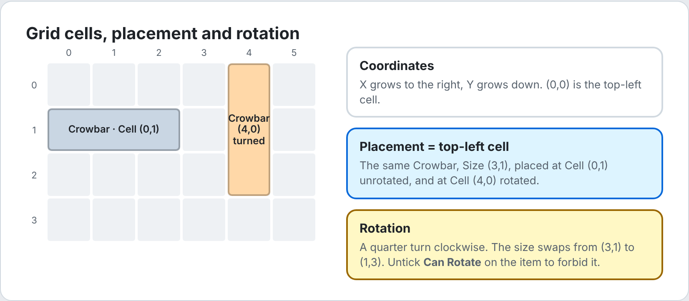

- X grows to the right and Y grows down. Cell (0,0) is the top-left.
- An item's placement is its top-left cell.
- Rotating turns an item a quarter clockwise and swaps its size: (3,1) becomes (1,3).
- **Rotate Item** turns an item in place if it still fits. Moves can also set the Rotated flag of the target placement.

### 7.2 Sockets

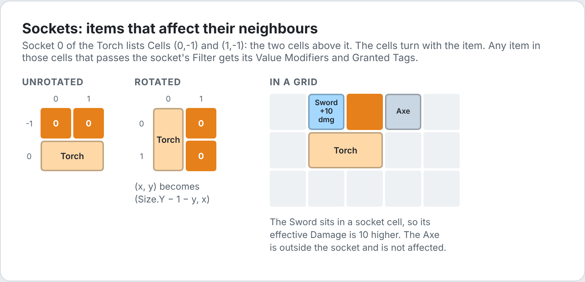

A socket lets an item affect neighbouring items in a grid. Sockets do nothing in slot or list containers.

| Field | Description |
| --- | --- |
| Cells | Cells relative to the item's top-left cell, **before rotation**. (0,-1) is directly above it; (Width,0) is to the right of its top-right cell. |
| Filter | Which items are affected. Empty affects any item. |
| Value Modifiers | Tag + value, added to affected items' effective tag values. |
| Granted Tags | Added to affected items' effective tags. |

- When the item turns, every socket cell (x, y) becomes (Size.Y − 1 − y, x).
- Read the results with **Get Effective Tag Value** and **Get Effective Item Tags**. **Get Socket Sources** lists the items affecting an item.
- Filters and queries never see socket bonuses, so placing an item can't change what its neighbours accept.
- Check your sockets with the Footprint preview ([12.4](#124-item-definition-details)).

---

## 8. Equipment

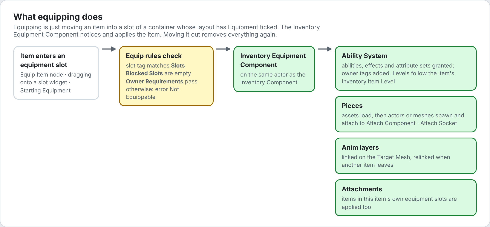

### 8.1 Making an item equippable

1. Give the item an **Equip Rules** asset whose **Slots** include the slot's tag, or a parent tag.
2. Give the owner a container whose layout is **Slots** with **Equipment** ticked and a slot with that tag.
3. Put the item in the slot with **Equip Item**, by dragging it onto a slot widget, or with **Starting Equipment**.

To equip an item without moving it, skip step 2 and call **Equip In Place** instead. The item keeps its spot, in a grid say, and everything in 8.2 still applies.

### 8.2 What equipping does

| Part | Behaviour |
| --- | --- |
| Abilities | Granted at their level. The Equipment Component is the ability's source object, so **Get Item From Ability** finds the item. |
| Effects | Applied at their level. |
| Attribute Sets | Added to the owner's Ability System Component. |
| Owner Tags | Added as loose tags. |
| Pieces | Assets load asynchronously; then actors or meshes spawn and attach. |
| Anim Layers | Linked on the target mesh. |
| Attachments | Items in the equipped item's own equipment containers are applied too. Their pieces attach to the parent item's first piece. |

Moving the item out of the slot removes all of it. Changing the item's level updates ability and effect levels in place.

### 8.3 First-person setups

- Set **Attach Component** to the name of your first-person arms mesh, and **First Person Primitive Type** to First Person.
- To also show the item on the world body, for shadows and reflections, add a second piece attached to the body mesh with **World Space Representation**.
- Linked anim layers for the arms need **Target Mesh** set to the arms mesh.

### 8.4 Equipment actors and Mutable

Use an **Actor** piece for anything a mesh can't do: lights, physics, Mutable characters. Implement **Inventory Equipment Actor Interface** on the actor. **On Equipped** gives you the Equipment Component, the item handle and the slot, so the actor can read the item's tag values and fragments. For example, it can build a Customizable Object instance from them.

### 8.5 Abilities that need their item

Inside an ability granted by an item, call **Get Item From Ability** (Self). With the handle, read the item's state through the Inventory Subsystem, such as **Get Tag Value** `Item.Stat.Charge`.

---

## 9. Loot tables

### 9.1 How a roll works

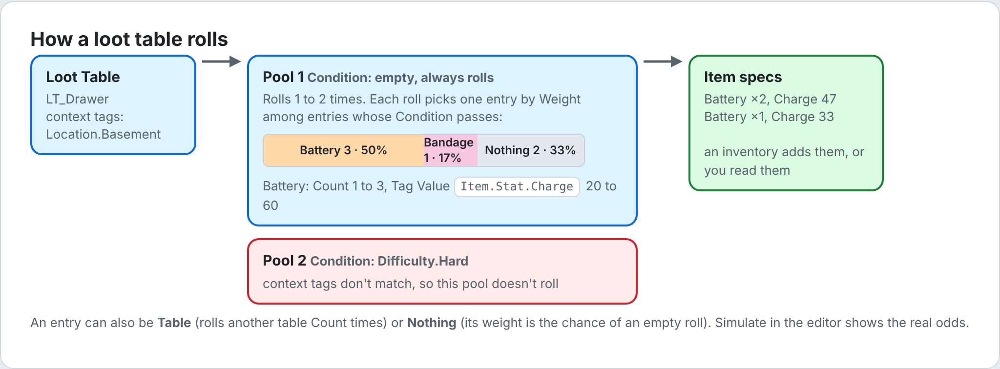

1. Each pool whose **Condition** passes rolls a random number of times between **Min Rolls** and **Max Rolls**.
2. Each roll picks one entry by **Weight**, among entries whose **Condition** passes and whose weight is above 0.
3. **Item** gives a random count between Min and Max, and rolls any **Tag Values** ranges.
4. **Table** rolls that table Count times. Tables nest up to 16 deep.
5. **Nothing** gives nothing. Its weight is the chance of an empty roll.

Rolls are deterministic for a given random stream, so a fixed seed gives the same loot every time.

### 9.2 Using loot tables

| Where | How |
| --- | --- |
| Containers that start filled | Inventory Component › **Starting Loot** and **Starting Loot Context** |
| On an event | Inventory Component › **Add Loot** (Table, Context Tags, Allow Partial) |
| Results without adding them | **Roll Loot Table** (Table, Context Tags, Seed). Seed -1 is random. Returns item specs. |
| Crafting | Recipe › **Random Outputs** |

### 9.3 Checking the odds

Open the table and look at its **Drop Rates** section. Set **Simulation Context** to the tags a real roll would have; the rates update as you edit the table ([12.6](#126-loot-table-drop-rates)).

---

## 10. Crafting

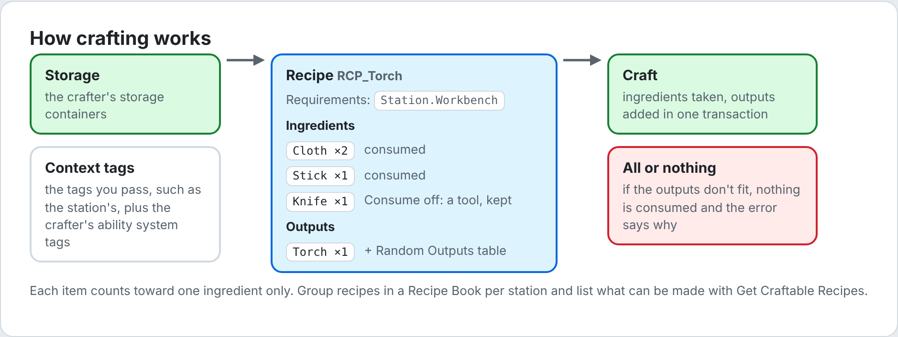

### 10.1 Rules

- Ingredients come from the crafter's storage containers. Each item counts toward one ingredient only.
- Tools (Consume off) must be present but are kept.
- The context tags are what you pass, plus the crafter's ability system tags. **Requirements** and **Is Available** are tested against them.
- Crafting is all or nothing. If the outputs don't fit, nothing is consumed and the error says why.
- **Times** crafts several at once, still all or nothing.

### 10.2 Crafting from Blueprint

| Node | Use |
| --- | --- |
| Can Craft (Recipe, Context Tags, Times) | Enable or disable a craft button: the requirements and ingredients. |
| Get Craft Error (Recipe, Context Tags, Times) | Why crafting would fail now, or None: Requirements Not Met, Missing Ingredients, or No Space for what it makes. It tries the craft and undoes it, so unlike Can Craft it checks room for the results too. |
| Get Craftable Times (Recipe, Context Tags, Max Times) | How many times it can be made at once now, such as "x3" beside a recipe. 0 when it can't be. |
| Craft (Recipe, Context Tags, Times) | Crafts. Outputs the new items and the error. |
| Craft Preferring (Recipe, Preferred Items, Context Tags, Times) | Crafts, taking ingredients from Preferred Items first, such as the stack the player picked the recipe for. |
| Get Craftable Recipes (Book, Context Tags) | Lists what can be made now, such as for a workbench menu. |
| Get Recipes Using (Book, Item) | Lists the recipes an item is an ingredient of, such as what a scrap of metal could make. |

Pass the station's tags as Context Tags, such as `Station.Workbench`. Recipes requiring them won't be craftable elsewhere.

For a menu listing what an item makes, see [11.15](#1115-recipe-menus-what-an-item-makes).

### 10.3 Custom availability

For rules that tags can't express, such as a story flag, make a Blueprint child of **Inventory Recipe**, override **Is Available**, and create recipe assets from that class.

---

## 11. User interface

### 11.1 How the UI works

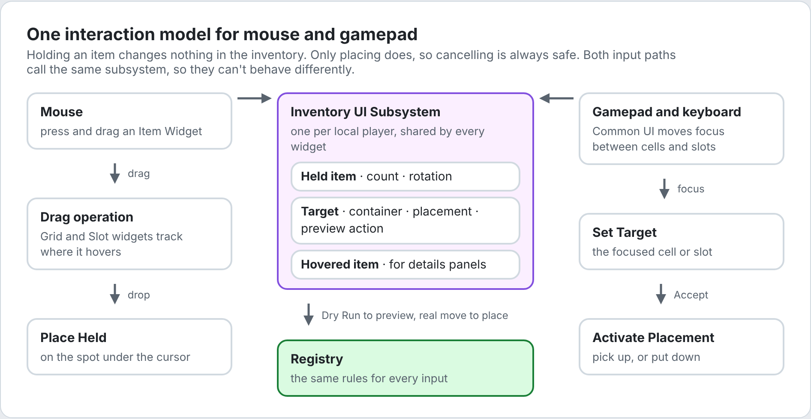

- One **Inventory UI Subsystem** per player holds the interaction: the held item (count and rotation), where it's aimed, the hovered and selected items, the item being chosen for another, and the transfer container.
- **Holding changes nothing.** Only placing moves items, so cancelling or closing the screen is always safe.
- Previews use the registry's **Dry Run**: the real operation, always undone. They can't disagree with the actual move.
- Common UI handles focus, hover, Accept and Back. Cells, slots, shortcuts and menu entries are Common UI buttons. UMG drag and drop is used only for the mouse.
- What clicks, Accept, double-clicks and long presses do is the **Interaction Style** ([11.4](#114-input-and-interaction-style)), which each inventory screen sets while it's open.
- Widgets follow the containers' capacity and Player Access by themselves: locked cells and slots draw disabled, and the player can't move what a container doesn't allow ([11.10](#1110-locked-cells-and-player-access)).

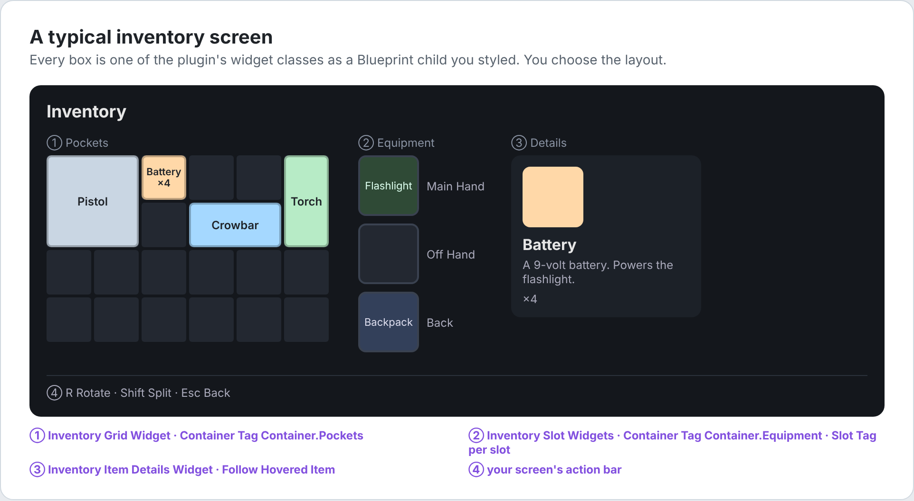

### 11.2 Widget reference

Every widget class is abstract: make a Blueprint child of each and design it. Named widgets are found by name in the designer and are optional unless marked **required**.

| Parent class | What it is |
| --- | --- |
| Inventory Screen Widget | The screen: binds the actions, handles Back, opens item menus, plays sounds, shows its pages and says what to do in its description line. |
| Inventory Grid Widget | A grid container: its cells, its items and where the held item would land. |
| Inventory Cell Widget | One cell of a grid. A Common UI button. |
| Inventory Slot Widget | One slot, such as an equipment slot, or one entry of a list. A Common UI button. |
| Inventory List Widget | A list container, filtered and sorted for display. |
| Inventory Item Widget | One item: its icon, count, numbers and highlight. Dragged with the mouse. |
| Inventory Item Details Widget | An item's name, description, traits and stats: a side panel or a tooltip. |
| Inventory Stat Widget | One stat row of a details panel. |
| Inventory Item Menu Widget | A menu of item actions beside an item ([11.8](#118-item-menus-and-item-actions)). |
| Inventory Item Action Button | One entry of an item menu. A Common UI button. |
| Inventory Recipe Menu Widget | An item menu listing what the item makes ([11.15](#1115-recipe-menus-what-an-item-makes)). |
| Inventory Recipe Menu Entry | One recipe of a recipe menu: what it makes, how many the player has, what it takes. A Common UI button. |
| Inventory Recipe Ingredient Widget | One ingredient in a recipe menu entry. |
| Inventory Shortcut Widget | One slot of an Inventory Shortcut Component ([11.12](#1112-shortcut-widgets)). A Common UI button. |

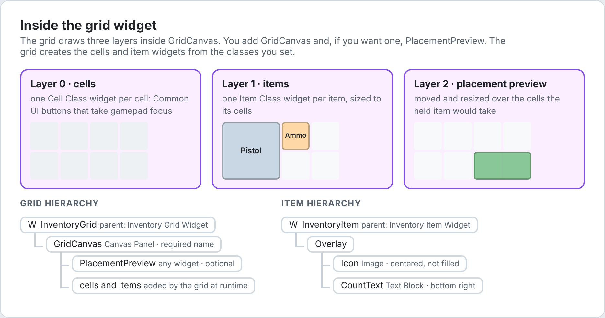

**Inventory Grid Widget**

| Part | Details |
| --- | --- |
| Named widgets | **`GridCanvas`** (Canvas Panel, required), `PlacementPreview` (any widget, inside Grid Canvas), and an animation named `PlacementPreviewLoop` |
| Settings | **Container Tag**: finds that container on the owning player's Inventory Component; leave empty and call Set Container for chests and backpacks. **Cell Size**, **Cell Gap**: pixels per cell and between cells. **Cell Class**, **Item Class**. **Preview Glide Speed**: how fast the preview, and a snapped held item, glide to new cells; 0 jumps. **Draw Grid Lines** with their color, thickness and overhang. **Preview Loop Actions**, play mode, speed and restart: when Placement Preview Loop plays |
| Rows | The grid draws its layout's Grid Size, plus each row it has grown into, always whole, and for a grid growing To Fit Items a free row below ([11.10](#1110-locked-cells-and-player-access)). Leave room for it to grow downward, or put it in a Scroll Box |
| Designer preview | **Preview Grid Size**, **Preview Added Cells** and **Preview Items** draw a grid with items in the designer only. Preview Added Cells draws the grid as upgrades grow it: 2 on a 4 × 2 grid draws a third row with its last two cells disabled |
| Events | On Container Refreshed, On Placement Preview Changed (Action), On Placement Preview Shown |
| Functions | Set Container, Get Container, Get Cell Widget (Cell), Get Item Widget (Item) |

**Inventory Cell Widget** and **Inventory Slot Widget**

| Part | Details |
| --- | --- |
| Named widgets | `LockedMarker` (optional, any widget, shown only while locked, on top of the style's disabled look). Slots also: `ItemWidget` (your item widget, hidden while empty) and `NameText` (the item's name, for list rows) |
| Settings | The Common UI button **Style**, **Holding Style** (used while an item is held), **Mouse Style** (used while the mouse is in use, such as one without a hover look). Slots also: **Container Tag** and **Slot Tag** |
| Events | On Cell Locked Changed (and the Common UI button events). Slots also: On Slot Item Changed, On Placement Preview Changed |
| Functions | Get Container, Get Placement, Get Item, Is Locked. Slots also: Set Container, Set Container Placement, Get Item Widget |

A cell or slot needs a root widget in its designer, such as an empty Overlay: Common UI only builds a button around designer content.

**Inventory List Widget**

| Part | Details |
| --- | --- |
| Named widgets | **`EntryPanel`** (any panel, required): a Wrap Box for tiles, a Vertical Box for rows. Put it in a Scroll Box for long lists |
| Settings | **Container Tag**, **Entry Class** (an Inventory Slot Widget; leave its tags empty), **Show Empty Entry** (an entry after the items while the list has room, for gamepads to put items on), **Display Filter**, **Sort By** (Container Order, Name, Category, Tag Value or Count), **Sort Tag**, **Sort Descending** |
| Functions | Set Container, Get Container, Get Entry Widget (Index), Get Item Widget (Item), Set Display Filter, Set Sort |

Display Filter and Sort By only change what's shown, such as one tab per kind of item over a single inventory: the container keeps every item, in its own order.

**Inventory Item Widget**

| Part | Details |
| --- | --- |
| Named widgets | `Icon` (Image), `Background` (covers the item's cells), `Highlight` (shown while highlighted), `NameText`, `CountText`, `TagTint` (Image tinted by Tag Colors), and whatever Value Displays name |
| Settings | **Highlight When Hovered**, **Highlight When Selected**, **Value Displays** ([11.9](#119-numbers-on-items-value-displays)), **Hide Count Of One**, **Count Format**, **Held Opacity** (how much of the item still shows in its own spot while held), **Tag Colors**, **Drag Visual Class**, **Drag Cell Size**, **Tooltip Class** (a details widget shown on mouse hover) |
| Events | On Item Changed, On Held Changed, On Held Item Shown, On Put Down, On Hovered Changed, On Selected Changed, On Highlight Changed, On Value Display Changed. Override Resolve Custom Value for Custom value displays |
| Functions | Set Item, Show Preview (a definition without an inventory, such as in a shop), Begin Drag, Get Item, Get Definition, Get Count, Is Held, Is Item Hovered, Is Selected, Is Highlighted, Is Drag Visual |

**Inventory Item Details Widget** and **Inventory Stat Widget** ([11.11](#1111-item-details-stats-traits-and-comparing))

| Part | Details |
| --- | --- |
| Named widgets | `Icon`, `NameText`, `CategoryText`, `DescriptionText`, `TraitsText`, `CountText`, `StatPanel` (gets a Stat Class row per stat). Stat rows: `LabelText`, `ValueText`, `DifferenceText`, `Bar` (Progress Bar) |
| Settings | **Follow Hovered Item** (a side panel; leave off for tooltips), **Keep Last Item**, **Hide Without Item**, **Count Format**, **Tag Colors**, **Stats**, **Stat Class**, **Compare With Equipped**, **Traits**, **Trait Separator**. Stat rows: **Max Format**, **Better Color**, **Worse Color** |
| Events | On Item Changed. Stat rows: On Stat Changed |
| Functions | Set Item, Get Item |

The screen, item menu, shortcut and recipe menu widgets are covered in [11.3](#113-building-an-inventory-screen), [11.8](#118-item-menus-and-item-actions), [11.12](#1112-shortcut-widgets) and [11.15](#1115-recipe-menus-what-an-item-makes).

### 11.3 Building an inventory screen

**1. Item widget.** A Widget Blueprint with parent **Inventory Item Widget**, named `W_InventoryItem`.
- Root: an **Overlay**.
- Add an **Image** named `Icon`, straight inside the Overlay. Set both alignments to **Center**, not Fill: the grid sizes the icon to the item's cells and turns it with the item. Anywhere else, the icon takes its texture's size, so long items stay long. Put the item widget in a **Scale Box** set to **Scale to Fit** to fit it into a slot.
- Add a **Text Block** named `CountText`, aligned bottom right. It's hidden for items that don't stack.
- Optionally a `Highlight` widget, such as a lit frame, shown while the item is hovered, focused or selected.

**2. Cell widget.** Parent **Inventory Cell Widget**, named `W_InventoryCell`.
- It's a Common UI button. Create a **Common Button Style** (Add › Blueprint Class › CommonButtonStyle) with normal, hovered, pressed and disabled looks, and set it as the cell's **Style**. The normal looks are what empty cells show, and the disabled look is what locked cells show: for example, a cross on a dark tile for an empty cell, and a plain darker tile for a locked one.
- Give its designer a root widget, such as an empty **Overlay**.
- Optionally a `LockedMarker`, such as a padlock, shown only on locked cells on top of the disabled look. Leave it out when the disabled look is enough.

**3. Grid widget.** Parent **Inventory Grid Widget**, named `W_InventoryGrid`.
- Root: a **Canvas Panel** named `GridCanvas`.
- Inside it, a **Border** named `PlacementPreview` with a white brush. Its position and size don't matter; the grid moves it.
- Class Defaults: Container Tag `Container.Inventory`, Cell Size `64`, Cell Class `W_InventoryCell`, Item Class `W_InventoryItem`.
- In the Event Graph, add **On Placement Preview Changed** and switch on the action: set PlacementPreview's brush color, such as Place green, Merge blue, Swap yellow, Invalid red.

**4. Details panel** (optional). Parent **Inventory Item Details Widget**, named `W_ItemDetails`, with an Image `Icon` and Text Blocks `NameText` and `DescriptionText`. For a side panel, tick **Follow Hovered Item**. For a tooltip, leave it off and set `W_ItemDetails` as the item widget's **Tooltip Class**.

**5. Equipment slot** (optional). Parent **Inventory Slot Widget**, named `W_EquipmentSlot`: an Overlay with a background, and a Size Box (64 × 64) holding a Scale Box (Scale to Fit, Down Only) holding `W_InventoryItem` named `ItemWidget`. Give it the cells' button style, Container Tag `Container.Equipment`, and set **Slot Tag** on each one you place.

**6. The screen.** A Widget Blueprint with parent **Inventory Screen Widget**, which is a Modular Activatable Widget, so it can pause the game and play an open reveal.
- Place `W_InventoryGrid`, named **`MainGrid`**, so gamepad focus starts on its first cell. Place your slots and `W_ItemDetails` beside it.
- For item menus, add a **Common Activatable Widget Stack** named `ItemMenuStack` over the rest of the screen, filling it, and set **Item Menu Class** ([11.8](#118-item-menus-and-item-actions)).
- Set **Interaction Style** ([11.4](#114-input-and-interaction-style)) and **Sounds**.
- Under **Input**, pick the rows of a Common UI input action data table for **Move**, **Item Menu**, **Rotate**, **Split**, **Transfer**, **Take All** and **Confirm** that you want, and place a **Common Bound Action Bar** to show them. **Action Availability** says when each is bound, and so shown:

  | Action Availability | Bound | The action bar |
  | --- | --- | --- |
  | By Mode, the default | The actions for what the player is doing: browsing the items, holding one, or choosing one. One that can't be done for what's aimed at does nothing, such as Move over an empty cell | Stays as it is while the cursor moves, changing only as the player picks something up, puts it down, or opens a menu, as console games keep it |
  | By Target | Only the actions that can be done for what's aimed at now | Changes as the cursor moves from item to item. A Common Bound Action Bar rebuilds its buttons each time, which shows as a flicker |
- Optionally add a description line along the bottom: a Text Block named `DescriptionText`, inside a `DescriptionPanel` such as a Border, and fill in the hint texts ([11.13](#1113-the-description-line)).
- Optionally put the screen's parts on pages, such as Map, Items and Crafting, with a Tab List and a Modular Page Switcher ([11.14](#1114-pages-tabs-on-an-inventory-screen)).
- Open the screen by pushing it onto one of your Common UI layer stacks. Close it with **Close Widget**.

The screen takes menu input and shows the cursor (tick **Game Keeps Input** to keep the game's input too). Back cancels choosing an item, then puts back the held item, then closes the screen, and closing drops whatever was held or chosen.

### 11.4 Input and interaction style

| Action | Mouse | Gamepad and keyboard |
| --- | --- | --- |
| Pick up | Drag an item, or click it with Left Click set to Pick Up | Accept on a focused cell, with Accept set to Pick Up, or the screen's Move action |
| Pick up half a stack | Shift + drag | Pick up, then Split |
| Put down | Release over the target, or click | Accept on a focused cell, or Move |
| Where it lands | Its cell under the cursor follows the cursor | Its cell picked up by goes on the focused cell |
| Rotate | The screen's Rotate action, a right-click or the mouse wheel as the style says | The Rotate action |
| Split | The Split action halves the held count; at one it goes back to the whole stack | same |
| Cancel | Release over nothing, or a refused spot | Back |
| Item menu | Right-click, as the style says | The Item Menu action, or Accept as the style says |
| Move to the other side | Shift + click, with Shift Click Transfers | The Transfer action |

The **Interaction Style** on the screen sets the rest. Its defaults are drag and drop with click to move:

| Setting | Default | What it does |
| --- | --- | --- |
| Left Click | Pick Up | What a left click on an item does while nothing is held: Pick Up, Open Item Menu, Default Action or None. A drag always picks the item up. |
| Right Click | Open Item Menu | The same for a right-click. |
| Accept | Pick Up | The same for Accept on a focused cell with a gamepad or keyboard, so the gamepad can open menus while the mouse picks items up, or the other way round. |
| Double Click | None | Such as Default Action to use or equip an item. |
| Long Press / Long Press Time | Open Item Menu / 0.5 s | What holding a finger on an item does on a touch screen. |
| Snap Held Item | off | Grids draw the held item on the cells it would land on instead of under the cursor. |
| Swap Items | on | Putting the held item on another item trades their places. In a grid, only items taking the same cells swap. Equipment slots make way either way. |
| Swap Picks Up Other | off | A swap picks the other item up from where the held one was, instead of only trading places. |
| Shift Click Transfers | off | Shift and a click moves an item to the other side, such as from a chest into the player's inventory. |
| Keep Last Hovered Item | off | The item the mouse was last over stays hovered until the mouse reaches another. |
| Held Right Click | As Usual | What a right-click does while an item is held: as usual, Put Back, or Rotate. |
| Wheel Rotates Held | off | The mouse wheel turns the held item. |

Held items in a grid land as close to where they're aimed as fits, never partly off the edge.

### 11.5 Placement preview

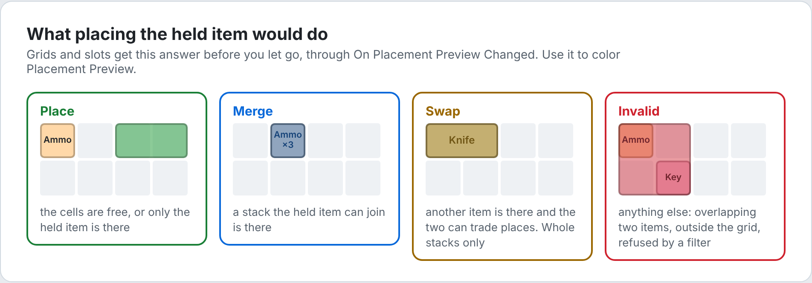

Grids and slots receive **On Placement Preview Changed** with one of: None, Place, Merge, Swap, Invalid. None means nothing is held over this widget. While it's Invalid, the Inventory UI Subsystem's **Get Target Error** says why, such as Occupied, Out Of Bounds for a locked cell, or Rejected for a container that won't take the item, and the screen can say it in its description line with **Invalid Hints** ([11.13](#1113-the-description-line)).

An animation named `PlacementPreviewLoop` on the grid plays on a loop while the preview shows one of its **Preview Loop Actions**, such as a pulse.

### 11.6 Chests, backpacks and other containers

Any grid, list or slot widget can show any container. Leave **Container Tag** empty and call **Set Container** with a handle:

| Container | Handle |
| --- | --- |
| A chest's storage | Chest's Inventory Component › **Get Container** (Tag) |
| A backpack's storage | Inventory Subsystem › **Find Item Container** (Backpack Item, `Container.Backpack`) |
| A worn backpack | Equipment Component › **Get Equipped Item** (`Equipment.Slot.Back`), then Find Item Container |

Dragging between widgets works without extra code: all containers share one registry. Refresh a backpack grid when the backpack changes, from **On Item Equipped** and **On Item Unequipped**.

For a chest, call the screen's **Set Transfer Container** with the chest's container each time it opens. The Transfer and Take All actions, Shift-clicks and the Transfer item action then move items between it and the player. Items taken from the chest go into the player's storage as the player's Inventory Component takes items, so a capacity upgrade in a chest is applied, not stored.

### 11.7 Inventory UI Subsystem

Get it with **Get Inventory UI Subsystem** (it needs the player). Screens and widgets call it for you; call it yourself for your own controls.

| Group | Functions and events |
| --- | --- |
| Style | Set Style, Get Style |
| Holding | Begin Hold (Item, Count; 0 = whole stack), Can Begin Hold, Cancel Hold, Rotate Held, Can Rotate Held, Split Held, Can Split Held, Set Held Count, Is Holding, Get Held Item, Get Held Count, Is Held Rotated, Get Held Size |
| Placing | Place Held (Container, Placement), Press Placement, Activate Placement, Pick Up Or Place, Activate Aimed, Preview Placement |
| Target | Set Target, Clear Target, Get Target Container, Get Target Placement, Get Target Action, Get Target Error, Get Landing Placement |
| Hover and selection | Set Hovered Item, Get Hovered Item, Set Selected Item, Get Selected Item |
| Item menus | Request Item Menu, Request Default Action |
| Choosing | Begin Choosing Item (for "use this on that", such as combining), Cancel Choosing Item, Is Choosing Item, Get Choosing For |
| Transfer | Set Transfer Container, Get Transfer Container, Transfer Item, Can Transfer Item, Take All, Can Take All |
| Reset | Clear Interaction: drops the hold, the choosing, the target, the hover and the selection |
| Events | On Held Item Changed, On Hold Event (for sounds), On Item Put Down, On Target Changed, On Hovered Item Changed, On Selected Item Changed, On Item Menu Requested, On Default Action Requested, On Item Chosen, On Dropped Outside |

### 11.8 Item menus and item actions

An **item action** is something the player can do with an item, such as Use, Equip, Combine or Discard. An **item menu** lists the actions that apply to an item beside it.

**Actions.** Make a Blueprint or C++ child of **Inventory Item Action**: override **Can Run** to say whether it works for an item now, and **Run** to do it. Every action entry has:

| Field | Description |
| --- | --- |
| Display Name, Description, Icon | What its entry shows, and what Description Text, the menu's and the screen's, says while it's highlighted. |
| Input Action | A key that runs it while the menu is open. |
| Item Filter | Only items that match are offered the action at all, such as Tag Query `Item.Type.Consumable` for Use, or one leaving out `Item.Trait.NoDiscard` for Discard. |
| When Unavailable | Hide it while Can Run says no, or Show Disabled with **Get Unavailable Reason**, such as "Not enough space". |
| Prompt, Prompt Text | Run at once, Confirm first, or ask for a Quantity. `{Item}` and `{Count}` are filled in. |
| Keeps Menu Open | The menu lists the actions again after it runs, such as for Equip and Unequip. |
| Button Name | Use a button placed in the menu's designer instead of making one. |

Built in: **Move** (picks the item up, for gamepads), **Split** (asks how many), **Transfer** (to the other side), **Apply Capacity Upgrade** (uses a carried capacity upgrade, [5.11](#511-inventory-capacity-upgrade)), **Use**, **Drop**, **Equip**, **Unequip**, **Assign Shortcut** (opens a shortcut menu, [11.12](#1112-shortcut-widgets)) and **Craft** (opens a recipe menu listing what the item makes, [11.15](#1115-recipe-menus-what-an-item-makes)). Put actions in an **Item Action Set** data asset to share them between menus, and set a set as the screen's **Default Actions**: the first one that can run is what a press set to Default Action does, such as a double-click.

**Menus.** A Widget Blueprint with parent **Inventory Item Menu Widget**, set as the screen's **Item Menu Class**:
- **`MenuPanel`** (required): the menu itself, inside a full-screen Canvas Panel with Size To Content ticked, so it can be moved beside the item. Give the root a full-screen, hit-testable border so presses outside the menu reach it.
- `ActionPanel` (such as a Vertical Box) gets a button of **Action Button Class** for each action. `ItemNameText` and `DescriptionText` are optional.
- For prompts: `PromptPanel` with `PromptText`, `ConfirmButton` and `CancelButton`, and for counts `QuantitySlider` and `QuantityText`.
- **Placement** (Toward Center, Right, Left, As Designed or At Cursor), **Menu Gap** and **Screen Padding** decide where it opens. **Outside Click** decides what a click off it does: **Close** only closes it, **Pass Through** closes it and goes on to the item under it, and **Block** does nothing, so the menu stays open until the player picks an action or goes Back. **Right Click** is **Back**, as in games where the right mouse button means Back, **Pass Through**, so right-clicking another item opens its menu instead, or **Ignore**. They're Modular UI context menu settings; see its guide.
- **Open Transition** fades, slides and grows the menu out of the item, and **Close Reverses Open** sends it back the same way, or **Close Transition** plays instead; animations named `OpenAnimation` and `CloseAnimation` play too. **Action Timing** runs a picked action as the menu starts closing, or once it has closed.
- Give it a **Confirm Action** and a Common Bound Action Bar on the screen shows Back and Confirm while it's open. They're bound once, so they don't flicker or swap places as the mouse moves over the actions.

The menu closes by itself when its item leaves the inventory, and when its screen closes. **Action Button Class** is a child of **Inventory Item Action Button**, with `NameText` (a Common Text), `Icon` and `ReasonText`, and an **Unavailable Style** for actions that can't run. With **Show Description On Screen**, on by default, what the highlighted action does shows in the screen's description line too, such as along the bottom of the screen, as console inventories say it; turn it off when the menu's own `DescriptionText` says it instead. Write each action's **Description** as what it does, such as "Use the item.", not what the item is.

### 11.9 Numbers on items: value displays

An item widget's **Value Displays** show numbers on items, such as ammo, charges, durability or a stack's count, without code. Each names Text Blocks and a Progress Bar in the item widget's designer.

| Field | Description |
| --- | --- |
| Source | Tag Value (shown for items that have it), Stack Count (for items that stack), or Custom (worked out in Resolve Custom Value). |
| Tag, Max Tag | The tag value shown, and the one that's full, such as `Item.Stat.Rounds` out of `Item.Stat.Capacity`. Without a Max Tag, the definition's starting value is full. |
| Include Bonuses | Adds sockets' and attachments' bonuses, as for a damage stat. |
| Item Filter | Only items that match show it. |
| Group | Displays in the same group take turns: the first that applies shows, so one corner can show ammo for a weapon, else charge for a tool, else a stack's count. |
| Text Widget, Format, Fractional Digits | The Text Block, and what it says: `{Value}`, `{Max}` and `{Percent}`, such as `{Value}/{Max}`. |
| Meter Widget, Frame Widget | A Progress Bar filled to how full it is, and a widget shown only while the value is. |
| Hide Single, Hide When Full | Hide a count of one, or a full value, such as a knife's durability until it's used. |
| Tint By Fullness, Colors | Colors the text and bar by how full, such as green to red. |

Names that don't exist in the designer are reported when the widget compiles. The **Inventory UI Function Library** works out the same numbers for any other widget, such as a HUD's ammo counter: Resolve Value Display, Format Value Display and Pick Meter Color.

### 11.10 Locked cells and Player Access

Widgets show containers as their capacity and Player Access say ([4.7](#47-capacity-storage-that-grows), [4.8](#48-player-access)):

- **Locked cells and slots** are disabled: they draw with the button style's Disabled look, and the `LockedMarker` if the cell has one, take no focus and can't be clicked. **On Cell Locked Changed** fires as they lock and unlock, such as to play an unlock animation as an upgrade is picked up.
- **A grid widget always draws whole rows**: its layout's Grid Size, plus each row the grid has grown into ([4.7](#47-capacity-storage-that-grows)). Growing With Upgrades, a 4 × 2 grid given two more cells shows a third row, its first two cells usable and its last two disabled. Rows it hasn't grown into aren't drawn, so the widget grows downward as the grid does.
- **A grid growing To Fit Items** also draws a free row below its last, or as many as the held item is tall, so the player always has somewhere to put an item down. Its rows come and go as items do.
- **How cells look** is up to the cell's button style: empty cells use its normal looks and disabled cells its Disabled look, such as a cross on a dark tile for an empty cell and a plain darker tile for one not added yet. A `LockedMarker`, such as a padlock, is optional.
- A held item keeps out of rows that are wholly locked, as it keeps inside the grid's edges, and can't be turned into a shape that only fits the locked part.
- **Player Access** decides what the player can pick up and where they can put it: items in Put Only and Read Only containers can't be picked up, and nothing can be put into Take Only and Read Only containers. Lists that can't be put into show no empty entry. Item menus still open for every item.
- **Preview Added Cells** shows a grid grown by upgrades in the designer, its disabled cells included.

### 11.11 Item details: stats, traits and comparing

A details widget lists an item's **Stats**, its tag values, each as a row of **Stat Class** in `StatPanel`:

| Stat field | Description |
| --- | --- |
| Tag, Label | The tag value and its name, such as Damage for `Item.Stat.Damage`. Items without it leave the row out. |
| Item Filter | Only items that match list it, such as Fire Rate only for weapons. |
| Hide When Zero | Left out at 0, such as a resistance the item doesn't give. |
| Show Max, Max Tag | Shows the value out of its maximum, such as durability. |
| Lower Is Better | For weight or reload time, so a comparison colors the difference the other way. |
| Format, Fractional Digits | Such as `{Value}%` or `{Value} kg`. |

With **Compare With Equipped**, each row also shows how much better or worse the item is than the one equipped where it would go, in Better Color or Worse Color. **Traits** are tags named in words, such as Two-Handed for `Item.Trait.TwoHanded`, listed in `TraitsText` with **Trait Separator** between them; traits that sockets and attachments grant are listed too. `CategoryText` shows the item definition's Category, and **Tag Colors** color `NameText` by the item's tags, such as its rarity.

### 11.12 Shortcut widgets

An **Inventory Shortcut Widget** shows one slot of the owning player's Inventory Shortcut Component ([6.3](#63-inventory-shortcut-component)), such as on a HUD bar or the inventory screen. It's a Common UI button.

| Part | Details |
| --- | --- |
| Named widgets | `ItemWidget` (your item widget), `NameText` (the slot's Display Name), `NumberText` (1 for the first slot), `EmptyMarker` (shown while empty) |
| Settings | **Slot Index**, or **Slot Tag** to follow a slot by its tag. **Right Click Clears** |
| Events | On Shortcut Changed, On Shortcut Activated (to flash it), On Assign Refused (the held item doesn't suit the slot) |
| Functions | Set Slot Index, Get Slot Index, Get Slot Item, Get Shortcuts |

While an item is held, clicking a shortcut, pressing Accept on it or dropping a dragged item on it puts the item on the slot and puts the held item back where it was, as the slot only points at it.

### 11.13 The description line

The line along the bottom of a console inventory says what the player can do right now. It never says what an item is: the details panel shows that ([11.11](#1111-item-details-stats-traits-and-comparing)), so while the player browses the items, the line is empty. An inventory screen has Modular UI's description line: a Text Block named **`DescriptionText`**, optionally inside a **`DescriptionPanel`**, which hides while there's nothing to say. It says, the first that has something:

| What it says | When | From |
| --- | --- | --- |
| What the highlighted option of an item menu does, such as "Use the item.", or why it can't run | An item menu is open over the screen | The action's **Description**, said by the menu, with its **Show Description On Screen** |
| What picking the highlighted recipe does, such as "Craft Handgun Ammo.", or why it can't be made | A recipe menu is open | The recipe menu's **Recipe Description**, or its Uncraftable Reasons ([11.15](#1115-recipe-menus-what-an-item-makes)) |
| Why the held item can't go where it's aimed | An item is held over a spot it can't go | **Invalid Hints** by reason, else **Invalid Hint** |
| Where to put the held item, such as "Select an area to place this item." | An item is held | **Move Hint** |
| Which item to choose, such as "Select an item to combine with." | An item is being chosen for another, such as after Combine | **Choose Hint** |
| What a highlighted button does | The mouse is over a Modular Button, or focus is on one, such as a tab or a Sort button | Its **Description** |
| What the screen is for | Nothing else says anything | **Default Description**, empty for most inventories |

Hovering an item takes the highlight from any button, so a tab's description isn't kept while the player browses. A Blueprint screen can add its own modes with Modular UI's **Show Description**, such as "Select a slot." while it waits for one, and give the line back with empty text.

Descriptions and hints say what to do; details say what something is. A tooltip is a box beside the cursor, an item widget's **Tooltip Class**, and a message is something gameplay says that comes and goes, such as "Not enough space.", shown by Modular UI's message feeds. See Modular UI's guide for the description line on other screens, such as an options menu.

### 11.14 Pages: tabs on an inventory screen

An inventory screen can have pages, such as Map, Items and Crafting, as survival horror inventories do:

1. Add a **Modular Tab List** named **`TabList`** with a Tab Button Class, and a tab for each page, in order. Give each a **Tab Id**, such as `Items` and `Crafting`, and optionally a **Description** for the description line and a **Shortcut**, a UI action that opens it directly.
2. Add a **Modular Page Switcher** named **`Pages`** holding the pages, in the same order. A Common Activatable Widget Switcher already there can be swapped with **Replace With**.
3. Set **Items Page** to the index of the page with the grids. The screen opens on it.

The items only work while their page shows: changing page puts back whatever was held. Coming back to them, focus goes back to the cell it was on, and with the mouse the item hovered as the player left is hovered again, so the details panel and description line show it at once. The page switcher brings each page in with a quick fade and a short slide from the side it comes from, and nothing on a page lights up as it slides under the cursor. Modular UI's guide, under Pages, explains why its transition replaces the Common Animated Switcher's own.

To open the screen on another page, such as a crafting key opening it on its crafting page, call **Set Start Tab** (or **Set Start Page**) as the screen is pushed, before it shows. In C++, Modular UI's `PushStreamedWidgetToLayer` takes a function that sets the widget up first:

```cpp
UI->PushStreamedWidgetToLayer(ModularUIGameplayTags::UI_Layer_GameMenu, InventoryScreenClass, /*bSuspendInput*/ true,
	[](UCommonActivatableWidget& Widget)
	{
		if (UInventoryScreenWidget* Screen = Cast<UInventoryScreenWidget>(&Widget))
		{
			Screen->SetStartTab(TEXT("Crafting"));
		}
	});
```

While the screen is open, the crafting tab's **Shortcut** opens that tab, and with the tab list's **Shortcut Toggles Screen**, pressed on that tab it closes the screen, so one key opens the crafting page, switches to it and closes it, as an inventory key does for the items.

### 11.15 Recipe menus: what an item makes

A recipe menu lists what an item can be crafted into, as survival games' Combine does: each recipe that takes the item, with what it makes, how many of that the player has, how many times it can be made now, and what it takes. Picking one crafts it, taking from the item the menu is for first.

**It's optional.** Nothing opens a recipe menu unless an item menu has a **Craft** action with a **Menu Class**. To combine the classic way instead, with the player picking the second item in the inventory, run the Inventory UI Subsystem's **Begin Choosing Item** from an action of your own, and in **On Item Chosen** craft the recipe of **Get Recipes Using** that takes both items, with the Inventory Component's **Craft Preferring** and the two items preferred. The screen's **Choose Hint** says what to do meanwhile. A game can offer both, such as the list for what recipes make and choosing for anything else, as an action that decides per item.

**The action.** Add a **Craft** item action to your item menu ([11.8](#118-item-menus-and-item-actions)), and set:

| Field | Description |
| --- | --- |
| Display Name, Description | Such as Combine, and "Combine items to make something new." |
| Menu Class | Your recipe menu. It opens where the screen opens item menus, replacing the item menu. |
| Recipe Book | The recipes it offers. None uses the menu's own Recipe Book. In C++, override `GetRecipeBook` to find them elsewhere, such as on the player. |
| Context Tags | Tags the recipes are checked with, such as the station the screen is open at. |
| Only When Craftable | Offered only while one of the item's recipes can be made now. Off, it's offered while the item takes part in any. |

**The menu.** A Widget Blueprint with parent **Inventory Recipe Menu Widget**. It's an item menu ([11.8](#118-item-menus-and-item-actions)), so it has `MenuPanel` and can open beside the item, or in the middle of the screen with Placement As Designed over a dim backdrop.
- **`RecipePanel`** (such as a Vertical Box, inside Menu Panel): gets a **Recipe Entry Class** entry for each recipe. Leave it empty.
- `ItemNameText`: the item's name, as a header. `DescriptionText`, optional: what picking the highlighted recipe does, or why it can't be made, which the screen's description line says too.
- `OutputItem`, `OutputIcon`, `OutputNameText`, `OutputDescriptionText`: what the highlighted recipe makes, such as a details panel beside the list.

| Setting | Description |
| --- | --- |
| Recipe Book, Context Tags | The recipes it lists when whoever opens it gives none, and tags they're checked with on top of the action's. |
| When Uncraftable | **Show Disabled** lists recipes that can't be made now, with why, so the player sees what the item could make; **Hide** leaves them out. |
| Craft Prompt, Craft Prompt Text, Craft Prompt Confirm Label | What picking a recipe asks first: nothing, crafting it once; Confirm; or Quantity, how many times, from one to as many as can be made. `{Item}`, `{Count}` and `{Max}` are filled in. |
| Close On Craft | The menu closes once a recipe is crafted. Off, it stays open with the new counts. It always closes once its item is used up. |
| Recipe Description | What the description line says for a recipe that can be made: what picking it does, "Craft {Name}." by default. `{Name}`, `{Count}`, `{Held}` and `{Craftable}` are filled in, and `{Description}`, though what it makes belongs in `OutputDescriptionText`. |
| Uncraftable Reasons, Uncraftable Reason | What it says for one that can't, by reason, such as "Not enough materials." for Missing Ingredients and "Not enough space." for No Space. |
| Max Craft Times | The most times one recipe is counted, and crafted at once. |

**The entry.** A Widget Blueprint with parent **Inventory Recipe Menu Entry**, a Common UI button, each named widget optional: `OutputItem` (an Inventory Item Widget showing what it makes, in a Scale Box), `OutputIcon`, `NameText` (a Common Text), `OutputCountText` (such as x10, in **Output Count Format**), `HeldText` (how many the player has, in **Held Format**), `CraftableText`, `ReasonText`, and **`IngredientPanel`** (such as a Horizontal Box) with an **Ingredient Class** widget for each ingredient and an **Ingredient Separator Class** widget, such as a plus sign, between them. **Unavailable Style** greys out recipes that can't be made; they can still be highlighted, so the player sees why.

**The ingredient.** Parent **Inventory Recipe Ingredient Widget**: `ItemWidget` or `Icon`, `NameText`, `CountText` in **Count Format** (`{Count}` needed, `{Held}` held, such as `{Held}/{Count}`), tinted **Missing Color** while there isn't enough, and `ToolMarker` for tools, which are needed but kept. What it shows for an ingredient is its **Display Item** ([5.7](#57-recipe)).

For example, a recipe turning scrap and gunpowder into handgun ammo: Ingredients Scrap × 1 and Gunpowder × 1, Outputs Handgun Ammo × 10. The scrap's recipe menu lists Handgun Ammo x10, how much handgun ammo the player carries, and Scrap 1 + Gunpowder 1, with every other recipe that takes scrap below it.

---

## 12. Editor tools

| Tool | Where |
| --- | --- |
| Add › Inventory | Content Browser **Add** menu ([12.1](#121-add--inventory)) |
| Create Inventory Item | Right-click static meshes or textures ([12.2](#122-create-inventory-item)) |
| Generate Item Icons, Edit Item Icon | Right-click item definitions; **Edit Icon...** in an item's details ([12.3](#123-item-icons)) |
| Documentation, Generate All Item Icons, Message Log, Settings | The **Modular Inventory** menu on the Level Editor toolbar ([12.11](#1211-the-modular-inventory-menu-and-this-guide)) |
| Asset Manager setup | By itself, once the project has an item definition ([12.7](#127-asset-manager-setup)) |
| Cosmetics Create button, Icon preview, Footprint | An item definition's details ([12.4](#124-item-definition-details)) |
| Drop Rates | A loot table's details ([12.6](#126-loot-table-drop-rates)) |
| Validation | On save, and right-click › **Validate Assets** ([12.9](#129-data-validation)) |

Tools that skip or fail on some assets list them in **Window › Message Log › Modular Inventory**, also **Message Log** in the toolbar menu. Click an asset's name there to find it.

### 12.1 Add › Inventory

Every plugin asset type has its own entry under **Inventory** in the Content Browser's **Add** menu and in the right-click menu: Item Definition, Item Cosmetics, Container Layout, Stack Rules, Equip Rules, Loot Table, Recipe, Recipe Book.

### 12.2 Create Inventory Item

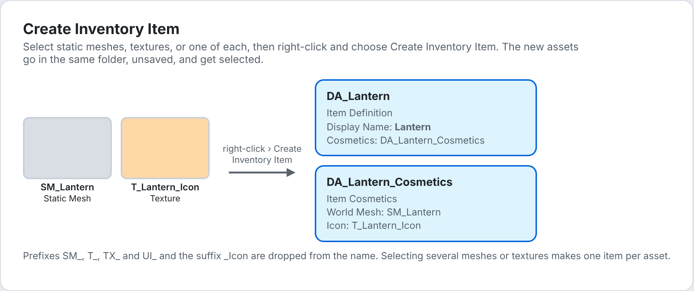

1. Select one or more **Static Meshes** and/or **Textures** in the Content Browser.
2. Right-click and choose **Create Inventory Item**.
3. For each asset, an item definition and its cosmetics are created in the same folder and selected.
   - Meshes become the **World Mesh** and textures the **Icon**.
   - Selecting exactly one mesh and one texture makes a single item with both.
   - Items made from a mesh alone get a generated icon ([12.3](#123-item-icons)). Turn this off with **Generate Icons For New Items** ([12.8](#128-settings)).
   - Names follow the Naming settings. With the defaults, `SM_FlashlightBattery` gives `DA_FlashlightBattery` and `DA_FlashlightBattery_Cosmetics`, and the Display Name "Flashlight Battery".
4. The new assets are unsaved. Fill in the rest, then **Save All**. Moving them to another folder is fine.

### 12.3 Item icons

Inventory widgets stretch an icon over the item's cells, so a 1 × 3 item needs an icon three times as tall as it is wide. The icon generator renders the item's **World Mesh** in exactly that shape, with a transparent background.

| Action | Where | What it does |
| --- | --- | --- |
| Generate Item Icons | Right-click one or more item definitions | Renders an icon for each item. |
| Edit Item Icon... | Right-click one item definition, or **Edit Icon...** in its details | Opens the Icon Studio for that item. |
| Generate All Item Icons | The Modular Inventory toolbar menu | Generate Item Icons for every item in the project, such as after changing the lighting. |

**What gets made**

- A texture named like `T_FlashlightBattery_Icon`, next to the item's cosmetics or in the **Icon Folder**, assigned to the cosmetics' **Icon**.
- Its size is the item's cells times **Pixels Per Cell**: a 1 × 3 item gets 128 × 384 pixels by default.
- It uses the texture settings for UI: UserInterface2D compression and the UI texture group. It has mipmaps, so it stays clean when drawn much smaller, such as in a shortcut slot. Icons generated before that have none until they're generated again.
- The changed assets are left unsaved, like any other edit.
- Before rendering a mesh, the generator waits until it can be drawn as it looks: the mesh built, every shader its materials need compiled, and every texture they use fully loaded. That way icons don't come out with the default material or low-resolution textures, but the first icons of a session, or of meshes nobody has opened yet, can take a while.

**Generated and hand-made icons**

- A generated texture remembers how its item was framed. Generating again re-renders it with the current settings and size but the same framing, so every item keeps its angle.
- Any other texture is hand-made, and the tools never change it. Generate Item Icons skips items with hand-made icons. Saving from the Icon Studio makes a new texture and switches the item to it, and the hand-made texture is left as it is.
- The framing is stored as editor-only data on the texture and isn't packaged.

**Icon Studio**

- The preview is the real icon, at its exact shape. **Drag** to turn the mesh, **right-drag** to move it, and **scroll** to zoom. **Rotation**, **Zoom** and **Offset** below the preview take exact values.
- **Reset** goes back to the default framing. **Quarter Turn** turns the mesh a quarter in the picture, to stand a long item up or lay it down.
- **Lighting...** opens the icon settings. The preview updates as you change them, and so does every icon you generate afterwards.
- **Save Icon** renders and saves the icon. The window stays open, so you can keep adjusting.
- The preview follows the item: change its size or its World Mesh and the preview updates.

**How an icon is framed**

1. The mesh is turned by **Rotation**. New icons start from **Default Rotation**, and long meshes are also turned to lie along the long side of their cells.
2. The camera fits what's visible of the mesh to the icon, keeping **Padding** around it.
3. **Zoom** and **Offset** adjust the result.

### 12.4 Item definition details

These appear while a single item definition is open.

| Row | What it does |
| --- | --- |
| Display › Cosmetics | Has a **Create** button while empty. It makes cosmetics next to the item, named after it, and assigns them. |
| Display › Icon | The icon stretched over the item's cells, exactly as inventory widgets show it, so a wrongly shaped icon looks wrong here too. **Edit Icon...** opens the Icon Studio. |
| Sockets › Footprint | A picture of the item's cells and the cells its sockets reach. See below. |

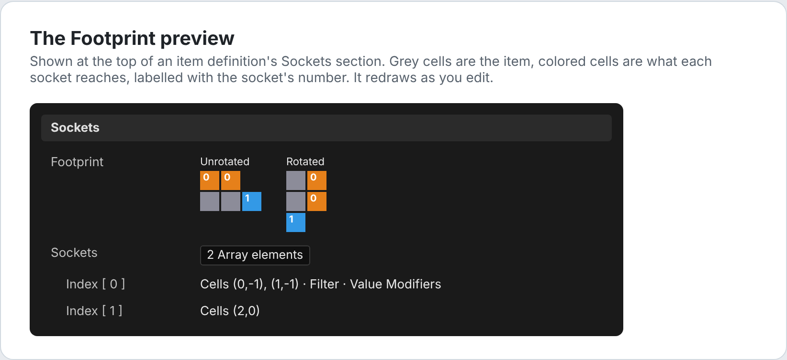

In the Footprint, grey cells are the item; colored cells are the cells each socket reaches, numbered like the Sockets array. The **Rotated** view appears when the item can rotate. It redraws as you edit.

### 12.5 Thumbnails

Item definitions and cosmetics use the item's icon as their Content Browser thumbnail. Assets made before the editor module was installed show it once they're opened or saved.

### 12.6 Loot table drop rates

A loot table's **Drop Rates** section shows how the table behaves, and updates as you edit it:

| Column | Meaning |
| --- | --- |
| Chance | The share of rolls that contain the item. |
| Count | The fewest and most of it that one roll gave, when it dropped. |
| Per Roll | How many a roll gives on average, counting the rolls where it didn't drop. |

Above the table is how often a roll gives nothing at all.

- **Simulation Rolls** is how many rolls are simulated. More rolls give steadier numbers.
- **Simulation Context** holds the tags a real roll would have, such as `Difficulty.Hard`, for pool and entry conditions.
- The rolls use a fixed seed, so the numbers only change when the table does. Editing any loot table updates them, since tables can roll other tables.
- Both settings are for the editor only and aren't saved with the table.

### 12.7 Asset Manager setup

There's no tool to run. When the editor starts, and whenever an item definition is made while items have no IDs, the editor:

1. adds the `InventoryItem` entry described in [2.2](#22-asset-manager) to `Config/DefaultGame.ini`, if the project has an item definition and no such entry;
2. resaves item definitions that still carry an ID from an older version of the plugin;
3. reloads the Asset Manager settings, so the IDs work at once.

A notification says what it did. When there's nothing to do, which is every time once the entry is committed, nothing happens. It never runs while cooking or running unattended.

### 12.8 Settings

**Project Settings › Plugins › Modular Inventory**, also **Settings** in the Modular Inventory toolbar menu. They are saved in `Config/DefaultEditor.ini`; commit that file so the whole team names assets and renders icons the same way.

| Category | Setting | Default | Description |
| --- | --- | --- | --- |
| Naming | Item Prefix | `DA_` | Put before item definition names. |
| Naming | Cosmetics Prefix / Suffix | `DA_` / `_Cosmetics` | Put around cosmetics names. |
| Naming | Icon Prefix / Suffix | `T_` / `_Icon` | Put around generated icon names. |
| Naming | Source Prefixes | `SM_`, `SK_`, `T_`, `TX_`, `UI_` | Dropped from mesh and texture names when naming items. All the prefixes and suffixes above are dropped too. |
| Icons | Pixels Per Cell | 128 | Icon pixels per grid cell. |
| Icons | Supersampling | 2 | Renders this many times larger and shrinks the result, for smooth edges. |
| Icons | Field Of View | 15 | Lower looks flatter, closer to an orthographic camera. |
| Icons | Padding | 0.06 | Empty space around the mesh, as a fraction of the icon. |
| Icons | Default Rotation | 0, 120, 20 | How new icons turn the mesh. The camera looks along X with Z up, so this shows a mesh modelled facing X from three-quarters, top tipped toward the camera. |
| Icons | Icon Folder | empty | A folder next to the cosmetics, such as `Icons`, or a full path, such as `/Game/UI/Icons`. Empty saves icons beside the cosmetics. |
| Icons | Generate Icons For New Items | on | Create Inventory Item renders icons for items made from a mesh alone. |
| Icons › Lighting | Exposure | 1 | Brightens or darkens every icon. |
| Icons › Lighting | Ambient Intensity | 1 | Soft light from every direction. |
| Icons › Lighting | Lights | key, fill, rim | Directional lights. **Direction** is seen from the camera: Yaw 0 shines away from it, Yaw 90 to the right, Pitch -90 straight down. |

### 12.9 Data validation

Every plugin asset checks itself when saved, and when you right-click a folder and choose **Validate Assets**. Problems appear in the Message Log, such as:
- missing layouts or tables;
- duplicate container tags;
- Min above Max;
- empty sockets;
- invalid fragments;
- items not registered with the Asset Manager.

The editor adds these item checks:

| Check | Result |
| --- | --- |
| Another item definition has the same asset name. Item IDs are asset names, so the two would share one. | Error |
| The item has no icon, so inventory widgets show nothing for it. | Warning |
| The icon's shape doesn't match the item's cells, so widgets stretch it. | Warning |

### 12.10 Inventory.Give

A console command for Play In Editor and development builds:

```
Inventory.Give <ItemAssetName> [Count]
Inventory.Give DA_Battery 5
```

It adds the items to the local player's pawn's Inventory Component, topping up stacks first. Use the asset name, not the display name. An unknown name prints the list of registered items. It needs the `InventoryItem` Asset Manager entry, which the editor adds by itself ([12.7](#127-asset-manager-setup)).

### 12.11 The Modular Inventory menu and this guide

The **Modular Inventory** button on the Level Editor toolbar, beside the play buttons, opens a menu with everything the plugin adds to the editor that isn't tied to a selected asset:

| Entry | What it does |
| --- | --- |
| Documentation | Opens this guide in the editor's documentation window, described below. |
| Generate All Item Icons | [12.3](#123-item-icons). |
| Message Log | What the tools skipped or couldn't do, and why. |
| Settings | [12.8](#128-settings). |

**The documentation window** shows this guide, the plugin's `README.md`, a chapter at a time:

- The chapters are listed on the left, with the sections of the open chapter under it. The first page introduces the plugin and links every chapter.
- **Search the guide** finds the chapters and sections that mention every word you type, shows where, and highlights the words. Enter opens the first.
- Links between chapters open the chapter at the section. **Back**, or the mouse's back button, returns to where you were.
- Code samples are colored as a code editor colors them, for C++, C#, JSON, ini files and other C-like languages, and have a **Copy** button.
- Table columns are always wide enough for code that can't wrap, such as a long function name.
- The window reads the guide again whenever it's saved, so it stays current as the plugin changes. It opens where you left it.

---

## 13. Loading and the Asset Manager

### 13.1 Item IDs

Every item definition is a primary asset of type `InventoryItem`, named after the asset: `InventoryItem:DA_Flashlight`.

- **Finding items without loading them**: `Inventory.Give`, debug menus, crafting lists.
- **Saving**: a save should store this ID instead of an object path, so moving assets between folders doesn't break saves.
- **Cooking**: with **Always Cook**, every item is packaged, even one that only a save game refers to.

Item definitions in Game Feature plugins need their own scan entry; see [14](#14-game-features).

### 13.2 When soft assets load

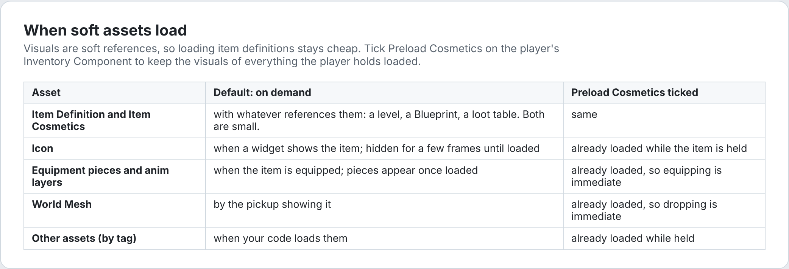

- Definitions hard-reference their rules and cosmetics assets, which are small. Visuals are soft references inside the cosmetics.
- By default, visuals load asynchronously when needed and unload once nothing uses them. Each user holds its own handle: a widget for its icon, an equipped item for its pieces.
- **Preload Cosmetics** on an Inventory Component keeps every visual of everything it holds loaded. Menus and equipping then never wait. Use it on the player, not on chests and pickups.
- Placed pickups can avoid popping in by setting their mesh in the editor, for example in the construction script. The level then saves the mesh and loads it with the level.

### 13.3 Why there are no asset bundles

Asset bundles only collect soft references from the primary asset itself, and the visuals live in a separate cosmetics asset. A bundle's loaded state is also global per asset. That suits loading a whole set at once, like a level, better than a single widget needing one icon. Per-use handles plus Preload Cosmetics cover both cases.

---

## 14. Game Features

The **Add Inventory Content** game feature action extends existing content while a Game Feature plugin is active, and removes the extension when it deactivates. Use it for DLC or optional content.

| Field | Description |
| --- | --- |
| Loot Pools | Each element has a **Table** and **Pools**. The pools roll after the table's own. |
| Recipes | Each element has a **Book** and **Recipes**. The recipes are added to the book. |

To use it:

1. Make sure the GameFeatureData Asset Manager entry exists ([2.2](#22-asset-manager)).
2. Create a Game Feature plugin: **Edit › Plugins › Add**, choose **Game Feature (Content Only)**.
3. Open the plugin's Game Feature Data asset. Under **Actions**, add **Add Inventory Content** and fill in the tables and books.
4. If the plugin has its own item definitions, add `InventoryItem` to the Game Feature Data's **Primary Asset Types to Scan** with the plugin's content folder.
5. Activate the feature: set its initial state, or use the Game Features subsystem.

---

## 15. Scripting reference

### 15.1 Getting the objects you need

| Object | Blueprint | C++ |
| --- | --- | --- |
| Inventory Component | **Find Inventory Component** (Actor) | `UInventoryComponent::FindInventoryComponent(Actor)` |
| Equipment Component | **Find Equipment Component** (Actor) | `UInventoryEquipmentComponent::FindEquipmentComponent(Actor)` |
| Inventory Subsystem | **Get Inventory Subsystem**, or **Get World Subsystem** with Inventory Subsystem | `UInventorySubsystem::Get(WorldContext)` |
| Registry | | `UInventorySubsystem::Get(this)->GetRegistry()` |
| Inventory UI Subsystem | **Get Inventory UI Subsystem** (Player Controller) | `UInventoryUISubsystem::Get(LocalPlayer)` |

### 15.2 Common tasks

| Task | Node(s) |
| --- | --- |
| Give items | Inventory Component › Add Item By Definition (Definition, Count), or Add Item (Spec, Allow Partial) for tag values and tags too |
| Does the player have it | Inventory Component › Count Items (Query) > 0 |
| Use up items | Inventory Component › Remove Items (Query, Count) |
| Use up one specific stack | Inventory Subsystem › Remove Item (Item, Count) |
| List items | Inventory Component › Find Items (Query) |
| Read an item | Inventory Subsystem › Get Item Definition, Get Item Count, Get Tag Value, Get Item Tags |
| Change an item | Inventory Subsystem › Set Tag Value, Add To Tag Value, Remove Tag Value, Add Item Tag, Remove Item Tag |
| Equip or unequip | Equipment Component › Equip Item, Unequip Item, Unequip Slot |
| Grow or shrink a container | Inventory Component › Add Container Capacity (Container Tag, Count) or Set Container Capacity; or give an item an Inventory Capacity Upgrade |
| Let items stack higher | Inventory Component › Add Container Stack Bonus (Container Tag, Item Query, Amount); or a capacity upgrade of the kind Stack Size |
| Use a capacity upgrade the player carries | Inventory Component › Apply Capacity Upgrade (the item menu's Apply Capacity Upgrade action calls it) |
| A weight limit | Inventory Component › Carry Limit settings; Get Carried, Get Max Carried, Set Max Carried, Is Over Carry Limit, On Over Carry Limit Changed |
| What's in a slot | Equipment Component › Get Equipped Item (Slot) |
| Hand items over | Inventory Component › Transfer Item / Take Item |
| Fill from a loot table | Inventory Component › Add Loot |
| What an item can make | Inventory Component › Get Recipes Using (Book, Item), then Get Craftable Times and Get Craft Error for each; or a recipe menu ([11.15](#1115-recipe-menus-what-an-item-makes)) |
| React to changes | Inventory Component › On Inventory Changed; Equipment Component › On Item Equipped / Unequipped |
| Struct data | Get Definition Fragment, Get Item Fragment, Set Item Fragment, Get/Set Container Fragment |
| The item behind an ability | Get Item From Ability (Ability) |

Fragment nodes have a wildcard struct pin; connect your struct type. They output **Found** or **Not Found**.

### 15.3 Inventory Subsystem

| Group | Functions |
| --- | --- |
| Items | Is Valid Item, Get Item Definition, Get Item Count, Get Item Container, Get Item Placement, Get Item Size, Get Item Containers, Find Item Container, Is Item Equipped, Get Attachments, Can Stack, Matches Query |
| Tags and values | Get Item Tags, Has Item Tag, Get Effective Item Tags, Get Tag Value, Get Effective Tag Value, Has Tag Value, Get Tag Value Max, Get Tag Value Fraction, Get Total Tag Value, Get Socket Sources, Set Tag Value, Add To Tag Value, Remove Tag Value, Add Item Tag, Remove Item Tag |
| Fragments | Remove Item Fragment, Remove Container Fragment (getters and setters are in the function library) |
| Containers | Is Valid Container, Get Container Layout, Get Container Tag, Get Container Items, Get Container Owner Item, Get Container Owner, Get Root Container, Get Item At, Get Item In Slot, Can Place Item, Find Placement, Find Items, Count Items, Create Container, Destroy Container, Set Container Layout, Sort Container |
| Capacity | Get Capacity, Get Max Capacity, Get Grid Rows, Is Placement Usable, Set Capacity, Add Capacity, Get Max Stack Size, Add Stack Bonus |
| Operations | Add Item, Add Item At, Remove Item, Move Item, Move Item To, Move Item To Containers, Swap Items, Split Stack, Split Stack To, Merge Stacks, Rotate Item, Equip Item, Unequip Item, Execute Batch |
| Crafting | Can Craft, Craft |

### 15.4 Function library

| Function | Description |
| --- | --- |
| Make Cell Placement / Make Index Placement | Build placements for grids, or for slots and lists. |
| Get Item Fragment / Set Item Fragment | An item's instance fragment of a struct type. |
| Get Container Fragment / Set Container Fragment | A container's instance fragment. |
| Get Definition Fragment | A definition's static fragment. |
| Get Item From Ability | The equipped item that granted an ability. |
| Roll Loot Table | Item specs from a table. Seed -1 is random. |
| == / != / To String | For item and container handles. |

### 15.5 C++

All operations live on `FInventoryRegistry` and return `EInventoryError`.

```cpp
#include "InventoryRegistry.h"
#include "InventorySubsystem.h"

FInventoryRegistry& Registry = UInventorySubsystem::Get(this)->GetRegistry();

// Several changes that succeed or fail together. Transactions nest.
const EInventoryError Error = Registry.RunTransaction([&]() -> EInventoryError
{
	const EInventoryError MoveError = Registry.MoveItem(OldLantern, Trash);
	if (MoveError != EInventoryError::None)
	{
		return MoveError;
	}
	return Registry.AddItem(FInventoryItemSpec(NewLanternDefinition), InventoryGrid);
});

// What would happen, with the real rules, without changing anything.
const EInventoryError Preview = Registry.DryRun([&]() { return Registry.MoveItem(Item, Chest); });

// A batch built from operations, undone as a whole if one fails.
const TArray<FInventoryOperation> Operations = {
	FInventoryOperation::MakeSplit(Ammo, 10, AmmoCase),
	FInventoryOperation::MakeEquip(Rifle, Equipment, SlotTag) };
const FInventoryBatchResult Result = Registry.ExecuteBatch(Operations);

// Hear about every committed change in the world.
Registry.OnChanged.AddUObject(this, &UMyClass::HandleInventoryChanged);
// void UMyClass::HandleInventoryChanged(const FInventoryChangeSet& Changes) — Changes.Items and Changes.Containers
```

Other useful registry functions: `FindItem` and `FindContainer` for read-only records, `GetItemAt`, `CanPlace`, `FindPlacement`, `FindItems`, `CollectContainers`, `GetEffectiveTagValue`, `ForEachSocketAffecting`, `GetCapacity`, `GetMaxCapacity`, `GetGridRows`, `SetCapacity`, `AddCapacity`, `GetMaxStackSize`, `AddStackBonus` and `GetCarriedValue`. On a layout, `GetMaxRows` gives the most rows a grid can have, `INDEX_NONE` without a limit.

### 15.6 Events: what fires when

All events fire after a change is committed, never during one, and never for a change that was undone or only previewed with a dry run.

| Event | On | Fires when |
| --- | --- | --- |
| On Inventory Changed | Inventory Component | Anything changed in one of its containers, nested ones included. Once per committed change. |
| On Capacity Upgraded | Inventory Component | A capacity upgrade was applied to one of its containers, once per upgrade used up. After On Inventory Changed. |
| On Over Carry Limit Changed | Inventory Component | It went over its carry limit or back under it. |
| On Container Changed | Inventory Subsystem | Any container in the world changed: its items, its capacity or its layout. |
| On Item Changed | Inventory Subsystem | Any item in the world changed: moved, its count, tags or values, or destroyed. |
| On Item Equipped / On Item Unequipped | Inventory Equipment Component | An item entered or left one of its equipment slots, after its grants were applied or removed. |
| On Shortcuts Changed / On Shortcut Activated | Inventory Shortcut Component | A slot's item changed; a slot was activated. |
| On Held Item Changed, On Hold Event, On Item Put Down, On Target Changed, On Hovered Item Changed, On Selected Item Changed, On Item Menu Requested, On Default Action Requested, On Item Chosen, On Dropped Outside | Inventory UI Subsystem | The player's interaction with the inventory UI ([11.7](#117-inventory-ui-subsystem)). |

Bind gameplay to the Inventory Component's events, which only fire for that actor; bind to the Inventory Subsystem's for things that watch the whole world, such as a quest tracking an item wherever it is. In C++, the registry's `OnChanged` gives the full change set of each committed transaction ([15.5](#155-c)).

---

## 16. How-to guides

### 16.1 A flashlight that uses battery charge

1. `DA_Flashlight`: Tag Values `Item.Stat.Charge = 100`, Equip Rules for the hand slot.
2. While the light is on, drain it: Equipment Component › **Get Equipped Item** (`Equipment.Slot.Hand.Main`), then Inventory Subsystem › **Add To Tag Value** (Item, `Item.Stat.Charge`, -drain per second × delta seconds).
3. When the charge reaches 0, turn the light off. Read it with **Get Tag Value**.
4. To swap the battery: Inventory Component › **Remove Items** (Query: Definitions `DA_Battery`, Count 1). If it returns 1, **Set Tag Value** (flashlight, `Item.Stat.Charge`, 100).

### 16.2 A backpack

1. `CL_Backpack`: Grid 4 × 4.
2. `DA_Backpack`: Containers `Container.Backpack` + `CL_Backpack`; Equip Rules with Slots `Equipment.Slot.Back`.
3. Add a `Equipment.Slot.Back` slot to the equipment layout.
4. Worn or carried, its grid joins the owner's storage after the root containers. Show it with a second grid ([11.6](#116-chests-backpacks-and-other-containers)).

### 16.3 A key that opens a door

On interact: player's Inventory Component › **Count Items** (Query: Definitions `DA_Key_Basement`). If it's above 0, open. To use the key up, **Remove Items** with the same query and Count 1. For a family of keys, tag them `Item.Type.Key.Basement` and query by tag instead.

### 16.4 A pickup

1. An actor Blueprint with a Static Mesh component, an Inventory Component (Containers `Container.Pickup` + a List layout) and your interaction component.
2. Set Starting Items on each placed instance.
3. On interact: for each container in **Get Containers**, and each item in Inventory Subsystem › **Get Container Items**, call the player's **Take Item** (Item, Count 0, Allow Partial on). What doesn't fit stays. Capacity upgrades, such as pouches, are used up as they're taken. To grey out the prompt while nothing fits, ask **Can Take Item** first.
4. When **Count Items** with an empty query is 0, destroy the pickup.
5. To show the item: set the mesh from the first item's Cosmetics › **World Mesh**. Do it in the construction script for placed pickups, so the level saves the mesh.

### 16.5 A chest

1. An actor with an Inventory Component (Containers `Container.Chest` + a Grid layout), plus Starting Loot for random contents.
2. On interact, open a screen with two grids: one with Container Tag `Container.Inventory` for the player, and one for the chest.
3. Call **Set Container** on the chest grid with the chest's **Get Container** (`Container.Chest`). The player drags items between them.

### 16.6 A two-handed weapon

Equip Rules: Slots `Equipment.Slot.Hand.Main`, Blocked Slots `Equipment.Slot.Hand.Off`. Equipping fails while the off hand holds something, and nothing can enter the off hand while it's equipped.

### 16.7 Weapon attachments

1. `CL_RifleAttachments`: Slots with **Equipment** ticked; slots `Attachment.Optic` and `Attachment.Muzzle`.
2. `DA_Rifle`: Containers `Container.Attachments` + `CL_RifleAttachments`.
3. `DA_RedDot`: Equip Rules with Slots `Attachment.Optic`. Cosmetics: a Static Mesh piece with Attach Socket set to the rifle mesh's optic socket.
4. While the rifle is equipped, the red dot is applied too, and its piece attaches to the rifle's first piece.

### 16.8 Random durability on loot

In the loot entry, add Tag Values: `Item.Stat.Durability`, Min 20, Max 60, Whole Number on. Each drop gets its own value, and stacks only merge with equal durability.

### 16.9 A consumable

From the item widget's **On Context Requested**, show a menu with **Use**. On Use, apply your Gameplay Effect to the player, then Inventory Subsystem › **Remove Item** (Item, 1).

### 16.10 Storage that grows during play

The player starts with a small inventory, and each pouch they find adds two cells. The grid always shows whole rows: when the new cells start a new row, the row appears with the cells still to come disabled. Full is full: what doesn't fit is turned away.

**What the player sees**

1. A new game: the inventory is a 4 × 2 grid.
2. They find a pouch on a shelf and take it. It never goes into the inventory: a message says they can carry more, and a third row appears, its first two cells usable and the last two disabled.
3. The next pouch fills in that row, and the one after starts a fourth. Once the inventory is at its biggest, a pickup with another pouch says there's no room for it.

**What the designer makes**

1. **Tags**: `Container.Inventory` for the inventory.
2. **The layout**, `CL_Inventory`: Type Grid, Grid Size `4 × 2`, the inventory the player starts with; **Grid Growth** With Upgrades; **Max Rows** `5`, the most it can grow to, room for six pouches. Max Rows `0` lets it grow as long as there are pouches.
3. **The character**: on its Inventory Component, add the container `Container.Inventory` + `CL_Inventory`. That's all it needs.
4. **The pouch**: an item definition `DA_Pouch`. Under **Fragments**, add **Inventory Capacity Upgrade**: Container Tag `Container.Inventory`, Kind Room, Amount `2` (or 1, or 3), Apply When Taken on.
5. **The pickup**: any pickup that takes its items with the player's **Take Item**, **Take All** or **Add Item** ([16.4](#164-a-pickup)), holding `DA_Pouch`.
6. **The screen**: an Inventory Grid Widget for `Container.Inventory`. Its cell's button style gives empty cells their normal look, such as a cross, and cells not added yet their disabled look, such as a plain dark tile ([11.10](#1110-locked-cells-and-player-access)). Leave room below the grid for the rows it will gain.
7. **The message**: bind the character's Inventory Component **On Capacity Upgraded** and show the upgrade's Display Name.

To start with a pouch already used, add `DA_Pouch` to the Inventory Component's **Starting Items**: it's applied as play begins, so the player starts with 10 cells. From a Blueprint, **Add Item By Definition** (`DA_Pouch`, 1) on the Inventory Component does the same at any time. For storage the player upgrades by hand, such as a backpack they carry until they find a workbench, untick **Apply When Taken** and offer the **Apply Capacity Upgrade** item action. For a reward that isn't an item, call the Inventory Component's **Add Container Capacity** (`Container.Inventory`, 2). To start a harder difficulty with less room and the same layout, tick the container's **Starting Capacity** and set it to `6`: the second row then shows its last two cells disabled.

### 16.11 Key items the player can't move

1. `CL_KeyItems`: Type List, Capacity 0 (no limit), Filter Tag Query `Item.Type.KeyItem`, **Player Access** Read Only.
2. The inventory's layout gets the opposite filter, so key items never land there: Tag Query None of `Item.Type.KeyItem`.
3. Add both containers to the character's Inventory Component. Picked-up key items go to the key items list by themselves, as it's the only container that accepts them.
4. Show the list with an Inventory List Widget. The player can look at key items and open their item menus, but can't pick them up, move them, or put anything in the list. Your code still adds and removes them, such as when a key is used up.
5. To keep item actions such as Discard away from key items, leave them out with each action's **Item Filter**.

### 16.12 Storage that never fills up

Every pickup is taken: the grid adds rows as items need them, and loses them again as it empties.

1. **The layout**: Type Grid, Grid Size such as `10 × 4`, the least it shows; **Grid Growth** To Fit Items; **Max Rows** `0` for no limit.
2. **The screen**: an Inventory Grid Widget in a **Scroll Box**, as the grid can grow past the screen. It always draws a free row below the last for the player to put items in.
3. To keep it in check some other way, such as by weight, add a carry limit ([16.13](#1613-a-weight-limit)).

### 16.13 A weight limit

1. **Tags**: a tag value for weight, such as `Item.Stat.Weight`, and give each item definition its weight under **Tag Values**.
2. **The character**: on its Inventory Component, set **Carry Limit**, **Carried Value Tag** `Item.Stat.Weight`, and **Max Carried**, such as `120`.
   - **Refuse** turns away what would go past it. Pickups with stacks take as many as can be carried.
   - **Allow Over** takes everything, and fires **On Over Carry Limit Changed**: slow the character down while it's over.
3. **The screen**: show **Get Carried** and **Get Max Carried**, such as `86 / 120`, refreshed on **On Inventory Changed**.
4. **Strength**: call **Set Max Carried** when it changes, such as from an attribute or a perk.

### 16.14 Ammo that stacks higher

An ammo case lets the player carry more ammo in each cell, instead of adding cells.

1. **The ammo**: its Stack Rules set how many stack to begin with, such as 30.
2. **The upgrade**: an item definition `DA_AmmoCase`. Under **Fragments**, add **Inventory Capacity Upgrade**: Container Tag `Container.Inventory`, Kind Stack Size, Amount `10`, Stack Items a Tag Query of `Item.Type.Ammo`.
3. Picked up, it's used at once: ammo now stacks to 40 in the inventory. Each further case adds 10 more. Value displays of the stack count show the new limit.
4. Ammo moved to a chest keeps its stack whole there, but chests stack it no higher than its Stack Rules unless they have a bonus of their own.

### 16.15 Choosing a setup for your game

| Your game is like | Containers | Layout settings | Also |
| --- | --- | --- | --- |
| Minecraft, Terraria | A storage grid and a hotbar | Grid, Grid Growth None; the hotbar a Slots layout, or an Inventory Shortcut Component pointing into the grid | Stack Rules per item |
| Diablo II, Escape from Tarkov | A grid, with items of different sizes; backpacks that are items | Grid, Grid Growth None; backpack items carry their own grid ([16.2](#162-a-backpack)) | Rotation, sockets |
| Requiem, the Resident Evil games | An inventory grid, key items list, item box | Inventory: Grid Growth With Upgrades, Max Rows as far as pouches go; key items: List, Player Access Read Only ([16.11](#1611-key-items-the-player-cant-move)) | Pouches ([16.10](#1610-storage-that-grows-during-play)); Combine as a recipe menu ([11.15](#1115-recipe-menus-what-an-item-makes)); Map, Items and Crafting pages ([11.14](#1114-pages-tabs-on-an-inventory-screen)) |
| Resident Evil 4 | An attaché case bought bigger | Grid per case size | Set Container Layout swaps the case |
| Stardew Valley | A grid that gains whole rows | Grid Growth With Upgrades | Upgrades whose Amount is the number of columns |
| Baldur's Gate 3, Divinity: Original Sin 2 | One grid that never fills | Grid Growth To Fit Items, Max Rows 0 ([16.12](#1612-storage-that-never-fills-up)) | Carry Limit Allow Over ([16.13](#1613-a-weight-limit)) |
| Skyrim, Fallout | One list sorted by category | List, Capacity 0 | Carry Limit Allow Over; list widgets with filters and sorting |
| Zelda: Breath of the Wild | Lists or slots per category, each earned bigger | One List per category with a Capacity, or Slots with Usable Slots | Room upgrades per container tag |
| The Last of Us | Ammo with a carried maximum | Stack Rules on the ammo | Stack Size upgrades ([16.14](#1614-ammo-that-stacks-higher)) |
| Diablo III, Path of Exile stashes | Tabs | One container per tab, each its own tag | A tab bar showing one grid at a time ([11.3](#113-building-an-inventory-screen)) |

---

## 17. Debugging and testing

| Tool | How |
| --- | --- |
| Gameplay Debugger | In Play In Editor, press the apostrophe key (`'`), then the number for **Inventory** (numpad by default). It shows the selected debug actor's inventory, or your own pawn's when none is selected: containers as a tree with their capacity, how far each grid can grow, and Player Access, an ASCII map of each grid's rows with locked cells as `#`, every item's state, and equipped items with their grants. Spawned pieces are marked in the world. |
| Inventory.Give | Gives items by asset name ([12.10](#1210-inventorygive)). |
| Unreal Insights | Operations appear as `Inventory_*` CPU scopes. Run with `-trace=default,counters` to graph the `Inventory/Items` and `Inventory/Containers` counters. |
| Automation tests | **Tools › Session Frontend › Automation**, filter `ModularInventory`, tick and run. They include a check that this guide has no broken links, images or tables. Command line: `UnrealEditor-Cmd.exe YourProject.uproject -ExecCmds="Automation RunTests ModularInventory; Quit" -unattended -nullrhi`. |
| Data validation | Right-click a folder › **Validate Assets** ([12.9](#129-data-validation)). |
| Message Log | **Window › Message Log › Modular Inventory** lists what the editor tools skipped and why. |
| Log | Category `LogInventory`. |

---

## 18. Troubleshooting

| Symptom | Cause | Fix |
| --- | --- | --- |
| The editor asks about GameFeatureData on every start | The Asset Manager entry was never saved | Click **Yes**, or add the entry by hand ([2.2](#22-asset-manager)) |
| "Modules are missing or built with a different engine version" | The plugin wasn't compiled | Regenerate project files and build Development Editor from your IDE |
| Item definitions warn "Items aren't registered with the Asset Manager" | No `InventoryItem` entry: `Config/DefaultGame.ini` couldn't be written, or the editor ran unattended | Make the file writable and open the editor, or add the entry by hand ([2.2](#22-asset-manager)) |
| `Inventory.Give` says there's no such item | Wrong name, or no `InventoryItem` entry | Use the asset name, such as `DA_Battery`. If it lists no items at all, see the row above |
| Add Item adds nothing | No storage containers, everything is full, or a filter rejects the item | Give the component a non-equipment container; check filters; check the Out Error |
| Starting equipment isn't equipped (warning in the log) | No equipment container has that slot tag, **Equipment** isn't ticked, or the equip rules don't allow the slot | Match the slot tags between the layout, Equip Rules and Starting Equipment |
| An equipped item is invisible | No pieces, wrong Attach Component, or First Person Primitive Type hides it | Check the cosmetics' Pieces. Get Spawned Pieces shows what spawned |
| Abilities or effects aren't granted | The owner has no Ability System Component through the Ability System Interface | Add one to the actor |
| The grid widget is empty | Container Tag doesn't match the component's, the player has no Inventory Component, the container isn't a Grid, or Item Class isn't set | Match the tags, set Item Class, or call Set Container |
| The grid shows its items but no cells, and empty cells can't be clicked | The Cell Class has nothing in its designer, so Common UI builds no button. The log says so. | Add any root widget to the cell, such as an empty Overlay |
| An empty slot shrinks to nothing | A Size Box with a collapsed child takes no space, whatever its overrides | Keep the item widget's visibility as the slot sets it (Hidden when empty); don't collapse it yourself |
| Gamepad can't move through the grid | Cell Class isn't set, or the screen has no desired focus target | Set Cell Class; return a cell from Get Desired Focus Target |
| Icons are stretched or turn wrong | The Icon fills its parent | Set its alignment to Center |
| Icons are tiny, huge or squashed outside the grid | Outside grids an icon takes its texture's size | Put the item widget, or the details panel's Icon, in a Scale Box set to Scale to Fit |
| Items don't stack | No Stack Rules, the item carries containers, or the stacks' state differs | Compare their tag values, tags and fragments |
| A swap is refused | One stack is partial, a filter refuses, or an item would end up inside itself | Swap whole stacks; check filters |
| A loot table gives nothing | Pool or entry conditions fail with your context tags, weights are 0, or Min Rolls is 0 | Check its Drop Rates with the same context ([12.6](#126-loot-table-drop-rates)) |
| Can't craft | Missing Ingredients, Requirements Not Met, or No Space | Read the Out Error. Each item counts toward one ingredient only |
| Visuals pop in | Assets load on demand | Tick **Preload Cosmetics** on the player; set placed pickups' meshes in the editor |
| No thumbnail icon | The asset hasn't been loaded since installing, or there's no Icon | Open or save the asset; set the Icon |
| No Footprint, Icon row or Cosmetics Create button | Several assets are being edited at once | Open a single item definition |
| No **Create Inventory Item** in the menu | The selection has no Static Meshes or Textures | Select those asset types |
| Generate Item Icons skips an item | It has a hand-made icon, or no World Mesh | See the Message Log. Use **Edit Item Icon...** to replace a hand-made icon |
| An icon is stretched in the inventory, or validation says its shape doesn't match | The item's Size changed after the icon was made, or the texture is hand-made in another shape | **Generate Item Icons** for a generated icon; reshape a hand-made one |
| Generated icons are too dark or too bright | Lighting settings | Open **Edit Item Icon...**, click **Lighting...** and adjust Exposure and the lights while watching the preview, then **Generate All Item Icons** |
| A generated icon looks blurry | Supersampling or Pixels Per Cell is low, or the mesh's textures are low resolution | Raise them in the settings ([12.8](#128-settings)) and generate again |
| A generated icon shows the mesh untextured, or with the grey default material | It was generated by an older version of the plugin, which could render before shaders and textures were ready; or the material doesn't compile | Generate it again. If it stays that way, open the mesh: if it looks the same there, fix its material |
| A generated icon is empty | The World Mesh has no visible geometry from that angle, or its materials are translucent or masked away | Turn the mesh in the Icon Studio |
| A pouch goes into the inventory instead of making room | The pouch's definition has no Inventory Capacity Upgrade, its Container Tag isn't one of the taker's containers, Apply When Taken is off, or it was dragged in by hand | Check the fragment is under **Fragments**, and that its Container Tag matches the Inventory Component's container. Pickups must take items with Take Item, Take All or Add Item |
| A pickup with an upgrade says there's no room | The container can't grow any more: a grid at its Max Rows with every cell usable, every slot unlocked, or a grid whose Grid Growth is None or To Fit Items, which has nothing to add | Set the layout's Grid Growth to With Upgrades, raise its Max Rows (0 is no limit), or place fewer upgrades |
| Some cells of a grid can't be used | They haven't been added yet, or a Starting Capacity locked them: they're past the container's capacity | Add them with capacity upgrades or Add Container Capacity, or raise the container's Starting Capacity ([4.7](#47-capacity-storage-that-grows)) |
| A grid shows whole rows the player can't use yet | A Starting Capacity smaller than its Grid Size locks them | Make Grid Size the grid it starts with, and set Grid Growth With Upgrades for the rest ([4.7](#47-capacity-storage-that-grows)) |
| A grid widget grows past the screen | It gains rows as it grows, up to Max Rows or without limit | Leave room below it for the grid at its biggest, or put it in a Scroll Box |
| A grid shows an empty row below its items | It grows To Fit Items: the free row is where the player puts items in | Use Grid Growth With Upgrades or None for a grid that's full when it's full |
| An item is turned away with Over Carry Limit | The Inventory Component's Carry Limit is Refuse, and the item would take the total past Max Carried | Raise Max Carried, use Allow Over, or set Carry Limit to None |
| Ammo doesn't stack higher after an upgrade | The Stack Size upgrade's Container Tag isn't the container the ammo is in, its Stack Items don't match the ammo, or the ammo doesn't stack at all | Check the Container Tag and Stack Items. Stack bonuses belong to one container |
| Items can't be picked up or dragged out of a container | Its layout's **Player Access** is Put Only or Read Only | Set it to Full or Take Only. Code can still move the items |
| Nothing can be put into a container through the UI | Its layout's Player Access is Take Only or Read Only | Set it to Full or Put Only |
| A list has no empty entry to put items on | Show Empty Entry is off, the list is full, or its Player Access doesn't let the player put items in | Check the list's capacity and Player Access |
| The description line never says anything | The screen has no Text Block named `DescriptionText`, or the hint texts, the actions' and the buttons' Descriptions are empty. Browsing the items, it says nothing by design | Name the Text Block `DescriptionText` and fill them in ([11.13](#1113-the-description-line)) |
| The action bar flickers, or its actions swap places, as the cursor moves or a menu opens | A Common Bound Action Bar rebuilds its buttons whenever the bound actions change. With Action Availability By Target, they change as the cursor moves from item to item | Set **Action Availability** to By Mode, its default, so they change only as the player picks up, puts down or opens a menu ([11.3](#113-building-an-inventory-screen)). Item menus bind Back and Confirm once, so they stay put while open |
| Back on the items page, nothing is focused or hovered | The switcher took longer to bring the page in than focus waits, or a Blueprint Get Desired Focus Target returns something other than a cell | Use a Modular Page Switcher ([11.14](#1114-pages-tabs-on-an-inventory-screen)); leave Get Desired Focus Target to the screen, or return a cell from it |
| Items light up one after another as a page slides in | A Common Animated Switcher's transition moves the real widgets under the cursor | Use a Modular Page Switcher, with Block Input While Showing |
| The screen opens on the wrong page | Set Start Tab was called after the screen showed, or the Tab Id isn't one of Tab List's | Call it as the screen is pushed, such as in the push's Init Func; the log names a Tab Id it can't find |
| The Craft action isn't offered | It has no Menu Class, no recipe of its book takes the item, or Only When Craftable is on and none can be made now | Set Menu Class and Recipe Book, on the action or the menu |
| A recipe menu lists no recipes | It has no Recipe Panel or Recipe Entry Class, or When Uncraftable is Hide and none can be made now | Add `RecipePanel` inside Menu Panel and set Recipe Entry Class; the log says so |

---

## 19. Saving (not implemented yet)

Everything saving needs is in place: records are `UPROPERTY(SaveGame)` structs, item definitions have Asset Manager IDs, and fragments are instanced structs. A container's own capacity, once it has one, is part of its record, so the upgrades found are saved with it. The plan for Easy Multi Save:

1. Add a `UPROPERTY(SaveGame)` snapshot to `UInventoryComponent` holding its subtree's records. Store handles as indices into the snapshot and definitions as their `FPrimaryAssetId`.
2. Fill the snapshot in `IEMSCompSaveInterface::ComponentPreSave`. In `ComponentLoaded`, destroy the current containers and rebuild them from the snapshot.
3. Use the same export and import to carry the player's inventory across level transitions, since each world has its own registry.

To be ready, mark the properties of your fragment structs `SaveGame`.

---

## 20. Design notes

- **Records instead of objects.** Thousands of items cost no UObjects and no garbage collection, and moving an item is a record update.
- **Fragments live on records.** Instanced structs allocate their own memory, so a separate fragment registry would only add indirection.
- **Tag values for numbers.** Durability, charge and ammo are tag values rather than fragments, because loot ranges, recipes, sockets and queries can all read tag values. Fragments are for structured state.
- **Hard rules, soft visuals.** Loading every item definition for a crafting list, a loot table or a save costs almost nothing.
- **A layout says where a container starts and how it grows; its capacity says where it is now.** A grid's Grid Size is what the player starts with, Grid Growth how it grows and Max Rows how far, so the designer sets up storage the way the player sees it, for fixed, upgradable and endless inventories alike. One layout serves every stage of an upgrade path, every difficulty and every character, and the UI always shows whole rows.
- **Limits are optional rules, off by default.** A carry limit lives on the Inventory Component, as it's about what one actor carries, and is checked where every item enters a container, so no path gets around it. Stack bonuses live on containers, as an ammo case upgrades one container, and only change how high stacks there grow.
- **The Inventory Component for gameplay, the Inventory Subsystem for the rest.** The component speaks in container tags and applies an actor's rules, such as upgrades used as they're taken; the subsystem does exactly what it's told to any container or item by handle.
- **Player Access is a UI rule.** It limits what the player can do through widgets, never what code can do, so pickups, crafting and scripts can still add and remove key items.
- **Upgrades are data.** A capacity upgrade is a fragment on an item, so a pouch needs no code: the Inventory Component applies it as it's taken.
- **Equipping is a move.** Equipping works inside batches and transactions, and a worn backpack is simply an item in the Back slot.
- **One UI subsystem.** Mouse and gamepad call the same functions, so they can't drift apart. Common UI owns focus and Accept; UMG drag and drop is only used for the mouse.
- **Checks that can't disagree.** A recipe menu's counts and reasons come from the real craft, tried and undone, as placement previews do, so a recipe listed as craftable has the ingredients and the room it needs.
- **No view models.** Widgets read the registry directly through handles. Item state is cheap to look up, so view models would mostly copy it.
- **Singleplayer.** There is no replication. The registry is per world.
