# Modular Inventory

A data-driven inventory system for Unreal Engine 5.7. Items live in grid, slot or list containers, can carry containers of their own, can be equipped with Gameplay Ability System grants and visible meshes, and can be crafted or rolled from loot tables. Everything is set up with data assets in the editor and can be used from Blueprint or C++. The plugin is for singleplayer games and has no replication.

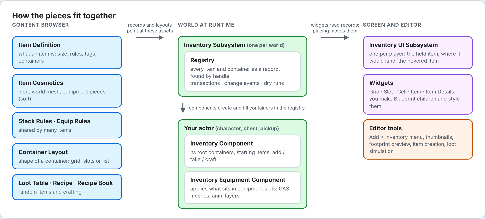

## Contents

1. [Overview](#1-overview)
2. [Installation and project setup](#2-installation-and-project-setup)
3. [Quick start](#3-quick-start)
4. [Core concepts](#4-core-concepts)
5. [Data assets](#5-data-assets)
6. [Components](#6-components)
7. [Grids: placement, rotation and sockets](#7-grids-placement-rotation-and-sockets)
8. [Equipment](#8-equipment)
9. [Loot tables](#9-loot-tables)
10. [Crafting](#10-crafting)
11. [User interface](#11-user-interface)
12. [Editor tools](#12-editor-tools)
13. [Loading and the Asset Manager](#13-loading-and-the-asset-manager)
14. [Game Features](#14-game-features)
15. [Scripting reference](#15-scripting-reference)
16. [How-to guides](#16-how-to-guides)
17. [Debugging and testing](#17-debugging-and-testing)
18. [Troubleshooting](#18-troubleshooting)
19. [Saving (not implemented yet)](#19-saving-not-implemented-yet)
20. [Design notes](#20-design-notes)

---

## 1. Overview

### 1.1 Features

| Area | What you get |
| --- | --- |
| Containers | Grids with items of any size that can turn 90 degrees, tagged slots, and ordered lists. Each container can have filters. |
| Nesting | Items can carry containers, such as a backpack's storage or a rifle's attachment slots, to any depth. |
| Stacks | Stacking, splitting, merging and swapping, with per-kind stack rules. |
| Item state | Tags and numeric tag values per item (durability, charge, ammo), plus fragments for structured data. |
| Equipment | Equipment slots that grant abilities, effects, attribute sets and tags, spawn meshes or actors on the character, and link anim layers. Grants scale with item level. |
| Sockets | Items in a grid can boost the items next to them. |
| Loot | Weighted pools, nested tables, tag conditions and random tag values. |
| Crafting | Recipes with consumed ingredients and tools, tag requirements, fixed and random outputs. |
| Safety | Every change is a transaction: it fully succeeds or is fully undone. |
| UI | Common UI widgets for mouse, keyboard and gamepad, with drag and drop and placement previews. |
| Editor | An Inventory section in the Add menu, one-click item creation, an icon generator with a live studio, icon thumbnails, a socket preview, live loot drop rates, extra validation and Asset Manager setup. |
| Debugging | A Gameplay Debugger category, Unreal Insights scopes, automation tests, and a console command to give items. |

### 1.2 Modules

| Module | Type | Contents |
| --- | --- | --- |
| `ModularInventory` | Runtime | Data assets, the registry and subsystem, Inventory and Equipment components, loot, crafting, the Game Feature action. |
| `ModularInventoryUI` | Runtime | The Inventory UI Subsystem and the widget base classes. Needs Common UI. |
| `ModularInventoryEditor` | Editor | Editor tools. It is never part of a packaged game. |

### 1.3 Requirements

- Unreal Engine 5.7.
- The plugins **Gameplay Abilities**, **Game Features** and **Common UI**, and **Data Validation** for the editor. Modular Inventory turns them on for you.
- An Ability System Component on actors that equip items, for the GAS grants only. Meshes, actors and anim layers work without one.

### 1.4 Glossary

| Term | Meaning |
| --- | --- |
| Item | One stack of something in a container: a record in the registry, not a UObject. |
| Item Definition | The data asset describing a kind of item: its size, rules, tags and visuals. |
| Handle | How you refer to an item or container: `FInventoryItemHandle`, `FInventoryContainerHandle`. |
| Container | A grid, slot set or list holding items. Built at runtime from a Container Layout. |
| Placement | Where an item sits in its container: a cell and rotation for grids, an index for slots and lists. |
| Storage | The containers new items go into: everything an Inventory Component holds except equipment slots. |
| Equipment container | A slot container whose layout has **Equipment** ticked. |
| Tag value | A number on an item, keyed by a gameplay tag. |
| Fragment | Any struct stored on a definition, item or container. |
| Context tags | Tags passed in when rolling loot or crafting, tested by conditions and requirements. |

---

## 2. Installation and project setup

### 2.1 Install the plugin

1. Copy the `ModularInventory` folder into your project's `Plugins` folder, so you have `YourProject/Plugins/ModularInventory/ModularInventory.uplugin`.
2. If your C++ code uses the plugin, add the modules to your module's `.Build.cs`:
   ```csharp
   PublicDependencyModuleNames.AddRange(new string[] { "ModularInventory", "ModularInventoryUI" });
   ```
   `ModularInventoryUI` is only needed if your C++ touches the widgets or the UI subsystem.
3. Close the editor. Right-click your `.uproject` and choose **Generate Visual Studio project files**.
4. Build the **Development Editor** configuration in your IDE.
5. Start the editor. Under **Edit > Plugins**, check that **Modular Inventory** is enabled.

> If the editor says *"The following modules are missing or built with a different engine version: ModularInventoryEditor"*, the plugin's modules weren't compiled. Close the editor, regenerate project files and build again from your IDE.

### 2.2 Asset Manager

The plugin needs two entries in **Project Settings > Game > Asset Manager > Primary Asset Types to Scan**. Both are saved in `Config/DefaultGame.ini`; commit that file afterwards.

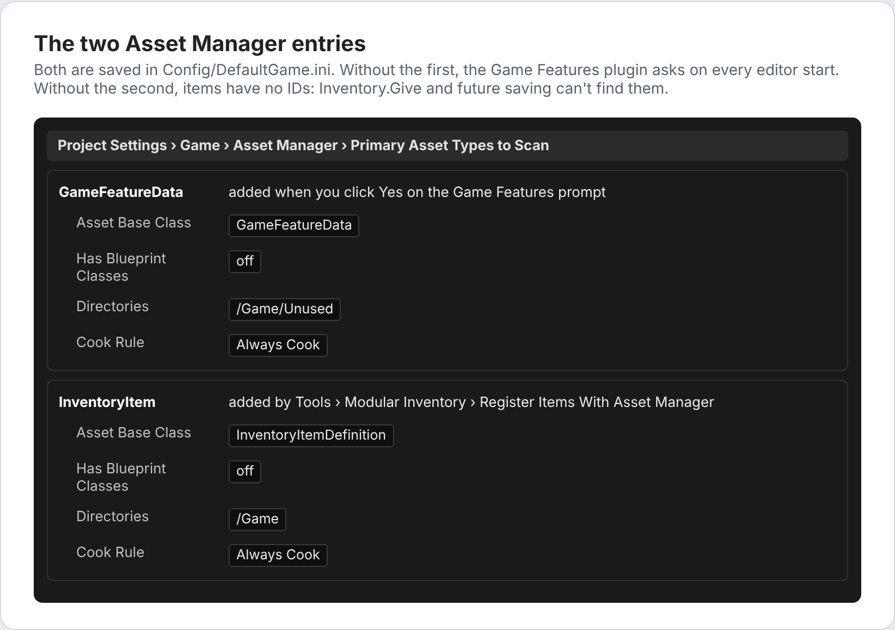

**GameFeatureData**, required by the Game Features plugin that Modular Inventory turns on. On the first start the editor asks:

> *Asset Manager settings do not include an entry for assets of type GameFeatureData, which is required for game feature plugins to function. Add entry to PrimaryAssetTypesToScan?*

Click **Yes**. The question then never comes back. If it keeps coming back, the entry wasn't saved: you clicked No, or `Config/DefaultGame.ini` is read-only. Add the entry by hand:

1. Open **Project Settings > Game > Asset Manager**.
2. Next to **Primary Asset Types to Scan**, click **+**.
3. Expand the new element and set:
   | Field | Value |
   | --- | --- |
   | Primary Asset Type | `GameFeatureData` |
   | Asset Base Class | `GameFeatureData` |
   | Has Blueprint Classes | off |
   | Is Editor Only | off |
   | Directories | `/Game/Unused` (any folder works; Game Feature data is found per plugin) |
   | Rules > Cook Rule | Always Cook |
4. Restart the editor.

**InventoryItem**, which gives every item definition an ID. Choose **Tools > Modular Inventory > Register Items With Asset Manager** once, or click **Register Items** on the prompt that appears when you create your first item. It adds this entry:

| Field | Value |
| --- | --- |
| Primary Asset Type | `InventoryItem` |
| Asset Base Class | `InventoryItemDefinition` |
| Directories | `/Game` |
| Rules > Cook Rule | Always Cook |

It also resaves item definitions that were saved before they had this type, so their IDs update. Until it is done, every item definition shows a validation warning when saved. See [13. Loading and the Asset Manager](#13-loading-and-the-asset-manager) for what the IDs are used for.

### 2.3 Gameplay tags

Containers, slots, item kinds and item numbers are all identified by gameplay tags. The plugin only defines `Inventory.Item.Level`; you create the rest.

To add tags, open **Project Settings > Project > GameplayTags**, click **Manage Gameplay Tags**, then click **+**, type the tag name, and save it to `DefaultGameplayTags.ini`.

A good starting set:

| Purpose | Example tags | Used in |
| --- | --- | --- |
| Container names | `Container.Pockets`, `Container.Equipment`, `Container.Backpack`, `Container.Pickup`, `Container.Chest` | Inventory Component containers, item containers, the UI's Container Tag |
| Equipment slots | `Equipment.Slot.Hand.Main`, `Equipment.Slot.Hand.Off`, `Equipment.Slot.Head`, `Equipment.Slot.Back` | Slot layouts, Equip Rules, Starting Equipment, slot widgets |
| Item kinds | `Item.Type.Weapon`, `Item.Type.Light`, `Item.Type.Ammo`, `Item.Type.Key`, `Item.Type.Consumable` | Item Definition tags, filters, recipes |
| Item numbers | `Item.Stat.Durability`, `Item.Stat.Charge`, `Item.Stat.Damage` | Tag values, loot ranges, sockets |
| Context | `Station.Workbench`, `Difficulty.Hard`, `Location.Basement` | Loot conditions, recipe requirements |
| Built in | `Inventory.Item.Level` | Item level; equipment grants scale with it |

Slot tags are matched hierarchically: equip rules that allow `Equipment.Slot.Hand` fit both `Equipment.Slot.Hand.Main` and `Equipment.Slot.Hand.Off`.

### 2.4 Common UI input

Only needed for the widgets.

- **Accept and Back** use your project's Common UI defaults (**Project Settings > Game > Common Input Settings > Input Data**). If menus already work with a gamepad, nothing changes here.
- **Rotate and Split** are actions your inventory screen binds. If your screen binds them by UI action tag, add each tag under **Project Settings > Game > Common UI Input Settings > Input Actions**:
  | Field | Example: rotate | Example: split |
  | --- | --- | --- |
  | Action Tag | `UI.Action.RotateItem` | `UI.Action.SplitStack` |
  | Default Display Name | Rotate | Split |
  | Key Mappings | R; Gamepad Face Button Top | Left Shift; Gamepad Left Shoulder |

See [11.4 Input](#114-input) for binding them.

---

## 3. Quick start

This builds a working inventory: a character that starts with a flashlight in hand and batteries in its pockets. Each step only uses what earlier steps created.

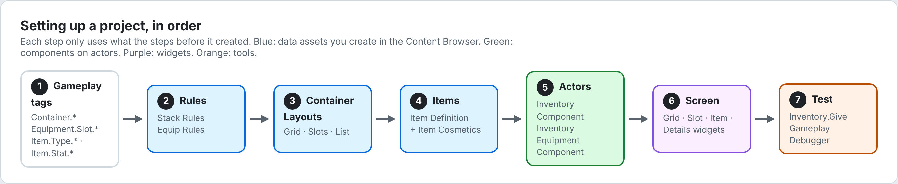

**Step 1. Create the tags.** Add `Container.Pockets`, `Container.Equipment`, `Equipment.Slot.Hand.Main`, `Item.Type.Light` and `Item.Stat.Charge` (see [2.3](#23-gameplay-tags)).

**Step 2. Create folders.** For example `Content/Inventory/Rules`, `Content/Inventory/Layouts`, `Content/Inventory/Items` and `Content/UI/Inventory`.

**Step 3. Create the rules.** In the Content Browser, click **Add > Inventory**:

| Asset | Type | Settings |
| --- | --- | --- |
| `SR_Battery` | Stack Rules | Max Stack Size `10`, Can Split on |
| `ER_HandItem` | Equip Rules | Slots: `Equipment.Slot.Hand` |

**Step 4. Create the container layouts.**

| Asset | Settings |
| --- | --- |
| `CL_Pockets` | Type **Grid**, Grid Size `6 × 4` |
| `CL_Equipment` | Type **Slots**, **Equipment** ticked, Slots: one element with Tag `Equipment.Slot.Hand.Main` and Display Name `Main Hand` |

**Step 5. Create the items.** Right-click your battery mesh (or its icon texture) and choose **Create Inventory Item**. Do the same for the flashlight. Then open each definition:

| Asset | Settings |
| --- | --- |
| `DA_Battery` | Size `1 × 1`, Stack Rules `SR_Battery`, Tags `Item.Type.Consumable` |
| `DA_Flashlight` | Size `1 × 2`, Equip Rules `ER_HandItem`, Tags `Item.Type.Light`, Tag Values `Item.Stat.Charge = 100` |

Items made from a mesh get an icon rendered from it. After changing an item's Size, right-click it and choose **Generate Item Icons** so the icon takes the new shape ([12.3](#123-item-icons)).

Open `DA_Flashlight_Cosmetics`. Under **Pieces**, add a **Static Mesh** piece and set:
- Mesh: the flashlight mesh;
- Attach Component: the name of your first-person mesh component;
- Attach Socket: the hand socket;
- First Person Primitive Type: First Person.

**Step 6. Register the items.** Choose **Tools > Modular Inventory > Register Items With Asset Manager**, if you didn't click **Register Items** when the prompt appeared.

**Step 7. Set up the character.** Open your character Blueprint and add an **Inventory Component** and an **Inventory Equipment Component** (**Add > Inventory**). Select the Inventory Component and set:

| Field | Value |
| --- | --- |
| Containers | `Container.Pockets` + `CL_Pockets`, and `Container.Equipment` + `CL_Equipment` |
| Preload Cosmetics | on |
| Starting Equipment | Slot `Equipment.Slot.Hand.Main`, Item Definition `DA_Flashlight` |
| Starting Items | Definition `DA_Battery`, Count `3` |

**Step 8. Test.** Press Play. The flashlight appears in your hand. Open the console with the backquote key (`` ` ``) and type `Inventory.Give DA_Battery 5`. Press the apostrophe key (`'`) and turn on the **Inventory** category: the pockets now hold one stack of 8 batteries.

**Step 9. Add a screen.** Follow [11.3 Building an inventory screen](#113-building-an-inventory-screen).

---

## 4. Core concepts

### 4.1 Items are records

Items are rows in one registry per world, owned by the **Inventory Subsystem**. You refer to them with handles. A handle remembers the slot and the slot's generation, so it can never reach an item that later reused the slot.

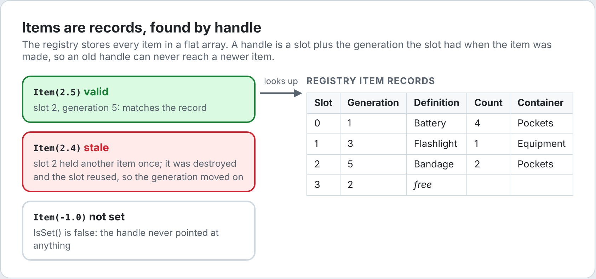

- A handle stays valid while its item exists, wherever the item moves: other containers, other actors, inside other items.
- `IsSet()` only says the handle was ever set. To know whether the item still exists, ask **Is Valid Item** on the subsystem.
- Containers work the same way with `FInventoryContainerHandle`.

### 4.2 Containers

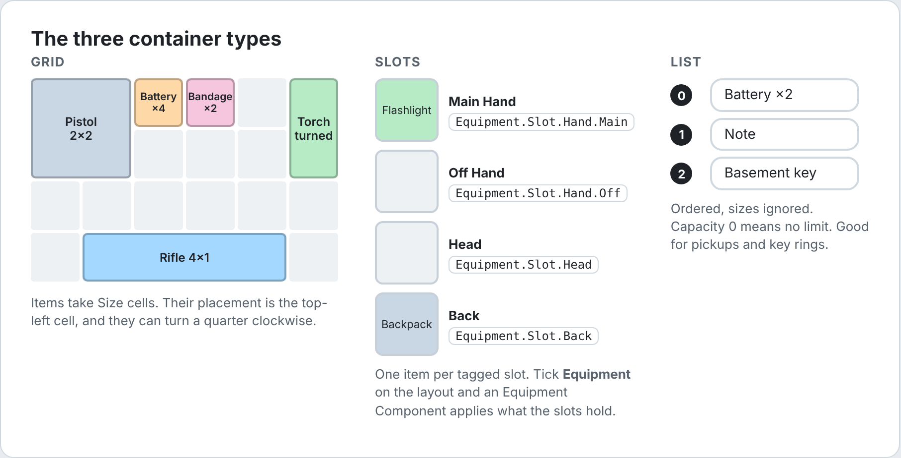

| Type | Placement | Behaviour |
| --- | --- | --- |
| Grid | `Cell` (top-left) and `Rotated` | Items take `Size` cells and may turn. See [7](#7-grids-placement-rotation-and-sockets). |
| Slots | `Index` | One item per slot. Each slot has a tag, a display name and its own filter. |
| List | `Index` (insert position) | Ordered. Item size is ignored. `Capacity` limits the count; 0 means unlimited. |

Containers are created at runtime from a **Container Layout**: by an Inventory Component on begin play, or with every item that carries containers.

### 4.3 Containers inside items

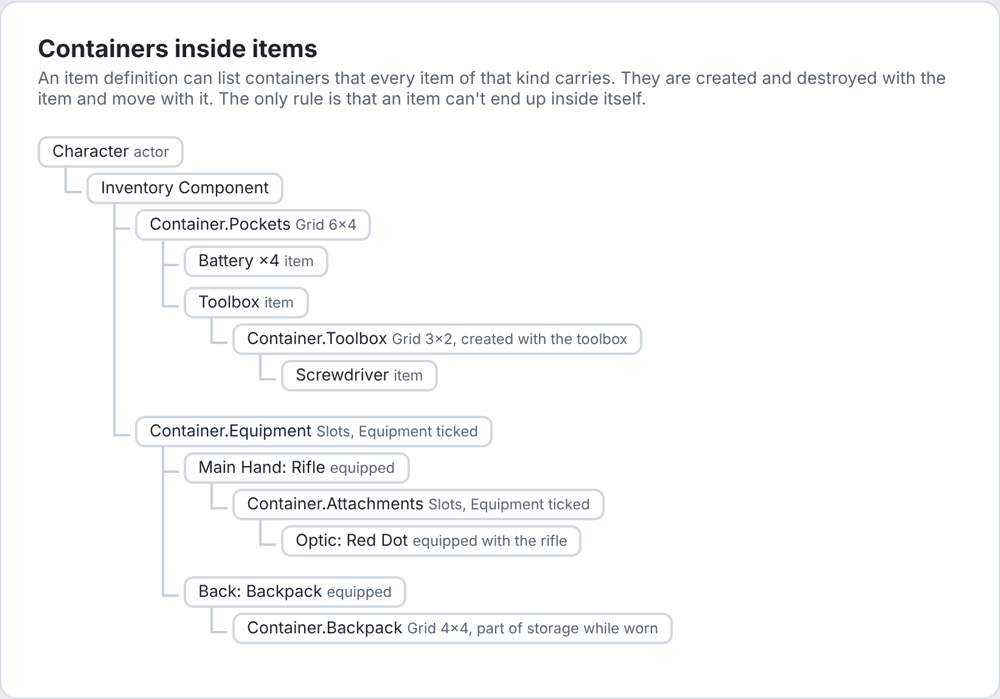

- Containers listed under an item definition's **Containers** are created with each item and destroyed with it. They move with the item, contents included.
- An item can't be put inside itself, directly or through other items (error `Would Contain Itself`).
- Items that carry containers never stack.
- Containers inside **equipped** items count as storage. A worn backpack holds new items; a backpack in the pockets also does, but after the pockets.

### 4.4 Tags, tag values and item level

| | Definition | Item |
| --- | --- | --- |
| Tags | **Tags** on the definition | The definition's tags plus tags added to the item at runtime |
| Tag values | **Tag Values** on the definition: the defaults | Values set on the item. An item only stores a value once it differs from the default |

- **Defaults stay live.** Changing a definition's default changes every existing item that hasn't set its own value.
- **Stacking.** Two stacks merge only if they have the same definition and identical item state: tags, tag values and instance fragments. A battery at 50% charge doesn't merge with a full one.
- **Item level** is the tag value `Inventory.Item.Level`. Items without it are level 1. Equipment grants scale with it ([8.2](#82-what-equipping-does)).
- **Effective values** add socket bonuses ([7.2](#72-sockets)). Plain values and tags ignore sockets.

### 4.5 Item queries

`FInventoryItemQuery` describes which items match. It is used by container and slot filters, recipe ingredients, socket targets, and searches such as Find, Count and Remove Items.

| Field | Meaning | Empty means |
| --- | --- | --- |
| Definitions | The item must be one of these definitions. | any definition |
| Tag Query | Tested against the item's tags, its definition's included. | any tags |
| Value Conditions | Each condition compares a tag value: Equal, Not Equal, Less, Less Or Equal, Greater, Greater Or Equal. All must pass. | no conditions |

An empty query matches every item. Examples:

| Want | Query |
| --- | --- |
| Only ammo in a pouch | Tag Query: Any Tags Match `Item.Type.Ammo` |
| Weapons with durability left | Tag Query `Item.Type.Weapon`; Value Condition `Item.Stat.Durability` Greater `0` |
| A specific key | Definitions: `DA_Key_Basement` |

### 4.6 Transactions and errors

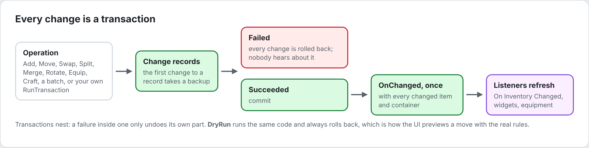

Every operation is all or nothing. Listeners hear about committed changes once, with the full set of changed items and containers.

| Operation | What it does |
| --- | --- |
| Add | Creates items from an item spec. Tops up matching stacks first unless a placement is given. |
| Remove | Removes a count from a stack, or the whole stack. |
| Move | Moves a stack, or part of one, to a container. Joins a stack if dropped on one. |
| Swap | Trades two items' places. Whole stacks only. |
| Split | Splits part of a stack into a new stack. |
| Merge | Moves count from one stack into another of the same kind. |
| Rotate | Turns a grid item a quarter, in place. |
| Equip / Unequip | Moves an item into or out of an equipment slot. |
| Batch | Runs several operations; if one fails, all are undone. |

Calls that can fail return or output an `EInventoryError`:

| Error | Meaning |
| --- | --- |
| None | Success. |
| Invalid Item / Invalid Container | The handle is stale or was never set. |
| Invalid Definition | No definition, or no recipe. |
| Invalid Count | The count is negative or more than the stack holds. |
| Invalid Tag / Invalid Fragment | Missing tag or fragment type. |
| Out Of Bounds | Outside the grid, or no such slot. |
| Occupied | The spot is taken. |
| Rejected | A container or slot filter refused the item. |
| Not Equippable | The equip rules don't allow the slot, another item blocks it, or the owner fails the requirements. |
| Cannot Rotate | The item can't turn, or turning doesn't fit. |
| Cannot Stack | Different kind or state, not stackable, or the stack is full. |
| Would Contain Itself | The target container is inside the item being moved. |
| No Space | Nothing fits anywhere. |
| Missing Ingredients | Not enough ingredients for the recipe. |
| Requirements Not Met | The recipe's requirements or Is Available refused. |

---

## 5. Data assets

Create every asset type with **Add > Inventory** in the Content Browser, or right-click an empty area of a folder.

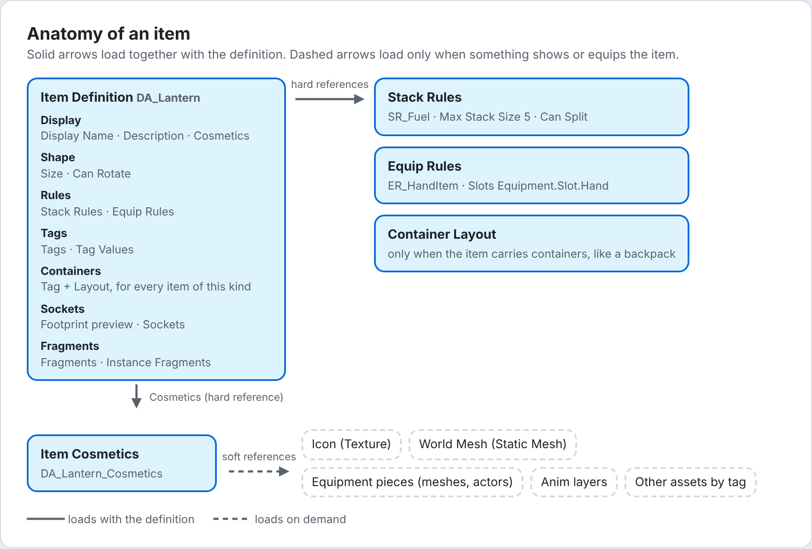

### 5.1 Item Definition

What a kind of item is. Every item record points at one.

| Category | Field | Default | Description |
| --- | --- | --- | --- |
| Display | Display Name | empty | Shown by widgets and pickups. |
| Display | Description | empty | Multi-line text for details panels. |
| Display | Cosmetics | None | The Item Cosmetics asset holding the visuals. |
| Shape | Size | 1 × 1 | Cells taken in grids: X wide, Y tall. Ignored by slots and lists. |
| Shape | Can Rotate | on | Whether the item may turn a quarter in grids. |
| Rules | Stack Rules | None | None: the item never stacks. |
| Rules | Equip Rules | None | None: the item can't be equipped. |
| Tags | Tags | empty | What kind of item this is. Matched by queries and filters. |
| Tags | Tag Values | empty | Starting numbers, such as `Item.Stat.Charge = 100`. |
| Containers | Containers | empty | Tag + Layout pairs. Every item of this kind carries these containers. |
| Sockets | Footprint | | Editor preview of cells and sockets ([12.4](#124-item-definition-details)). |
| Sockets | Sockets | empty | Boosts for neighbouring items ([7.2](#72-sockets)). |
| Fragments | Fragments | empty | Structs shared by all items of this kind, such as a use sound. |
| Fragments | Instance Fragments | empty | Structs copied onto each new item as its own state, such as a magazine. |

- **Asset Manager ID:** `InventoryItem:<asset name>`, so item definition names must be unique across the project.
- **Stack size:** taken from the Stack Rules. It is always 1 without Stack Rules, or when the item carries containers.
- **Validation** checks the size, container layouts, duplicate container tags, empty sockets, fragments, and Asset Manager registration. The editor also checks for items sharing a name, and for missing or wrongly shaped icons ([12.9](#129-data-validation)).

### 5.2 Item Cosmetics

Everything visual about an item, all soft references. It is separate from the definition so that loading definitions never loads meshes or textures, and so artists and designers can edit different assets. Several definitions can share one.

| Category | Field | Description |
| --- | --- | --- |
| Display | Icon | Texture for widgets and Content Browser thumbnails. |
| Display | World Mesh | Static mesh for the item lying in the world. |
| Equipment | Pieces | What appears on the owner while the item is equipped. See below. |
| Equipment | Anim Layers | Anim layer classes linked while equipped. |
| Assets | Assets | Any other assets keyed by tag: sounds, effects, materials. Your code loads them. |

**Pieces.** Add one or more. Choose the type from the dropdown.

| Piece | Own fields | Spawns |
| --- | --- | --- |
| Actor | Actor Class | An actor attached to the owner. If it implements **Inventory Equipment Actor Interface**, it gets **On Equipped** (Equipment, Item, Slot) right after spawning. |
| Static Mesh | Mesh | A static mesh component. |
| Skeletal Mesh | Mesh, Follow Parent Pose, Anim Class | A skeletal mesh component. **Follow Parent Pose** copies the pose of the mesh it attaches to, for clothing and armour. Otherwise **Anim Class** animates it. |

Fields on every piece:

| Field | Description |
| --- | --- |
| Attach Component | A component tag or name on the owner. None attaches to the character mesh, or the root. Pieces of attachments attach to their parent item's first piece instead. |
| Attach Socket | Socket or bone name on that component. |
| Relative Transform | Offset from the socket. |
| First Person Primitive Type | For first-person rendering: **First Person** for the first-person view, **World Space Representation** for the world body. |

**Anim Layers.** Each element has a **Target Mesh** (component tag or name; None uses the character mesh) and a **Layer Class**. When several equipped items link the same layer interface, the last one equipped wins. When an item is unequipped, the remaining items' layers are linked again.

### 5.3 Stack Rules

How items of a kind stack. Share one asset between items, such as one for all ammo.

| Field | Default | Description |
| --- | --- | --- |
| Max Stack Size | 10 | Most items in one stack. |
| Can Split | on | Whether a stack may be divided. Off: stacks always move whole. |

### 5.4 Equip Rules

Where an item can be equipped and what it grants. Share one asset between items, such as one for all pistols.

| Category | Field | Description |
| --- | --- | --- |
| Slots | Slots | Slot tags the item fits. A slot matches if its tag is one of these or a child of one. |
| Slots | Blocked Slots | Slots in the same container that must stay empty while equipped, such as the off hand for a two-handed weapon. |
| Requirements | Owner Requirements | Tags the owner's Ability System Component must have (Require Tags) or must not have (Ignore Tags), or a tag query. |
| Granted | Abilities | Ability class, **Level** (default 1) and **Scale With Item Level** (default on). |
| Granted | Effects | Effect class, **Level** and **Scale With Item Level**. |
| Granted | Attribute Sets | Attribute set classes added while equipped. |
| Granted | Owner Tags | Loose tags added to the owner while equipped. |

**Level scaling.** With Scale With Item Level on, the granted level is `Level + ItemLevel - 1`:

| Level | Item level | Granted level |
| --- | --- | --- |
| 1 | 1 | 1 |
| 1 | 3 | 3 |
| 2 | 3 | 4 |
| 2 | 3, scaling off | 2 |

If the item's level changes while it's equipped, the grants are updated in place.

### 5.5 Container Layout

The shape and rules of a container. It is shared by every container built from it, on actors or inside items.

| Category | Field | Shown for | Description |
| --- | --- | --- | --- |
| Layout | Type | all | Grid, Slots or List. |
| Layout | Grid Size | Grid | Columns × rows. Default 4 × 4. |
| Layout | Slots | Slots | Each slot has a **Tag**, a **Display Name** and a **Filter**, which applies on top of the layout's. |
| Layout | Capacity | List | Most items; 0 means unlimited. |
| Layout | Equipment | Slots | The slots are equipment: only items whose equip rules allow the slot fit, and an Equipment Component applies them. |
| Rules | Filter | all | Query every item must match. Empty accepts anything. |
| Rules | Read Only In UI | all | The inventory UI shows the items but can't pick them up or put anything here. Code still can. For things like key items, which come and go by themselves. |
| Tags | Tags | all | Tags for your own logic. |
| Fragments | Fragments / Instance Fragments | all | Static data, and per-container state. |

### 5.6 Loot Table

Random item generation. See [9. Loot tables](#9-loot-tables) for how a roll works.

| Level | Field | Default | Description |
| --- | --- | --- | --- |
| Pool | Min Rolls / Max Rolls | 1 / 1 | How many times the pool rolls. |
| Pool | Condition | empty | Tag query against the context tags. Empty always passes. |
| Pool | Entries | | What a roll can pick. |
| Entry | Type | Item | **Item**, **Table** (roll another table) or **Nothing**. |
| Entry | Item / Table | | What to give or roll. |
| Entry | Min Count / Max Count | 1 / 1 | Item: how many. Table: how many times to roll it. |
| Entry | Weight | 1 | Chance relative to the pool's other entries. |
| Entry | Condition | empty | Tag query; entries that fail are skipped. |
| Entry | Tag Values | | Item only: Tag, Min, Max, Whole Number. Random starting values. |
| Drop Rates | Simulation Rolls / Simulation Context | 1000 | Editor-only live odds ([12.6](#126-loot-table-drop-rates)). |

### 5.7 Recipe

Turns ingredients into items. See [10. Crafting](#10-crafting).

| Field | Description |
| --- | --- |
| Display Name | Name for crafting menus. |
| Tags | Tags for your own logic, such as a category. |
| Requirements | Tag query against the context tags: the station's tags you pass, plus the crafter's. Empty always passes. |
| Ingredients | Each has a **Query**, a **Count** and **Consume**. Consume off makes it a tool that is required but kept. |
| Outputs | Item specs added on every craft. |
| Random Outputs | A loot table rolled on every craft and added to the outputs. |
| Fragments | Anything else your game needs, such as craft time. |

To add custom rules, make a Blueprint child of the recipe class and override **Is Available**.

### 5.8 Recipe Book

A list of recipes, such as everything a workbench can make. **Get Recipes** returns its own recipes followed by any added by Game Features.

### 5.9 Item specs

An item spec says what to create. It is used by Starting Items, Starting Equipment, recipe outputs, Add Item and loot results.

| Field | Default | Description |
| --- | --- | --- |
| Definition | | The item definition. |
| Count | 1 | How many. |
| Tag Values | empty | Set on the new item, replacing the definition's defaults. |
| Tags | empty | Added to the item's tags. |
| Fragments | empty | Replace the definition's instance fragment of the same type, or add a new one. |

### 5.10 Suggested names

| Asset | Prefix | Example |
| --- | --- | --- |
| Item Definition | `DA_` | `DA_Flashlight` |
| Item Cosmetics | `DA_` + `_Cosmetics` | `DA_Flashlight_Cosmetics` |
| Stack Rules | `SR_` | `SR_Ammo` |
| Equip Rules | `ER_` | `ER_HandItem` |
| Container Layout | `CL_` | `CL_Pockets` |
| Loot Table | `LT_` | `LT_Drawer` |
| Recipe | `RCP_` | `RCP_Torch` |
| Recipe Book | `RB_` | `RB_Workbench` |
| Item icon | `T_` + `_Icon` | `T_Flashlight_Icon` |

The editor tools name the item definitions, cosmetics and icons they create this way. Change the prefixes in the settings ([12.8](#128-settings)).

---

## 6. Components

### 6.1 Inventory Component

Gives an actor its own containers. Use it on characters, chests, drawers and pickups.

| Field | Description |
| --- | --- |
| Containers | Tag + Layout pairs. Each becomes a root container on begin play. The order matters for where new items go. |
| Preload Cosmetics | Keeps the cosmetics of everything held here loaded ([13.2](#132-when-soft-assets-load)). Turn it on for the player only. |
| Starting Items | Item specs added on begin play. |
| Starting Equipment | Slot + item spec. Each is placed straight into the first equipment container that has that slot. |
| Starting Loot | A loot table rolled on begin play, such as a drawer's contents. |
| Starting Loot Context | Context tags for that roll. |

**Lifecycle**

1. **Begin play** creates the containers, places the Starting Equipment, adds the Starting Items, rolls the Starting Loot, then starts preloading if it's on. Items that don't fit are logged as warnings.
2. **End play** destroys the containers and everything in them. Move items elsewhere first if they should survive, such as with Transfer Item.

**Where new items go**

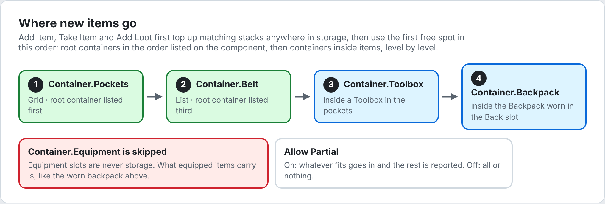

**Functions**

| Function | Description |
| --- | --- |
| Find Inventory Component (Actor) | Static. The first Inventory Component on an actor. |
| Get Containers / Get Container (Tag) | Root containers, or the one with a tag. |
| Get Storage Containers / Get Equipment Containers | The containers new items go into, and the equipment slot containers. |
| Owns Container / Owns Item | Whether something is inside this component, at any depth. |
| Add Item (Spec, Allow Partial) | Adds to storage and returns how many were added. Out Items lists the stacks touched. |
| Add Loot (Table, Context Tags, Allow Partial) | Rolls a table and adds the results. The owner's ability tags join the context. |
| Take Item (Item, Count, Allow Partial) | Moves an item from anywhere into this storage. Count 0 takes the whole stack. |
| Transfer Item (Item, Target, Count, Allow Partial) | Moves an item into another component's storage. |
| Remove Items (Query, Count) | Removes matching items from everything held. Count 0 removes all of them. Returns how many were removed. |
| Find Items (Query) / Count Items (Query) | Searches everything held, equipment and nested containers included. |
| Can Craft / Craft / Get Craftable Recipes | See [10](#10-crafting). |
| **On Inventory Changed** (event) | Fires once per committed change touching any of its containers, nested ones included. |

### 6.2 Inventory Equipment Component

Applies whatever sits in the owner's equipment slots. It has no settings.

- **Needs** an Inventory Component on the same actor. Its equipment slots are that component's containers whose layout has **Equipment** ticked.
- **For GAS grants**, the actor must expose an Ability System Component through the Ability System Interface.

| Function | Description |
| --- | --- |
| Find Equipment Component (Actor) | Static. |
| Equip Item (Item, Slot) | Moves the item into the first equipment container with that slot. The slot's current item swaps places with it, or goes to storage. |
| Equip In Place (Item, Slot) | Equips an item the owner carries without moving it, as the RE games do with the weapon in hand. Its equip rules must allow the slot; use a slot no equipment container has. Whatever was equipped in place in that slot stops being equipped, and the item stays equipped until unequipped or until it leaves the inventory. |
| Unequip Item (Item) / Unequip Slot (Slot) | Moves the item to a free spot in storage. An item equipped in place just stops being equipped. |
| Get Equipped Item (Slot) | The item in a slot. |
| Get Equipped Items | Every applied item, attachments included, parents first. |
| Is Equipped (Item) | |
| Get Spawned Pieces (Item) | The actors and components an item spawned. Empty until its cosmetics finish loading. |
| Get Item For Ability (Ability Spec Handle) | The equipped item that granted an ability. |
| **On Item Equipped / On Item Unequipped** (events) | Item and slot. |

---

## 7. Grids: placement, rotation and sockets

### 7.1 Placement and rotation

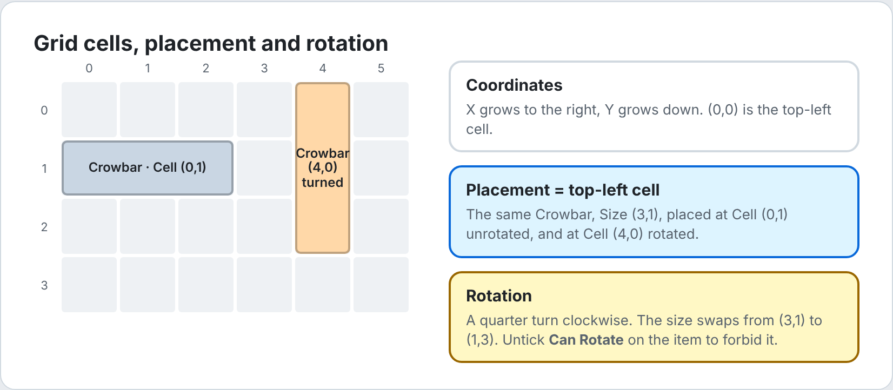

- X grows to the right and Y grows down. Cell (0,0) is the top-left.
- An item's placement is its top-left cell.
- Rotating turns an item a quarter clockwise and swaps its size: (3,1) becomes (1,3).
- **Rotate Item** turns an item in place if it still fits. Moves can also set the Rotated flag of the target placement.

### 7.2 Sockets

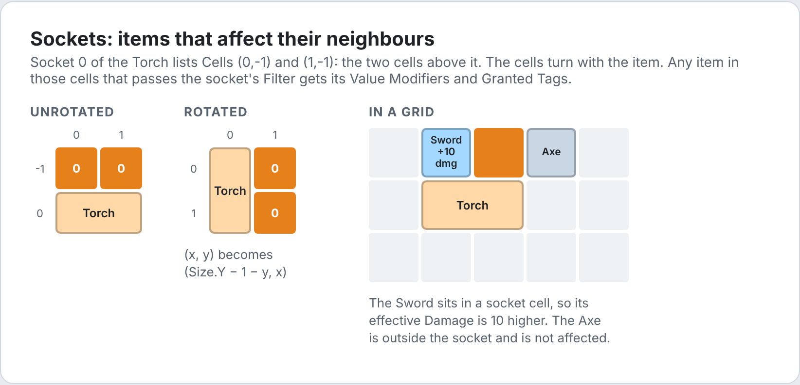

A socket lets an item affect neighbouring items in a grid. Sockets do nothing in slot or list containers.

| Field | Description |
| --- | --- |
| Cells | Cells relative to the item's top-left cell, **before rotation**. (0,-1) is directly above it; (Width,0) is to the right of its top-right cell. |
| Filter | Which items are affected. Empty affects any item. |
| Value Modifiers | Tag + value, added to affected items' effective tag values. |
| Granted Tags | Added to affected items' effective tags. |

- When the item turns, every socket cell (x, y) becomes (Size.Y − 1 − y, x).
- Read the results with **Get Effective Tag Value** and **Get Effective Item Tags**. **Get Socket Sources** lists the items affecting an item.
- Filters and queries never see socket bonuses, so placing an item can't change what its neighbours accept.
- Check your sockets with the Footprint preview ([12.4](#124-item-definition-details)).

---

## 8. Equipment

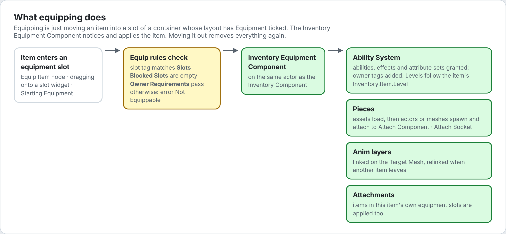

### 8.1 Making an item equippable

1. Give the item an **Equip Rules** asset whose **Slots** include the slot's tag, or a parent tag.
2. Give the owner a container whose layout is **Slots** with **Equipment** ticked and a slot with that tag.
3. Put the item in the slot with **Equip Item**, by dragging it onto a slot widget, or with **Starting Equipment**.

To equip an item without moving it, skip step 2 and call **Equip In Place** instead. The item keeps its spot, in a grid say, and everything in 8.2 still applies.

### 8.2 What equipping does

| Part | Behaviour |
| --- | --- |
| Abilities | Granted at their level. The Equipment Component is the ability's source object, so **Get Item From Ability** finds the item. |
| Effects | Applied at their level. |
| Attribute Sets | Added to the owner's Ability System Component. |
| Owner Tags | Added as loose tags. |
| Pieces | Assets load asynchronously; then actors or meshes spawn and attach. |
| Anim Layers | Linked on the target mesh. |
| Attachments | Items in the equipped item's own equipment containers are applied too. Their pieces attach to the parent item's first piece. |

Moving the item out of the slot removes all of it. Changing the item's level updates ability and effect levels in place.

### 8.3 First-person setups

- Set **Attach Component** to the name of your first-person arms mesh, and **First Person Primitive Type** to First Person.
- To also show the item on the world body, for shadows and reflections, add a second piece attached to the body mesh with **World Space Representation**.
- Linked anim layers for the arms need **Target Mesh** set to the arms mesh.

### 8.4 Equipment actors and Mutable

Use an **Actor** piece for anything a mesh can't do: lights, physics, Mutable characters. Implement **Inventory Equipment Actor Interface** on the actor. **On Equipped** gives you the Equipment Component, the item handle and the slot, so the actor can read the item's tag values and fragments. For example, it can build a Customizable Object instance from them.

### 8.5 Abilities that need their item

Inside an ability granted by an item, call **Get Item From Ability** (Self). With the handle, read the item's state through the Inventory Subsystem, such as **Get Tag Value** `Item.Stat.Charge`.

---

## 9. Loot tables

### 9.1 How a roll works

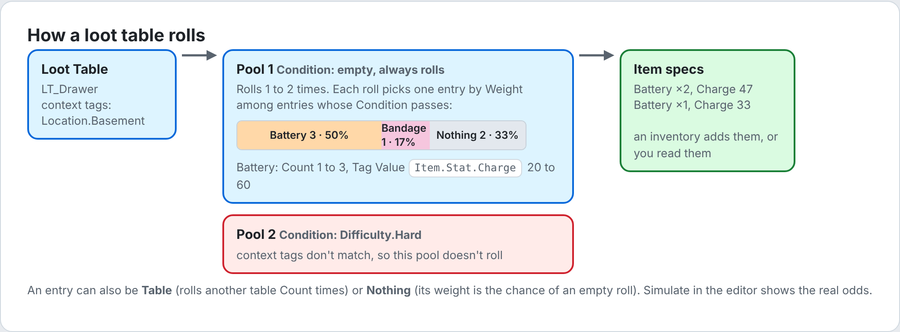

1. Each pool whose **Condition** passes rolls a random number of times between **Min Rolls** and **Max Rolls**.
2. Each roll picks one entry by **Weight**, among entries whose **Condition** passes and whose weight is above 0.
3. **Item** gives a random count between Min and Max, and rolls any **Tag Values** ranges.
4. **Table** rolls that table Count times. Tables nest up to 16 deep.
5. **Nothing** gives nothing. Its weight is the chance of an empty roll.

Rolls are deterministic for a given random stream, so a fixed seed gives the same loot every time.

### 9.2 Using loot tables

| Where | How |
| --- | --- |
| Containers that start filled | Inventory Component › **Starting Loot** and **Starting Loot Context** |
| On an event | Inventory Component › **Add Loot** (Table, Context Tags, Allow Partial) |
| Results without adding them | **Roll Loot Table** (Table, Context Tags, Seed). Seed -1 is random. Returns item specs. |
| Crafting | Recipe › **Random Outputs** |

### 9.3 Checking the odds

Open the table and look at its **Drop Rates** section. Set **Simulation Context** to the tags a real roll would have; the rates update as you edit the table ([12.6](#126-loot-table-drop-rates)).

---

## 10. Crafting

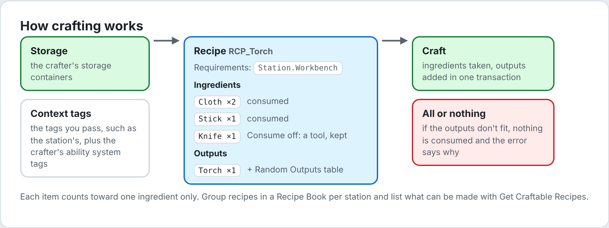

### 10.1 Rules

- Ingredients come from the crafter's storage containers. Each item counts toward one ingredient only.
- Tools (Consume off) must be present but are kept.
- The context tags are what you pass, plus the crafter's ability system tags. **Requirements** and **Is Available** are tested against them.
- Crafting is all or nothing. If the outputs don't fit, nothing is consumed and the error says why.
- **Times** crafts several at once, still all or nothing.

### 10.2 Crafting from Blueprint

| Node | Use |
| --- | --- |
| Can Craft (Recipe, Context Tags, Times) | Enable or disable a craft button. |
| Craft (Recipe, Context Tags, Times) | Crafts. Outputs the new items and the error. |
| Get Craftable Recipes (Book, Context Tags) | Lists what can be made now, such as for a workbench menu. |

Pass the station's tags as Context Tags, such as `Station.Workbench`. Recipes requiring them won't be craftable elsewhere.

### 10.3 Custom availability

For rules that tags can't express, such as a story flag, make a Blueprint child of **Inventory Recipe**, override **Is Available**, and create recipe assets from that class.

---

## 11. User interface

### 11.1 How the UI works

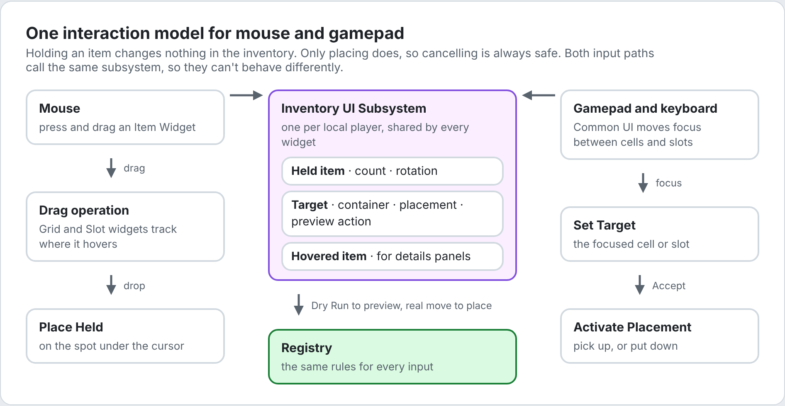

- One **Inventory UI Subsystem** per player holds the held item (count and rotation), the target, the hovered item and the selected item.
- **Holding changes nothing.** Only placing moves items, so cancelling or closing the screen is always safe.
- Previews use the registry's **Dry Run**: the real operation, always undone. They can't disagree with the actual move.
- Common UI handles focus, hover, Accept and Back. Cells and slots are Common UI buttons. UMG drag and drop is used only for the mouse.

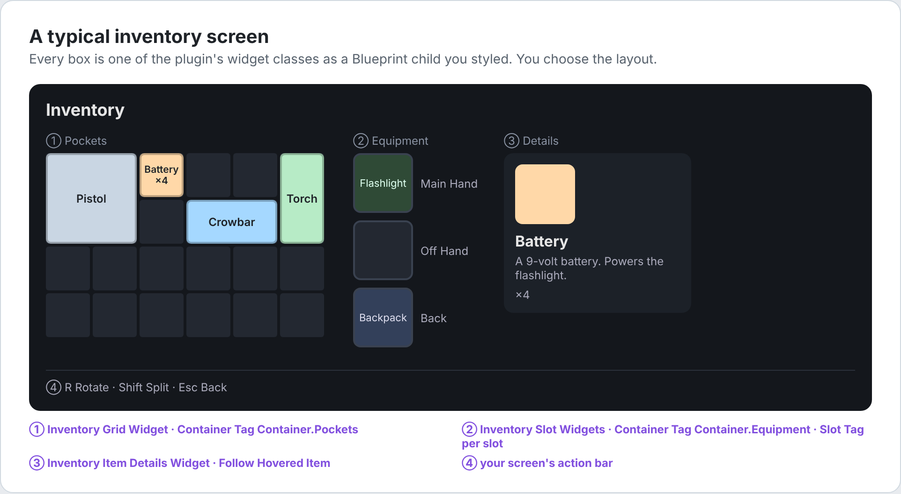

### 11.2 Widget reference

All widget classes are abstract: make a Blueprint child of each and design it. Named widgets are optional unless marked **required**.

| Parent class | Named widgets | Settings | Events | Functions |
| --- | --- | --- | --- | --- |
| Inventory Item Widget | `Icon` (Image), `CountText` (Text Block) | Drag Visual Class, Drag Cell Size, Tooltip Class | On Item Changed, On Held Changed, On Hovered Changed, On Selected Changed, On Context Requested | Set Item, Get Item, Get Definition, Get Count, Is Held, Is Selected, Is Drag Visual |
| Inventory Cell Widget | none, but it needs a root widget of any kind | Common UI button style | (Common button events) | Get Container, Get Placement, Get Item |
| Inventory Grid Widget | **`GridCanvas`** (Canvas Panel, required), `PlacementPreview` (any widget inside Grid Canvas) | Container Tag, Cell Size, Cell Class, Item Class | On Container Refreshed, On Placement Preview Changed | Set Container, Get Container, Get Cell Widget, Get Item Widget |
| Inventory Slot Widget | `ItemWidget` (your item widget), `NameText` (Text Block, for list rows) | Container Tag, Slot Tag, Common UI button style | On Slot Item Changed, On Placement Preview Changed | Set Container |
| Inventory Item Details Widget | `Icon`, `NameText`, `DescriptionText`, `CountText` | Follow Hovered Item, Keep Last Item, Hide Without Item | On Item Changed | Set Item, Get Item |
| Inventory List Widget | **`EntryPanel`** (any panel, required) | Container Tag, Entry Class, Show Empty Entry | | Set Container, Get Container, Get Entry Widget |

Settings explained:

| Setting | On | Description |
| --- | --- | --- |
| Drag Visual Class | Item | Widget following the cursor while dragging. None uses the item widget's own class. |
| Drag Cell Size | Item | Cell size of the drag visual when the item isn't in a grid, such as when dragged from a slot. |
| Tooltip Class | Item | A details widget shown on mouse hover. Leave empty if a details panel follows the hovered item. |
| Container Tag | Grid, Slot | Finds the container with this tag on the owning player's Inventory Component when constructed. Leave empty and call **Set Container** for chests and backpacks. |
| Cell Size | Grid | Pixels per cell. |
| Cell Class | Grid | Widget for each cell. Needed for gamepad focus. |
| Item Class | Grid | Widget for each item, and for the held item while Snap Held Item is on. |
| Preview Glide Speed | Grid | How fast the placement preview, and a snapped held item, glide to new cells. Higher is snappier; 0 jumps. |
| Slot Tag | Slot | Which slot of the container this widget shows. |
| Follow Hovered Item | Details | Shows whatever the player hovers or focuses. Turn it off when used as a tooltip. |
| Keep Last Item | Details | With Follow Hovered Item, keeps showing the last item while nothing is hovered, until it leaves the inventory. |
| Hide Without Item | Details | Hides the panel while there's no item. It keeps its size, so nothing around it moves. |
| Entry Class | List | Widget for each entry: an Inventory Slot Widget. |
| Show Empty Entry | List | An empty entry after the items while the list has room, for gamepads to put items on. Without it, an item dropped anywhere else on the list goes to the end. Read-only lists never have one. |

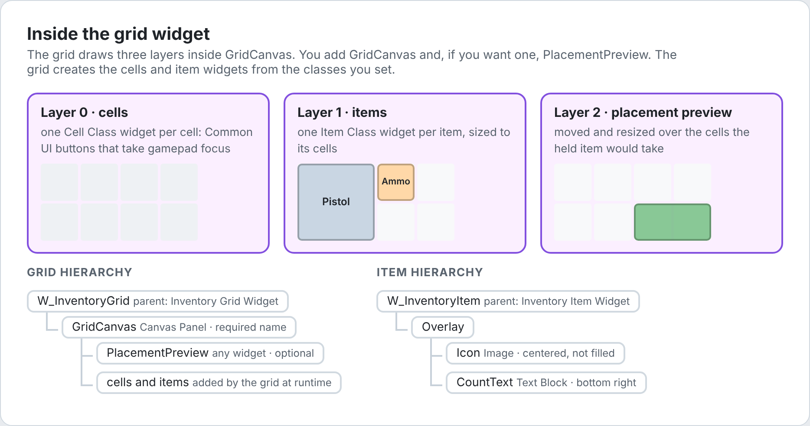

### 11.3 Building an inventory screen

**1. Item widget.** Add a Widget Blueprint with parent **Inventory Item Widget**, named `W_InventoryItem`.
- Root: an **Overlay**.
- Add an **Image** named `Icon`, straight inside the Overlay. Set both alignments to **Center**, not Fill: the grid sizes the icon to the item's cells and turns it with the item, letting it hang over the Overlay's edges while it turns. Anywhere else, the icon takes its texture's size, so long items stay long. Put the item widget in a **Scale Box** set to **Scale to Fit** to fit it into a slot.
- Add a **Text Block** named `CountText`, aligned bottom right. It is hidden automatically for items that don't stack.
- In the Event Graph, add **On Held Changed** and set Render Opacity to 0.35 while held, so the player sees what they picked up.
- Optionally, **On Hovered Changed** for a highlight.

**2. Cell widget.** Add a Widget Blueprint with parent **Inventory Cell Widget**, named `W_InventoryCell`.
- It is a Common UI button. Create a **Common Button Style** (Add › Blueprint Class › CommonButtonStyle) with normal, hovered and pressed looks, and set it as the cell's Style.
- Give its designer a root widget, such as an empty **Overlay**. Common UI only builds the button around designer content, so a cell with an empty designer draws nothing and can't be clicked. The grid sizes each cell to Cell Size.

**3. Grid widget.** Add a Widget Blueprint with parent **Inventory Grid Widget**, named `W_InventoryGrid`.
- Root: a **Canvas Panel** named `GridCanvas`.
- Inside it, add a **Border** named `PlacementPreview` with a white brush. Its position and size don't matter; the grid moves it.
- Class Defaults: Container Tag `Container.Pockets`, Cell Size `64`, Cell Class `W_InventoryCell`, Item Class `W_InventoryItem`.
- In the Event Graph, add **On Placement Preview Changed** and switch on the action. Set PlacementPreview's brush color: Place green, Merge blue, Swap yellow, Invalid red. The preview is only visible while an item is held over this grid.

**4. Details panel** (optional). Parent **Inventory Item Details Widget**, named `W_ItemDetails`.
- A Vertical Box with an Image `Icon` and Text Blocks `NameText`, `DescriptionText` and `CountText`.
- For a side panel, tick **Follow Hovered Item**. For a tooltip, leave it off and set `W_ItemDetails` as the item widget's **Tooltip Class**.
- In **On Item Changed**, read stats with **Get Tag Value**.

**5. Equipment slot** (optional). Parent **Inventory Slot Widget**, named `W_EquipmentSlot`.
- Root content: an Overlay with a background Border, and a Size Box (64 × 64) containing a Scale Box (Scale to Fit, Down Only) containing `W_InventoryItem` named `ItemWidget`. The item widget is hidden while the slot is empty.
- For a row in a list, such as a storage box, add a Text Block named `NameText` beside the item. It shows the item's name.
- Give it the same Common Button Style as the cells.
- Container Tag `Container.Equipment`. Set **Slot Tag** on each instance you place in the screen.

**6. The screen.** A Widget Blueprint whose parent is a **Common Activatable Widget**, or your game's screen class based on it.
- Place `W_InventoryGrid`, a few `W_EquipmentSlot` widgets and `W_ItemDetails`. Put the grid in a container that uses its natural size, such as a Horizontal Box slot set to Auto.
- Make the screen take menu input and show the cursor. In C++, override `GetDesiredInputConfig` to return a Menu input config. If your project's screen base class has an input mode setting, set it to Menu.
- Give gamepads a starting focus: override **Get Desired Focus Target** and return the grid's **Get Cell Widget** (0, 0).
- Tick **Is Back Handler**. In **On Handle Back Action**: if the Inventory UI Subsystem **Is Holding**, call **Cancel Hold** and return true. Otherwise return false so Back closes the screen.
- In **On Deactivated**, call the Inventory UI Subsystem's **Clear Interaction**.
- Open the screen by pushing it onto one of your Common UI layer stacks, such as a game menu layer above the HUD.

**7. Rotate and split.** Bind your Rotate and Split actions to the subsystem's **Rotate Held** and **Split Held**. Rotate Held leaves the item as it is if, turned, it couldn't fit the targeted grid at all, such as a long gun stood upright in short pockets. In C++, inside your screen's `NativeOnInitialized`:

```cpp
RegisterUIActionBinding(FBindUIActionArgs(FUIActionTag::ConvertChecked(RotateTag), true,
	FSimpleDelegate::CreateWeakLambda(this, [this]()
	{
		if (UInventoryUISubsystem* Interaction = UInventoryUISubsystem::Get(GetOwningLocalPlayer()))
		{
			Interaction->RotateHeld();
		}
	})));
```

In Blueprint, add Common buttons to the screen with **Triggering Input Action** set to your rotate and split actions, and call Rotate Held and Split Held from On Clicked.

### 11.4 Input

| Action | Mouse | Gamepad and keyboard |
| --- | --- | --- |
| Pick up | Start dragging an item, or click it | Focus a cell and press Accept |
| Pick up half a stack | Shift + drag | Pick up, then Split |
| Put down | Release over the target, or click a cell | Focus a cell and press Accept |
| Where it lands | Centered on the cursor | Top-left corner on the focused cell |
| Rotate | Your Rotate action | Your Rotate action |
| Split | Your Split action halves the held count; at one it goes back to the whole stack | same |
| Cancel | Release over nothing, or a refused spot | Back |
| Item menu | Right-click: **On Context Requested** on the item widget | your own binding |

**RE-style play.** Three switches on the Inventory UI Subsystem change the table above. Set them once, such as when the inventory screen opens:

| Switch | Effect |
| --- | --- |
| Click Opens Item Menu | A click or Accept on an item asks for its item menu (On Context Requested) instead of picking it up. Items are picked up by dragging, or with **Begin Hold** from your own Move action. |
| Snap Held Item | Grids draw the held item, using their Item Class, on the cells it would land on instead of a drag visual under the cursor. It stays on the last cells aimed at, and a mouse drag let go anywhere puts it there. |
| Swap Picks Up Other | Putting the held item on another one picks that one up from where the held item was, instead of only trading places. Cancelling then leaves it there, which finishes the swap. |

With any of them, held items in a grid land as close to the target as fits, never partly off the edge.

### 11.5 Placement preview

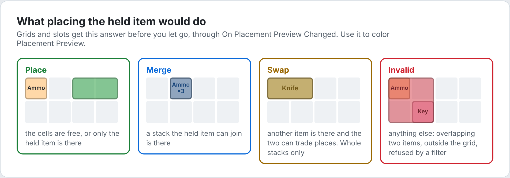

Grids and slots receive **On Placement Preview Changed** with one of: None, Place, Merge, Swap, Invalid. None means nothing is held over this widget.

### 11.6 Chests, backpacks and other containers

Any grid or slot widget can show any container. Leave **Container Tag** empty and call **Set Container** with a handle:

| Container | Handle |
| --- | --- |
| A chest's storage | Chest's Inventory Component › **Get Container** (Tag) |
| A backpack's storage | Inventory Subsystem › **Find Item Container** (Backpack Item, `Container.Backpack`) |
| A worn backpack | Equipment Component › **Get Equipped Item** (`Equipment.Slot.Back`), then Find Item Container |

Dragging between grids works without extra code: all containers share one registry. Refresh a backpack grid when the backpack changes, from **On Item Equipped** and **On Item Unequipped**.

### 11.7 Inventory UI Subsystem

Get it with **Get Inventory UI Subsystem** (it needs the player).

| Group | Functions and events |
| --- | --- |
| Holding | Begin Hold (Item, Count; 0 = whole stack), Cancel Hold, Rotate Held, Split Held, Set Held Count, Is Holding, Get Held Item, Get Held Count, Is Held Rotated, Get Held Size |
| Placing | Place Held (Container, Placement), Activate Placement (place if holding, otherwise pick up or ask for the item menu), Preview Placement |
| Target | Set Target, Clear Target, Get Target Container, Get Target Placement, Get Target Action, Get Landing Placement (where the held item would land, moved in from a grid's edge) |
| Hover | Set Hovered Item, Get Hovered Item |
| Selection | Set Selected Item, Get Selected Item: the item being acted on, such as the one whose menu is open. Item widgets show it with On Selected Changed. |
| Style | Click Opens Item Menu, Snap Held Item, Swap Picks Up Other (11.4) |
| Reset | Clear Interaction: drops the hold, the choosing, the target, the hover and the selection |
| Events | On Held Item Changed, On Target Changed, On Hovered Item Changed (Item), On Selected Item Changed (Item) |

---

## 12. Editor tools

| Tool | Where |
| --- | --- |
| Add › Inventory | Content Browser **Add** menu ([12.1](#121-add--inventory)) |
| Create Inventory Item | Right-click static meshes or textures ([12.2](#122-create-inventory-item)) |
| Generate Item Icons, Edit Item Icon | Right-click item definitions; **Edit Icon...** in an item's details ([12.3](#123-item-icons)) |
| Generate All Item Icons, Register Items With Asset Manager, Settings | **Tools › Modular Inventory** |
| Cosmetics Create button, Icon preview, Footprint | An item definition's details ([12.4](#124-item-definition-details)) |
| Drop Rates | A loot table's details ([12.6](#126-loot-table-drop-rates)) |
| Validation | On save, and right-click › **Validate Assets** ([12.9](#129-data-validation)) |

Tools that skip or fail on some assets list them in **Window › Message Log › Modular Inventory**. Click an asset's name there to find it.

### 12.1 Add › Inventory

Every plugin asset type has its own entry under **Inventory** in the Content Browser's **Add** menu and in the right-click menu: Item Definition, Item Cosmetics, Container Layout, Stack Rules, Equip Rules, Loot Table, Recipe, Recipe Book.

### 12.2 Create Inventory Item

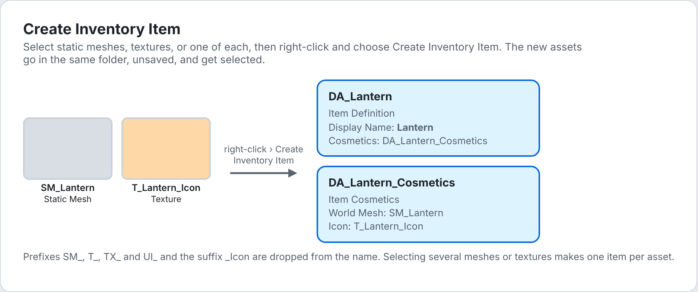

1. Select one or more **Static Meshes** and/or **Textures** in the Content Browser.
2. Right-click and choose **Create Inventory Item**.
3. For each asset, an item definition and its cosmetics are created in the same folder and selected.
   - Meshes become the **World Mesh** and textures the **Icon**.
   - Selecting exactly one mesh and one texture makes a single item with both.
   - Items made from a mesh alone get a generated icon ([12.3](#123-item-icons)). Turn this off with **Generate Icons For New Items** ([12.8](#128-settings)).
   - Names follow the Naming settings. With the defaults, `SM_FlashlightBattery` gives `DA_FlashlightBattery` and `DA_FlashlightBattery_Cosmetics`, and the Display Name "Flashlight Battery".
4. The new assets are unsaved. Fill in the rest, then **Save All**. Moving them to another folder is fine.

### 12.3 Item icons

Inventory widgets stretch an icon over the item's cells, so a 1 × 3 item needs an icon three times as tall as it is wide. The icon generator renders the item's **World Mesh** in exactly that shape, with a transparent background.

| Action | Where | What it does |
| --- | --- | --- |
| Generate Item Icons | Right-click one or more item definitions | Renders an icon for each item. |
| Edit Item Icon... | Right-click one item definition, or **Edit Icon...** in its details | Opens the Icon Studio for that item. |
| Generate All Item Icons | Tools › Modular Inventory | Generate Item Icons for every item in the project, such as after changing the lighting. |

**What gets made**

- A texture named like `T_FlashlightBattery_Icon`, next to the item's cosmetics or in the **Icon Folder**, assigned to the cosmetics' **Icon**.
- Its size is the item's cells times **Pixels Per Cell**: a 1 × 3 item gets 128 × 384 pixels by default.
- It uses the texture settings for UI: UserInterface2D compression and the UI texture group. It has mipmaps, so it stays clean when drawn much smaller, such as in a shortcut slot. Icons generated before that have none until they're generated again.
- The changed assets are left unsaved, like any other edit.

**Generated and hand-made icons**

- A generated texture remembers how its item was framed. Generating again re-renders it with the current settings and size but the same framing, so every item keeps its angle.
- Any other texture is hand-made, and the tools never change it. Generate Item Icons skips items with hand-made icons. Saving from the Icon Studio makes a new texture and switches the item to it, and the hand-made texture is left as it is.
- The framing is stored as editor-only data on the texture and isn't packaged.

**Icon Studio**

- The preview is the real icon, at its exact shape. **Drag** to turn the mesh, **right-drag** to move it, and **scroll** to zoom. **Rotation**, **Zoom** and **Offset** below the preview take exact values.
- **Reset** goes back to the default framing. **Quarter Turn** turns the mesh a quarter in the picture, to stand a long item up or lay it down.
- **Lighting...** opens the icon settings. The preview updates as you change them, and so does every icon you generate afterwards.
- **Save Icon** renders and saves the icon. The window stays open, so you can keep adjusting.
- The preview follows the item: change its size or its World Mesh and the preview updates.

**How an icon is framed**

1. The mesh is turned by **Rotation**. New icons start from **Default Rotation**, and long meshes are also turned to lie along the long side of their cells.
2. The camera fits what's visible of the mesh to the icon, keeping **Padding** around it.
3. **Zoom** and **Offset** adjust the result.

### 12.4 Item definition details

These appear while a single item definition is open.

| Row | What it does |
| --- | --- |
| Display › Cosmetics | Has a **Create** button while empty. It makes cosmetics next to the item, named after it, and assigns them. |
| Display › Icon | The icon stretched over the item's cells, exactly as inventory widgets show it, so a wrongly shaped icon looks wrong here too. **Edit Icon...** opens the Icon Studio. |
| Sockets › Footprint | A picture of the item's cells and the cells its sockets reach. See below. |

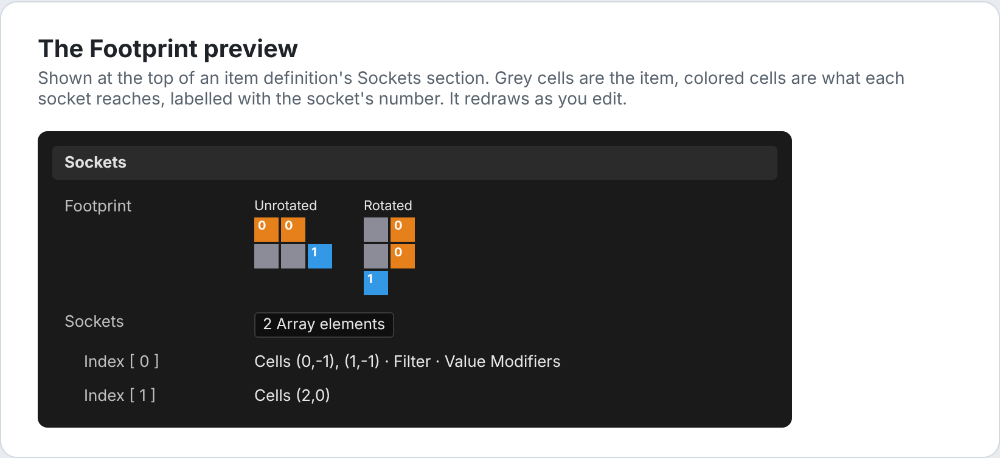

In the Footprint, grey cells are the item; colored cells are the cells each socket reaches, numbered like the Sockets array. The **Rotated** view appears when the item can rotate. It redraws as you edit.

### 12.5 Thumbnails

Item definitions and cosmetics use the item's icon as their Content Browser thumbnail. Assets made before the editor module was installed show it once they're opened or saved.

### 12.6 Loot table drop rates

A loot table's **Drop Rates** section shows how the table behaves, and updates as you edit it:

| Column | Meaning |
| --- | --- |
| Chance | The share of rolls that contain the item. |
| Count | The fewest and most of it that one roll gave, when it dropped. |
| Per Roll | How many a roll gives on average, counting the rolls where it didn't drop. |

Above the table is how often a roll gives nothing at all.

- **Simulation Rolls** is how many rolls are simulated. More rolls give steadier numbers.
- **Simulation Context** holds the tags a real roll would have, such as `Difficulty.Hard`, for pool and entry conditions.
- The rolls use a fixed seed, so the numbers only change when the table does. Editing any loot table updates them, since tables can roll other tables.
- Both settings are for the editor only and aren't saved with the table.

### 12.7 Register Items With Asset Manager

Under **Tools › Modular Inventory**. It adds the `InventoryItem` entry described in [2.2](#22-asset-manager) if it's missing, resaves item definitions that still carry an old ID, and reloads the Asset Manager settings. A notification says how many items it resaved. Running it again is harmless.

Until items are registered, creating an item definition shows a prompt with a **Register Items** button that does the same.

### 12.8 Settings

**Project Settings › Plugins › Modular Inventory**, also under **Tools › Modular Inventory › Settings**. They are saved in `Config/DefaultEditor.ini`; commit that file so the whole team names assets and renders icons the same way.

| Category | Setting | Default | Description |
| --- | --- | --- | --- |
| Naming | Item Prefix | `DA_` | Put before item definition names. |
| Naming | Cosmetics Prefix / Suffix | `DA_` / `_Cosmetics` | Put around cosmetics names. |
| Naming | Icon Prefix / Suffix | `T_` / `_Icon` | Put around generated icon names. |
| Naming | Source Prefixes | `SM_`, `SK_`, `T_`, `TX_`, `UI_` | Dropped from mesh and texture names when naming items. All the prefixes and suffixes above are dropped too. |
| Icons | Pixels Per Cell | 128 | Icon pixels per grid cell. |
| Icons | Supersampling | 2 | Renders this many times larger and shrinks the result, for smooth edges. |
| Icons | Field Of View | 15 | Lower looks flatter, closer to an orthographic camera. |
| Icons | Padding | 0.06 | Empty space around the mesh, as a fraction of the icon. |
| Icons | Default Rotation | 0, 120, 20 | How new icons turn the mesh. The camera looks along X with Z up, so this shows a mesh modelled facing X from three-quarters, top tipped toward the camera. |
| Icons | Icon Folder | empty | A folder next to the cosmetics, such as `Icons`, or a full path, such as `/Game/UI/Icons`. Empty saves icons beside the cosmetics. |
| Icons | Generate Icons For New Items | on | Create Inventory Item renders icons for items made from a mesh alone. |
| Icons › Lighting | Exposure | 1 | Brightens or darkens every icon. |
| Icons › Lighting | Ambient Intensity | 1 | Soft light from every direction. |
| Icons › Lighting | Lights | key, fill, rim | Directional lights. **Direction** is seen from the camera: Yaw 0 shines away from it, Yaw 90 to the right, Pitch -90 straight down. |

### 12.9 Data validation

Every plugin asset checks itself when saved, and when you right-click a folder and choose **Validate Assets**. Problems appear in the Message Log, such as:
- missing layouts or tables;
- duplicate container tags;
- Min above Max;
- empty sockets;
- invalid fragments;
- items not registered with the Asset Manager.

The editor adds these item checks:

| Check | Result |
| --- | --- |
| Another item definition has the same asset name. Item IDs are asset names, so the two would share one. | Error |
| The item has no icon, so inventory widgets show nothing for it. | Warning |
| The icon's shape doesn't match the item's cells, so widgets stretch it. | Warning |

### 12.10 Inventory.Give

A console command for Play In Editor and development builds:

```
Inventory.Give <ItemAssetName> [Count]
Inventory.Give DA_Battery 5
```

It adds the items to the local player's pawn's Inventory Component, topping up stacks first. Use the asset name, not the display name. An unknown name prints the list of registered items. It needs the `InventoryItem` Asset Manager entry.

---

## 13. Loading and the Asset Manager

### 13.1 Item IDs

Every item definition is a primary asset of type `InventoryItem`, named after the asset: `InventoryItem:DA_Flashlight`.

- **Finding items without loading them**: `Inventory.Give`, debug menus, crafting lists.
- **Saving**: a save should store this ID instead of an object path, so moving assets between folders doesn't break saves.
- **Cooking**: with **Always Cook**, every item is packaged, even one that only a save game refers to.

Item definitions in Game Feature plugins need their own scan entry; see [14](#14-game-features).

### 13.2 When soft assets load

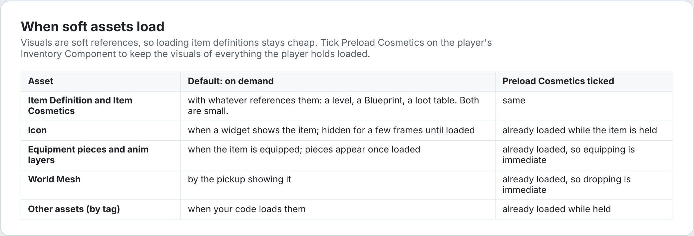

- Definitions hard-reference their rules and cosmetics assets, which are small. Visuals are soft references inside the cosmetics.
- By default, visuals load asynchronously when needed and unload once nothing uses them. Each user holds its own handle: a widget for its icon, an equipped item for its pieces.
- **Preload Cosmetics** on an Inventory Component keeps every visual of everything it holds loaded. Menus and equipping then never wait. Use it on the player, not on chests and pickups.
- Placed pickups can avoid popping in by setting their mesh in the editor, for example in the construction script. The level then saves the mesh and loads it with the level.

### 13.3 Why there are no asset bundles

Asset bundles only collect soft references from the primary asset itself, and the visuals live in a separate cosmetics asset. A bundle's loaded state is also global per asset. That suits loading a whole set at once, like a level, better than a single widget needing one icon. Per-use handles plus Preload Cosmetics cover both cases.

---

## 14. Game Features

The **Add Inventory Content** game feature action extends existing content while a Game Feature plugin is active, and removes the extension when it deactivates. Use it for DLC or optional content.

| Field | Description |
| --- | --- |
| Loot Pools | Each element has a **Table** and **Pools**. The pools roll after the table's own. |
| Recipes | Each element has a **Book** and **Recipes**. The recipes are added to the book. |

To use it:

1. Make sure the GameFeatureData Asset Manager entry exists ([2.2](#22-asset-manager)).
2. Create a Game Feature plugin: **Edit › Plugins › Add**, choose **Game Feature (Content Only)**.
3. Open the plugin's Game Feature Data asset. Under **Actions**, add **Add Inventory Content** and fill in the tables and books.
4. If the plugin has its own item definitions, add `InventoryItem` to the Game Feature Data's **Primary Asset Types to Scan** with the plugin's content folder.
5. Activate the feature: set its initial state, or use the Game Features subsystem.

---

## 15. Scripting reference

### 15.1 Getting the objects you need

| Object | Blueprint | C++ |
| --- | --- | --- |
| Inventory Component | **Find Inventory Component** (Actor) | `UInventoryComponent::FindInventoryComponent(Actor)` |
| Equipment Component | **Find Equipment Component** (Actor) | `UInventoryEquipmentComponent::FindEquipmentComponent(Actor)` |
| Inventory Subsystem | **Get Inventory Subsystem**, or **Get World Subsystem** with Inventory Subsystem | `UInventorySubsystem::Get(WorldContext)` |
| Registry | | `UInventorySubsystem::Get(this)->GetRegistry()` |
| Inventory UI Subsystem | **Get Inventory UI Subsystem** (Player Controller) | `UInventoryUISubsystem::Get(LocalPlayer)` |

### 15.2 Common tasks

| Task | Node(s) |
| --- | --- |
| Give items | Inventory Component › Add Item (Spec, Allow Partial) |
| Does the player have it | Inventory Component › Count Items (Query) > 0 |
| Use up items | Inventory Component › Remove Items (Query, Count) |
| Use up one specific stack | Inventory Subsystem › Remove Item (Item, Count) |
| List items | Inventory Component › Find Items (Query) |
| Read an item | Inventory Subsystem › Get Item Definition, Get Item Count, Get Tag Value, Get Item Tags |
| Change an item | Inventory Subsystem › Set Tag Value, Add To Tag Value, Remove Tag Value, Add Item Tag, Remove Item Tag |
| Equip or unequip | Equipment Component › Equip Item, Unequip Item, Unequip Slot |
| What's in a slot | Equipment Component › Get Equipped Item (Slot) |
| Hand items over | Inventory Component › Transfer Item / Take Item |
| Fill from a loot table | Inventory Component › Add Loot |
| React to changes | Inventory Component › On Inventory Changed; Equipment Component › On Item Equipped / Unequipped |
| Struct data | Get Definition Fragment, Get Item Fragment, Set Item Fragment, Get/Set Container Fragment |
| The item behind an ability | Get Item From Ability (Ability) |

Fragment nodes have a wildcard struct pin; connect your struct type. They output **Found** or **Not Found**.

### 15.3 Inventory Subsystem

| Group | Functions |
| --- | --- |
| Items | Is Valid Item, Get Item Definition, Get Item Count, Get Item Container, Get Item Placement, Get Item Size, Get Item Containers, Find Item Container, Is Item Equipped, Can Stack, Matches Query |
| Tags and values | Get Item Tags, Has Item Tag, Get Effective Item Tags, Get Tag Value, Get Effective Tag Value, Has Tag Value, Get Socket Sources, Set Tag Value, Add To Tag Value, Remove Tag Value, Add Item Tag, Remove Item Tag |
| Fragments | Remove Item Fragment, Remove Container Fragment (getters and setters are in the function library) |
| Containers | Is Valid Container, Get Container Layout, Get Container Tag, Get Container Items, Get Container Owner Item, Get Container Owner, Get Root Container, Get Item At, Get Item In Slot, Can Place Item, Find Placement, Find Items, Count Items, Create Container, Destroy Container |
| Operations | Add Item, Add Item At, Remove Item, Move Item, Move Item To, Move Item To Containers, Swap Items, Split Stack, Split Stack To, Merge Stacks, Rotate Item, Equip Item, Unequip Item, Execute Batch |
| Crafting | Can Craft, Craft |

### 15.4 Function library

| Function | Description |
| --- | --- |
| Make Cell Placement / Make Index Placement | Build placements for grids, or for slots and lists. |
| Get Item Fragment / Set Item Fragment | An item's instance fragment of a struct type. |
| Get Container Fragment / Set Container Fragment | A container's instance fragment. |
| Get Definition Fragment | A definition's static fragment. |
| Get Item From Ability | The equipped item that granted an ability. |
| Roll Loot Table | Item specs from a table. Seed -1 is random. |
| == / != / To String | For item and container handles. |

### 15.5 C++

All operations live on `FInventoryRegistry` and return `EInventoryError`.

```cpp
#include "InventoryRegistry.h"
#include "InventorySubsystem.h"

FInventoryRegistry& Registry = UInventorySubsystem::Get(this)->GetRegistry();

// Several changes that succeed or fail together. Transactions nest.
const EInventoryError Error = Registry.RunTransaction([&]() -> EInventoryError
{
	const EInventoryError MoveError = Registry.MoveItem(OldLantern, Trash);
	if (MoveError != EInventoryError::None)
	{
		return MoveError;
	}
	return Registry.AddItem(FInventoryItemSpec(NewLanternDefinition), Pockets);
});

// What would happen, with the real rules, without changing anything.
const EInventoryError Preview = Registry.DryRun([&]() { return Registry.MoveItem(Item, Chest); });

// A batch built from operations, undone as a whole if one fails.
const TArray<FInventoryOperation> Operations = {
	FInventoryOperation::MakeSplit(Ammo, 10, Pouch),
	FInventoryOperation::MakeEquip(Rifle, Equipment, SlotTag) };
const FInventoryBatchResult Result = Registry.ExecuteBatch(Operations);

// Hear about every committed change in the world.
Registry.OnChanged.AddUObject(this, &UMyClass::HandleInventoryChanged);
// void UMyClass::HandleInventoryChanged(const FInventoryChangeSet& Changes) — Changes.Items and Changes.Containers
```

Other useful registry functions: `FindItem` and `FindContainer` for read-only records, `GetItemAt`, `CanPlace`, `FindPlacement`, `FindItems`, `CollectContainers`, `GetEffectiveTagValue` and `ForEachSocketAffecting`.

---

## 16. How-to guides

### 16.1 A flashlight that uses battery charge

1. `DA_Flashlight`: Tag Values `Item.Stat.Charge = 100`, Equip Rules for the hand slot.
2. While the light is on, drain it: Equipment Component › **Get Equipped Item** (`Equipment.Slot.Hand.Main`), then Inventory Subsystem › **Add To Tag Value** (Item, `Item.Stat.Charge`, -drain per second × delta seconds).
3. When the charge reaches 0, turn the light off. Read it with **Get Tag Value**.
4. To swap the battery: Inventory Component › **Remove Items** (Query: Definitions `DA_Battery`, Count 1). If it returns 1, **Set Tag Value** (flashlight, `Item.Stat.Charge`, 100).

### 16.2 A backpack

1. `CL_Backpack`: Grid 4 × 4.
2. `DA_Backpack`: Containers `Container.Backpack` + `CL_Backpack`; Equip Rules with Slots `Equipment.Slot.Back`.
3. Add a `Equipment.Slot.Back` slot to the equipment layout.
4. Worn or carried, its grid joins the owner's storage after the root containers. Show it with a second grid ([11.6](#116-chests-backpacks-and-other-containers)).

### 16.3 A key that opens a door

On interact: player's Inventory Component › **Count Items** (Query: Definitions `DA_Key_Basement`). If it's above 0, open. To use the key up, **Remove Items** with the same query and Count 1. For a family of keys, tag them `Item.Type.Key.Basement` and query by tag instead.

### 16.4 A pickup

1. An actor Blueprint with a Static Mesh component, an Inventory Component (Containers `Container.Pickup` + a List layout) and your interaction component.
2. Set Starting Items on each placed instance.
3. On interact: for each container in **Get Containers**, and each item in Inventory Subsystem › **Get Container Items**, call the player's **Take Item** (Item, Count 0, Allow Partial on). What doesn't fit stays.
4. When **Count Items** with an empty query is 0, destroy the pickup.
5. To show the item: set the mesh from the first item's Cosmetics › **World Mesh**. Do it in the construction script for placed pickups, so the level saves the mesh.

### 16.5 A chest

1. An actor with an Inventory Component (Containers `Container.Chest` + a Grid layout), plus Starting Loot for random contents.
2. On interact, open a screen with two grids: one with Container Tag `Container.Pockets` for the player, and one for the chest.
3. Call **Set Container** on the chest grid with the chest's **Get Container** (`Container.Chest`). The player drags items between them.

### 16.6 A two-handed weapon

Equip Rules: Slots `Equipment.Slot.Hand.Main`, Blocked Slots `Equipment.Slot.Hand.Off`. Equipping fails while the off hand holds something, and nothing can enter the off hand while it's equipped.

### 16.7 Weapon attachments

1. `CL_RifleAttachments`: Slots with **Equipment** ticked; slots `Attachment.Optic` and `Attachment.Muzzle`.
2. `DA_Rifle`: Containers `Container.Attachments` + `CL_RifleAttachments`.
3. `DA_RedDot`: Equip Rules with Slots `Attachment.Optic`. Cosmetics: a Static Mesh piece with Attach Socket set to the rifle mesh's optic socket.
4. While the rifle is equipped, the red dot is applied too, and its piece attaches to the rifle's first piece.

### 16.8 Random durability on loot

In the loot entry, add Tag Values: `Item.Stat.Durability`, Min 20, Max 60, Whole Number on. Each drop gets its own value, and stacks only merge with equal durability.

### 16.9 A consumable

From the item widget's **On Context Requested**, show a menu with **Use**. On Use, apply your Gameplay Effect to the player, then Inventory Subsystem › **Remove Item** (Item, 1).

---

## 17. Debugging and testing

| Tool | How |
| --- | --- |
| Gameplay Debugger | In Play In Editor, press the apostrophe key (`'`), then the number for **Inventory** (numpad by default). It shows the selected debug actor's inventory, or your own pawn's when none is selected: containers as a tree, an ASCII map of each grid, every item's state, and equipped items with their grants. Spawned pieces are marked in the world. |
| Inventory.Give | Gives items by asset name ([12.10](#1210-inventorygive)). |
| Unreal Insights | Operations appear as `Inventory_*` CPU scopes. Run with `-trace=default,counters` to graph the `Inventory/Items` and `Inventory/Containers` counters. |
| Automation tests | **Tools › Session Frontend › Automation**, filter `ModularInventory`, tick and run. Command line: `UnrealEditor-Cmd.exe YourProject.uproject -ExecCmds="Automation RunTests ModularInventory; Quit" -unattended -nullrhi`. |
| Data validation | Right-click a folder › **Validate Assets** ([12.9](#129-data-validation)). |
| Message Log | **Window › Message Log › Modular Inventory** lists what the editor tools skipped and why. |
| Log | Category `LogInventory`. |

---

## 18. Troubleshooting

| Symptom | Cause | Fix |
| --- | --- | --- |
| The editor asks about GameFeatureData on every start | The Asset Manager entry was never saved | Click **Yes**, or add the entry by hand ([2.2](#22-asset-manager)) |
| "Modules are missing or built with a different engine version" | The plugin wasn't compiled | Regenerate project files and build Development Editor from your IDE |
| Item definitions warn "Items aren't registered with the Asset Manager" | No `InventoryItem` entry | **Tools › Modular Inventory › Register Items With Asset Manager**, or **Register Items** on the prompt |
| `Inventory.Give` says there's no such item | Not registered, wrong name, or an item saved before registering | Run the register action. Use the asset name, such as `DA_Battery` |
| Add Item adds nothing | No storage containers, everything is full, or a filter rejects the item | Give the component a non-equipment container; check filters; check the Out Error |
| Starting equipment isn't equipped (warning in the log) | No equipment container has that slot tag, **Equipment** isn't ticked, or the equip rules don't allow the slot | Match the slot tags between the layout, Equip Rules and Starting Equipment |
| An equipped item is invisible | No pieces, wrong Attach Component, or First Person Primitive Type hides it | Check the cosmetics' Pieces. Get Spawned Pieces shows what spawned |
| Abilities or effects aren't granted | The owner has no Ability System Component through the Ability System Interface | Add one to the actor |
| The grid widget is empty | Container Tag doesn't match the component's, the player has no Inventory Component, the container isn't a Grid, or Item Class isn't set | Match the tags, set Item Class, or call Set Container |
| The grid shows its items but no cells, and empty cells can't be clicked | The Cell Class has nothing in its designer, so Common UI builds no button. The log says so. | Add any root widget to the cell, such as an empty Overlay |
| An empty slot shrinks to nothing | A Size Box with a collapsed child takes no space, whatever its overrides | Keep the item widget's visibility as the slot sets it (Hidden when empty); don't collapse it yourself |
| Gamepad can't move through the grid | Cell Class isn't set, or the screen has no desired focus target | Set Cell Class; return a cell from Get Desired Focus Target |
| Icons are stretched or turn wrong | The Icon fills its parent | Set its alignment to Center |
| Icons are tiny, huge or squashed outside the grid | Outside grids an icon takes its texture's size | Put the item widget, or the details panel's Icon, in a Scale Box set to Scale to Fit |
| Items don't stack | No Stack Rules, the item carries containers, or the stacks' state differs | Compare their tag values, tags and fragments |
| A swap is refused | One stack is partial, a filter refuses, or an item would end up inside itself | Swap whole stacks; check filters |
| A loot table gives nothing | Pool or entry conditions fail with your context tags, weights are 0, or Min Rolls is 0 | Check its Drop Rates with the same context ([12.6](#126-loot-table-drop-rates)) |
| Can't craft | Missing Ingredients, Requirements Not Met, or No Space | Read the Out Error. Each item counts toward one ingredient only |
| Visuals pop in | Assets load on demand | Tick **Preload Cosmetics** on the player; set placed pickups' meshes in the editor |
| No thumbnail icon | The asset hasn't been loaded since installing, or there's no Icon | Open or save the asset; set the Icon |
| No Footprint, Icon row or Cosmetics Create button | Several assets are being edited at once | Open a single item definition |
| No **Create Inventory Item** in the menu | The selection has no Static Meshes or Textures | Select those asset types |
| Generate Item Icons skips an item | It has a hand-made icon, or no World Mesh | See the Message Log. Use **Edit Item Icon...** to replace a hand-made icon |
| An icon is stretched in the inventory, or validation says its shape doesn't match | The item's Size changed after the icon was made, or the texture is hand-made in another shape | **Generate Item Icons** for a generated icon; reshape a hand-made one |
| Generated icons are too dark or too bright | Lighting settings | Open **Edit Item Icon...**, click **Lighting...** and adjust Exposure and the lights while watching the preview, then **Generate All Item Icons** |
| A generated icon looks blurry | Supersampling or Pixels Per Cell is low, or the mesh's textures are low resolution | Raise them in the settings ([12.8](#128-settings)) and generate again |
| A generated icon is empty | The World Mesh has no visible geometry from that angle, or its materials are translucent or masked away | Turn the mesh in the Icon Studio |

---

## 19. Saving (not implemented yet)

Everything saving needs is in place: records are `UPROPERTY(SaveGame)` structs, item definitions have Asset Manager IDs, and fragments are instanced structs. The plan for Easy Multi Save:

1. Add a `UPROPERTY(SaveGame)` snapshot to `UInventoryComponent` holding its subtree's records. Store handles as indices into the snapshot and definitions as their `FPrimaryAssetId`.
2. Fill the snapshot in `IEMSCompSaveInterface::ComponentPreSave`. In `ComponentLoaded`, destroy the current containers and rebuild them from the snapshot.
3. Use the same export and import to carry the player's inventory across level transitions, since each world has its own registry.

To be ready, mark the properties of your fragment structs `SaveGame`.

---

## 20. Design notes

- **Records instead of objects.** Thousands of items cost no UObjects and no garbage collection, and moving an item is a record update.
- **Fragments live on records.** Instanced structs allocate their own memory, so a separate fragment registry would only add indirection.
- **Tag values for numbers.** Durability, charge and ammo are tag values rather than fragments, because loot ranges, recipes, sockets and queries can all read tag values. Fragments are for structured state.
- **Hard rules, soft visuals.** Loading every item definition for a crafting list, a loot table or a save costs almost nothing.
- **Equipping is a move.** Equipping works inside batches and transactions, and a worn backpack is simply an item in the Back slot.
- **One UI subsystem.** Mouse and gamepad call the same functions, so they can't drift apart. Common UI owns focus and Accept; UMG drag and drop is only used for the mouse.
- **No view models.** Widgets read the registry directly through handles. Item state is cheap to look up, so view models would mostly copy it.
- **Singleplayer.** There is no replication. The registry is per world.
